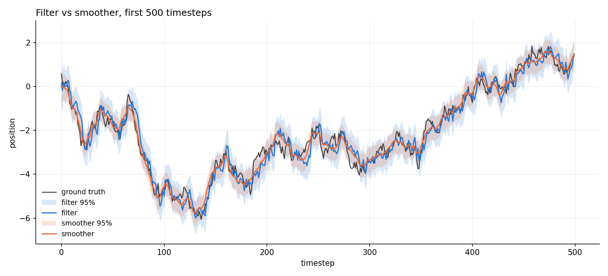

# Trajectory reconstruction and sensor fusion for underwater robotics

A place to store code that will be used in my masters pre-project. This Repo will likely see many revisions and changes, and nothing here is permanent.

## Status and next steps

### Phase 1: prototype and play around to figure stuff out (current)

- [x] Simple test cases: gaussian random walk and gaussian white noise, in 1-D and 2-D
- [x] Standard KF, filtering the trajectory forward
- [x] RTS smoother, used on the path
- [x] Plot the results and evaluate filter and smoother consistency (NIS and NEES, single run)

Other interesting tests to perform when writing about results and theory:

- [x] Mis-tune `q` or `r` in the filter while leaving the simulator alone, to show an inconsistent filter for contrast
- [ ] Standard forward-backward smoother, to compare against the RTS smoother

### Phase 2: sophistication

- [x] Extend the current filter and smoother to be able to handle nonlinearities
- [x] Add and experiment with EKF and ERTSS
- [x] Add a 2D strapdown inertial navigation model to test how the filters deal with real nonlinearities.
- [x] Add and experiment with UKF and URTSS
- [ ] Add and experiment with the IEKF and IERTSS
- [x] Run experiments and document consistency, accuracy and other factors that might be of interest


Other interesting tests to perform when writing about results and theory:

- [x] Introduce model mismatch between the filter and the simulator, to show an inconsistent filter for contrast
- [ ] Monte Carlo over seeds for proper consistency bands
- [x] Reason about why we can expect or should not expect differences in performance between an Unscented, an Extended or an Iterative variant of a filter/smoother.

### Phase 3: towards realistic scenarios

- [ ] Implement dynamical AUV model from Fossen
- [ ] Implement a 3D stapdown INS model
- [ ] Implement sensor models for the 3D strapdown INS model
- [ ] Run experiments and document consistency, accuracy and other factors that might be of interest

### Phase 4: Iterative solutions, Graph based solutions, and batch solutions

- [ ] Experiment with a home cooked batch solver
- [ ] Experiment with ISAM2, an incremental solver
- [ ] Experiment with GTSAM, a graph based solver
- [ ] Run experiments and document consistency, accuracy and other factors that might be of interest

### Additions if time allows

- [ ] Experiment with the ESKF and ESRTSS
- [ ] Experiment with the Stonefish simulator and how to get good data from it

### Example results

A 1-D random walk seen through noisy measurements, estimated with the filter and
the smoother. Both draw a 95% confidence band; the smoother's path is closer to
the truth (RMSE 0.274 against 0.365) and its band is narrower.



## Experiments

Each experiment lives in `results/<name>/` with its own `README.md`. The INS experiments in
`results/INS2D/` hold one folder per case, with the case's `config.yaml`, `data/`, `figures/` and `stats.txt`.

| experiment                              | what it tests                                     | result                                                |
| --------------------------------------- | ------------------------------------------------- | ----------------------------------------------------- |
| [1-D random walk](results/1D/README.md) | filter and smoother on the simplest matched model | 1000 steps, RMSE 0.365 to 0.274, all three consistent |
| [2-D random walk](results/2D/README.md) | the same with vectors, and covariance ellipses    | 200 steps, RMSE 0.545 to 0.388, all three consistent  |
| [2-D strapdown INS, GNSS only](results/INS2D/only_gnss/README.md) | GNSS the only aiding sensor, on a four-corner test and a figure-eight | 30000 steps, position consistent, smoother RMSE 0.21 m against filter 0.70 m |
| [2-D strapdown INS, multi-sensor fusion](results/INS2D/multi_sensor_fusion/README.md) | GNSS, magnetometer and DVL fused sequentially, on both trajectories | 30000 steps, all consistency checks pass, filter RMSE 0.66 to 0.68 m |
| [2-D strapdown INS, dead reckoning](results/INS2D/dead_reckoning/README.md) | GNSS disabled, magnetometer and DVL only, on both trajectories | 30000 steps, position covariance conservative (ANEES below band), magnetometer NIS mildly low |
| [2-D strapdown INS, GNSS outage](results/INS2D/gnss_outage/README.md) | GNSS denied for 210 s in the middle of the run, matched and mistuned IMU noise, on both trajectories | 30000 steps, consistent except the magnetometer NIS |
| [2-D strapdown INS, UKF and URTSS](results/INS2D/ukf/README.md) | the unscented filter and smoother against the EKF and ERTS, on an outage run and a heading-stress run, on both trajectories | 30000 steps, indistinguishable on the outage run, UKF RMSE 4.90 against 8.49 m on the stress run |
| [2-D strapdown INS, IEKF](results/INS2D/iekf/README.md) | the iterated EKF with Levenberg-Marquardt against the EKF and UKF, on the figure-eight with multi-sensor fusion and with a GNSS outage | 30000 steps, consistent, within about 6 cm of the EKF, no clear accuracy difference |

## Repository layout

```
lib/        headers, grouped by role; src/ mirrors this structure
  filters/      bayesian_filter (interface), kalman_filter, extended_kalman_filter
  smoothers/    bayesian_smoother (interface), rts and extended rts smoothers
  models/       motion/measurement interfaces, linear and nonlinear (INS) models
  scenarios/    one run function per scenario
  estimation.hpp   runs any filter forward and any smoother backward over a list of sensors
  sensors.hpp, simulation.hpp, results.hpp, utilities.hpp   sensor schedules, noise generators, CSV export, helpers
src/        implementations, and main.cpp which loads one config and runs it
configs/    one yaml file per scenario
scripts/    analysis: analyze_1d.py, analyze_2d.py, analyze_ins_2d.py
results/    one folder per experiment: README.md, and per case config.yaml, data/, figures/, stats.txt
data/       scratch output of the latest run (gitignored)
figures/    scratch figures of the latest analysis (gitignored)
```

| file                                                                     | contents                                                                       |
| ------------------------------------------------------------------------ | ------------------------------------------------------------------------------ |
| `lib/filters/bayesian_filter.hpp`, `lib/smoothers/bayesian_smoother.hpp` | pure virtual interfaces                                                        |
| `lib/models/models.hpp`                                                  | `MotionModel` (F, Q) and `MeasurementModel` (H, R)                             |
| `src/filters/kalman_filter.cpp`                                          | implements the kalman filter predict/update step from Algorithm 1, Brekke 2025 |
| `src/smoothers/rauch_tung_striebel_smoother.cpp`                         | implements the backward recursion equations from Sarkka theorem 12.2           |
| `src/main.cpp`                                                           | runs the case folder(s) given, and the scenario each config names in `scenario` |
| `src/estimation.cpp`                                                     | `run_filter` and `run_smoother`, shared by every scenario                      |
| `src/scenarios/strapdown_ins_2D_scenario.cpp`                            | the 2D INS scenario: builds the sensors and the simulated data, then runs the estimators |
| `src/scenarios/random_walk_scenario.cpp`                                 | the random walk scenario (any dimension), values come from the yaml config     |
| `src/simulation.cpp`                                                     | Gaussian white noise and random walk generators for the simulation             |
| `src/results.cpp`                                                        | CSV export for filter, smoother and the true state                             |
| `scripts/analyze_1d.py`                                                  | plots and consistency statistics for the 1-D case                              |
| `scripts/analyze_2d.py`                                                  | trajectory plots with covariance ellipses and consistency statistics for 2-D   |
| `scripts/analyze_ins_2d.py`                                              | scenario, error, bias and consistency figures and `stats.txt` for one INS case |

## Building and running

```bash
cmake -S . -B build && cmake --build build
./build/kalman_filtering_and_smoothing results/INS2D/iekf/gnss_outage
python3 scripts/analyze_ins_2d.py results/INS2D/iekf/gnss_outage/data
```

A case is a folder with a `config.yaml`. The executable simulates it and writes `<case>/data`. Given a folder that holds several cases, for example
`results/INS2D`, it runs all of them. The analysis script reads `<case>/data` and writes the figures to `<case>/figures` and the numbers it prints to `<case>/stats.txt`.
A config names its scenario with the `scenario` key, `strapdown_ins_2d` (the default when the key is missing) or `random_walk`. With no argument the executable runs `configs/strapdown_ins_2D.yaml` and writes to `data/`. Release is the default build type. The 1-D and 2-D experiments use the same two commands, with their analysis scripts.

Requires Eigen 3, yaml-cpp and a C++20 compiler.

Most of the code is handwritten by myself, the scripts and visualization is done
with a lot of heavy lifting by Anthropics Claude Code.
