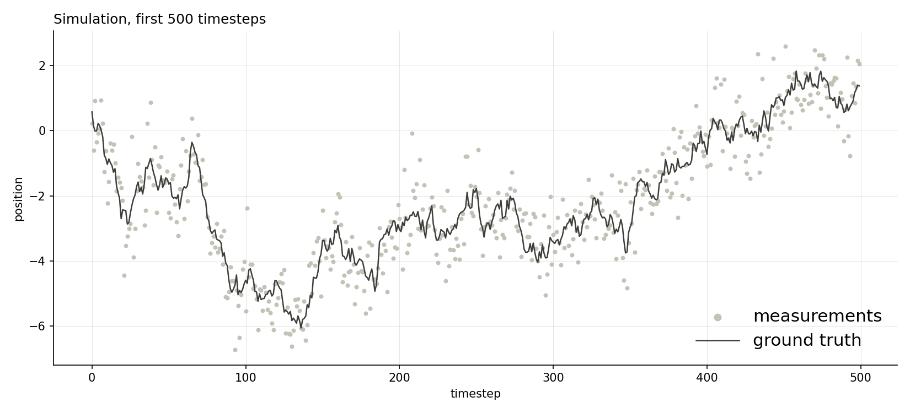
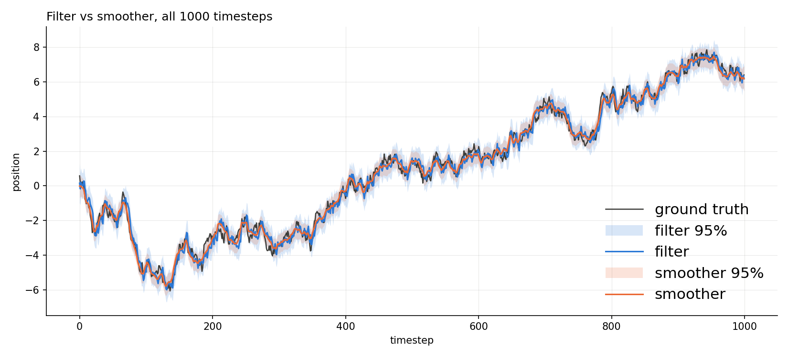
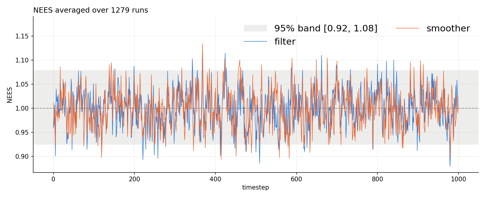

# 1-D random walk

[Back to the overview](../../README.md) | [Next: 2-D random walk](../2D/README.md)

The first end-to-end test of the filter and the smoother, on the simplest model
there is. The filter is given exactly the model the data was simulated from (a
_matched_ model), so if the implementation is right the estimates should be
accurate and consistent. If they are not, the bug is in the code, not in a
modelling choice.

|               |                                                               |
| ------------- | ------------------------------------------------------------- |
| **Status**    | done, consistent over a Monte Carlo of 1279 seeds             |
| **Run**       | Monte Carlo over seeds 42 to 1320, 1279 runs of 1000 timesteps |
| **Reproduce** | see [Reproduce](#reproduce)                                   |

## Setup

A 1-D random walk observed directly:

$$
x_k = x_{k-1} + w_k, \quad w_k \sim \mathcal{N}(0, q)
\qquad \Rightarrow \qquad F = 1,\ Q = q
$$

$$
z_k = x_k + v_k, \quad v_k \sim \mathcal{N}(0, r)
\qquad \Rightarrow \qquad H = 1,\ R = r
$$

| parameter        | value    | meaning                    |
| ---------------- | -------- | -------------------------- |
| $q$              | 0.05     | process noise variance     |
| $r$              | 0.5      | measurement noise variance |
| $\hat x_0$, $P_0$ | 0.0, 1.0 | prior mean and variance    |
| timesteps        | 1000     |                            |

- $q$ and $r$ are declared once in `config.yaml` and handed to both the
  simulator and the filter, so the filter's model matches the truth by
  construction.
- The true initial state is drawn from the prior $\mathcal{N}(\hat x_0, P_0)$,
  so the prior is honest from the first step.
- The Kalman filter runs predict then update at every timestep, starting from
  the prior. The RTS smoother then runs backward over the stored filter output,
  starting from the last filtered estimate.

### Monte Carlo

A single run says little about consistency, because the time average of NEES
from one realisation scatters widely. Over the seeds used here the filter's
single-run ANEES ranges from 0.75 to 1.32. The experiment is therefore repeated
for $M = 1279$ seeds, 42 to 1320, each a full independent realisation of the
truth, the measurements and the prior draw, with everything else in the
configuration unchanged. The range starts at 42 from _The Hitchhiker's Guide to
the Galaxy_ and ends at 1320, the 22 minutes of the _Outer Wilds_ time loop in
seconds.

For each run $i$ and timestep $k$, with estimation error $\tilde x_k^i = x_k^i - \hat x_k^i$
and innovation $\nu_k^i$ with covariance $S_k$,

$$
\epsilon_k^i = \frac{(\tilde x_k^i)^2}{P_k}, \qquad
\eta_k^i = \frac{(\nu_k^i)^2}{S_k},
$$

and the run-averaged statistics are

$$
\bar\epsilon_k = \frac{1}{M}\sum_{i=1}^{M} \epsilon_k^i, \qquad
\bar\eta_k = \frac{1}{M}\sum_{i=1}^{M} \eta_k^i .
$$

Because the runs are independent, $M\bar\epsilon_k \sim \chi^2_{M n}$ under a
consistent filter, with $n = 1$ here. Every timestep therefore gets an exact 95%
band $[\chi^2_{M,\,0.025},\ \chi^2_{M,\,0.975}]/M = [0.924,\ 1.079]$, with no
correction for autocorrelation over time. The same holds for NIS with $m = 1$.

The overall averages over all runs and timesteps are tested with the spread of
the per-run averages. These are independent across runs, so a 95% $t$-interval
over the 1279 values is a valid interval for the overall average, which should
contain 1.

$P_k$ and $S_k$ do not depend on the data in a linear Kalman filter, so they are
identical in every run.

## Reproduce

To regenerate the figures and statistics from the stored data:

```bash
python3 scripts/monte_carlo_1d.py --skip-run results/1D/monte_carlo
```

To regenerate the data as well (about 10 s on 8 cores):

```bash
cmake -S . -B build && cmake --build build
python3 scripts/monte_carlo_1d.py results/1D/monte_carlo
```

The script runs `results/1D/config.yaml` once per seed with only the seed
changed. Each run happens in a temporary folder that is deleted afterwards, and
only the reduced Monte Carlo data is written to `monte_carlo/data/`, together
with `monte_carlo/stats.txt` and `monte_carlo/figures/`. The seeds are set in
the script and recorded in the first column of `per_run.csv`. Add `--pdf` for
vector figures.

The example run shown in the trajectory figures is the seed 42 case in this
folder, and is regenerated with

```bash
./build/kalman_filtering_and_smoothing results/1D     # writes results/1D/data/
python3 scripts/analyze_1d.py results/1D/data         # writes results/1D/figures/
```

## Data

The Monte Carlo data is in `monte_carlo/data/`.

| file               | rows                | columns                                                                                                                |
| ------------------ | ------------------- | ---------------------------------------------------------------------------------------------------------------------- |
| `per_run.csv`      | one per seed (1279) | `seed, rmse_filter, rmse_smoother, mae_filter, mae_smoother, anis, anees_filter, anees_smoother`                       |
| `per_timestep.csv` | one per timestep    | `timestep, nis, nees_filter, nees_smoother, rmse_filter, rmse_smoother, mae_filter, mae_smoother, P_filter, P_smoother` |

The per-run columns are time averages over one run. The per-timestep columns
are averages over all runs at that timestep, except `P`, which is the same in
every run.

The example run in `data/` (seed 42) holds four CSV files with one row per timestep and a shared `timestep` column, so they can
be joined on it. The column layout is documented in `lib/results.hpp`.

| file                    | columns                                                                                     |
| ----------------------- | ------------------------------------------------------------------------------------------- |
| `truth.csv`             | `timestep, x_true_0`                                                                        |
| `measurement_fixes.csv` | `timestep, z_0, innovation_0, S_0_0`                                                        |
| `filter.csv`            | `timestep, x_predicted_0, P_predicted_0_0, x_updated_0, innovation_0, S_0_0, P_updated_0_0` |
| `smoother.csv`          | `timestep, x_smoothed_0, P_smoothed_0_0`                                                    |

`S` is the innovation covariance, kept so that NIS can be computed later.

## Results

### What one run looks like

The trajectory figures show a single realisation (seed 42), since overlaid
trajectories from many runs would be unreadable. Its errors are typical of the
Monte Carlo set, with filter RMSE 0.365 and smoother RMSE 0.274 against the
means of 0.368 and 0.279 below.

The problem: a hidden random walk and the noisy measurements of it.



The Kalman filter with its 95% confidence band. It tracks, but lags at the turns
and inherits visible jitter from the measurements, because each estimate only
knows the past.


The RTS smoother over the same data. Each estimate uses the whole record, so it
is smoother, closer to truth, and reports a narrower band.


Side by side, at three zoom levels. The smoother's band is about 76% as wide as
the filter's (its variance is about 58% of the filter's).




### Accuracy over 1279 runs

Mean and standard deviation across the runs of each run's time-averaged error.

|          | RMSE            | MAE             | mean $P$ |
| -------- | --------------- | --------------- | -------- |
| filter   | 0.3676 ± 0.0149 | 0.2935 ± 0.0124 | 0.1354   |
| smoother | 0.2794 ± 0.0113 | 0.2231 ± 0.0093 | 0.0783   |

The smoother has the lower RMSE in all 1279 runs, on average 23.9% lower, its
MAE is also 23.9% lower, and its mean $P$ is 42% lower.

The RMSE across the runs at each timestep, $\sqrt{\frac{1}{M}\sum_i (\tilde x_k^i)^2}$,
should scatter around the standard deviation the estimator reports, $\sqrt{P_k}$.
It does, for both the filter and the smoother, including the initial transient
and the smoother's rise to the filter's value at the final step.


### Filter vs smoother variance


The smoother's reported variance is never larger than the filter's, and the two
are equal at the final timestep, matching Figure 12.2 in Sarkka's _Bayesian
Filtering and Smoothing_ for this exact example (a Gaussian random walk).
It's a property of the RTS recursion itself, since the smoother's covariance
update only ever subtracts a positive semi-definite term from the filter's, so
it is a check on the implementation, not on the data. It is the same in every
run.

## Consistency

NEES averaged over the 1279 runs at every timestep, for the filter and the
smoother, against the exact 95% band. The dashed line is the expected value
$\mathbb{E}[\chi^2_1] = 1$.



NIS averaged over the 1279 runs, against the same band.


About 95% of the timesteps should land inside the band if the estimator is
consistent, and they do.

| statistic     | timesteps inside [0.924, 1.079] |
| ------------- | ------------------------------- |
| NIS           | 95.3%                           |
| NEES filter   | 95.0%                           |
| NEES smoother | 95.4%                           |

Averaged over all runs and timesteps, as mean ± standard error with the 95%
$t$-interval from the spread of the per-run averages:

| statistic      | value           | 95% interval     | per-run range    | verdict    |
| -------------- | --------------- | ---------------- | ---------------- | ---------- |
| ANIS           | 0.9987 ± 0.0013 | [0.9962, 1.0012] | [0.8610, 1.1744] | consistent |
| ANEES filter   | 0.9994 ± 0.0023 | [0.9950, 1.0039] | [0.7473, 1.3158] | consistent |
| ANEES smoother | 0.9986 ± 0.0023 | [0.9941, 1.0030] | [0.7741, 1.3103] | consistent |

All three overall averages are within a quarter of a percent of 1.

## Takeaways and limits

- With a matched model, the filter and the smoother are both consistent over the
  Monte Carlo, at every timestep and on average, and the smoother is more
  accurate and more confident in every run, as it should be. That is good
  evidence that the predict/update step and the RTS backward recursion are
  implemented correctly.
- The measured error across runs follows $\sqrt{P_k}$ over the whole run, so the
  covariance the estimators report is the covariance of their actual error.
- One run is not enough to judge consistency. Single-run ANEES values here span
  0.75 to 1.32, so a single run can look over- or underconfident by chance. An
  earlier Monte Carlo over only 21 seeds (22 to 42) put the filter ANEES at
  0.949, just outside its interval, which the 1279 runs show was the seed set
  and not the filter.
