# 2-D strapdown INS, dead reckoning

[Back to the overview](../../../README.md) | [Previous: multi-sensor fusion](../multi_sensor_fusion/README.md) | [Next: GNSS outage](../gnss_outage/README.md)

Without any absolute position reference an inertial navigation system dead-reckons, and its position error can only grow. This scenario removes GNSS entirely and keeps a magnetometer for heading and a DVL for body-frame velocity, so the position is propagated from corrected velocity and heading alone.

|               |                                  |
| ------------- | -------------------------------- |
| **Status**    | done, underconfident in position and in the magnetometer on both trajectories |
| **Run**       | 30000 timesteps (300 s at $\Delta t = 0.01$ s), seed 42 |
| **Reproduce** | see [Reproduction](#reproduction) |

## Motivation

This is the limiting case of the aided scenarios: nothing observes position, so what remains is how fast the error grows and whether the filter knows it. The questions are:

- How large does the position error become over five minutes with heading and velocity aiding?
- Does the reported position covariance describe that growth, or over- or understate it?
- Can the smoother improve the estimate when no fix anywhere in the run anchors the position?

Two paths are used, a four-corner test and a figure-eight.

## Problem formulation

### State and motion model

The state collects position, heading, velocity in the navigation frame and the two sensor biases,

$$
x = \begin{bmatrix} p^\top & \psi & v^\top & b_a^\top & b_g \end{bmatrix}^\top \in \mathbb{R}^{8},
\qquad p, v \in \mathbb{R}^2 .
$$

The IMU reading $u_k$ is corrected with the estimated biases, $\tilde a_k = a_k - b_{a,k}$ and
$\tilde\omega_k = \omega_k - b_{g,k}$, and integrated with the heading at the middle of the step,
$\psi_{k+\frac12} = \psi_k + \tfrac{\Delta t}{2}\tilde\omega_k$:

$$
\begin{aligned}
p_{k+1} &= p_k + \Delta t\, v_k + \tfrac{\Delta t^2}{2}\, R(\psi_{k+\frac12})\,\tilde a_k, \\
\psi_{k+1} &= \psi_k + \Delta t\, \tilde\omega_k, \\
v_{k+1} &= v_k + \Delta t\, R(\psi_{k+\frac12})\,\tilde a_k, \\
b_{a,k+1} &= e^{-\Delta t / T_a}\, b_{a,k}, \qquad b_{g,k+1} = e^{-\Delta t / T_g}\, b_{g,k}.
\end{aligned}
$$

Written as $x_k = f(x_{k-1}, u_k) + w_k$ with $w_k \sim \mathcal{N}(0, Q_k)$. The biases are first-order
Gauss-Markov processes with time constant $T$ and stationary variance $\sigma_b^2$, driven by white noise of
intensity $2\sigma_b^2 / T$. White accelerometer noise enters the velocity and white gyro noise the heading. With $G_k$ mapping the
six noise sources into the state and $D$ the diagonal matrix of their intensities, the process noise is the first-order approximation

$$
Q_k = G_k\, D\, G_k^\top\, \Delta t .
$$


| symbol | meaning |
| --- | --- |
| $x_k = \begin{bmatrix} p_k^\top & \psi_k & v_k^\top & b_{a,k}^\top & b_{g,k} \end{bmatrix}^\top$ | state: position, heading, navigation-frame velocity, accelerometer and gyro bias |
| $u_k = \begin{bmatrix} a_k^\top & \omega_k \end{bmatrix}^\top$ | IMU reading: body-frame specific force and yaw rate |
| $R(\psi)$ | rotation from the body to the navigation frame |
| $\bar x_k,\ \bar P_k$ | predicted mean and covariance |
| $\hat x_k,\ \hat P_k$ | updated (filtered) mean and covariance |
| $\hat x^s_k,\ P^s_k$ | smoothed mean and covariance |
| $\eta_k,\ S_k$ | innovation and innovation covariance |
| $W_k$ | Kalman gain |
| $\boxplus,\ \boxminus$ | addition and subtraction that wrap the heading to $(-\pi, \pi]$ |


| parameter | value |
| --- | --- |
| time step $\Delta t$, steps, duration | 0.01 s, 30000, 300 s |
| speed along the path | 2 m/s |
| accelerometer bias: variance $\sigma_{b_a}^2$, time constant $T_a$ | $5\cdot10^{-2}$ (m/s²)², 1000 s, both axes |
| gyro bias: variance $\sigma_{b_g}^2$, time constant $T_g$ | $5\cdot10^{-5}$ (rad/s)², 1000 s |
| white noise intensity, accelerometer / gyro | $5\cdot10^{-4}$ (m/s²)²·s / $5\cdot10^{-4}$ rad²/s |
| prior mean $\hat x_0$ | $[0,\ 0,\ 0,\ 2,\ 0,\ 0,\ 0,\ 0]^\top$ |
| prior covariance $\hat P_0$ | $\mathrm{diag}(0.4,\ 0.4,\ 0.04,\ 0.04,\ 0.04,\ 0.004,\ 0.004,\ 0.0004)$ |


The truth is simulated, not generated by $f$. A geometric path (below) gives position, heading and curvature at constant
speed; the velocity is the speed along the heading, the specific force is the centripetal acceleration rotated into the body frame, and
each IMU reading is that ideal value plus a simulated Gauss-Markov bias plus white noise. The filter is configured with the same noise
values the simulator uses. The configuration values match; the white-noise intensity is read as a continuous-time intensity by the filter
and drawn as a per-sample variance by the simulator, so the noise statistics differ by a factor $1/\Delta t$ in variance, and the truth starts
exactly at the prior mean. Both push the position covariance in the conservative direction. The study guide (chapter 12) documents them.

### Sensors

**Magnetometer** observes the heading,

$$
z^{m}_k = \psi_k + \varepsilon^{m}_k, \qquad \varepsilon^{m}_k \sim \mathcal{N}(0,\ 3\cdot 10^{-3})\ \mathrm{rad^2},
$$

and its innovation is wrapped, $\eta^m_k = z^m_k \boxminus h^m(\bar x_k)$.

**DVL** observes the velocity in the body frame, which makes it the one nonlinear sensor,

$$
z^{d}_k = R(\psi_k)^\top v_k + \varepsilon^{d}_k, \qquad
H_d = \begin{bmatrix} 0_{2\times 2} & \dfrac{\partial R^\top}{\partial \psi}\, v & R(\psi)^\top & 0_{2\times 3} \end{bmatrix}, \qquad
\varepsilon^{d}_k \sim \mathcal{N}(0,\ 10^{-2}\, I_2)\ \mathrm{(m/s)^2}.
$$


GNSS is never used. The magnetometer fires at random intervals drawn uniformly from 0.25 to 1 s (467 fixes) and the DVL from 0.2 to 1 s (499 fixes). A step where both are due applies the magnetometer first.


### Trajectories

Both paths are traced at constant speed starting at the origin heading $+x$.

| trajectory | geometry | length per lap | laps in 300 s |
| --- | --- | --- | --- |
| four-corner test (`rounded_rectangle`) | $80 \times 50$ m rectangle with corner radius 10 m, counterclockwise: left turns only | 242.8 m | 2.5 |
| figure-eight (`figure_eight`) | two circles of radius 20 m with centres 70 m apart, joined by two straights that cross at the origin: one right and one left turn per lap | 289.2 m | 2.1 |

### Estimators

When several sensors fire in the same step they update in turn, each starting from the result of the previous one.

**Extended Kalman filter.** Prediction and update with sensor model $h$, Jacobians $F$ and $H$, and measurement noise $R$:

$$
\bar x_k = f(\hat x_{k-1}, u_k), \qquad \bar P_k = F_k \hat P_{k-1} F_k^\top + Q_k,
$$

$$
\eta_k = z_k \boxminus h(\bar x_k), \qquad S_k = H_k \bar P_k H_k^\top + R, \qquad W_k = \bar P_k H_k^\top S_k^{-1},
$$

$$
\hat x_k = \bar x_k \boxplus W_k \eta_k, \qquad
\hat P_k = (I - W_k H_k)\, \bar P_k\, (I - W_k H_k)^\top + W_k R\, W_k^\top .
$$

The covariance update is written in Joseph form, which keeps $\hat P_k$ positive semidefinite.

**Extended Rauch-Tung-Striebel smoother (ERTS).** Run backward over the stored filter output, starting from
$\hat x^s_N = \hat x_N$, with $F_k$ evaluated at the filtered state:

$$
G_k = \hat P_k F_k^\top \bar P_{k+1}^{-1}, \qquad
\hat x^s_k = \hat x_k \boxplus G_k\,(\hat x^s_{k+1} \boxminus \bar x_{k+1}), \qquad
P^s_k = \hat P_k + G_k\,(P^s_{k+1} - \bar P_{k+1})\,G_k^\top .
$$

### Consistency

A filter is consistent if the errors it makes agree with the covariance it reports. Two statistics test this, with the truth $x_k$ known from the simulation.

$$
\mathrm{NIS}_k = \eta_k^\top S_k^{-1} \eta_k \sim \chi^2_{m}, \qquad
\mathrm{NEES}_k = (p_k - \hat p_k)^\top \big(\hat P^{pp}_k\big)^{-1} (p_k - \hat p_k) \sim \chi^2_{2},
$$

where $m$ is the measurement dimension (2 for GNSS and DVL, 1 for the magnetometer) and $\hat P^{pp}_k$ is the position block of the covariance.
The NIS is evaluated at every fix of a sensor. The NEES is evaluated for the position at every step, for the filter and for the smoother.
The time average $\bar\epsilon = \frac{1}{N}\sum_k \epsilon_k$ of either statistic with $d$ degrees of freedom is held against the interval

$$
\left[\ \frac{\chi^2_{\alpha/2}(N_{\mathrm{eff}}\, d)}{N_{\mathrm{eff}}},\ \ \frac{\chi^2_{1-\alpha/2}(N_{\mathrm{eff}}\, d)}{N_{\mathrm{eff}}}\ \right], \qquad
N_{\mathrm{eff}} = \max\!\Big(1,\ N\,\frac{1-\rho}{1+\rho}\Big), \qquad \alpha = 0.05,
$$

where $\rho$ is the lag-one autocorrelation of the series. A statistic is "consistent" if its time average lies inside the interval. A value below the interval
means the errors are smaller than the reported covariance says, the estimator is underconfident (conservative). A value above means the errors are larger than it says, the estimator is overconfident (too optimistic).
The position NEES is strongly autocorrelated, so $N_{\mathrm{eff}}$ is small and the interval wide; for the smoother it is so wide that it excludes almost nothing. The
share of steps with the true position inside the reported 95% ellipse is a second check that does not depend on it.
All numbers are from one run with seed 42, so they carry no error bars.

## Reproduction

Build once, then simulate and analyse each case:

```bash
cmake -S . -B build && cmake --build build
./build/kalman_filtering_and_smoothing results/INS2D/dead_reckoning/rounded_rectangle
python3 scripts/analyze_ins_2d.py results/INS2D/dead_reckoning/rounded_rectangle/data
./build/kalman_filtering_and_smoothing results/INS2D/dead_reckoning/figure_eight
python3 scripts/analyze_ins_2d.py results/INS2D/dead_reckoning/figure_eight/data
```

The executable reads `<case>/config.yaml` and writes `<case>/data`. Given a folder that holds several cases, it runs all of them, so
`./build/kalman_filtering_and_smoothing results/INS2D/dead_reckoning` simulates every case of this page in one command. The analysis reads `<case>/data`
and writes `<case>/stats.txt`, which holds every number quoted below, and the figures in `<case>/figures`.

`data/` holds one CSV file per quantity with one row per timestep and a shared `timestep` column. `truth.csv` has the true state `x_true_0 ... x_true_7`;
`filter.csv` and `smoother.csv` have the predicted and updated (or smoothed) mean and the full covariance; `*_fixes.csv` has, for each fix of one sensor, the raw measurement,
the innovation and $S$, which is what the NIS is computed from.

## Results

### Four-corner test

The true path with the direction of travel, and when each sensor fired.

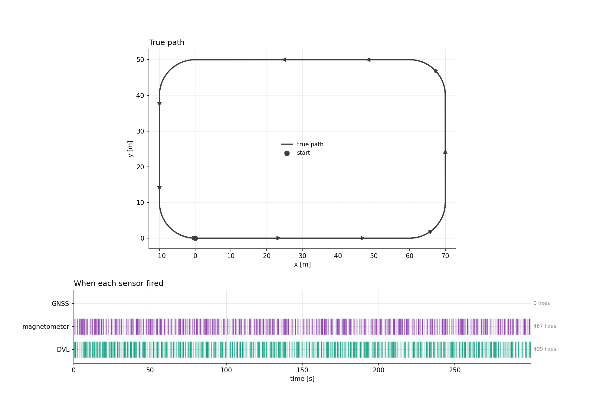

The path with the EKF and ERTS estimates. A and B zoom in on turns, with the 95% position ellipses of both estimators: the turn where the filter's position error is largest and next to it the largest error in the opposite direction, or elsewhere on the path if it only turns one way.

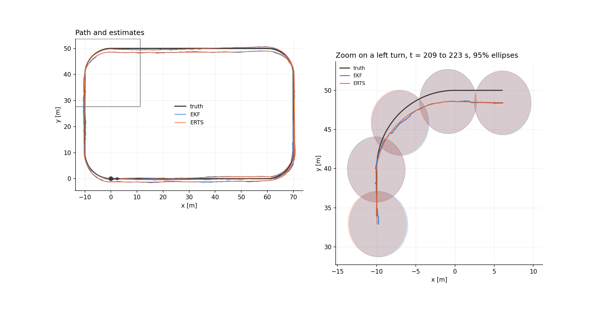

Error against truth with each estimator's own 95% band.

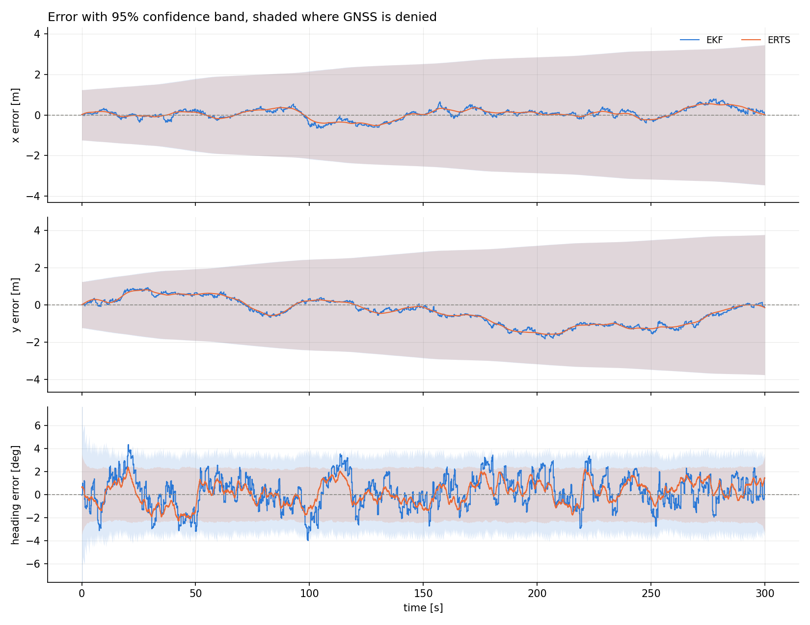

The position spread $\sqrt{\mathrm{tr}\,P_{xy}}$ each estimator reports about itself, on a log scale.


True and estimated sensor biases.

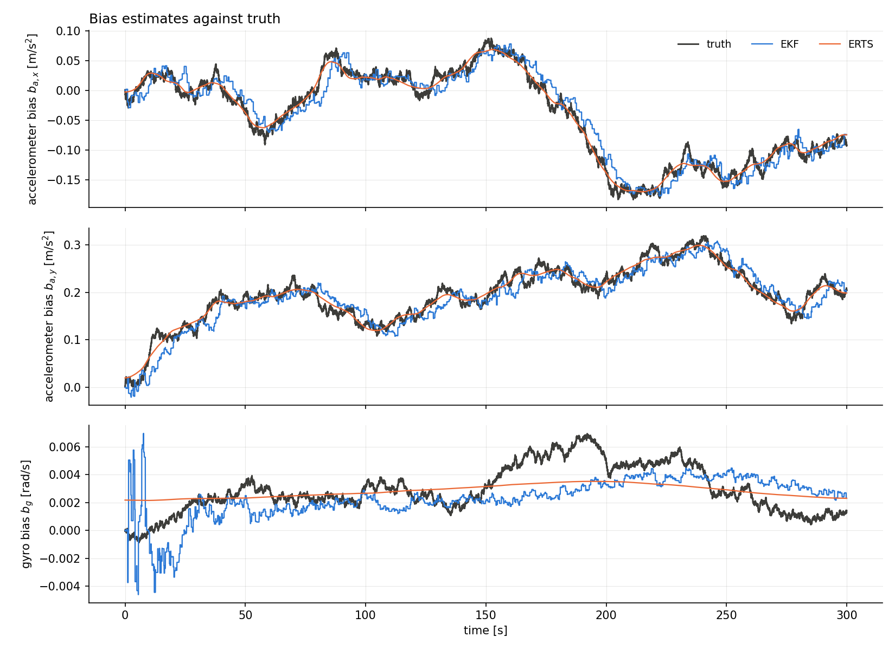

NIS of every fix against its 95% interval, and the running mean of the position NEES.

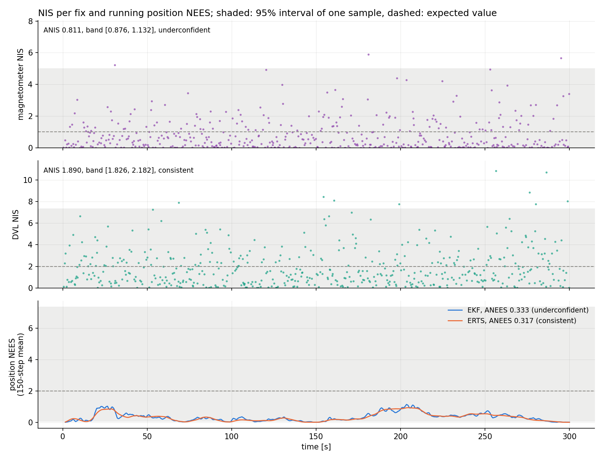

| statistic | value | 95% band | verdict |
| --- | --- | --- | --- |
| ANIS magnetometer | 0.8112 | [0.8761, 1.1320] | underconfident |
| ANIS DVL | 1.8901 | [1.8256, 2.1823] | consistent |
| ANEES position filter (EKF) | 0.3330 | [0.9036, 3.5245] | underconfident |
| ANEES position smoother (ERTS) | 0.3169 | [0.0506, 7.3778] | consistent |

| estimator | RMSE position [m] | median [m] | 95th percentile [m] | max [m] | RMSE heading [°] |
| --- | --- | --- | --- | --- | --- |
| EKF | 0.838 | 0.630 | 1.497 | 1.835 | 1.41 |
| ERTS | 0.818 | 0.608 | 1.490 | 1.585 | 0.95 |

| estimator | RMSE $b_{a,x}$ [m/s²] | RMSE $b_{a,y}$ [m/s²] | RMSE $b_g$ [rad/s] | peak $\lvert b_g - \hat b_g \rvert$ [rad/s] |
| --- | --- | --- | --- | --- |
| EKF | 0.0196 | 0.0232 | 0.00183 | 0.0074 |
| ERTS | 0.0096 | 0.0117 | 0.00135 | 0.0034 |

The true position lies inside the filter's reported 95% ellipse on 100.0% of the steps and inside the smoother's on 100.0%.

### Figure-eight

The true path with the direction of travel, and when each sensor fired.

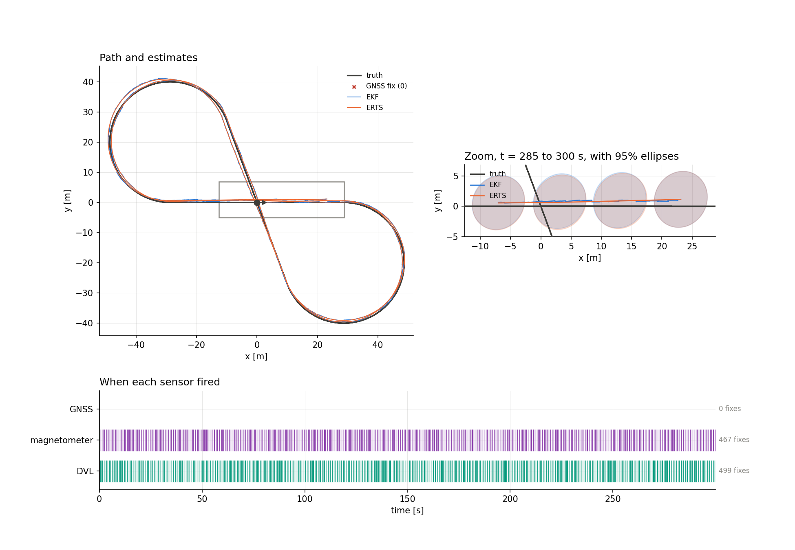

The path with the EKF and ERTS estimates. A and B zoom in on turns, with the 95% position ellipses of both estimators: the turn where the filter's position error is largest and next to it the largest error in the opposite direction, or elsewhere on the path if it only turns one way.

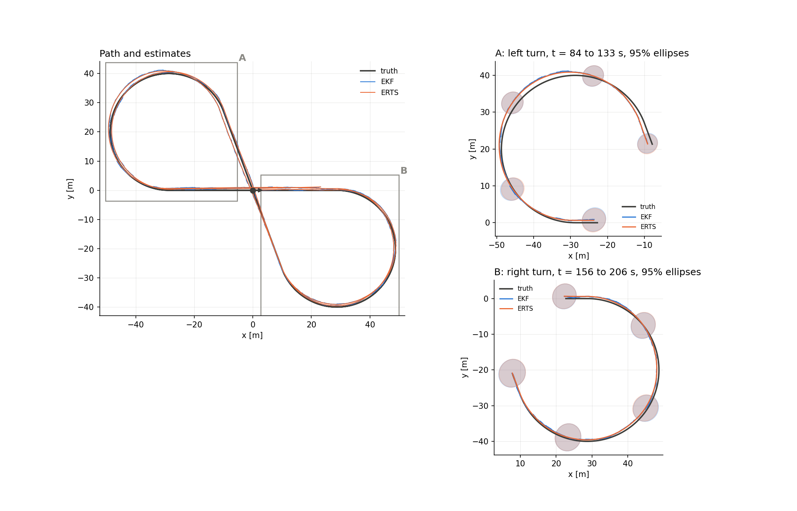

Error against truth with each estimator's own 95% band.

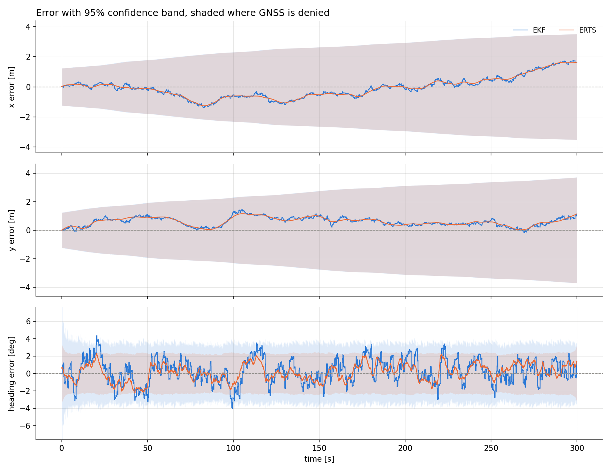

The position spread $\sqrt{\mathrm{tr}\,P_{xy}}$ each estimator reports about itself, on a log scale.

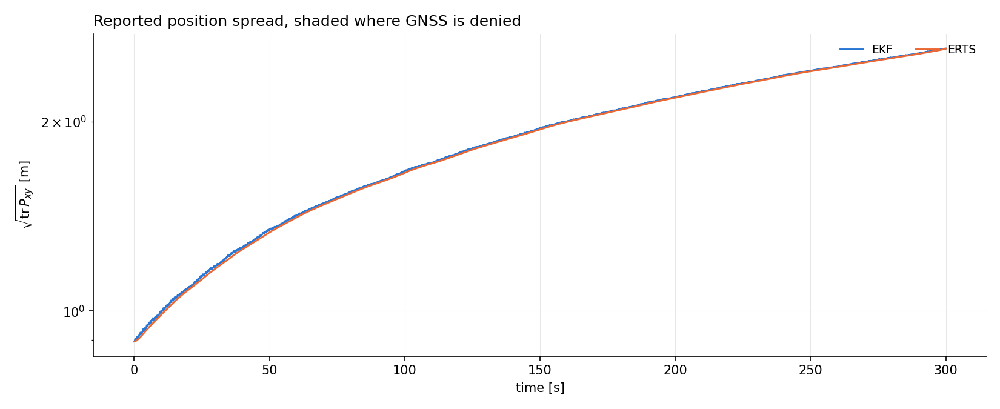

True and estimated sensor biases.

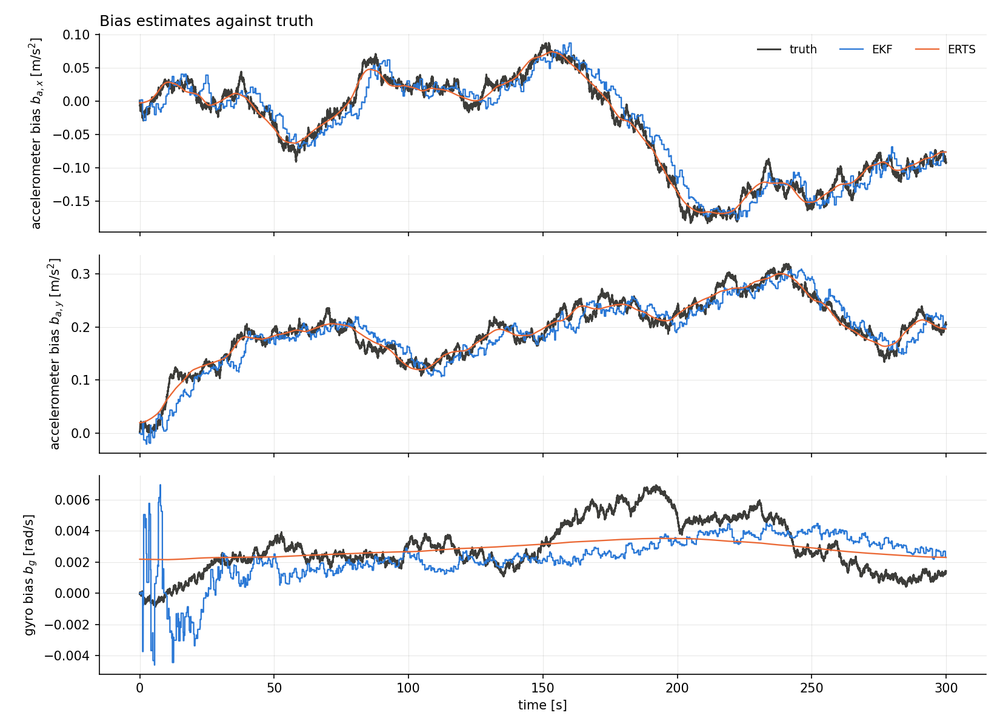

NIS of every fix against its 95% interval, and the running mean of the position NEES.

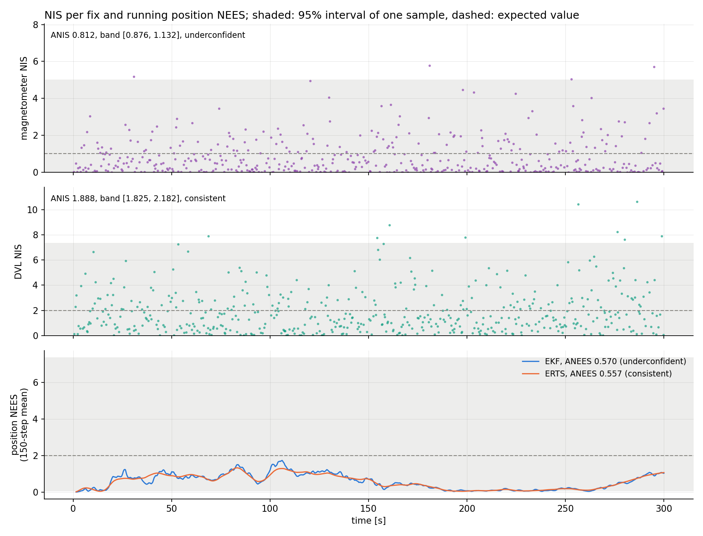

| statistic | value | 95% band | verdict |
| --- | --- | --- | --- |
| ANIS magnetometer | 0.8120 | [0.8763, 1.1317] | underconfident |
| ANIS DVL | 1.8878 | [1.8255, 2.1824] | consistent |
| ANEES position filter (EKF) | 0.5702 | [0.7157, 3.9325] | underconfident |
| ANEES position smoother (ERTS) | 0.5569 | [0.0506, 7.3778] | consistent |

| estimator | RMSE position [m] | median [m] | 95th percentile [m] | max [m] | RMSE heading [°] |
| --- | --- | --- | --- | --- | --- |
| EKF | 0.963 | 0.865 | 1.568 | 1.998 | 1.40 |
| ERTS | 0.952 | 0.870 | 1.556 | 1.970 | 0.95 |

| estimator | RMSE $b_{a,x}$ [m/s²] | RMSE $b_{a,y}$ [m/s²] | RMSE $b_g$ [rad/s] | peak $\lvert b_g - \hat b_g \rvert$ [rad/s] |
| --- | --- | --- | --- | --- |
| EKF | 0.0195 | 0.0231 | 0.00182 | 0.0074 |
| ERTS | 0.0097 | 0.0119 | 0.00135 | 0.0034 |

The true position lies inside the filter's reported 95% ellipse on 100.0% of the steps and inside the smoother's on 100.0%.

## Discussion

- **The position error grows slowly and stays small.** Filter position RMSE is 0.84 m on the four-corner test and 0.96 m on the figure-eight, with a largest error of 1.84 m and 2.00 m after 300 s. Because the DVL measures velocity, the position error is an integrated velocity error rather than a doubly integrated acceleration error.
- **The filter is underconfident in position.** The reported covariance is conservative. The position ANEES is 0.33 and 0.57 against lower band edges of 0.90 and 0.72, and the true position is inside the reported 95% ellipse on 100% and 100% of the steps. The reported spread $\sqrt{\mathrm{tr}\,P_{xy}}$ grows from 0.9 m to 2.6 m on the four-corner test and 2.6 m on the figure-eight, while the largest actual errors are 1.84 m and 2.00 m. The filter overstates its uncertainty by a factor of about 6.0 to 3.5 in variance.
- **Two causes of the conservatism are known.** The truth starts exactly at the prior mean, so the initial position variance of 0.4 m² per axis is never needed, and nothing in this scenario shrinks it. The white-noise level the filter assumes is also higher than the simulator draws (the factor $1/\Delta t$ in the model section). In a separate test, setting the simulator's white-noise level to the filter's moved the magnetometer ANIS into its band while the position ANEES stayed low; the study guide (chapter 12) reports it.
- **The filter is underconfident about the magnetometer.** The ANIS is low, 0.811 and 0.812 against lower band edges of 0.876 and 0.876: the innovation covariance $S$ is larger than the innovations need, in line with the conservative covariance. The DVL ANIS (1.89, 1.89) is inside its band.
- **The smoother barely helps.** Position RMSE falls from 0.84 to 0.82 m and from 0.96 to 0.95 m. With no absolute position anywhere there is nothing for the backward pass to carry. Its heading is better, 1.41° to 0.95°.
- **Biases are recovered.** Accelerometer bias RMSE is 0.020 and 0.023 m/s² for the filter on the four-corner test, and the gyro bias RMSE 0.0018 rad/s.
- **Limits.** One seed per path; no sensor other than the magnetometer and the DVL; the error was not compared across paths beyond the two shown, so no statement is made about how it depends on the amount of turning.

## Related results

- [Multi-sensor fusion](../multi_sensor_fusion/README.md) adds sparse GNSS to this sensor set: filter position RMSE 0.68 m and 0.66 m.
- [GNSS outage](../gnss_outage/README.md) switches dense GNSS off for the middle of a run with this sensor set, so the position error grows for 210 s and is then reset.
