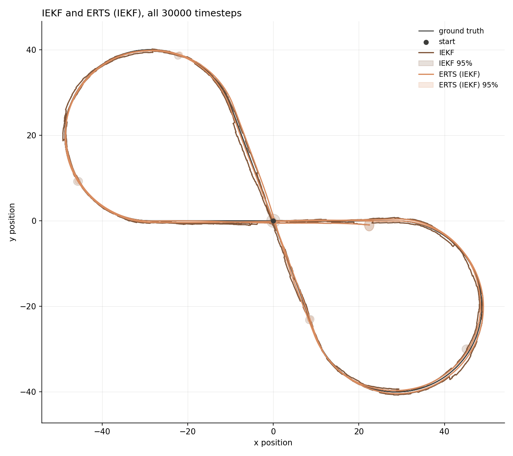
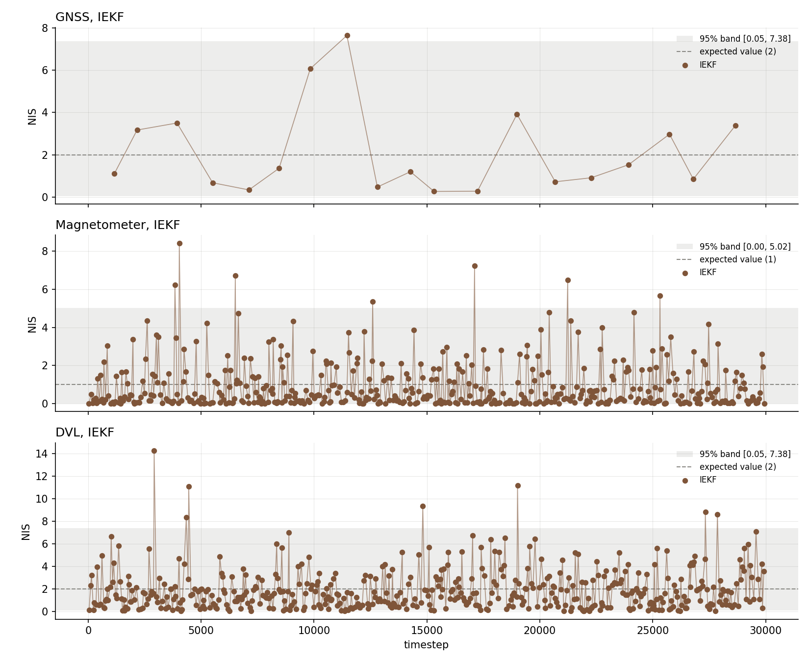
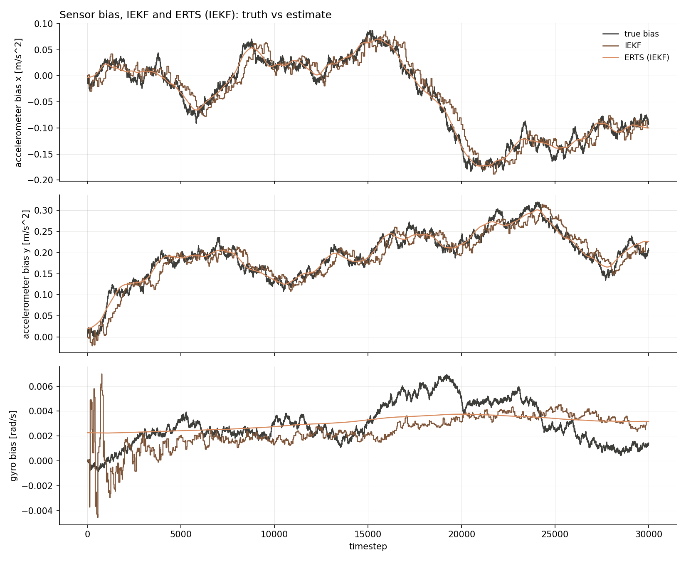
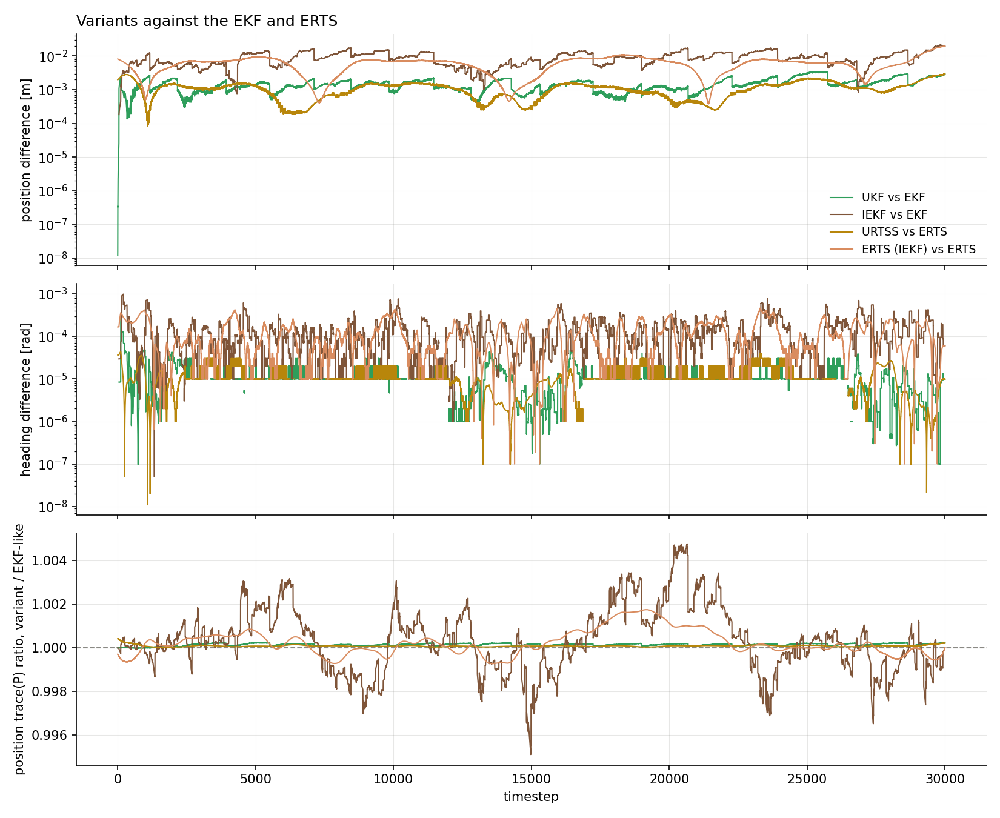
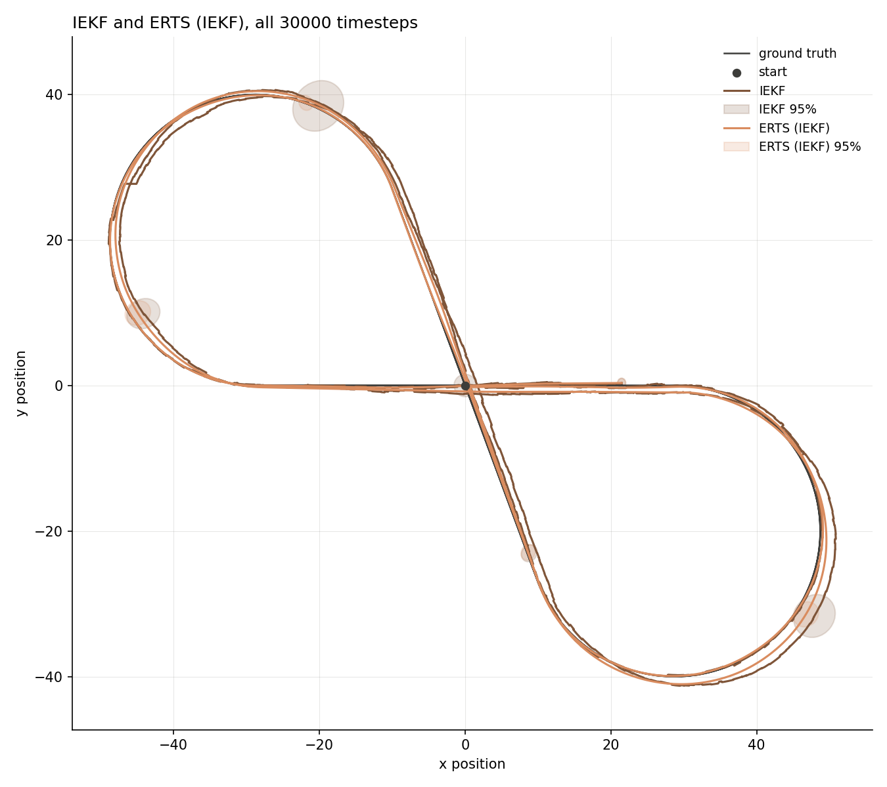
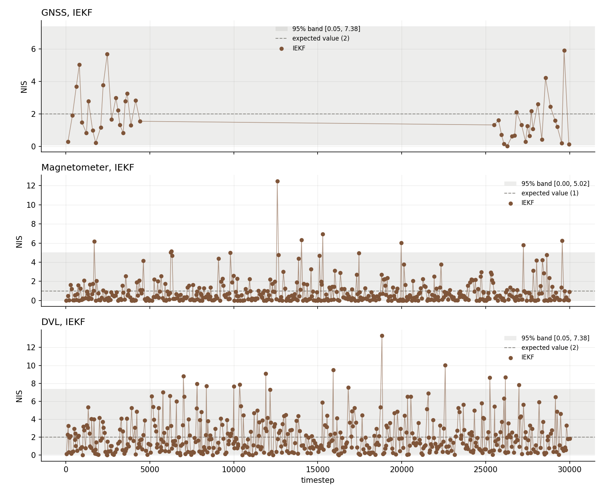
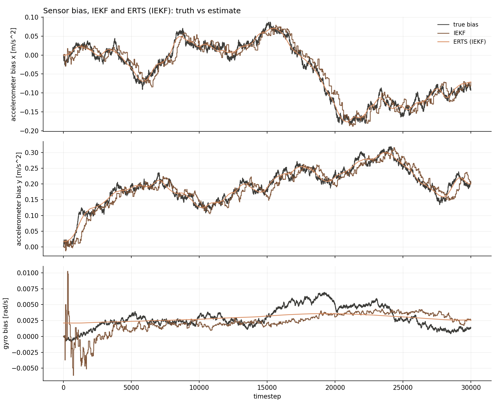
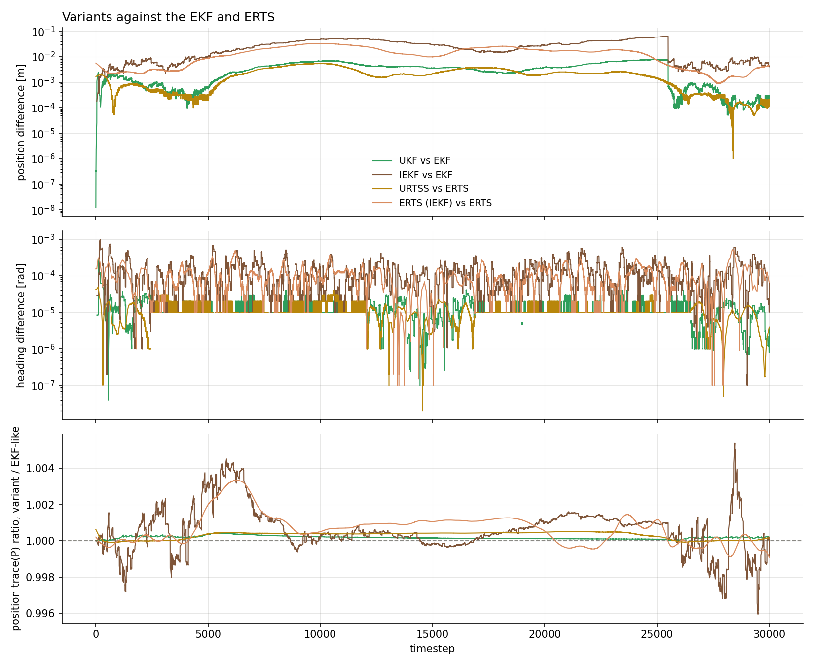

# 2-D strapdown INS, IEKF

[Back to the overview](../../../README.md) | [Previous: UKF and URTSS](../ukf/README.md)

The iterated extended Kalman filter, with Levenberg-Marquardt, on the same 2-D
strapdown INS setup as the EKF and UKF scenarios. The IEKF runs next to the EKF
and UKF on the same simulated data and the same sensor fixes, so every
difference below comes from the estimator and not from the data. Two runs, both
on the [figure-eight](#the-trajectory): [multi-sensor
fusion](../multi_sensor_fusion/README.md) and a [GNSS
outage](../gnss_outage/README.md).

|               |                                                                                                    |
| ------------- | -------------------------------------------------------------------------------------------------- |
| **Status**    | done, IEKF consistent and within about 6 cm of the EKF on both runs, no clear accuracy difference        |
| **Run**       | 30000 timesteps (5 minutes at dt=0.01s), seed 42, both runs                                        |
| **Reproduce** | see [Reproduce](#reproduce)                                                                        |

## The IEKF here

The prediction is the plain EKF prediction. The update replaces the single
linearisation at the prediction by an iteration on the one-step MAP cost

J(x) = 1/2 |z - h(x)|^2 in R^-1 + 1/2 |x - x_predicted|^2 in P_predicted^-1

Each pass linearises `h` at the current iterate, which with no damping is
Gauss-Newton, i.e. Algorithm 7.9 in Sarkka. The step is damped
Levenberg-Marquardt style with `lambda * P_predicted^-1`, which is the same as
running the usual gain with the prior shrunk to `P_predicted / (1 + lambda)`.
A step is accepted if the cost went down (`lambda` goes down by
`lambda_factor`) and rejected otherwise (`lambda` goes up by it).

- **Posterior covariance:** the undamped Joseph form at the final iterate, so
  it is not inflated by `lambda`.
- **Innovation and S:** reported the way the EKF reports them, at the
  prediction, so the NIS is directly comparable between the filters.
- **Smoother:** the standard ERTS run over the IEKF's output, labelled "ERTS
  (IEKF)". The smoother is not iterated, only the filter is.
- **Linear sensors:** the cost of a linear sensor is quadratic and the EKF update
  is already its exact minimiser, so the iteration can only change anything
  for the DVL, the one nonlinear sensor.

## Setup

Shared parameters as in [GNSS only](../only_gnss/README.md#setup). Levenberg-
Marquardt parameters, not tuned:

| parameter                 | value | meaning                                              |
| ------------------------- | ----- | ---------------------------------------------------- |
| `lambda_initial`          | 1e-2  | initial damping                                      |
| `lambda_min`, `lambda_max`| 1e-12, 1e12 | floor, and ceiling at which an update gives up |
| `lambda_factor`           | 10    | `lambda` is multiplied or divided by this           |
| `max_iter`                | 50    | iterations per fix, accepted and rejected            |
| `max_rejections`          | 30    | consecutive rejections before giving up              |
| `step_tolerance`          | 1e-8  | stop when the step in the `P_predicted` norm is below this |
| `cost_relative_tolerance` | 1e-12 | or when the relative cost decrease is below this     |

| run                  | what it is                                                                                          |
| -------------------- | --------------------------------------------------------------------------------------------------- |
| `multi_sensor_fusion`| GNSS uniform(10, 20)s (19 fixes), magnetometer uniform(0.25, 1)s (476), DVL uniform(0.2, 1)s (487) |
| `gnss_outage`        | GNSS uniform(1, 3)s but denied 45-255s (45 fixes), magnetometer (470) and DVL (492) as above         |

Both use the matched IMU noise belief. Because the seed and the data are the
same as in [`multi_sensor_fusion/figure_eight`](../multi_sensor_fusion/README.md)
and [`gnss_outage/figure_eight_matched`](../gnss_outage/README.md), the EKF
and UKF numbers here are the same as theirs.

### The trajectory

A figure-eight: two circles of radius 20 m, their centres 70 m apart, joined by
two straights that cross at the origin (the circles' internal tangents). One
lap is 289 m, with 87 m of left turn, 87 m of right turn and the rest straight,
so 300 s at 2 m/s is about 2.1 laps. It starts at the crossing heading +x. It
was added so the filters see both turn directions and a path that passes the
same point twice, which the rounded rectangle (left turns only) does not.

## Reproduce

```bash
python3 scripts/analyze_ins_2d.py results/INS2D/iekf/<multi_sensor_fusion|gnss_outage>/data
```

To regenerate the data, run the executable with the config and an output
directory as arguments, so `configs/` is left alone:

```bash
cmake --build build
./build/kalman_filtering_and_smoothing \
  results/INS2D/iekf/<case>/config.yaml results/INS2D/iekf/<case>/data
```

`run_iekf: true` in the config is what switches the IEKF on, one run writes the
EKF/ERTS, UKF/URTSS and IEKF files. The EKF/ERTS figures keep their usual
names, the UKF ones are prefixed `ukf_` and the IEKF ones `iekf_`.

## Results: multi-sensor fusion

### IEKF and ERTS on its output

| IEKF and ERTS (IEKF)                                                          | NIS (IEKF)                                              |
| ----------------------------------------------------------------------------- | ------------------------------------------------------- |
|  |  |

| value (verdict)         | EKF / ERTS          | UKF / URTSS         | IEKF / ERTS (IEKF)  |
| ----------------------- | ------------------- | ------------------- | ------------------- |
| ANIS GNSS               | 2.1052 (consistent) | 2.1018 (consistent) | 2.1238 (consistent) |
| ANIS magnetometer       | 0.8980 (consistent) | 0.8980 (consistent) | 0.8980 (consistent) |
| ANIS DVL                | 1.8979 (consistent) | 1.8974 (consistent) | 1.8975 (consistent) |
| ANEES position filter   | 2.3119 (consistent) | 2.3062 (consistent) | 2.3387 (consistent) |
| ANEES position smoother | 1.8170 (consistent) | 1.8149 (consistent) | 1.8206 (consistent) |

|                        | EKF    | UKF    | IEKF   | ERTS   | URTSS  | ERTS (IEKF) |
| ---------------------- | ------ | ------ | ------ | ------ | ------ | ----------- |
| RMSE position [m]      | 0.6555 | 0.6549 | 0.6592 | 0.4027 | 0.4024 | 0.4039      |
| RMSE heading [deg]     | 1.292  | 1.292  | 1.293  | 0.881  | 0.881  | 0.882       |
| max position error [m] | 1.45   | 1.45   | 1.45   | 1.28   | 1.28   | 1.30        |

All three filters are consistent on every sensor and on the position ANEES,
with the same sensor mix.

### Bias estimates



|                           | EKF     | UKF     | IEKF    | ERTS    | URTSS   | ERTS (IEKF) |
| ------------------------- | ------- | ------- | ------- | ------- | ------- | ----------- |
| RMSE accel bias x [m/s^2] | 0.0213  | 0.0213  | 0.0213  | 0.0104  | 0.0104  | 0.0104      |
| RMSE accel bias y [m/s^2] | 0.0236  | 0.0235  | 0.0235  | 0.0120  | 0.0120  | 0.0120      |
| RMSE gyro bias [rad/s]    | 0.00177 | 0.00177 | 0.00177 | 0.00139 | 0.00139 | 0.00139     |

### EKF against the other variants



## Results: GNSS outage

### IEKF and ERTS on its output

| IEKF and ERTS (IEKF)                                                    | NIS (IEKF)                                        |
| ----------------------------------------------------------------------- | ------------------------------------------------- |
|  |  |

| value (verdict)         | EKF / ERTS            | UKF / URTSS           | IEKF / ERTS (IEKF)    |
| ----------------------- | --------------------- | --------------------- | --------------------- |
| ANIS GNSS               | 1.8012 (consistent)   | 1.8013 (consistent)   | 1.7990 (consistent)   |
| ANIS magnetometer       | 0.8593 (INCONSISTENT) | 0.8593 (INCONSISTENT) | 0.8595 (INCONSISTENT) |
| ANIS DVL                | 1.9876 (consistent)   | 1.9872 (consistent)   | 1.9878 (consistent)   |
| ANEES position filter   | 2.3378 (consistent)   | 2.3414 (consistent)   | 2.2828 (consistent)   |
| ANEES position smoother | 1.7506 (consistent)   | 1.7479 (consistent)   | 1.7560 (consistent)   |

|                        | EKF    | UKF    | IEKF   | ERTS   | URTSS  | ERTS (IEKF) |
| ---------------------- | ------ | ------ | ------ | ------ | ------ | ----------- |
| RMSE position [m]      | 1.4191 | 1.4210 | 1.3955 | 0.6844 | 0.6838 | 0.6852      |
| RMSE heading [deg]     | 1.355  | 1.355  | 1.356  | 0.844  | 0.844  | 0.845       |
| max position error [m] | 2.63   | 2.64   | 2.62   | 1.55   | 1.55   | 1.56        |

The IEKF is consistent in the same places the EKF is, and fails in the same
place: the magnetometer ANIS sits just under its band for all three filters
(0.8593 to 0.8595 against a lower edge of 0.8682), the mild underconfidence
about the sensor's `R` already found in the [outage](../gnss_outage/README.md#consistency)
and [UKF](../ukf/README.md) pages. It is a property of the setup, not of the
filter.

### Bias estimates



|                           | EKF     | UKF     | IEKF    | ERTS    | URTSS   | ERTS (IEKF) |
| ------------------------- | ------- | ------- | ------- | ------- | ------- | ----------- |
| RMSE accel bias x [m/s^2] | 0.0207  | 0.0207  | 0.0207  | 0.0100  | 0.0100  | 0.0100      |
| RMSE accel bias y [m/s^2] | 0.0239  | 0.0239  | 0.0239  | 0.0109  | 0.0109  | 0.0109      |
| RMSE gyro bias [rad/s]    | 0.00186 | 0.00186 | 0.00186 | 0.00134 | 0.00134 | 0.00134     |

### EKF against the other variants



## How far the IEKF is from the EKF

Differences between the estimates over the whole run, from the csv files:

|                                        | fusion          | outage          |
| -------------------------------------- | --------------- | --------------- |
| IEKF vs EKF, position, median / max    | 8.6 / 22.1 mm   | 25.8 / 63.5 mm  |
| UKF vs EKF, position, median / max     | 1.4 / 3.4 mm    | 3.5 / 7.9 mm    |
| ERTS (IEKF) vs ERTS, median / max      | 6.6 / 19.6 mm   | 14.6 / 32.8 mm  |
| IEKF vs EKF, heading, max              | 0.056 deg       | 0.056 deg       |
| IEKF / EKF position `trace(P)`, range  | 0.9951 - 1.0048 | 0.9959 - 1.0054 |

- **The IEKF moves away from the EKF six to eight times more than the UKF does.** On
  both runs it stays within 6.4 cm and 0.06 degrees, which is small against
  position RMSEs of 0.66 and 1.4 m. Its reported uncertainty stays within about
  0.5% of the EKF's.
- **In the outage the difference builds up with the dead-reckoning stretch** to
  about 6 cm just before GNSS comes back at 255 s, and falls to a few
  millimetres once it does (read from the figure above).
- **The smoother removes most of the difference**, down to 6.6 and 14.6 mm
  median.

## Findings

- **No clear accuracy difference.** The IEKF's position RMSE is 3.7 mm worse
  than the EKF's in fusion (0.6592 against 0.6555 m) and 23.6 mm better in the
  outage (1.3955 against 1.4191 m). The sign flips between the two runs and the
  sizes are small, and this is one seed, so I would not read a ranking out of
  it. Heading and the bias estimates are the same to the printed digits.
- **Consistency is unchanged.** Nothing became consistent or inconsistent
  because of the iteration, in any column of the tables.
- **The reason is the setup.** GNSS and the magnetometer are linear, and the
  DVL is only mildly nonlinear with the heading known to a degree or so, so the
  linearisation at the prediction is already good. This is the same reason the
  [UKF page](../ukf/README.md) finds the UKF indistinguishable from the EKF.

## Not covered

- **The case where the iteration should matter.** The UKF page needed a heading
  stress run (heading prior 1.5 rad off, sparse magnetometer) to separate the
  filters. The IEKF has not been run on it in this folder, so nothing here says
  whether iterating helps when the linearisation is bad.
- **Iteration counts.** How many passes each update used, and how often a step
  was rejected, were not logged, so there is no evidence here of how much work
  the iteration did, only of what it changed.
- **One seed, one trajectory per case.** Differences of a few millimetres or
  centimetres between filters could be a different seed away from reversing.
- **Only the filter is iterated.** The smoother is the plain ERTS. An iterated
  smoother is a separate piece of work.
