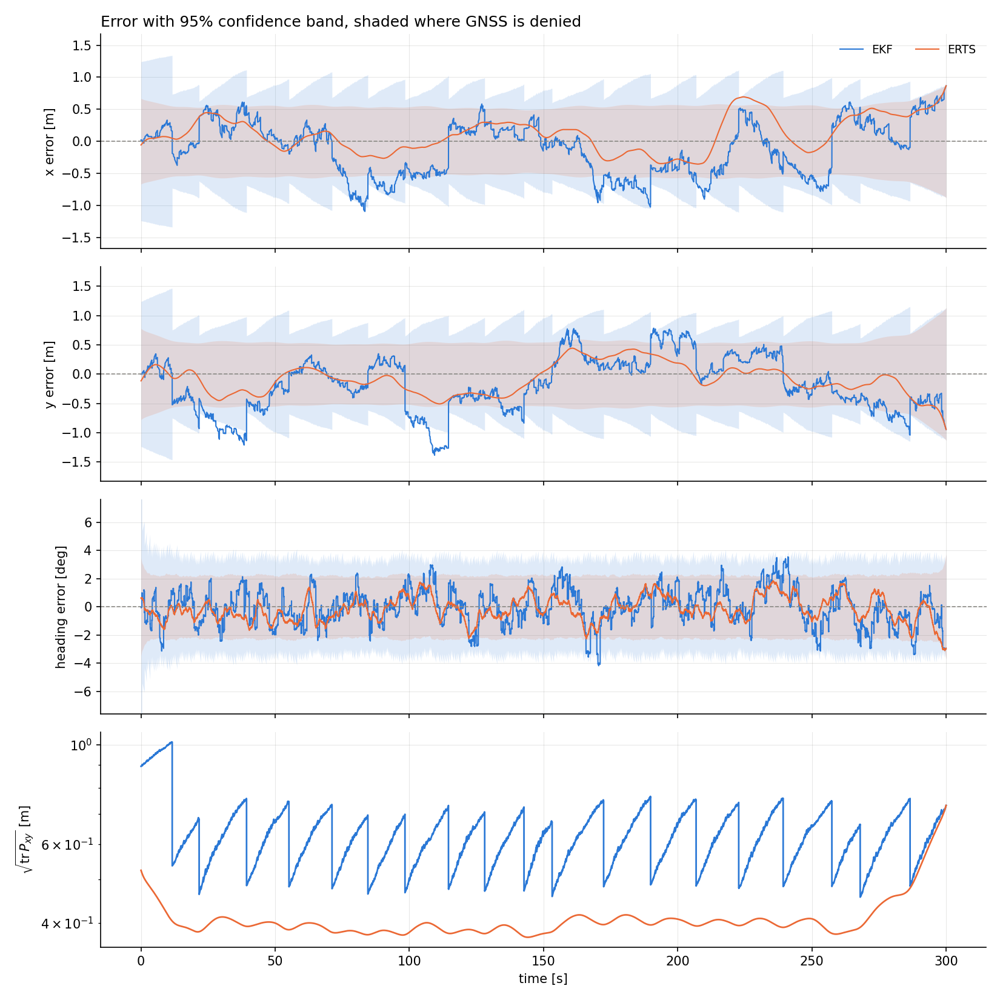
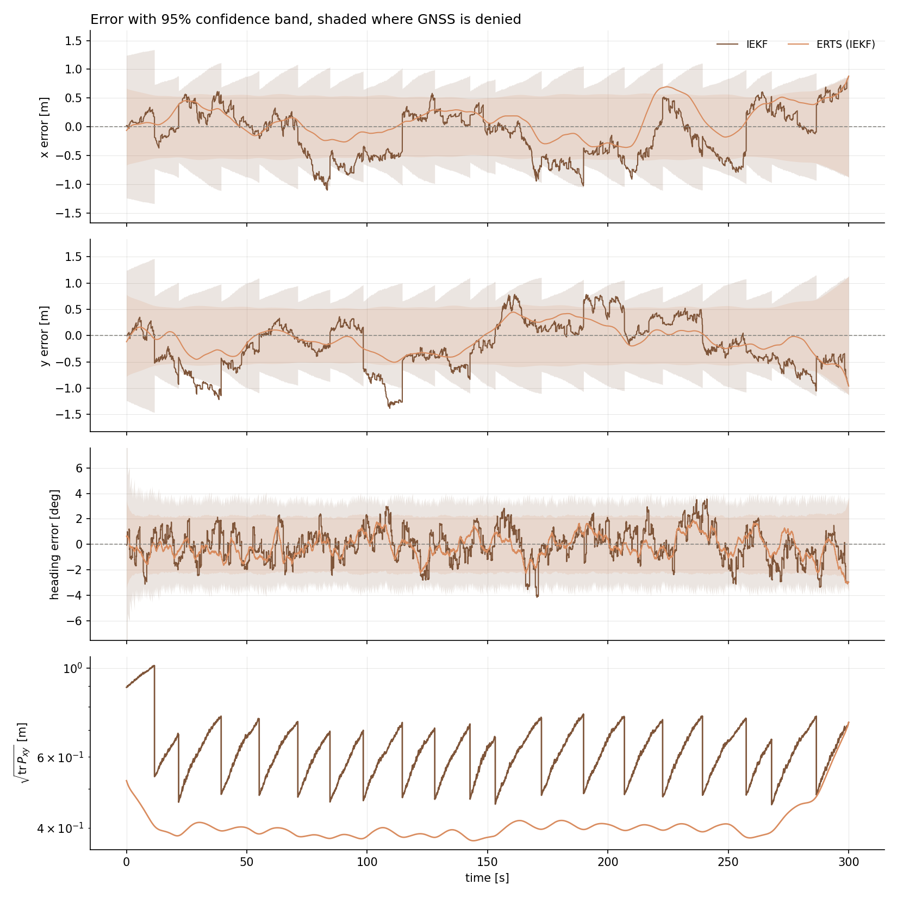
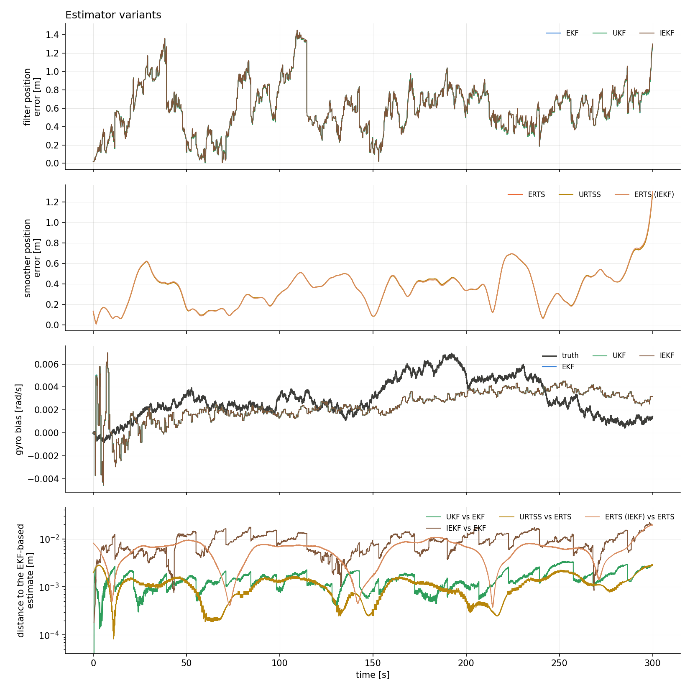
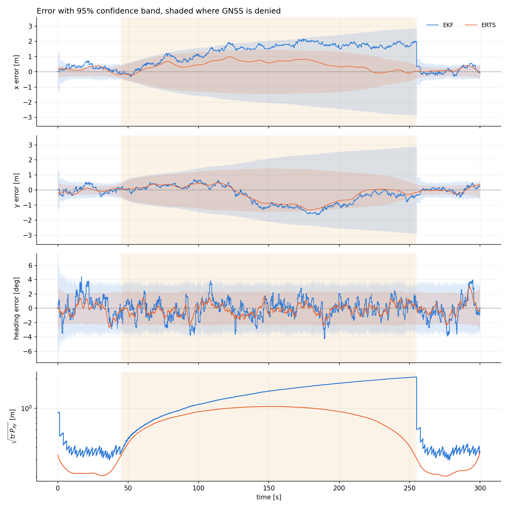
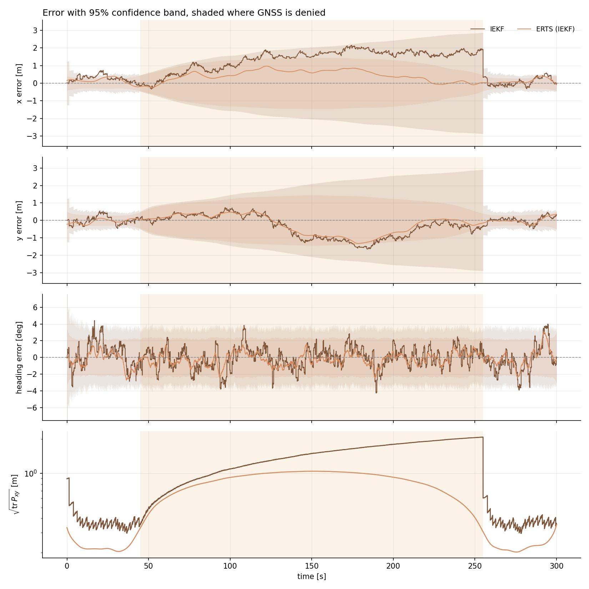
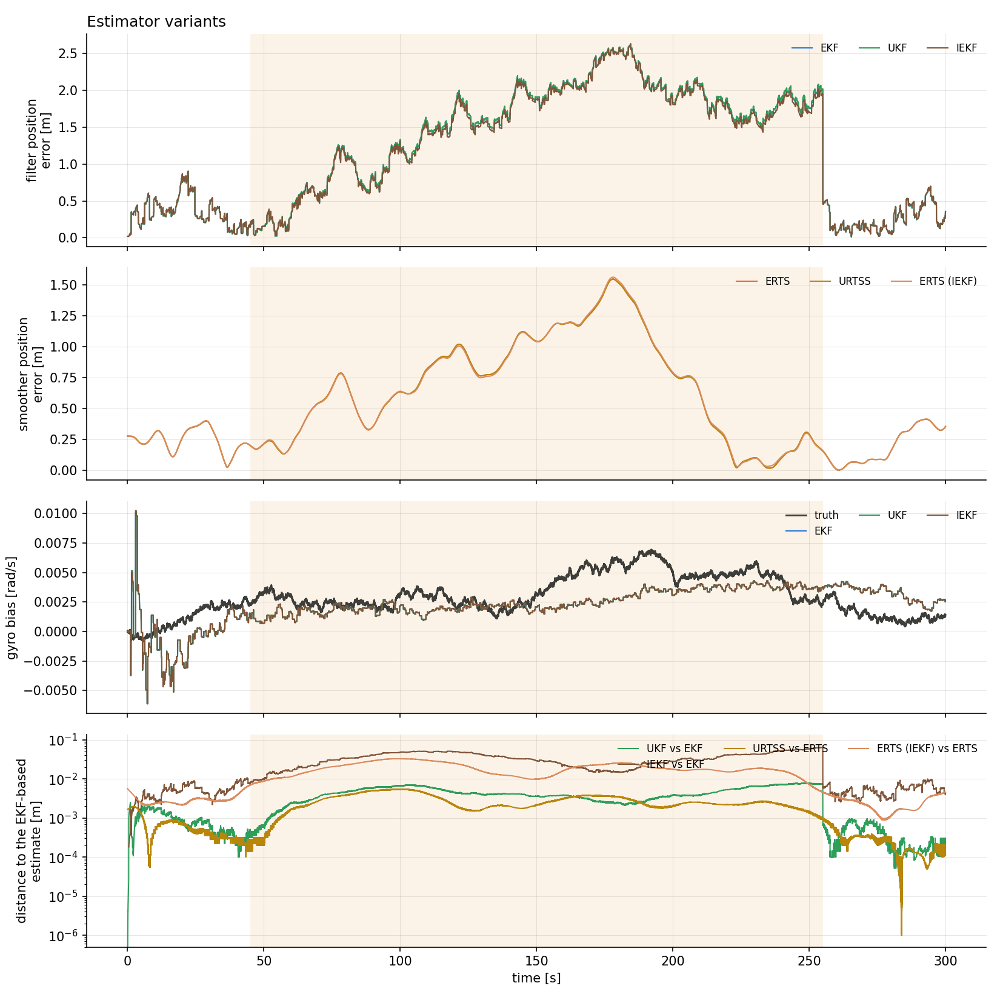

# 2-D strapdown INS, IEKF

[Back to the overview](../../../README.md) | [Previous: UKF and URTSS](../ukf/README.md)

The extended Kalman filter linearises the measurement function once per update, at the prediction. If the prediction is far from the posterior the linearisation point is poor. The iterated extended Kalman filter relinearises at each improved estimate until the update settles, and a Levenberg-Marquardt damping keeps each step from overshooting. This page runs it next to the EKF and the UKF on a figure-eight, once with three sensors and once with a GNSS outage.

|               |                                  |
| ------------- | -------------------------------- |
| **Status**    | done, consistent and within about 6 cm of the EKF on both runs, with no clear accuracy difference |
| **Run**       | 30000 timesteps (300 s at $\Delta t = 0.01$ s), seed 42 |
| **Reproduce** | see [Reproduction](#reproduction) |

## Motivation

Of the three sensors, only the DVL is nonlinear in the state (it rotates the velocity by the heading). For a linear sensor the EKF update is already exact, so the iteration can only change the result through the DVL, and only if the prediction is a poor linearisation point for it. The scenario asks:

- Does iterating the DVL update change the estimate, the reported covariance or the consistency, compared with the EKF and the UKF?
- Does it matter more when GNSS is lost for a long time and the prediction drifts further from the truth?

Both are run on the figure-eight, which turns both ways.

## Problem formulation

### State and motion model

The state collects position, heading, velocity in the navigation frame and the two sensor biases,

$$
x = \begin{bmatrix} p^\top & \psi & v^\top & b_a^\top & b_g \end{bmatrix}^\top \in \mathbb{R}^{8},
\qquad p, v \in \mathbb{R}^2 .
$$

The IMU reading $u_k$ is corrected with the estimated biases, $\tilde a_k = a_k - b_{a,k}$ and
$\tilde\omega_k = \omega_k - b_{g,k}$, and integrated with the heading at the middle of the step,
$\psi_{k+\frac12} = \psi_k + \tfrac{\Delta t}{2}\tilde\omega_k$:

$$
\begin{aligned}
p_{k+1} &= p_k + \Delta t\, v_k + \tfrac{\Delta t^2}{2}\, R(\psi_{k+\frac12})\,\tilde a_k, \\
\psi_{k+1} &= \psi_k + \Delta t\, \tilde\omega_k, \\
v_{k+1} &= v_k + \Delta t\, R(\psi_{k+\frac12})\,\tilde a_k, \\
b_{a,k+1} &= e^{-\Delta t / T_a}\, b_{a,k}, \qquad b_{g,k+1} = e^{-\Delta t / T_g}\, b_{g,k}.
\end{aligned}
$$

Written as $x_k = f(x_{k-1}, u_k) + w_k$ with $w_k \sim \mathcal{N}(0, Q_k)$. The biases are first-order
Gauss-Markov processes with time constant $T$ and stationary variance $\sigma_b^2$, driven by white noise of
intensity $2\sigma_b^2 / T$. White accelerometer noise enters the velocity and white gyro noise the heading. With $G_k$ mapping the
six noise sources into the state and $D$ the diagonal matrix of their intensities, the process noise is the first-order approximation

$$
Q_k = G_k\, D\, G_k^\top\, \Delta t .
$$


| symbol | meaning |
| --- | --- |
| $x_k = \begin{bmatrix} p_k^\top & \psi_k & v_k^\top & b_{a,k}^\top & b_{g,k} \end{bmatrix}^\top$ | state: position, heading, navigation-frame velocity, accelerometer and gyro bias |
| $u_k = \begin{bmatrix} a_k^\top & \omega_k \end{bmatrix}^\top$ | IMU reading: body-frame specific force and yaw rate |
| $R(\psi)$ | rotation from the body to the navigation frame |
| $\bar x_k,\ \bar P_k$ | predicted mean and covariance |
| $\hat x_k,\ \hat P_k$ | updated (filtered) mean and covariance |
| $\hat x^s_k,\ P^s_k$ | smoothed mean and covariance |
| $\eta_k,\ S_k$ | innovation and innovation covariance |
| $W_k$ | Kalman gain |
| $\boxplus,\ \boxminus$ | addition and subtraction that wrap the heading to $(-\pi, \pi]$ |


| parameter | value |
| --- | --- |
| time step $\Delta t$, steps, duration | 0.01 s, 30000, 300 s |
| speed along the path | 2 m/s |
| accelerometer bias: variance $\sigma_{b_a}^2$, time constant $T_a$ | $5\cdot10^{-2}$ (m/s²)², 1000 s, both axes |
| gyro bias: variance $\sigma_{b_g}^2$, time constant $T_g$ | $5\cdot10^{-5}$ (rad/s)², 1000 s |
| white noise intensity, accelerometer / gyro | $5\cdot10^{-4}$ (m/s²)²·s / $5\cdot10^{-4}$ rad²/s |
| prior mean $\hat x_0$ | $[0,\ 0,\ 0,\ 2,\ 0,\ 0,\ 0,\ 0]^\top$ |
| prior covariance $\hat P_0$ | $\operatorname{diag}(0.4,\ 0.4,\ 0.04,\ 0.04,\ 0.04,\ 0.004,\ 0.004,\ 0.0004)$ |


The truth is simulated, not generated by $f$. A geometric path (below) gives position, heading and curvature at constant
speed; the velocity is the speed along the heading, the specific force is the centripetal acceleration rotated into the body frame, and
each IMU reading is that ideal value plus a simulated Gauss-Markov bias plus white noise. The filter is configured with the same noise
values the simulator uses. The configuration values match; the white-noise intensity is read as a continuous-time intensity by the filter
and drawn as a per-sample variance by the simulator, so the noise statistics differ by a factor $1/\Delta t$ in variance, and the truth starts
exactly at the prior mean. Both push the position covariance in the conservative direction. The study guide (chapter 12) documents them.

### Sensors

**GNSS** observes the position directly,

$$
z^{g}_k = H_g\, x_k + \varepsilon^{g}_k, \qquad H_g = \begin{bmatrix} I_2 & 0_{2\times 6} \end{bmatrix}, \qquad \varepsilon^{g}_k \sim \mathcal{N}(0,\ 0.2\, I_2)\ \mathrm{m^2}.
$$

**Magnetometer** observes the heading,

$$
z^{m}_k = \psi_k + \varepsilon^{m}_k, \qquad \varepsilon^{m}_k \sim \mathcal{N}(0,\ 3\cdot 10^{-3})\ \mathrm{rad^2},
$$

and its innovation is wrapped, $\eta^m_k = z^m_k \boxminus h^m(\bar x_k)$.

**DVL** observes the velocity in the body frame, which makes it the one nonlinear sensor,

$$
z^{d}_k = R(\psi_k)^\top v_k + \varepsilon^{d}_k, \qquad
H_d = \begin{bmatrix} 0_{2\times 2} & \dfrac{\partial R^\top}{\partial \psi}\, v & R(\psi)^\top & 0_{2\times 3} \end{bmatrix}, \qquad
\varepsilon^{d}_k \sim \mathcal{N}(0,\ 10^{-2}\, I_2)\ \mathrm{(m/s)^2}.
$$


The sensors and noise are those of the other INS scenarios. The two runs differ in GNSS:

| run | GNSS | magnetometer | DVL |
| --- | --- | --- | --- |
| multi-sensor fusion | every 10 to 20 s, 19 fixes | every 0.25 to 1 s, 476 fixes | every 0.2 to 1 s, 487 fixes |
| GNSS outage | every 1 to 3 s, denied between $t = 45$ s and $t = 255$ s, 45 fixes | 470 fixes | 492 fixes |

The EKF, the UKF (with $\alpha = 1$, $\beta = 2$, $\kappa = 0$) and the IEKF run on the same simulated data and the same fixes, so every difference comes from the estimator.


### Trajectory

Both runs use the figure-eight: two circles of radius 20 m with centres 70 m apart, joined by two straights that cross at the origin, traced at 2 m/s starting at the origin heading $+x$. One lap is 289.2 m and the run covers 2.1 laps, with one right and one left turn per lap.

### Estimators

When several sensors fire in the same step they update in turn, each starting from the result of the previous one.

**Extended Kalman filter.** Prediction and update with sensor model $h$, Jacobians $F$ and $H$, and measurement noise $R$:

$$
\bar x_k = f(\hat x_{k-1}, u_k), \qquad \bar P_k = F_k \hat P_{k-1} F_k^\top + Q_k,
$$

$$
\eta_k = z_k \boxminus h(\bar x_k), \qquad S_k = H_k \bar P_k H_k^\top + R, \qquad W_k = \bar P_k H_k^\top S_k^{-1},
$$

$$
\hat x_k = \bar x_k \boxplus W_k \eta_k, \qquad
\hat P_k = (I - W_k H_k)\, \bar P_k\, (I - W_k H_k)^\top + W_k R\, W_k^\top .
$$

The covariance update is written in Joseph form, which keeps $\hat P_k$ positive semidefinite.

**Extended Rauch-Tung-Striebel smoother (ERTS).** Run backward over the stored filter output, starting from
$\hat x^s_N = \hat x_N$, with $F_k$ evaluated at the filtered state:

$$
G_k = \hat P_k F_k^\top \bar P_{k+1}^{-1}, \qquad
\hat x^s_k = \hat x_k \boxplus G_k\,(\hat x^s_{k+1} \boxminus \bar x_{k+1}), \qquad
P^s_k = \hat P_k + G_k\,(P^s_{k+1} - \bar P_{k+1})\,G_k^\top .
$$


**Iterated extended Kalman filter (IEKF) with Levenberg-Marquardt.** The prediction is the EKF prediction. The EKF update linearises the measurement function once, at the
prediction $\bar x$. The IEKF update instead finds the maximum a posteriori estimate of the state for this one measurement, the minimiser of the cost

$$
J(x) = \tfrac12\, \big\lVert z \boxminus h(x) \big\rVert^2_{R^{-1}} + \tfrac12\, \big\lVert x \boxminus \bar x \big\rVert^2_{\bar P^{-1}},
$$

by iterating on the linearisation point $x_i$, starting at $x_0 = \bar x$. With $\eta_i = z \boxminus h(x_i)$, $H_i = H(x_i)$ and the offset $d_i = x_i \boxminus \bar x$, the Gauss-Newton step $\delta$ solves

$$
\big(\bar P^{-1} + H_i^\top R^{-1} H_i + \lambda\, \bar P^{-1}\big)\,\delta = H_i^\top R^{-1} \eta_i - \bar P^{-1} d_i ,
$$

where $\lambda = 0$ is Gauss-Newton and $\lambda > 0$ is the Levenberg-Marquardt damping. Adding $\lambda \bar P^{-1}$ is the same as shrinking the prior covariance to $\bar P_\lambda = \bar P / (1+\lambda)$, so the
step has the form of a Kalman update:

$$
S_\lambda = H_i \bar P_\lambda H_i^\top + R, \qquad W_\lambda = \bar P_\lambda H_i^\top S_\lambda^{-1}, \qquad
\delta = W_\lambda\, \eta_i - (I - W_\lambda H_i)\,\frac{d_i}{1+\lambda}, \qquad x_{i+1} = x_i \boxplus \delta .
$$

A step is accepted if $J(x_i \boxplus \delta) < J(x_i)$, and then $\lambda \leftarrow \lambda / \lambda_f$; otherwise the iterate stays and $\lambda \leftarrow \lambda_f\, \lambda$. The iteration stops when the step
in the $\bar P$ norm, or the relative decrease of $J$, falls below a tolerance, or when the iteration or rejection limits are reached. The posterior covariance is the Joseph form of the EKF with the
undamped $W$ and $H$ evaluated at the final iterate $\hat x$, and the innovation and $S$ that are reported (and used for the NIS) are the EKF's, evaluated at $\bar x$, so that they are comparable between the filters.

For a linear sensor $J$ is quadratic and the EKF update already is its minimiser, so only the DVL can make the iteration differ from the EKF.

| parameter | value | meaning |
| --- | --- | --- |
| $\lambda_0$ | $10^{-2}$ | initial damping |
| $\lambda_{\min},\ \lambda_{\max}$ | $10^{-12},\ 10^{12}$ | floor, and ceiling at which an update gives up |
| $\lambda_f$ | 10 | factor applied to $\lambda$ on a rejection or an accept |
| maximum iterations, maximum consecutive rejections | 50, 30 | |
| step tolerance, relative cost tolerance | $10^{-8}$, $10^{-12}$ | stopping thresholds |

The smoother is the standard ERTS run over the IEKF's output, labelled ERTS (IEKF); only the filter is iterated.

### Consistency

A filter is consistent if the errors it makes agree with the covariance it reports. Two statistics test this, with the truth $x_k$ known from the simulation.

$$
\mathrm{NIS}_k = \eta_k^\top S_k^{-1} \eta_k \sim \chi^2_{m}, \qquad
\mathrm{NEES}_k = (p_k - \hat p_k)^\top \big(\hat P^{pp}_k\big)^{-1} (p_k - \hat p_k) \sim \chi^2_{2},
$$

where $m$ is the measurement dimension (2 for GNSS and DVL, 1 for the magnetometer) and $\hat P^{pp}_k$ is the position block of the covariance.
The NIS is evaluated at every fix of a sensor. The NEES is evaluated for the position at every step, for the filter and for the smoother.
The time average $\bar\epsilon = \frac{1}{N}\sum_k \epsilon_k$ of either statistic with $d$ degrees of freedom is held against the interval

$$
\left[\ \frac{\chi^2_{\alpha/2}(N_{\mathrm{eff}}\, d)}{N_{\mathrm{eff}}},\ \ \frac{\chi^2_{1-\alpha/2}(N_{\mathrm{eff}}\, d)}{N_{\mathrm{eff}}}\ \right], \qquad
N_{\mathrm{eff}} = \max\!\Big(1,\ N\,\frac{1-\rho}{1+\rho}\Big), \qquad \alpha = 0.05,
$$

where $\rho$ is the lag-one autocorrelation of the series. A statistic is "consistent" if its time average lies inside the interval. A value below the interval
means the filter reports more uncertainty than its errors need (conservative), above means less (overconfident).
The position NEES is strongly autocorrelated, so $N_{\mathrm{eff}}$ is small and the interval wide; for the smoother it is so wide that it excludes almost nothing. The
share of steps with the true position inside the reported 95% ellipse is a second check that does not depend on it.
All numbers are from one run with seed 42, so they carry no error bars.

## Reproduction

Build once, then simulate and analyse each case:

```bash
cmake -S . -B build && cmake --build build
./build/kalman_filtering_and_smoothing results/INS2D/iekf/multi_sensor_fusion
python3 scripts/analyze_ins_2d.py results/INS2D/iekf/multi_sensor_fusion/data
./build/kalman_filtering_and_smoothing results/INS2D/iekf/gnss_outage
python3 scripts/analyze_ins_2d.py results/INS2D/iekf/gnss_outage/data
```

The executable reads `<case>/config.yaml` and writes `<case>/data`. Given a folder that holds several cases, it runs all of them, so
`./build/kalman_filtering_and_smoothing results/INS2D/iekf` simulates every case of this page in one command. The analysis reads `<case>/data`
and writes `<case>/stats.txt`, which holds every number quoted below, and the figures in `<case>/figures`.

`data/` holds one CSV file per quantity with one row per timestep and a shared `timestep` column. `truth.csv` has the true state `x_true_0 ... x_true_7`;
`filter.csv` and `smoother.csv` have the predicted and updated (or smoothed) mean and the full covariance; `*_fixes.csv` has, for each fix of one sensor, the raw measurement,
the innovation and $S$, which is what the NIS is computed from.

`run_iekf: true` in a case's `config.yaml` switches the IEKF on, together with the Levenberg-Marquardt parameters of the table above; the IEKF files carry the prefix `iekf_`.

## Results

The figures per run: the path with the EKF and ERTS estimates, the EKF/ERTS error, the IEKF/ERTS (IEKF) error, and the variants against each other.

### Multi-sensor fusion








| statistic | EKF / ERTS | UKF / URTSS | IEKF / ERTS (IEKF) |
| --- | --- | --- | --- |
| ANIS GNSS | 2.1052 (consistent) | 2.1018 (consistent) | 2.1238 (consistent) |
| ANIS magnetometer | 0.8980 (consistent) | 0.8980 (consistent) | 0.8980 (consistent) |
| ANIS DVL | 1.8979 (consistent) | 1.8974 (consistent) | 1.8975 (consistent) |
| ANEES position filter | 2.3119 (consistent) | 2.3062 (consistent) | 2.3387 (consistent) |
| ANEES position smoother | 1.8170 (consistent) | 1.8149 (consistent) | 1.8206 (consistent) |

| estimator | RMSE position [m] | median [m] | 95th percentile [m] | max [m] | RMSE heading [°] |
| --- | --- | --- | --- | --- | --- |
| EKF | 0.655 | 0.589 | 1.038 | 1.450 | 1.29 |
| UKF | 0.655 | 0.587 | 1.037 | 1.449 | 1.29 |
| IEKF | 0.659 | 0.594 | 1.042 | 1.453 | 1.29 |
| ERTS | 0.403 | 0.373 | 0.679 | 1.282 | 0.88 |
| URTSS | 0.402 | 0.373 | 0.679 | 1.280 | 0.88 |
| ERTS (IEKF) | 0.404 | 0.373 | 0.682 | 1.302 | 0.88 |

| estimator | RMSE $b_{a,x}$ [m/s²] | RMSE $b_{a,y}$ [m/s²] | RMSE $b_g$ [rad/s] | peak $\lvert b_g - \hat b_g \rvert$ [rad/s] |
| --- | --- | --- | --- | --- |
| EKF | 0.0213 | 0.0236 | 0.00177 | 0.0074 |
| UKF | 0.0213 | 0.0235 | 0.00177 | 0.0075 |
| IEKF | 0.0213 | 0.0235 | 0.00177 | 0.0075 |
| ERTS | 0.0104 | 0.0120 | 0.00139 | 0.0032 |
| URTSS | 0.0104 | 0.0120 | 0.00139 | 0.0032 |
| ERTS (IEKF) | 0.0104 | 0.0120 | 0.00139 | 0.0032 |

| distance | position median [mm] | position max [mm] | heading max [°] | position $\operatorname{tr}P$ ratio range |
| --- | --- | --- | --- | --- |
| IEKF vs EKF | 8.6 | 22.1 | 0.056 | [0.9951, 1.0048] |
| UKF vs EKF | 1.4 | 3.4 | 0.016 | [1.0000, 1.0002] |
| ERTS (IEKF) vs ERTS | 6.6 | 19.6 | 0.026 | [0.9993, 1.0018] |

### GNSS outage








| statistic | EKF / ERTS | UKF / URTSS | IEKF / ERTS (IEKF) |
| --- | --- | --- | --- |
| ANIS GNSS | 1.8012 (consistent) | 1.8013 (consistent) | 1.7990 (consistent) |
| ANIS magnetometer | 0.8593 (INCONSISTENT) | 0.8593 (INCONSISTENT) | 0.8595 (INCONSISTENT) |
| ANIS DVL | 1.9876 (consistent) | 1.9872 (consistent) | 1.9878 (consistent) |
| ANEES position filter | 2.3378 (consistent) | 2.3414 (consistent) | 2.2828 (consistent) |
| ANEES position smoother | 1.7506 (consistent) | 1.7479 (consistent) | 1.7560 (consistent) |

| estimator | RMSE position [m] | median [m] | 95th percentile [m] | max [m] | RMSE heading [°] |
| --- | --- | --- | --- | --- | --- |
| EKF | 1.419 | 1.247 | 2.380 | 2.634 | 1.36 |
| UKF | 1.421 | 1.248 | 2.382 | 2.636 | 1.36 |
| IEKF | 1.395 | 1.218 | 2.366 | 2.623 | 1.36 |
| ERTS | 0.684 | 0.394 | 1.321 | 1.548 | 0.84 |
| URTSS | 0.684 | 0.393 | 1.319 | 1.545 | 0.84 |
| ERTS (IEKF) | 0.685 | 0.396 | 1.334 | 1.562 | 0.85 |

| estimator | RMSE $b_{a,x}$ [m/s²] | RMSE $b_{a,y}$ [m/s²] | RMSE $b_g$ [rad/s] | peak $\lvert b_g - \hat b_g \rvert$ [rad/s] |
| --- | --- | --- | --- | --- |
| EKF | 0.0207 | 0.0239 | 0.00186 | 0.0106 |
| UKF | 0.0207 | 0.0239 | 0.00186 | 0.0106 |
| IEKF | 0.0207 | 0.0239 | 0.00186 | 0.0107 |
| ERTS | 0.0100 | 0.0109 | 0.00134 | 0.0034 |
| URTSS | 0.0100 | 0.0109 | 0.00134 | 0.0034 |
| ERTS (IEKF) | 0.0100 | 0.0109 | 0.00134 | 0.0034 |

| distance | position median [mm] | position max [mm] | heading max [°] | position $\operatorname{tr}P$ ratio range |
| --- | --- | --- | --- | --- |
| IEKF vs EKF | 25.8 | 63.5 | 0.056 | [0.9959, 1.0054] |
| UKF vs EKF | 3.5 | 7.9 | 0.016 | [1.0000, 1.0004] |
| ERTS (IEKF) vs ERTS | 14.6 | 32.8 | 0.030 | [0.9991, 1.0033] |

## Discussion

- **Consistency is unchanged.** Every verdict is the same for the EKF, the UKF and the IEKF in both runs. The one failure is the magnetometer ANIS in the outage run, 0.8593, 0.8593 and 0.8595 for the three filters against a lower band edge of 0.8682.
- **No clear accuracy difference.** The IEKF's position RMSE is +0.0037 m from the EKF's in the fusion run (0.6592 against 0.6555 m) and -0.0236 m in the outage run (1.3955 against 1.4191 m). The sign differs between the runs and the sizes are small, so no ranking is read from them. Heading RMSE and the bias estimates agree at the precision of the tables.
- **The IEKF moves away from the EKF more than the UKF does.** The median distance is 8.6 mm in the fusion run and 25.8 mm in the outage run (at most 22.1 and 63.5 mm), against 1.4 and 3.5 mm for the UKF, and the reported position $\operatorname{tr}P$ stays within 0.5% of the EKF's. The distance grows during the outage and falls once GNSS returns (the bottom panel of the variants figure). Since GNSS and the magnetometer are linear and the iteration cannot change them, the difference comes from the DVL updates.
- **The smoother removes most of the difference.** ERTS (IEKF) is 6.6 and 14.6 mm from the ERTS in median.
- **The reason is the setup.** The DVL is only mildly nonlinear while the heading is known to a degree or so, so the linearisation at the prediction is already good. The UKF, which also avoids the linearisation, stays within 3.4 and 7.9 mm of the EKF.

**Not covered.** The case where the iteration should matter, a large heading error with sparse magnetometer fixes, was not run with the IEKF; nothing here says whether iterating helps when the linearisation is bad. The number of iterations per update and how often a step was rejected were not logged, so the page shows what the iteration changed and not how much work it did. One seed and one path per case: differences of millimetres or centimetres between the filters could reverse with another seed. Only the filter is iterated, the smoother is the plain ERTS.

## Related results

- [UKF and URTSS](../ukf/README.md) asks the same question of the unscented filter, including a heading-stress run in which the linearisation is poor.
- [GNSS outage](../gnss_outage/README.md) and [multi-sensor fusion](../multi_sensor_fusion/README.md) are the EKF-only versions of these two runs, on a four-corner test and a figure-eight.
