# 2-D strapdown INS, IEKS

[Back to the overview](../../../README.md) | [Previous: IEKF](../iekf/README.md)

The extended Rauch-Tung-Striebel smoother linearises the motion model once, at the filtered estimates, and those were computed from the measurements up to each step only. The iterated extended Kalman smoother (IEKS) relinearises both the motion and the measurement models at the smoothed trajectory itself and repeats, with a Levenberg-Marquardt damping, until the whole trajectory settles. This page runs it, over the IEKF, next to the EKF with the ERTS and the UKF with the URTSS on a figure-eight, once with three sensors and once with a GNSS outage.

|               |                                  |
| ------------- | -------------------------------- |
| **Status**    | done, no difference to the ERTS on the fusion and outage runs, clearly the best smoother on the heading-stress runs |
| **Run**       | 30000 timesteps (300 s at $\Delta t = 0.01$ s), seed 42 |
| **Reproduce** | see [Reproduction](#reproduction) |

## Motivation

A smoother that is built on a filter inherits its linearisation points. The ERTS evaluates $F_k$ at the filtered state $\hat x_k$, which does not yet know about later measurements, and the filter's own updates were linearised at the predictions. The IEKS removes both: every Jacobian, of the motion and of the sensors, is evaluated at the current smoothed trajectory, and the trajectory is improved until it is a minimiser of the whole-run cost. The scenario asks:

- Does iterating over the whole trajectory change the smoothed estimate, the reported covariance or the consistency, compared with the ERTS and the URTSS?
- Does it matter more when GNSS is lost for a long time and the filter's linearisation points drift further from the truth?
- Does it matter when the filter starts with a large heading error that a sparse magnetometer corrects only rarely, so the filter linearises about a wrong heading for a long time?

The first two are run on the figure-eight, which turns both ways, and the heading-stress run on both the four-corner test and the figure-eight. The EKF, UKF and IEKF are run on the same data, so the filters and the smoothers of the three families can be compared.

## Problem formulation

### State and motion model

The state collects position, velocity in the navigation frame, heading and the two sensor biases,

$$
x = \begin{bmatrix} p^\top & v^\top & \psi & b_a^\top & b_g \end{bmatrix}^\top \in \mathbb{R}^{8},
\qquad p, v \in \mathbb{R}^2 .
$$

The IMU reading $u_k$ is corrected with the estimated biases, $\tilde a_k = a_k - b_{a,k}$ and
$\tilde\omega_k = \omega_k - b_{g,k}$, and integrated with the heading at the middle of the step,
$\psi_{k+\frac12} = \psi_k + \tfrac{\Delta t}{2}\tilde\omega_k$:

$$
\begin{aligned}
p_{k+1} &= p_k + \Delta t\, v_k + \tfrac{\Delta t^2}{2}\, R(\psi_{k+\frac12})\,\tilde a_k, \\
v_{k+1} &= v_k + \Delta t\, R(\psi_{k+\frac12})\,\tilde a_k, \\
\psi_{k+1} &= \psi_k + \Delta t\, \tilde\omega_k, \\
b_{a,k+1} &= e^{-\Delta t / T_a}\, b_{a,k}, \qquad b_{g,k+1} = e^{-\Delta t / T_g}\, b_{g,k}.
\end{aligned}
$$

Written as $x_k = f(x_{k-1}, u_k) + w_k$ with $w_k \sim \mathcal{N}(0, Q_k)$. The biases are first-order
Gauss-Markov processes with time constant $T$ and stationary variance $\sigma_b^2$, driven by white noise of
intensity $2\sigma_b^2 / T$. White accelerometer noise enters the velocity and white gyro noise the heading. With $G_k$ mapping the
six noise sources into the state, $D$ the diagonal matrix of their intensities and $A$ the continuous-time Jacobian of the model at the
current estimate, the process noise is the exact discretization by Van Loan's formula,

$$
\exp\!\left( \begin{bmatrix} -A & G_k D G_k^\top \\ 0 & A^\top \end{bmatrix} \Delta t \right)
= \begin{bmatrix} \cdot & E_{12} \\ 0 & E_{22} \end{bmatrix},
\qquad Q_k = E_{22}^\top E_{12} .
$$


| symbol | meaning |
| --- | --- |
| $x_k$ | state: position $p_k$, navigation-frame velocity $v_k$, heading $\psi_k$, accelerometer bias $b_{a,k}$ and gyro bias $b_{g,k}$ |
| $u_k$ | IMU reading $(a_k, \omega_k)$: body-frame specific force and yaw rate |
| $R(\psi)$ | rotation from the body to the navigation frame |
| $\bar x_k,\ \bar P_k$ | predicted mean and covariance |
| $\hat x_k,\ \hat P_k$ | updated (filtered) mean and covariance |
| $\hat x^s_k,\ P^s_k$ | smoothed mean and covariance |
| $\eta_k,\ S_k$ | innovation and innovation covariance |
| $W_k$ | Kalman gain |
| $\boxplus,\ \boxminus$ | addition and subtraction that wrap the heading to $(-\pi, \pi]$ |


| parameter | value |
| --- | --- |
| time step $\Delta t$, steps, duration | 0.01 s, 30000, 300 s |
| speed along the path | 2 m/s |
| accelerometer bias: variance $\sigma_{b_a}^2$, time constant $T_a$ | $5\cdot10^{-2}$ (m/s²)², 200 s, both axes |
| gyro bias: variance $\sigma_{b_g}^2$, time constant $T_g$ | $5\cdot10^{-5}$ (rad/s)², 200 s |
| white noise intensity, accelerometer / gyro | $5\cdot10^{-4}$ (m/s²)²·s / $5\cdot10^{-4}$ rad²/s |
| true initial state $x_0$ | $[0,\ 0,\ 0,\ 2,\ 0,\ 0,\ 0,\ 0]^\top$ |
| prior mean $\hat x_0$ | drawn from $\mathcal{N}(x_0,\ \hat P_0)$ |
| prior covariance $\hat P_0$ | $\mathrm{diag}(0.4,\ 0.4,\ 0.04,\ 0.04,\ 0.04,\ 0.004,\ 0.004,\ 0.0004)$ |


The truth is simulated, not generated by $f$. A geometric path (below) gives position, heading and curvature at constant
speed; the velocity is the speed along the heading, the specific force is the centripetal acceleration rotated into the body frame, and
each IMU reading is that ideal value plus a simulated Gauss-Markov bias plus white noise. The filter is configured with the same noise
values the simulator uses. The white noise is a continuous-time intensity in both, so the simulator draws each sample with variance
intensity$/\Delta t$. The biases start at zero and are simulated with the exact discretization $b_k = e^{-\Delta t/T} b_{k-1} + w_k$,
$w_k \sim \mathcal{N}(0,\ \sigma_b^2 (1 - e^{-2\Delta t/T}))$, so with $T = 200$ s their variance reaches 95% of $\sigma_b^2$ by the end of the run.
The prior mean is drawn around the true initial state from the prior covariance, so the initial error is a sample from $\hat P_0$, as the consistency
tests assume.

### Sensors

**GNSS** observes the position directly,

$$
z^{g}_k = H_g\, x_k + \varepsilon^{g}_k, \qquad H_g = \begin{bmatrix} I_2 & 0_{2\times 6} \end{bmatrix}, \qquad \varepsilon^{g}_k \sim \mathcal{N}(0,\ 0.2\, I_2)\ \mathrm{m^2}.
$$

**Magnetometer** observes the heading,

$$
z^{m}_k = \psi_k + \varepsilon^{m}_k, \qquad \varepsilon^{m}_k \sim \mathcal{N}(0,\ 3\cdot 10^{-3})\ \mathrm{rad^2},
$$

and its innovation is wrapped, $\eta^m_k = z^m_k \boxminus h^m(\bar x_k)$.

**DVL** observes the velocity in the body frame, which makes it the one nonlinear sensor,

$$
z^{d}_k = R(\psi_k)^\top v_k + \varepsilon^{d}_k, \qquad
H_d = \begin{bmatrix} 0_{2\times 2} & R(\psi)^\top & \dfrac{\partial R^\top}{\partial \psi}\, v & 0_{2\times 3} \end{bmatrix}, \qquad
\varepsilon^{d}_k \sim \mathcal{N}(0,\ 10^{-2}\, I_2)\ \mathrm{(m/s)^2}.
$$


The sensors and noise are those of the other INS scenarios. The two runs differ in GNSS:

| run | GNSS | magnetometer | DVL |
| --- | --- | --- | --- |
| multi-sensor fusion | every 10 to 20 s, 19 fixes | every 0.25 to 1 s, 476 fixes | every 0.2 to 1 s, 487 fixes |
| GNSS outage | every 1 to 3 s, denied between $t = 45$ s and $t = 255$ s, 45 fixes | 470 fixes | 492 fixes |
| heading stress | as the GNSS outage, 46 fixes | every 30 to 60 s, 6 fixes | 497 fixes |

The heading-stress run is the one of the [UKF page](../ukf/README.md). The filters start with a heading of 1.5 rad (86°) while the truth starts at 0, with an initial heading variance of 2.25 rad², and this prior mean is kept instead of being drawn around the truth.

The EKF with the ERTS, the UKF with the URTSS and the IEKF with the IEKS run on the same simulated data and the same fixes, so every difference comes from the estimator.


### Trajectory

The fusion and outage runs use the figure-eight: two circles of radius 20 m with centres 70 m apart, joined by two straights that cross at the origin, traced at 2 m/s starting at the origin heading $+x$. One lap is 289.2 m and the run covers 2.1 laps, with one right and one left turn per lap. The heading-stress run also uses the four-corner test, an $80 \times 50$ m rectangle with corner radius 10 m traced counterclockwise, 242.8 m per lap.

### Estimators

When several sensors fire in the same step they update in turn, each starting from the result of the previous one.

**Extended Kalman filter.** Prediction and update with sensor model $h$, Jacobians $F$ and $H$, and measurement noise $R$:

$$
\bar x_k = f(\hat x_{k-1}, u_k), \qquad \bar P_k = F_k \hat P_{k-1} F_k^\top + Q_k,
$$

$$
\eta_k = z_k \boxminus h(\bar x_k), \qquad S_k = H_k \bar P_k H_k^\top + R, \qquad W_k = \bar P_k H_k^\top S_k^{-1},
$$

$$
\hat x_k = \bar x_k \boxplus W_k \eta_k, \qquad
\hat P_k = (I - W_k H_k)\, \bar P_k\, (I - W_k H_k)^\top + W_k R\, W_k^\top .
$$

The covariance update is written in Joseph form, which keeps $\hat P_k$ positive semidefinite.

**Extended Rauch-Tung-Striebel smoother (ERTS).** Run backward over the stored filter output, starting from
$\hat x^s_N = \hat x_N$, with $F_k$ evaluated at the filtered state:

$$
G_k = \hat P_k F_k^\top \bar P_{k+1}^{-1}, \qquad
\hat x^s_k = \hat x_k \boxplus G_k\,(\hat x^s_{k+1} \boxminus \bar x_{k+1}), \qquad
P^s_k = \hat P_k + G_k\,(P^s_{k+1} - \bar P_{k+1})\,G_k^\top .
$$

**Iterated extended Kalman filter (IEKF) with Levenberg-Marquardt.** The prediction is the EKF prediction. The EKF update linearises the measurement function once, at the
prediction $\bar x$. The IEKF update instead finds the maximum a posteriori estimate of the state for this one measurement, the minimiser of the cost

$$
J(x) = \tfrac12\, \big\lVert z \boxminus h(x) \big\rVert^2_{R^{-1}} + \tfrac12\, \big\lVert x \boxminus \bar x \big\rVert^2_{\bar P^{-1}},
$$

by iterating on the linearisation point $x_i$, starting at $x_0 = \bar x$. With $\eta_i = z \boxminus h(x_i)$, $H_i = H(x_i)$ and the offset $d_i = x_i \boxminus \bar x$, the Gauss-Newton step $\delta$ solves

$$
\big(\bar P^{-1} + H_i^\top R^{-1} H_i + \lambda\, \bar P^{-1}\big)\,\delta = H_i^\top R^{-1} \eta_i - \bar P^{-1} d_i ,
$$

where $\lambda = 0$ is Gauss-Newton and $\lambda > 0$ is the Levenberg-Marquardt damping. Adding $\lambda \bar P^{-1}$ is the same as shrinking the prior covariance to $\bar P_\lambda = \bar P / (1+\lambda)$, so the
step has the form of a Kalman update:

$$
S_\lambda = H_i \bar P_\lambda H_i^\top + R, \qquad W_\lambda = \bar P_\lambda H_i^\top S_\lambda^{-1}, \qquad
\delta = W_\lambda\, \eta_i - (I - W_\lambda H_i)\,\frac{d_i}{1+\lambda}, \qquad x_{i+1} = x_i \boxplus \delta .
$$

A step is accepted if $J(x_i \boxplus \delta) < J(x_i)$, and then $\lambda \leftarrow \lambda / \lambda_f$; otherwise the iterate stays and $\lambda \leftarrow \lambda_f\, \lambda$. The iteration stops when the step
in the $\bar P$ norm, or the relative decrease of $J$, falls below a tolerance, or when the iteration or rejection limits are reached. The posterior covariance is the Joseph form of the EKF with the
undamped $W$ and $H$ evaluated at the final iterate $\hat x$, and the innovation and $S$ that are reported (and used for the NIS) are the EKF's, evaluated at $\bar x$, so that they are comparable between the filters.

For a linear sensor $J$ is quadratic and the EKF update already is its minimiser, so only the DVL can make the iteration differ from the EKF.

| parameter | value | meaning |
| --- | --- | --- |
| $\lambda_0$ | $10^{-2}$ | initial damping |
| $\lambda_{\min},\ \lambda_{\max}$ | $10^{-12},\ 10^{12}$ | floor, and ceiling at which an update gives up |
| $\lambda_f$ | 10 | factor applied to $\lambda$ on a rejection or an accept |
| maximum iterations, maximum consecutive rejections | 50, 30 | |
| step tolerance, relative cost tolerance | $10^{-8}$, $10^{-12}$ | stopping thresholds |

**Unscented Kalman filter and URTSS.** The UKF and the URTSS replace the Jacobians by sigma points, with $\alpha = 1$, $\beta = 2$ and $\kappa = 0$; they are derived on the [UKF page](../ukf/README.md) and only appear here as the second reference.

**Iterated extended Kalman smoother (IEKS) with Levenberg-Marquardt.** The IEKF iterates one update at a time. The IEKS iterates the whole run. Number the nodes $0, \dots, N$, with node $0$ the prior and node $k$ the state at step $k$, so that the transition from $k-1$ to $k$ uses $u_k$ and the measurements $z_k$ belong to node $k$. The smoother minimises the cost of the whole trajectory $x_{0:N}$,

$$
J(x_{0:N}) = \tfrac12\, \big\lVert x_0 \boxminus \hat x_0 \big\rVert^2_{\hat P_0^{-1}}
+ \sum_{k=1}^{N} \tfrac12\, \big\lVert x_k \boxminus f(x_{k-1}, u_k) \big\rVert^2_{Q_k^{+}}
+ \sum_{k=1}^{N} \sum_{s} \tfrac12\, \big\lVert z^{s}_k \boxminus h^{s}(x_k) \big\rVert^2_{R_s^{-1}},
$$

where the sum over $s$ runs over the sensors that fired at step $k$. Position has no process noise in this model, so $Q_k$ is singular and the motion term uses its pseudo-inverse $Q_k^{+}$: only the part of the residual that the noise can drive is penalised.

Given a reference trajectory $x^{\mathrm{ref}}_{0:N}$, write $x_k = x^{\mathrm{ref}}_k \boxplus \delta_k$ and linearise the models there. The problem in $\delta$ is linear and Gaussian,

$$
\delta_k = c_k + F_k\, \delta_{k-1} + w_k, \qquad c_k = f(x^{\mathrm{ref}}_{k-1}, u_k) \boxminus x^{\mathrm{ref}}_k, \qquad w_k \sim \mathcal{N}(0, Q_k),
$$

$$
z^{s}_k \boxminus h^{s}(x^{\mathrm{ref}}_k) = H^{s}_k\, \delta_k + \varepsilon^{s}_k, \qquad \delta_0 \sim \mathcal{N}\big(\hat x_0 \boxminus x^{\mathrm{ref}}_0,\ \hat P_0\big),
$$

with $F_k$ and $Q_k$ evaluated at $x^{\mathrm{ref}}_{k-1}$ and $H^{s}_k$ at $x^{\mathrm{ref}}_k$. The offset $c_k$ is how far the reference is from satisfying the motion model, and it is zero for a trajectory the model could have produced. The step $\delta^s_{0:N}$ that minimises this quadratic cost is found with a Kalman filter that carries the offset $c_k$ and applies the sensors of a step in turn, followed by an RTS smoother in $\delta$:

$$
\bar\delta_k = c_k + F_k \hat\delta_{k-1}, \qquad \bar P_k = F_k \hat P_{k-1} F_k^\top + Q_k, \qquad
G_k = \hat P_k F_k^\top \bar P_{k+1}^{-1}, \qquad \delta^s_k = \hat\delta_k + G_k\,(\delta^s_{k+1} - \bar\delta_{k+1}),
$$

and the reference is moved to $x^{\mathrm{ref}}_k \boxplus \delta^s_k$. This is one Gauss-Newton iteration of the whole trajectory.

Levenberg-Marquardt damping is added to every node as one more measurement, $0 = \delta_k + \varepsilon_k$ with $\varepsilon_k \sim \mathcal{N}(0, D_k / \lambda)$, so that a large $\lambda$ keeps the step small and $\lambda = 0$ is Gauss-Newton. The scale $D_k$ is the covariance the filter reported at node $k$, here the IEKF's, which makes the damping independent of the units of the state. A step is accepted if $J$ decreased, and then $\lambda \leftarrow \lambda / \lambda_f$; otherwise the trajectory stays and $\lambda \leftarrow \lambda_f\, \lambda$. The iteration stops when the step, measured in the filter's covariance and averaged over the nodes, or the relative decrease of $J$, falls below a tolerance, or when the iteration or rejection limits are reached. The reported covariance is $P^s_k$ of one more undamped pass at the final trajectory.

The iteration starts from the IEKF's filtered trajectory, with the prior mean as node $0$. The Levenberg-Marquardt parameters are those of the IEKF in the table above.

**What differs from the ERTS.** The ERTS makes one backward pass over the filter's output, linearised at the filtered states. The IEKS repeats forward and backward passes over all the data, relinearising $f$ and every $h$ at the smoothed trajectory. For a linear model the cost is quadratic and an undamped step reaches the minimiser. On a four-state linear test model, run once outside this repository, the IEKS reached the RTS smoother's mean to $3 \cdot 10^{-9}$ and its covariance to the printed precision. The reported covariance is the linearised one at the final trajectory, and it can differ slightly from the ERTS's because it is evaluated at a different linearisation point.

### Consistency

A filter is consistent if the errors it makes agree with the covariance it reports. Two statistics test this, with the truth $x_k$ known from the simulation.

$$
\mathrm{NIS}_k = \eta_k^\top S_k^{-1} \eta_k \sim \chi^2_{m}, \qquad
\mathrm{NEES}_k = (p_k - \hat p_k)^\top \big(\hat P^{pp}_k\big)^{-1} (p_k - \hat p_k) \sim \chi^2_{2},
$$

where $m$ is the measurement dimension (2 for GNSS and DVL, 1 for the magnetometer) and $\hat P^{pp}_k$ is the position block of the covariance.
The NIS is evaluated at every fix of a sensor. The NEES is evaluated for the position at every step, for the filter and for the smoother.
The time average $\bar\epsilon = \frac{1}{N}\sum_k \epsilon_k$ of either statistic with $d$ degrees of freedom is held against the interval

$$
\left[\ \frac{\chi^2_{\alpha/2}(N_{\mathrm{eff}}\, d)}{N_{\mathrm{eff}}},\ \ \frac{\chi^2_{1-\alpha/2}(N_{\mathrm{eff}}\, d)}{N_{\mathrm{eff}}}\ \right], \qquad
N_{\mathrm{eff}} = \max\!\Big(1,\ N\,\frac{1-\rho}{1+\rho}\Big), \qquad \alpha = 0.05,
$$

where $\rho$ is the lag-one autocorrelation of the series. A statistic is "consistent" if its time average lies inside the interval. A value below the interval
means the errors are smaller than the reported covariance says, the estimator is underconfident (conservative). A value above means the errors are larger than it says, the estimator is overconfident (too optimistic).
The position NEES is strongly autocorrelated, so $N_{\mathrm{eff}}$ is small and the interval wide; for the smoother it is so wide that it excludes almost nothing. The
share of steps with the true position inside the reported 95% ellipse is a second check that does not depend on it.
All numbers are from one run with seed 42, so they carry no error bars.

## Reproduction

Build once, then simulate and analyse each case:

```bash
cmake -S . -B build && cmake --build build
./build/kalman_filtering_and_smoothing results/INS2D/ieks/multi_sensor_fusion
python3 scripts/analyze_ins_2d.py results/INS2D/ieks/multi_sensor_fusion/data
./build/kalman_filtering_and_smoothing results/INS2D/ieks/gnss_outage
python3 scripts/analyze_ins_2d.py results/INS2D/ieks/gnss_outage/data
./build/kalman_filtering_and_smoothing results/INS2D/ieks/heading_stress
python3 scripts/analyze_ins_2d.py results/INS2D/ieks/heading_stress/data
./build/kalman_filtering_and_smoothing results/INS2D/ieks/figure_eight_heading_stress
python3 scripts/analyze_ins_2d.py results/INS2D/ieks/figure_eight_heading_stress/data
```

The executable reads `<case>/config.yaml` and writes `<case>/data`. Given a folder that holds several cases, it runs all of them, so
`./build/kalman_filtering_and_smoothing results/INS2D/ieks` simulates every case of this page in one command. The analysis reads `<case>/data`
and writes `<case>/stats.txt`, which holds every number quoted below, and the figures in `<case>/figures`.

`data/` holds one CSV file per quantity with one row per timestep and a shared `timestep` column. `truth.csv` has the true state `x_true_0 ... x_true_7`, ordered as in the state $x$ above;
`<estimator>_filter.csv` and `<estimator>_smoother.csv` have the predicted and updated (or smoothed) mean and the full covariance; `<estimator>_*_fixes.csv` has, for each fix of one sensor, the raw measurement,
the innovation and $S$, which is what the NIS is computed from.

The estimators a case runs are listed in its `config.yaml`, `estimators: [ekf, ukf, ieks]`, and each one's files carry its name as prefix. `ekf` is the EKF with the ERTS, `ukf` the UKF with the URTSS and `ieks` the IEKF with the IEKS, so the IEKF and the IEKS share the prefix `ieks_`. The IEKF and the IEKS use the Levenberg-Marquardt parameters of the table above.

## Results

The figures per run: the true path and when each sensor fired, the path with the IEKF and IEKS estimates and a zoom on the turn where the IEKF position error is largest, the IEKF and IEKS error with its 95% bands, and the variants against each other. In the path figure the EKF and ERTS are drawn wide and faint underneath, so they only show where they differ from the IEKF and IEKS. In the variants figure the EKF-based estimates are drawn wide and the variants dashed over them, because they lie almost exactly on top of each other.

### Multi-sensor fusion

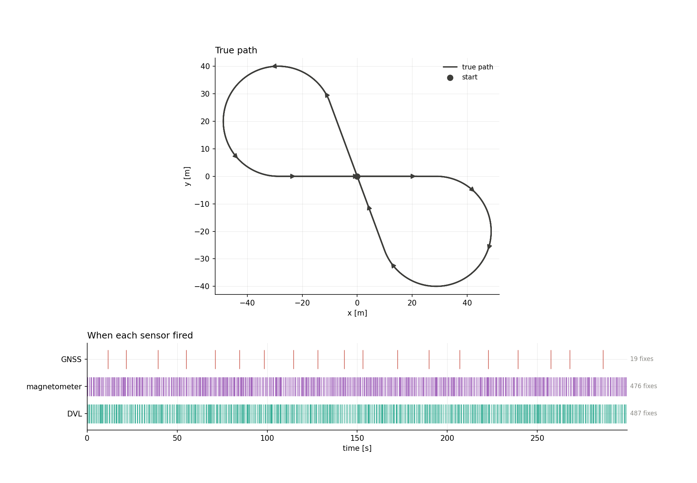

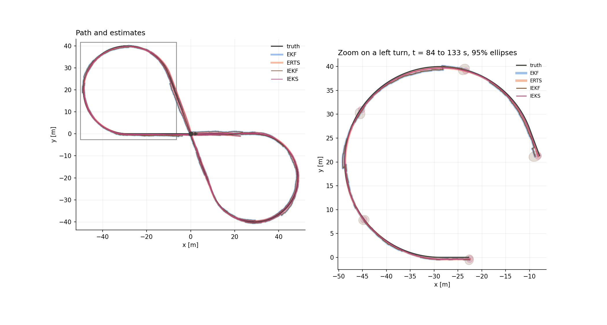


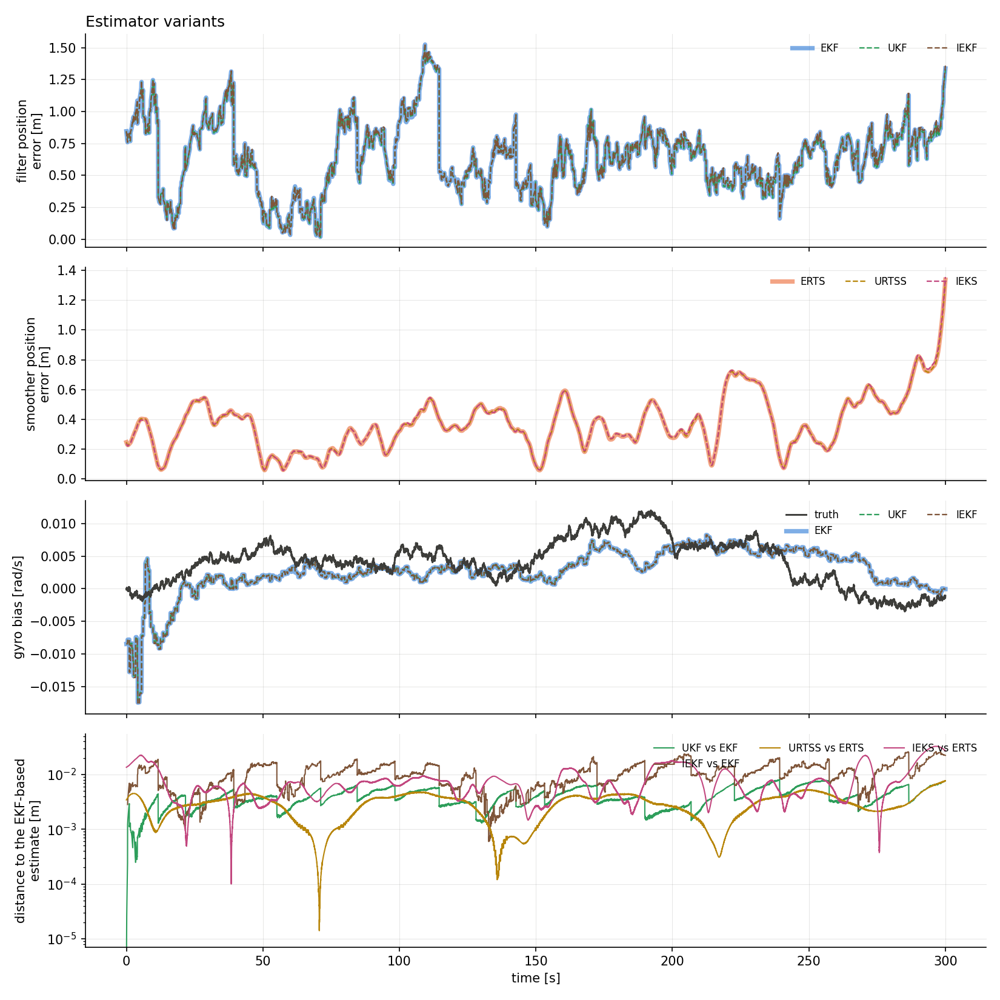

| statistic | EKF / ERTS | UKF / URTSS | IEKF / IEKS |
| --- | --- | --- | --- |
| ANIS GNSS | 2.2138 (consistent) | 2.2035 (consistent) | 2.2420 (consistent) |
| ANIS magnetometer | 0.9883 (consistent) | 0.9883 (consistent) | 0.9882 (consistent) |
| ANIS DVL | 2.0580 (consistent) | 2.0570 (consistent) | 2.0569 (consistent) |
| ANEES position filter | 2.4560 (consistent) | 2.4428 (consistent) | 2.4911 (consistent) |
| ANEES position smoother | 1.8354 (consistent) | 1.8328 (consistent) | 1.8501 (consistent) |

| estimator | RMSE position [m] | median [m] | 95th percentile [m] | max [m] | RMSE heading [°] |
| --- | --- | --- | --- | --- | --- |
| EKF | 0.694 | 0.641 | 1.095 | 1.525 | 1.68 |
| UKF | 0.692 | 0.640 | 1.093 | 1.524 | 1.68 |
| IEKF | 0.698 | 0.644 | 1.100 | 1.532 | 1.68 |
| ERTS | 0.412 | 0.356 | 0.706 | 1.338 | 1.23 |
| URTSS | 0.412 | 0.357 | 0.705 | 1.332 | 1.23 |
| IEKS | 0.415 | 0.357 | 0.713 | 1.356 | 1.22 |

| estimator | RMSE $b_{a,x}$ [m/s²] | RMSE $b_{a,y}$ [m/s²] | RMSE $b_g$ [rad/s] | peak $\lvert b_g - \hat b_g \rvert$ [rad/s] |
| --- | --- | --- | --- | --- |
| EKF | 0.0386 | 0.0456 | 0.00389 | 0.0164 |
| UKF | 0.0385 | 0.0456 | 0.00389 | 0.0164 |
| IEKF | 0.0386 | 0.0456 | 0.00391 | 0.0166 |
| ERTS | 0.0201 | 0.0230 | 0.00213 | 0.0055 |
| URTSS | 0.0201 | 0.0230 | 0.00213 | 0.0055 |
| IEKS | 0.0201 | 0.0230 | 0.00213 | 0.0055 |

| distance | position median [mm] | position max [mm] | heading max [°] | position $\mathrm{tr}\,P$ ratio range |
| --- | --- | --- | --- | --- |
| UKF vs EKF | 3.7 | 8.2 | 0.006 | [1.0000, 1.0003] |
| IEKF vs EKF | 10.2 | 26.1 | 0.108 | [0.9929, 1.0073] |
| URTSS vs ERTS | 3.1 | 7.7 | 0.003 | [1.0001, 1.0008] |
| IEKS vs ERTS | 6.5 | 32.7 | 0.133 | [0.9947, 1.0062] |

### GNSS outage


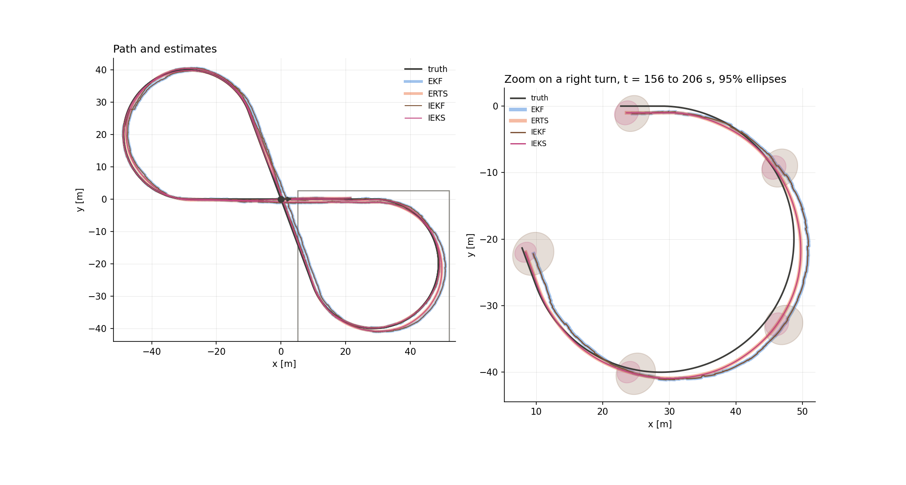


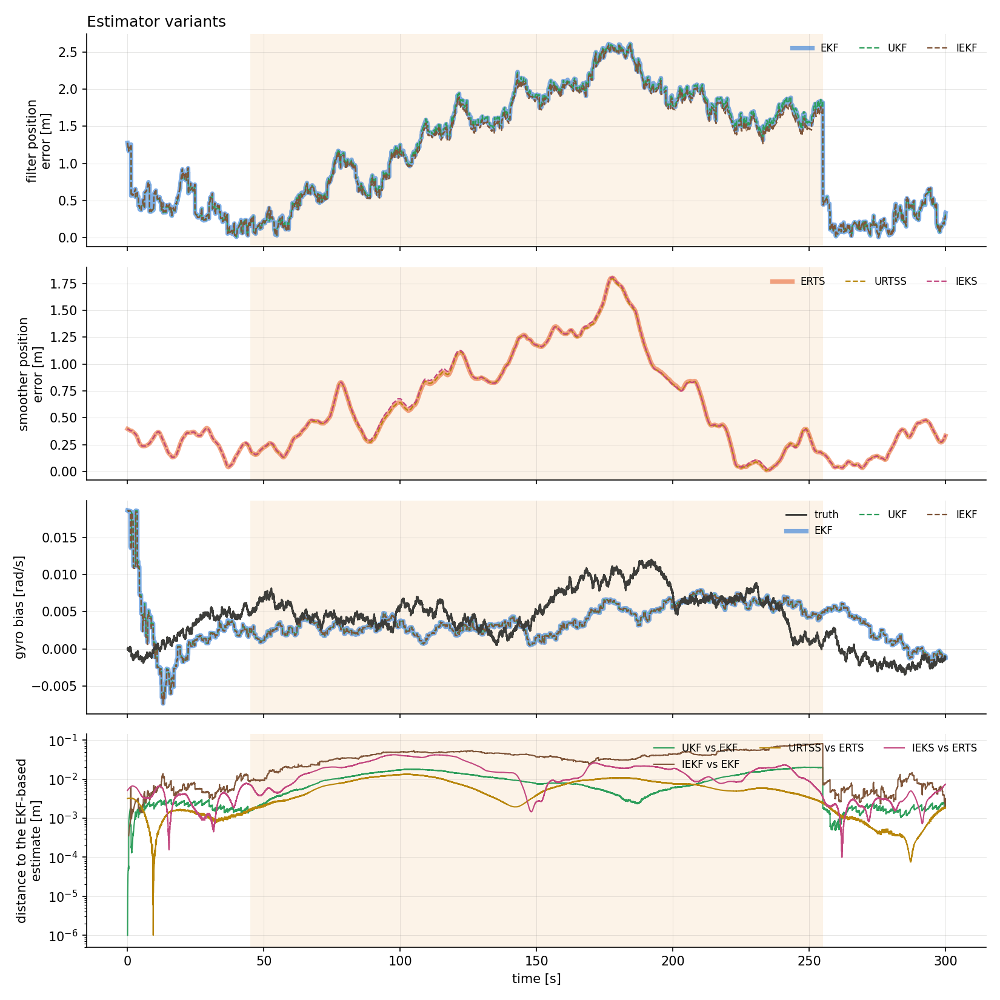

| statistic | EKF / ERTS | UKF / URTSS | IEKF / IEKS |
| --- | --- | --- | --- |
| ANIS GNSS | 1.8616 (consistent) | 1.8612 (consistent) | 1.8594 (consistent) |
| ANIS magnetometer | 0.9262 (consistent) | 0.9262 (consistent) | 0.9260 (consistent) |
| ANIS DVL | 2.1712 (consistent) | 2.1704 (consistent) | 2.1709 (consistent) |
| ANEES position filter | 2.3143 (consistent) | 2.3230 (consistent) | 2.2559 (consistent) |
| ANEES position smoother | 1.9839 (consistent) | 1.9750 (consistent) | 1.9914 (consistent) |

| estimator | RMSE position [m] | median [m] | 95th percentile [m] | max [m] | RMSE heading [°] |
| --- | --- | --- | --- | --- | --- |
| EKF | 1.383 | 1.205 | 2.365 | 2.616 | 1.78 |
| UKF | 1.388 | 1.210 | 2.366 | 2.618 | 1.78 |
| IEKF | 1.355 | 1.175 | 2.345 | 2.601 | 1.78 |
| ERTS | 0.737 | 0.425 | 1.431 | 1.804 | 1.21 |
| URTSS | 0.735 | 0.421 | 1.423 | 1.795 | 1.21 |
| IEKS | 0.741 | 0.428 | 1.442 | 1.810 | 1.21 |

| estimator | RMSE $b_{a,x}$ [m/s²] | RMSE $b_{a,y}$ [m/s²] | RMSE $b_g$ [rad/s] | peak $\lvert b_g - \hat b_g \rvert$ [rad/s] |
| --- | --- | --- | --- | --- |
| EKF | 0.0389 | 0.0434 | 0.00383 | 0.0197 |
| UKF | 0.0388 | 0.0434 | 0.00383 | 0.0197 |
| IEKF | 0.0389 | 0.0434 | 0.00383 | 0.0195 |
| ERTS | 0.0204 | 0.0206 | 0.00205 | 0.0054 |
| URTSS | 0.0204 | 0.0206 | 0.00205 | 0.0054 |
| IEKS | 0.0203 | 0.0206 | 0.00205 | 0.0054 |

| distance | position median [mm] | position max [mm] | heading max [°] | position $\mathrm{tr}\,P$ ratio range |
| --- | --- | --- | --- | --- |
| UKF vs EKF | 6.8 | 20.3 | 0.012 | [1.0000, 1.0005] |
| IEKF vs EKF | 33.9 | 81.2 | 0.210 | [0.9937, 1.0094] |
| URTSS vs ERTS | 4.9 | 13.3 | 0.003 | [1.0000, 1.0011] |
| IEKS vs ERTS | 10.3 | 42.2 | 0.102 | [0.9934, 1.0145] |

### Heading stress, four-corner test

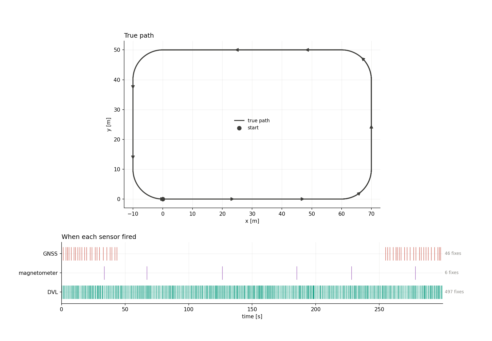

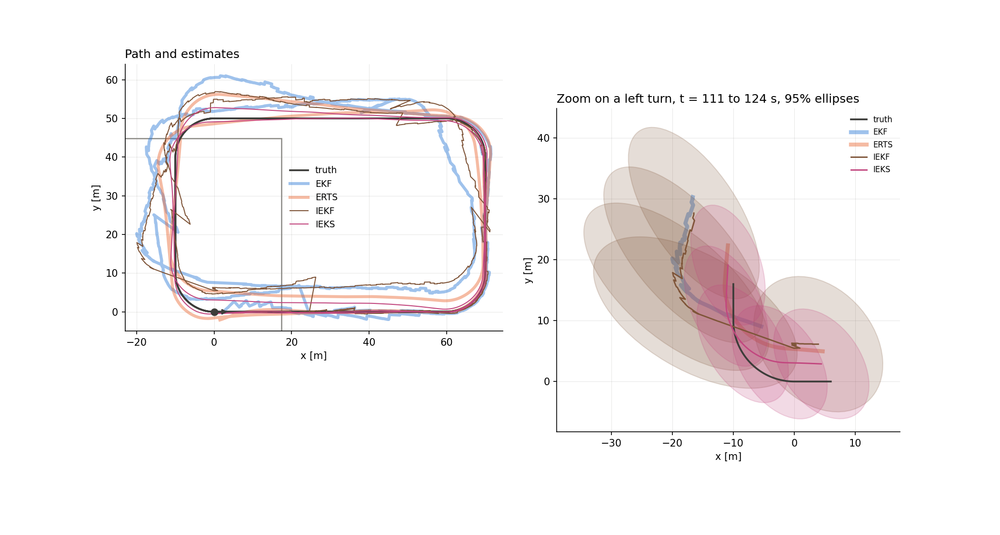

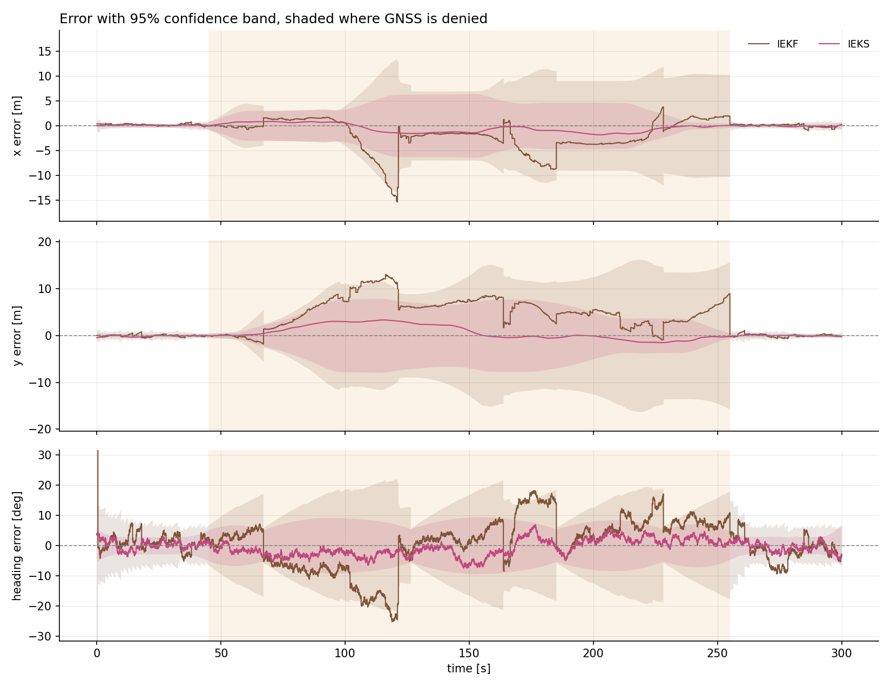

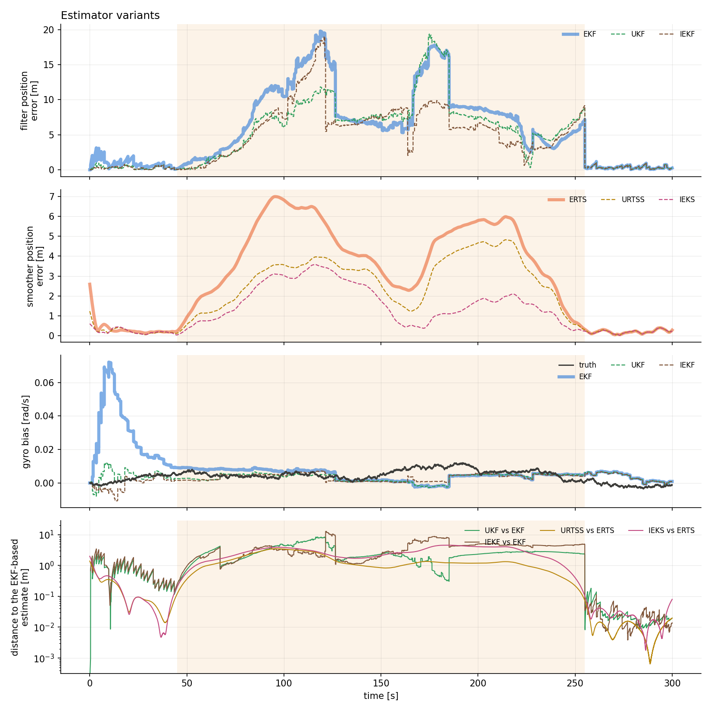

| statistic | EKF / ERTS | UKF / URTSS | IEKF / IEKS |
| --- | --- | --- | --- |
| ANIS GNSS | 4.7461 (overconfident) | 2.2008 (consistent) | 2.0938 (consistent) |
| ANIS magnetometer | 2.5189 (consistent) | 2.4315 (overconfident) | 1.8224 (consistent) |
| ANIS DVL | 2.4046 (overconfident) | 1.8406 (consistent) | 2.0791 (consistent) |
| ANEES position filter | 3.2084 (overconfident) | 1.5728 (consistent) | 1.3670 (consistent) |
| ANEES position smoother | 3.2130 (consistent) | 1.6063 (consistent) | 0.7922 (consistent) |

| estimator | RMSE position [m] | median [m] | 95th percentile [m] | max [m] | RMSE heading [°] |
| --- | --- | --- | --- | --- | --- |
| EKF | 7.874 | 5.327 | 16.668 | 19.781 | 12.43 |
| UKF | 6.743 | 5.375 | 15.151 | 19.357 | 9.77 |
| IEKF | 5.967 | 3.736 | 12.252 | 19.007 | 8.47 |
| ERTS | 3.770 | 2.876 | 6.488 | 6.996 | 5.04 |
| URTSS | 2.598 | 1.824 | 4.593 | 4.824 | 3.51 |
| IEKS | 1.629 | 0.999 | 3.232 | 3.581 | 2.63 |

| estimator | RMSE $b_{a,x}$ [m/s²] | RMSE $b_{a,y}$ [m/s²] | RMSE $b_g$ [rad/s] | peak $\lvert b_g - \hat b_g \rvert$ [rad/s] |
| --- | --- | --- | --- | --- |
| EKF | 0.0531 | 0.0450 | 0.01369 | 0.0723 |
| UKF | 0.0399 | 0.0453 | 0.00472 | 0.0132 |
| IEKF | 0.0395 | 0.0465 | 0.00425 | 0.0118 |
| ERTS | 0.0267 | 0.0243 | 0.00481 | 0.0185 |
| URTSS | 0.0214 | 0.0236 | 0.00268 | 0.0073 |
| IEKS | 0.0212 | 0.0221 | 0.00237 | 0.0060 |

| distance | position median [mm] | position max [mm] | heading max [°] | position $\mathrm{tr}\,P$ ratio range |
| --- | --- | --- | --- | --- |
| UKF vs EKF | 1880.3 | 8300.0 | 56.057 | [0.9853, 1.3604] |
| IEKF vs EKF | 2308.1 | 12650.4 | 47.958 | [0.5916, 1.4531] |
| URTSS vs ERTS | 952.0 | 3477.1 | 20.628 | [0.9837, 1.1006] |
| IEKS vs ERTS | 1829.9 | 4523.9 | 23.897 | [0.9730, 1.2694] |

### Heading stress, figure-eight

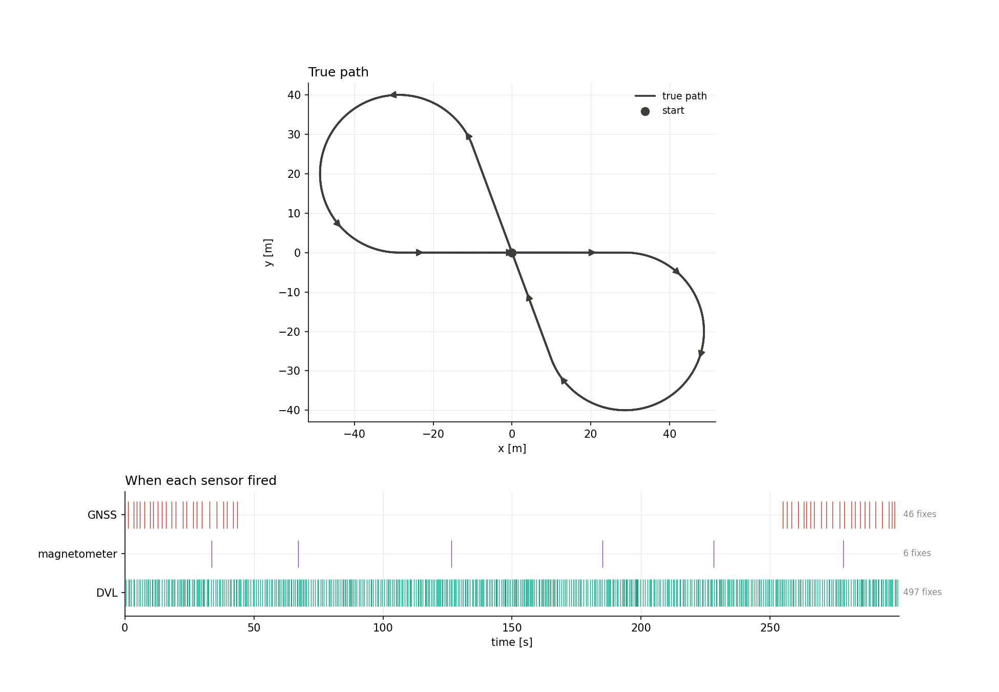

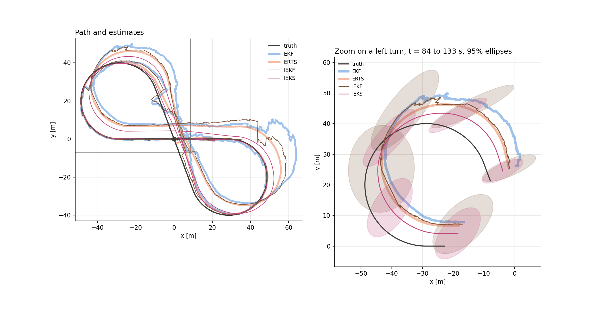

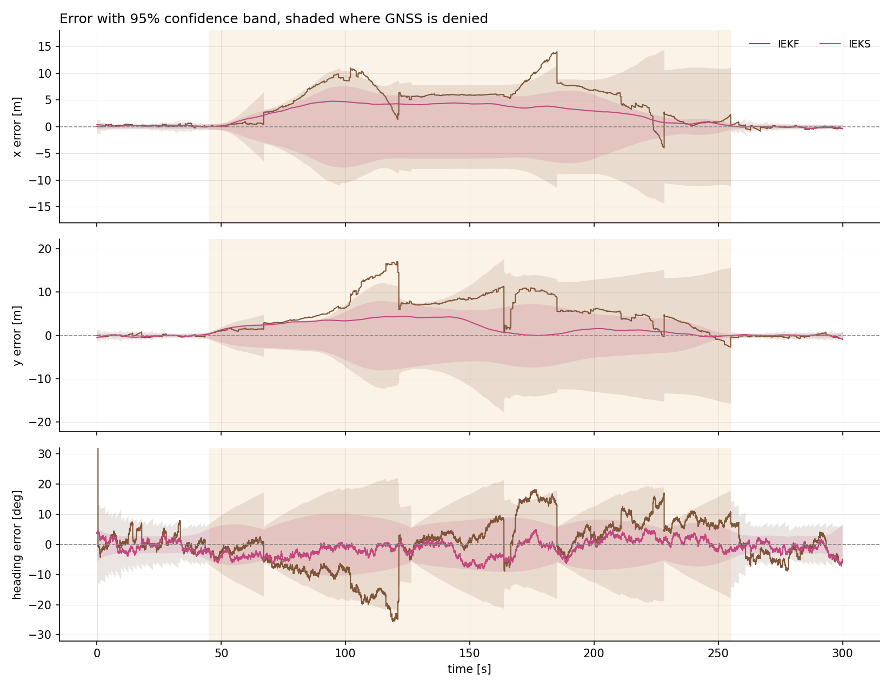

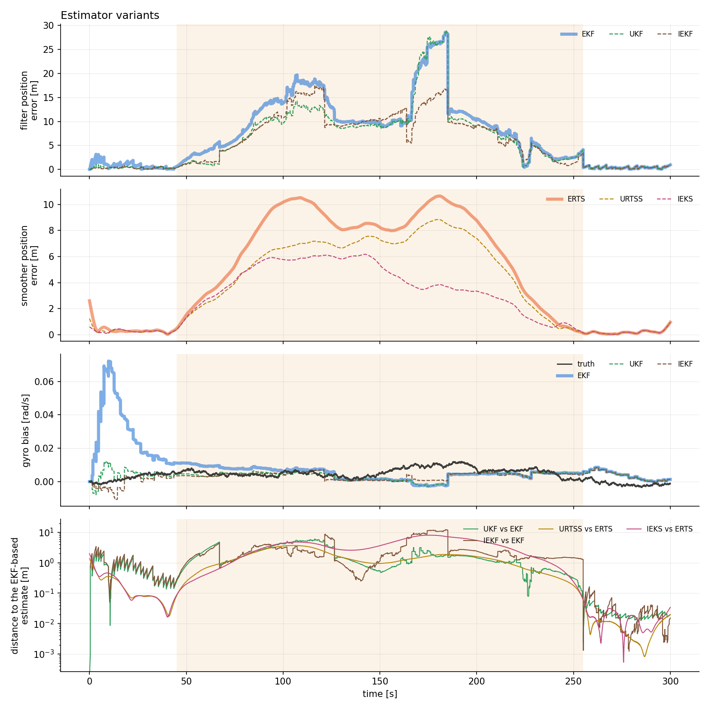

| statistic | EKF / ERTS | UKF / URTSS | IEKF / IEKS |
| --- | --- | --- | --- |
| ANIS GNSS | 4.7085 (overconfident) | 2.1356 (consistent) | 2.0467 (consistent) |
| ANIS magnetometer | 2.7979 (overconfident) | 2.9071 (overconfident) | 2.2131 (overconfident) |
| ANIS DVL | 2.4051 (overconfident) | 1.8499 (consistent) | 2.0800 (consistent) |
| ANEES position filter | 4.5829 (overconfident) | 2.3121 (consistent) | 2.4313 (consistent) |
| ANEES position smoother | 5.6699 (consistent) | 3.0930 (consistent) | 2.0692 (consistent) |

| estimator | RMSE position [m] | median [m] | 95th percentile [m] | max [m] | RMSE heading [°] |
| --- | --- | --- | --- | --- | --- |
| EKF | 10.042 | 5.569 | 21.150 | 28.643 | 12.70 |
| UKF | 8.904 | 4.738 | 22.206 | 28.855 | 9.97 |
| IEKF | 7.803 | 4.745 | 15.794 | 17.406 | 8.51 |
| ERTS | 6.260 | 4.473 | 10.382 | 10.646 | 5.22 |
| URTSS | 4.973 | 3.512 | 8.338 | 8.840 | 3.64 |
| IEKS | 3.497 | 2.778 | 6.044 | 6.171 | 2.86 |

| estimator | RMSE $b_{a,x}$ [m/s²] | RMSE $b_{a,y}$ [m/s²] | RMSE $b_g$ [rad/s] | peak $\lvert b_g - \hat b_g \rvert$ [rad/s] |
| --- | --- | --- | --- | --- |
| EKF | 0.0534 | 0.0441 | 0.01375 | 0.0723 |
| UKF | 0.0403 | 0.0444 | 0.00464 | 0.0133 |
| IEKF | 0.0399 | 0.0455 | 0.00416 | 0.0118 |
| ERTS | 0.0269 | 0.0236 | 0.00488 | 0.0187 |
| URTSS | 0.0218 | 0.0230 | 0.00270 | 0.0076 |
| IEKS | 0.0214 | 0.0211 | 0.00247 | 0.0060 |

| distance | position median [mm] | position max [mm] | heading max [°] | position $\mathrm{tr}\,P$ ratio range |
| --- | --- | --- | --- | --- |
| UKF vs EKF | 1013.9 | 6049.2 | 56.057 | [0.9999, 1.2815] |
| IEKF vs EKF | 1493.1 | 12236.7 | 47.958 | [0.6572, 1.4531] |
| URTSS vs ERTS | 951.9 | 3704.7 | 20.586 | [0.9827, 1.1551] |
| IEKS vs ERTS | 1611.3 | 8093.1 | 23.850 | [0.9718, 1.4583] |

## Discussion

**Fusion and outage runs**

- **No accuracy difference between the smoothers.** The position RMSE of the IEKS is 0.415 m in the fusion run and 0.741 m in the outage run, against 0.412 and 0.737 m for the ERTS and 0.412 and 0.735 m for the URTSS. The differences are 3 to 6 mm in RMSE, so no ranking is read from them. Heading RMSE and the bias estimates agree at the precision of the tables.
- **Everything is consistent.** Every ANIS and ANEES of the IEKF and the IEKS lies inside its band, and the smoother ANEES is 1.85 and 1.99 against 1.84 and 1.98 for the ERTS. The magnetometer ANIS of the outage run, 0.926, used to be the one failure before the white noise was simulated as intensity$/\Delta t$.
- **The IEKS moves away from the ERTS more than the URTSS does, but less than the IEKF moves from the EKF.** The median distance to the ERTS is 6.5 mm in the fusion run and 10.3 mm in the outage run (at most 32.7 and 42.2 mm), against 3.1 and 4.9 mm for the URTSS. The IEKF is 10.2 and 33.9 mm from the EKF in median. The reported position $\mathrm{tr}\,P$ stays within 0.6% (fusion) and 1.5% (outage) of the ERTS's.
- **Most of that distance comes from the IEKF the IEKS starts from, not from the smoother's own iteration.** The ERTS run over the IEKF's output, ERTS (IEKF) on the [IEKF page](../iekf/README.md), has a position RMSE of 0.414 m and 0.741 m on the two runs, against 0.415 m and 0.741 m for the IEKS. Computed from the two pages' CSV files, the IEKS is a median of 7.0 mm and 8.2 mm (at most 20.3 mm and 38.9 mm) away from it.
- **The reason is the setup.** The DVL is only mildly nonlinear while the heading is known to a degree or so, GNSS and the magnetometer are linear, and the motion model is smooth at this $\Delta t$, so the linearisations at the filtered states are already good.

**Heading-stress runs**

- **Here the IEKS is clearly the best smoother.** Position RMSE is 1.63 m on the four-corner test and 3.50 m on the figure-eight, against 2.60 and 4.97 m for the URTSS and 3.77 and 6.26 m for the ERTS. The largest error is 3.6 and 6.2 m against 4.8 and 8.8 m for the URTSS. The ERTS and the URTSS keep the linearisation points or sigma points of a filter that spent most of the run with a wrong heading, while the IEKS relinearises about its own trajectory, which has the GNSS on both sides of the outage.
- **The IEKF alone gains much less.** Its position RMSE is 5.97 and 7.80 m against 6.74 and 8.90 m for the UKF and 7.87 and 10.04 m for the EKF. Iterating one update cannot fix a heading that is wrong for tens of seconds between magnetometer fixes, iterating the whole trajectory can.
- **The IEKS is consistent where the other smoothers are not.** Over the 21-run Monte Carlo the IEKS position ANEES is 2.04 and 1.88, consistent, while the ERTS (7.1 and 6.7), the URTSS (2.7 and 2.6) and the IEKF (5.5 on both) are overconfident. Its mean RMSE over the runs, 2.83 and 2.95 m, is also the lowest, against 3.31 and 3.46 m for the URTSS. The IEKF's mean RMSE, 10.2 and 10.4 m, is the worst of the filters over the runs although it is the best for seed 42, so a few runs where the iteration settles on a wrong heading carry its average.
- **The smoother's covariance is below the filter's except at the very end.** On the four-corner run the IEKS position $\mathrm{tr}\,P$ is above the IEKF's at the last step only, by 0.0002%. Both are evaluated at different linearisation points, the IEKF's at its filtered states and the IEKS's at its final trajectory, so at the last step, where a smoother equals its filter, they do not coincide exactly.

**Not covered.** The number of iterations, how often a step was rejected and the cost of the final trajectory were not logged, so the page shows what the iteration changed and not how much work it did. The IEKS starts from the IEKF, so a different starting trajectory is not compared. One seed per case on this page, so differences of millimetres between the smoothers in the fusion and outage runs could reverse with another seed.

## Related results

- [IEKF](../iekf/README.md) is the filter this smoother runs over, with the same two runs.
- [UKF and URTSS](../ukf/README.md) asks the same question of the unscented filter and smoother, including a heading-stress run.
- [3-D strapdown INS, IEKS](../../INS3D/base_case/iterated/README.md) is the same smoother with a quaternion attitude.
