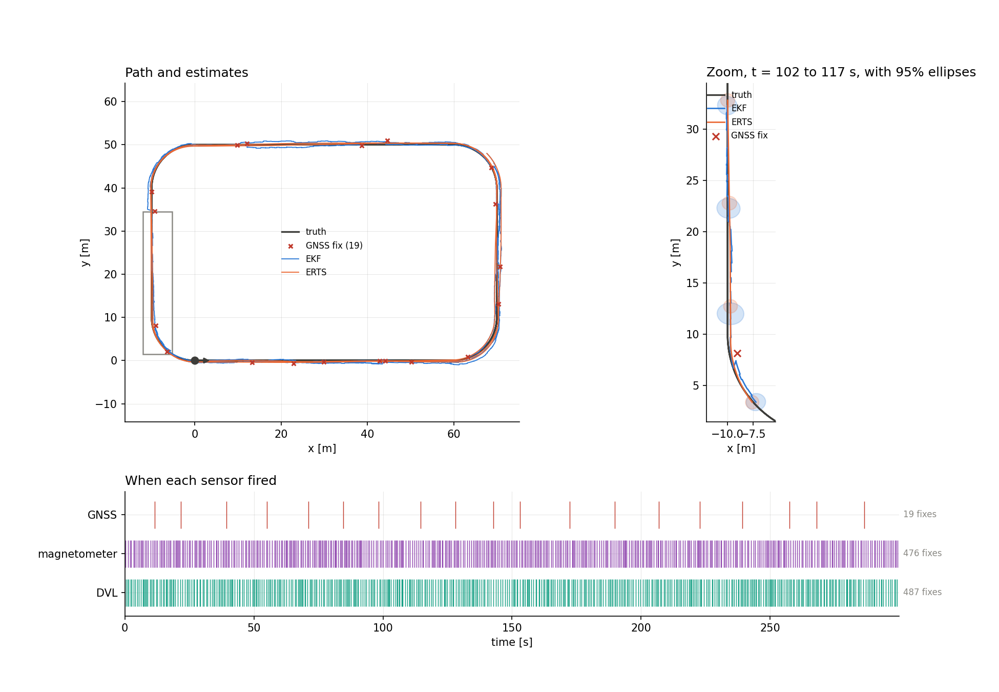
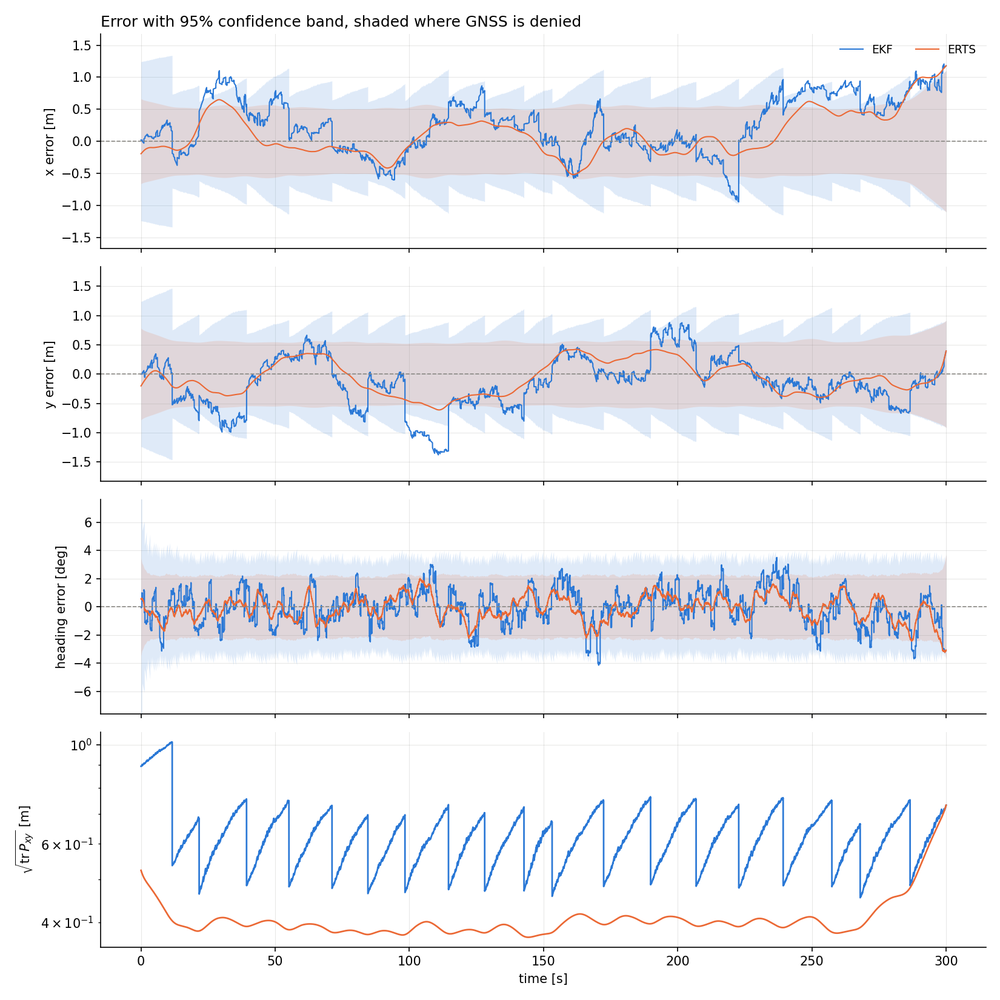
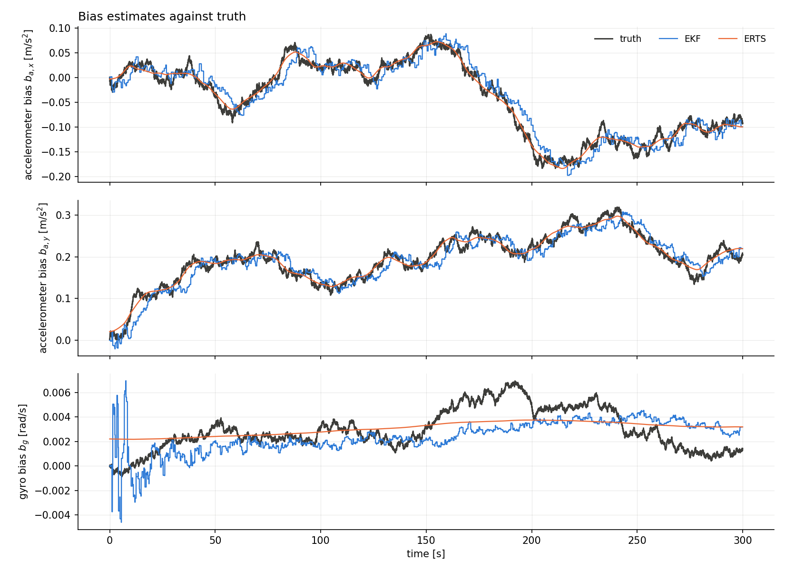
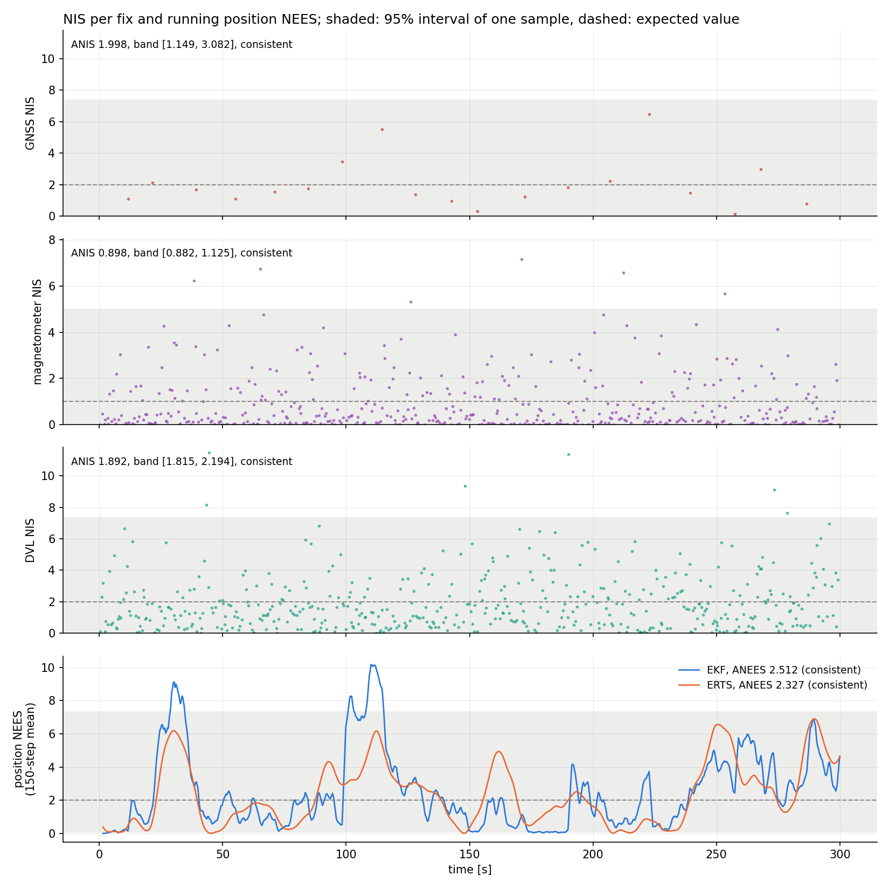
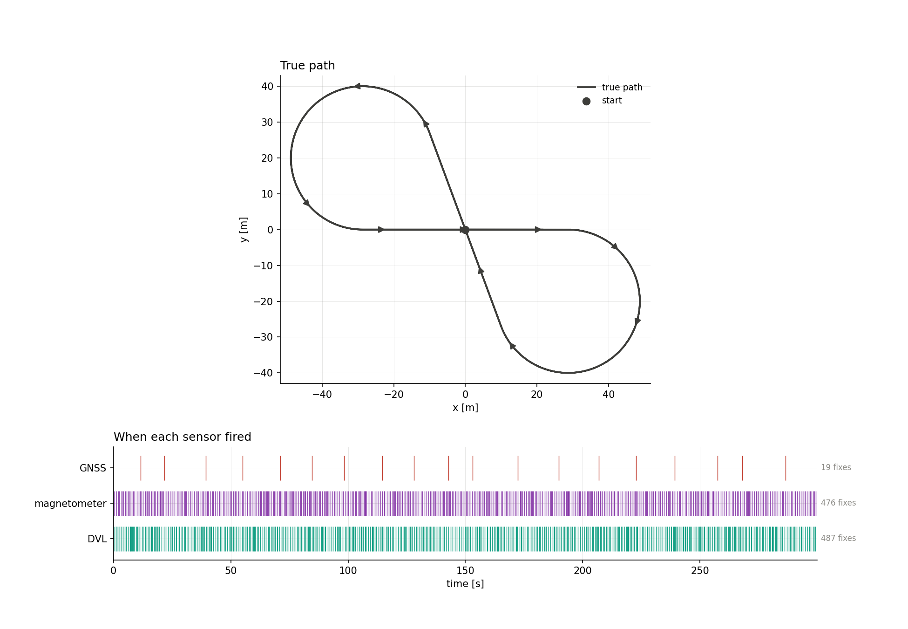
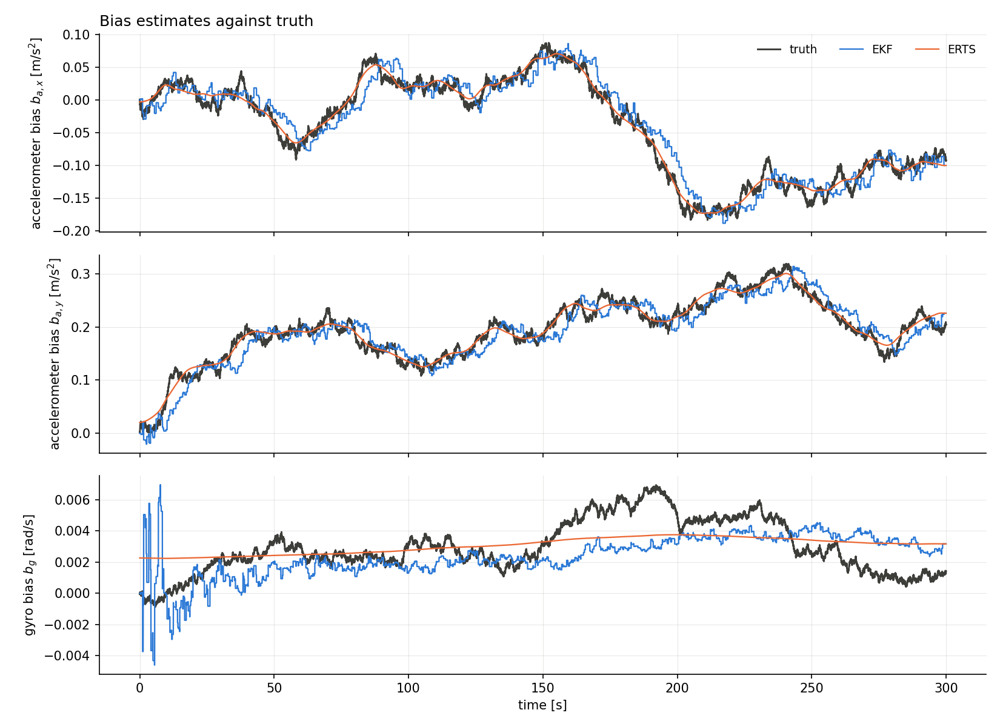
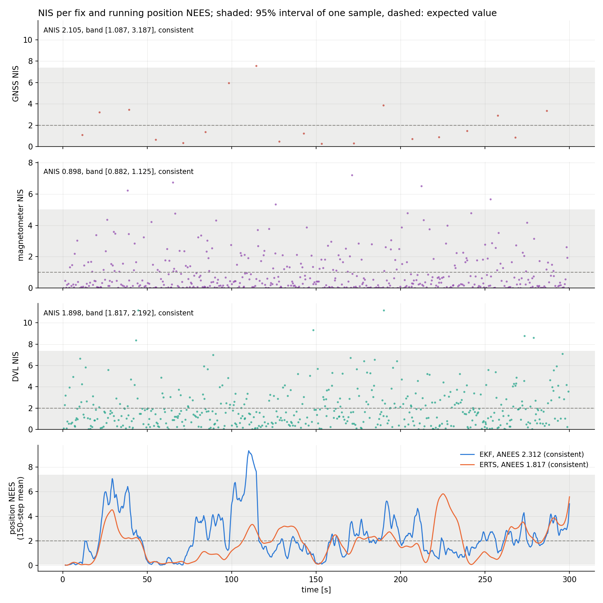

# 2-D strapdown INS, multi-sensor fusion

[Back to the overview](../../../README.md) | [Previous: GNSS only](../only_gnss/README.md) | [Next: dead reckoning](../dead_reckoning/README.md)

A real vehicle rarely has one sensor. This scenario fuses three with very different information: sparse GNSS position fixes, a magnetometer that reports heading, and a Doppler velocity log (DVL) that reports the velocity in the body frame, the one nonlinear sensor. Magnetometer and DVL fire several times a second but say nothing about position; GNSS fires only every 10 to 20 s.

|               |                                  |
| ------------- | -------------------------------- |
| **Status**    | done, every consistency check passes on both trajectories |
| **Run**       | 30000 timesteps (300 s at $\Delta t = 0.01$ s), seed 42 |
| **Reproduce** | see [Reproduction](#reproduction) |

## Motivation

Heading and velocity are exactly the states that GNSS alone constrains weakly, and the sensors added here measure them directly. The questions are:

- Do the fixes of three sensors with different dimensions and rates fuse consistently when they are applied one after the other within a time step?
- How much accuracy do the frequent heading and velocity fixes carry between the rare position fixes?
- Does the nonlinear DVL measurement keep the EKF consistent?

Two paths are used, a four-corner test and a figure-eight.

## Problem formulation

### State and motion model

The state collects position, heading, velocity in the navigation frame and the two sensor biases,

$$
x = \begin{bmatrix} p^\top & \psi & v^\top & b_a^\top & b_g \end{bmatrix}^\top \in \mathbb{R}^{8},
\qquad p, v \in \mathbb{R}^2 .
$$

The IMU reading $u_k$ is corrected with the estimated biases, $\tilde a_k = a_k - b_{a,k}$ and
$\tilde\omega_k = \omega_k - b_{g,k}$, and integrated with the heading at the middle of the step,
$\psi_{k+\frac12} = \psi_k + \tfrac{\Delta t}{2}\tilde\omega_k$:

$$
\begin{aligned}
p_{k+1} &= p_k + \Delta t\, v_k + \tfrac{\Delta t^2}{2}\, R(\psi_{k+\frac12})\,\tilde a_k, \\
\psi_{k+1} &= \psi_k + \Delta t\, \tilde\omega_k, \\
v_{k+1} &= v_k + \Delta t\, R(\psi_{k+\frac12})\,\tilde a_k, \\
b_{a,k+1} &= e^{-\Delta t / T_a}\, b_{a,k}, \qquad b_{g,k+1} = e^{-\Delta t / T_g}\, b_{g,k}.
\end{aligned}
$$

Written as $x_k = f(x_{k-1}, u_k) + w_k$ with $w_k \sim \mathcal{N}(0, Q_k)$. The biases are first-order
Gauss-Markov processes with time constant $T$ and stationary variance $\sigma_b^2$, driven by white noise of
intensity $2\sigma_b^2 / T$. White accelerometer noise enters the velocity and white gyro noise the heading. With $G_k$ mapping the
six noise sources into the state and $D$ the diagonal matrix of their intensities, the process noise is the first-order approximation

$$
Q_k = G_k\, D\, G_k^\top\, \Delta t .
$$


| symbol | meaning |
| --- | --- |
| $x_k = \begin{bmatrix} p_k^\top & \psi_k & v_k^\top & b_{a,k}^\top & b_{g,k} \end{bmatrix}^\top$ | state: position, heading, navigation-frame velocity, accelerometer and gyro bias |
| $u_k = \begin{bmatrix} a_k^\top & \omega_k \end{bmatrix}^\top$ | IMU reading: body-frame specific force and yaw rate |
| $R(\psi)$ | rotation from the body to the navigation frame |
| $\bar x_k,\ \bar P_k$ | predicted mean and covariance |
| $\hat x_k,\ \hat P_k$ | updated (filtered) mean and covariance |
| $\hat x^s_k,\ P^s_k$ | smoothed mean and covariance |
| $\eta_k,\ S_k$ | innovation and innovation covariance |
| $W_k$ | Kalman gain |
| $\boxplus,\ \boxminus$ | addition and subtraction that wrap the heading to $(-\pi, \pi]$ |


| parameter | value |
| --- | --- |
| time step $\Delta t$, steps, duration | 0.01 s, 30000, 300 s |
| speed along the path | 2 m/s |
| accelerometer bias: variance $\sigma_{b_a}^2$, time constant $T_a$ | $5\cdot10^{-2}$ (m/s²)², 1000 s, both axes |
| gyro bias: variance $\sigma_{b_g}^2$, time constant $T_g$ | $5\cdot10^{-5}$ (rad/s)², 1000 s |
| white noise intensity, accelerometer / gyro | $5\cdot10^{-4}$ (m/s²)²·s / $5\cdot10^{-4}$ rad²/s |
| prior mean $\hat x_0$ | $[0,\ 0,\ 0,\ 2,\ 0,\ 0,\ 0,\ 0]^\top$ |
| prior covariance $\hat P_0$ | $\operatorname{diag}(0.4,\ 0.4,\ 0.04,\ 0.04,\ 0.04,\ 0.004,\ 0.004,\ 0.0004)$ |


The truth is simulated, not generated by $f$. A geometric path (below) gives position, heading and curvature at constant
speed; the velocity is the speed along the heading, the specific force is the centripetal acceleration rotated into the body frame, and
each IMU reading is that ideal value plus a simulated Gauss-Markov bias plus white noise. The filter is configured with the same noise
values the simulator uses. The configuration values match; the white-noise intensity is read as a continuous-time intensity by the filter
and drawn as a per-sample variance by the simulator, so the noise statistics differ by a factor $1/\Delta t$ in variance, and the truth starts
exactly at the prior mean. Both push the position covariance in the conservative direction. The study guide (chapter 12) documents them.

### Sensors

**GNSS** observes the position directly,

$$
z^{g}_k = H_g\, x_k + \varepsilon^{g}_k, \qquad H_g = \begin{bmatrix} I_2 & 0_{2\times 6} \end{bmatrix}, \qquad \varepsilon^{g}_k \sim \mathcal{N}(0,\ 0.2\, I_2)\ \mathrm{m^2}.
$$

**Magnetometer** observes the heading,

$$
z^{m}_k = \psi_k + \varepsilon^{m}_k, \qquad \varepsilon^{m}_k \sim \mathcal{N}(0,\ 3\cdot 10^{-3})\ \mathrm{rad^2},
$$

and its innovation is wrapped, $\eta^m_k = z^m_k \boxminus h^m(\bar x_k)$.

**DVL** observes the velocity in the body frame, which makes it the one nonlinear sensor,

$$
z^{d}_k = R(\psi_k)^\top v_k + \varepsilon^{d}_k, \qquad
H_d = \begin{bmatrix} 0_{2\times 2} & \dfrac{\partial R^\top}{\partial \psi}\, v & R(\psi)^\top & 0_{2\times 3} \end{bmatrix}, \qquad
\varepsilon^{d}_k \sim \mathcal{N}(0,\ 10^{-2}\, I_2)\ \mathrm{(m/s)^2}.
$$


Each sensor fires at random intervals drawn uniformly from a range: GNSS 10 to 20 s (19 fixes), magnetometer 0.25 to 1 s (476 fixes), DVL 0.2 to 1 s (487 fixes). When more than one is due in a step they are applied in the order GNSS, magnetometer, DVL.


### Trajectories

Both paths are traced at constant speed starting at the origin heading $+x$.

| trajectory | geometry | length per lap | laps in 300 s |
| --- | --- | --- | --- |
| four-corner test (`rounded_rectangle`) | $80 \times 50$ m rectangle with corner radius 10 m, counterclockwise: left turns only | 242.8 m | 2.5 |
| figure-eight (`figure_eight`) | two circles of radius 20 m with centres 70 m apart, joined by two straights that cross at the origin: one right and one left turn per lap | 289.2 m | 2.1 |

### Estimators

When several sensors fire in the same step they update in turn, each starting from the result of the previous one.

**Extended Kalman filter.** Prediction and update with sensor model $h$, Jacobians $F$ and $H$, and measurement noise $R$:

$$
\bar x_k = f(\hat x_{k-1}, u_k), \qquad \bar P_k = F_k \hat P_{k-1} F_k^\top + Q_k,
$$

$$
\eta_k = z_k \boxminus h(\bar x_k), \qquad S_k = H_k \bar P_k H_k^\top + R, \qquad W_k = \bar P_k H_k^\top S_k^{-1},
$$

$$
\hat x_k = \bar x_k \boxplus W_k \eta_k, \qquad
\hat P_k = (I - W_k H_k)\, \bar P_k\, (I - W_k H_k)^\top + W_k R\, W_k^\top .
$$

The covariance update is written in Joseph form, which keeps $\hat P_k$ positive semidefinite.

**Extended Rauch-Tung-Striebel smoother (ERTS).** Run backward over the stored filter output, starting from
$\hat x^s_N = \hat x_N$, with $F_k$ evaluated at the filtered state:

$$
G_k = \hat P_k F_k^\top \bar P_{k+1}^{-1}, \qquad
\hat x^s_k = \hat x_k \boxplus G_k\,(\hat x^s_{k+1} \boxminus \bar x_{k+1}), \qquad
P^s_k = \hat P_k + G_k\,(P^s_{k+1} - \bar P_{k+1})\,G_k^\top .
$$

### Consistency

A filter is consistent if the errors it makes agree with the covariance it reports. Two statistics test this, with the truth $x_k$ known from the simulation.

$$
\mathrm{NIS}_k = \eta_k^\top S_k^{-1} \eta_k \sim \chi^2_{m}, \qquad
\mathrm{NEES}_k = (p_k - \hat p_k)^\top \big(\hat P^{pp}_k\big)^{-1} (p_k - \hat p_k) \sim \chi^2_{2},
$$

where $m$ is the measurement dimension (2 for GNSS and DVL, 1 for the magnetometer) and $\hat P^{pp}_k$ is the position block of the covariance.
The NIS is evaluated at every fix of a sensor. The NEES is evaluated for the position at every step, for the filter and for the smoother.
The time average $\bar\epsilon = \frac{1}{N}\sum_k \epsilon_k$ of either statistic with $d$ degrees of freedom is held against the interval

$$
\left[\ \frac{\chi^2_{\alpha/2}(N_{\mathrm{eff}}\, d)}{N_{\mathrm{eff}}},\ \ \frac{\chi^2_{1-\alpha/2}(N_{\mathrm{eff}}\, d)}{N_{\mathrm{eff}}}\ \right], \qquad
N_{\mathrm{eff}} = \max\!\Big(1,\ N\,\frac{1-\rho}{1+\rho}\Big), \qquad \alpha = 0.05,
$$

where $\rho$ is the lag-one autocorrelation of the series. A statistic is "consistent" if its time average lies inside the interval. A value below the interval
means the filter reports more uncertainty than its errors need (conservative), above means less (overconfident).
The position NEES is strongly autocorrelated, so $N_{\mathrm{eff}}$ is small and the interval wide; for the smoother it is so wide that it excludes almost nothing. The
share of steps with the true position inside the reported 95% ellipse is a second check that does not depend on it.
All numbers are from one run with seed 42, so they carry no error bars.

## Reproduction

Build once, then simulate and analyse each case:

```bash
cmake -S . -B build && cmake --build build
./build/kalman_filtering_and_smoothing results/INS2D/multi_sensor_fusion/rounded_rectangle
python3 scripts/analyze_ins_2d.py results/INS2D/multi_sensor_fusion/rounded_rectangle/data
./build/kalman_filtering_and_smoothing results/INS2D/multi_sensor_fusion/figure_eight
python3 scripts/analyze_ins_2d.py results/INS2D/multi_sensor_fusion/figure_eight/data
```

The executable reads `<case>/config.yaml` and writes `<case>/data`. Given a folder that holds several cases, it runs all of them, so
`./build/kalman_filtering_and_smoothing results/INS2D/multi_sensor_fusion` simulates every case of this page in one command. The analysis reads `<case>/data`
and writes `<case>/stats.txt`, which holds every number quoted below, and the figures in `<case>/figures`.

`data/` holds one CSV file per quantity with one row per timestep and a shared `timestep` column. `truth.csv` has the true state `x_true_0 ... x_true_7`;
`filter.csv` and `smoother.csv` have the predicted and updated (or smoothed) mean and the full covariance; `*_fixes.csv` has, for each fix of one sensor, the raw measurement,
the innovation and $S$, which is what the NIS is computed from.

## Results

### Four-corner test

Top left: the path with every GNSS fix and the EKF and ERTS estimates. Top right: a 15 s zoom on the largest filter error, with 95% position ellipses. Bottom: when each sensor fired.



Error against truth with each estimator's own 95% band, and the position spread $\sqrt{\operatorname{tr}P_{xy}}$ the estimator reports. The background is shaded where GNSS is denied.



True and estimated sensor biases.



NIS of every fix against its 95% interval, and the running mean of the position NEES.



| statistic | value | 95% band | verdict |
| --- | --- | --- | --- |
| ANIS GNSS | 1.9977 | [1.1494, 3.0823] | consistent |
| ANIS magnetometer | 0.8981 | [0.8823, 1.1250] | consistent |
| ANIS DVL | 1.8918 | [1.8152, 2.1936] | consistent |
| ANEES position filter (EKF) | 2.5121 | [0.9895, 3.3601] | consistent |
| ANEES position smoother (ERTS) | 2.3270 | [0.0506, 7.3778] | consistent |

| estimator | RMSE position [m] | median [m] | 95th percentile [m] | max [m] | RMSE heading [°] |
| --- | --- | --- | --- | --- | --- |
| EKF | 0.678 | 0.599 | 1.163 | 1.416 | 1.27 |
| ERTS | 0.458 | 0.385 | 0.757 | 1.243 | 0.87 |

| estimator | RMSE $b_{a,x}$ [m/s²] | RMSE $b_{a,y}$ [m/s²] | RMSE $b_g$ [rad/s] | peak $\lvert b_g - \hat b_g \rvert$ [rad/s] |
| --- | --- | --- | --- | --- |
| EKF | 0.0214 | 0.0233 | 0.00177 | 0.0074 |
| ERTS | 0.0103 | 0.0116 | 0.00138 | 0.0032 |

The true position lies inside the filter's reported 95% ellipse on 89.7% of the steps and inside the smoother's on 94.0%.

### Figure-eight

Top left: the path with every GNSS fix and the EKF and ERTS estimates. Top right: a 15 s zoom on the largest filter error, with 95% position ellipses. Bottom: when each sensor fired.



Error against truth with each estimator's own 95% band, and the position spread $\sqrt{\operatorname{tr}P_{xy}}$ the estimator reports. The background is shaded where GNSS is denied.


True and estimated sensor biases.



NIS of every fix against its 95% interval, and the running mean of the position NEES.



| statistic | value | 95% band | verdict |
| --- | --- | --- | --- |
| ANIS GNSS | 2.1052 | [1.0870, 3.1867] | consistent |
| ANIS magnetometer | 0.8980 | [0.8823, 1.1250] | consistent |
| ANIS DVL | 1.8979 | [1.8170, 2.1917] | consistent |
| ANEES position filter (EKF) | 2.3119 | [1.1053, 3.1556] | consistent |
| ANEES position smoother (ERTS) | 1.8170 | [0.0506, 7.3778] | consistent |

| estimator | RMSE position [m] | median [m] | 95th percentile [m] | max [m] | RMSE heading [°] |
| --- | --- | --- | --- | --- | --- |
| EKF | 0.655 | 0.589 | 1.038 | 1.450 | 1.29 |
| ERTS | 0.403 | 0.373 | 0.679 | 1.282 | 0.88 |

| estimator | RMSE $b_{a,x}$ [m/s²] | RMSE $b_{a,y}$ [m/s²] | RMSE $b_g$ [rad/s] | peak $\lvert b_g - \hat b_g \rvert$ [rad/s] |
| --- | --- | --- | --- | --- |
| EKF | 0.0213 | 0.0236 | 0.00177 | 0.0074 |
| ERTS | 0.0104 | 0.0120 | 0.00139 | 0.0032 |

The true position lies inside the filter's reported 95% ellipse on 95.6% of the steps and inside the smoother's on 99.9%.

## Discussion

- **All three sensors are consistent on both paths.** Every ANIS and the position ANEES of the filter lie inside their bands. The magnetometer ANIS, 0.898 and 0.898, sits close to the lower edge of its band, 0.882: the innovation covariance is slightly larger than the heading innovations need.
- **Position error stays close to that of a single GNSS fix without frequent GNSS.** A single fix has a two-dimensional RMS error of $\sqrt{2 \cdot 0.2} = 0.63$ m; the filter's position RMSE is 0.68 m and 0.66 m with 19 position fixes in 300 s. The reported spread $\sqrt{\operatorname{tr}P_{xy}}$ grows between fixes and drops at each one, ranging from 0.45 to 1.01 m on the four-corner test.
- **Heading is measured well.** The heading RMSE is 1.27° (four-corner) and 1.29° (figure-eight) for the filter, below the 3.1° standard deviation of a single magnetometer reading, because the filter combines the readings with the gyro.
- **The smoother helps moderately.** Position RMSE falls from 0.68 to 0.46 m and from 0.66 to 0.40 m, reductions of 32% and 39%. Between the rare position fixes the backward pass only has heading and velocity information to carry.
- **Coverage is nominal on the figure-eight and low on the four-corner test.** The true position is inside the filter's 95% ellipse on 95.6% of the steps on the figure-eight but on 89.7% on the four-corner test, which is mildly overconfident even though its time-averaged NEES (2.51) is inside the band.
- **Biases.** Accelerometer biases are recovered to about 0.021 m/s² for the filter and half of that for the smoother. The gyro bias RMSE is 0.0018 rad/s for the filter and 0.0014 for the smoother.
- **Limits.** One seed per path; the configured-but-not-statistically-matched noise model described above; no deliberate model mismatch.

## Related results

- [GNSS only](../only_gnss/README.md) has dense GNSS and no other sensor: filter position RMSE 0.70 m and 0.69 m, smoother 0.21 m and 0.21 m, and a heading RMSE of several degrees.
- [Dead reckoning](../dead_reckoning/README.md) removes GNSS from this sensor set.
- [GNSS outage](../gnss_outage/README.md) uses this sensor set with a dense GNSS that is switched off for the middle of the run.
- [UKF](../ukf/README.md) and [IEKF](../iekf/README.md) run other estimators on this data and on the outage data.
