# 2-D strapdown INS aided by GNSS only

[Back to the overview](../../../README.md) | [Previous: 2-D random walk](../../2D/README.md) | [Next: multi-sensor fusion](../multi_sensor_fusion/README.md)

A strapdown inertial navigation system integrates accelerometer and gyro readings into velocity, heading and position. The readings carry slowly varying biases, so the integral drifts. Here the only correction is a position fix from GNSS every one to three seconds. Heading, velocity and both biases are never measured, so the filter can only learn them from how the position moves between fixes. This is the best aiding there is for position and the hardest test of the states that are not observed directly.

|               |                                  |
| ------------- | -------------------------------- |
| **Status**    | done, position consistent on both trajectories |
| **Run**       | 30000 timesteps (300 s at $\Delta t = 0.01$ s), seed 42 |
| **Reproduce** | see [Reproduction](#reproduction) |

## Motivation

The scenario answers three questions about the extended Kalman filter (EKF) and its smoother (ERTS) on a nonlinear 8-state inertial model:

- Is the position estimate consistent, that is, does the reported covariance match the actual error?
- How much does the backward pass improve on the filter when every point has fixes on both sides?
- How well are the states without a sensor, the heading and the two biases, recovered?

Everything is run on two paths, a four-corner test that only turns left and a figure-eight that turns both ways, so that the answers do not depend on one manoeuvre.

## Problem formulation

### State and motion model

The state collects position, heading, velocity in the navigation frame and the two sensor biases,

$$
x = \begin{bmatrix} p^\top & \psi & v^\top & b_a^\top & b_g \end{bmatrix}^\top \in \mathbb{R}^{8},
\qquad p, v \in \mathbb{R}^2 .
$$

The IMU reading $u_k$ is corrected with the estimated biases, $\tilde a_k = a_k - b_{a,k}$ and
$\tilde\omega_k = \omega_k - b_{g,k}$, and integrated with the heading at the middle of the step,
$\psi_{k+\frac12} = \psi_k + \tfrac{\Delta t}{2}\tilde\omega_k$:

$$
\begin{aligned}
p_{k+1} &= p_k + \Delta t\, v_k + \tfrac{\Delta t^2}{2}\, R(\psi_{k+\frac12})\,\tilde a_k, \\
\psi_{k+1} &= \psi_k + \Delta t\, \tilde\omega_k, \\
v_{k+1} &= v_k + \Delta t\, R(\psi_{k+\frac12})\,\tilde a_k, \\
b_{a,k+1} &= e^{-\Delta t / T_a}\, b_{a,k}, \qquad b_{g,k+1} = e^{-\Delta t / T_g}\, b_{g,k}.
\end{aligned}
$$

Written as $x_k = f(x_{k-1}, u_k) + w_k$ with $w_k \sim \mathcal{N}(0, Q_k)$. The biases are first-order
Gauss-Markov processes with time constant $T$ and stationary variance $\sigma_b^2$, driven by white noise of
intensity $2\sigma_b^2 / T$. White accelerometer noise enters the velocity and white gyro noise the heading. With $G_k$ mapping the
six noise sources into the state and $D$ the diagonal matrix of their intensities, the process noise is the first-order approximation

$$
Q_k = G_k\, D\, G_k^\top\, \Delta t .
$$


| symbol | meaning |
| --- | --- |
| $x_k$ | state: position $p_k$, heading $\psi_k$, navigation-frame velocity $v_k$, accelerometer bias $b_{a,k}$ and gyro bias $b_{g,k}$ |
| $u_k$ | IMU reading $(a_k, \omega_k)$: body-frame specific force and yaw rate |
| $R(\psi)$ | rotation from the body to the navigation frame |
| $\bar x_k,\ \bar P_k$ | predicted mean and covariance |
| $\hat x_k,\ \hat P_k$ | updated (filtered) mean and covariance |
| $\hat x^s_k,\ P^s_k$ | smoothed mean and covariance |
| $\eta_k,\ S_k$ | innovation and innovation covariance |
| $W_k$ | Kalman gain |
| $\boxplus,\ \boxminus$ | addition and subtraction that wrap the heading to $(-\pi, \pi]$ |


| parameter | value |
| --- | --- |
| time step $\Delta t$, steps, duration | 0.01 s, 30000, 300 s |
| speed along the path | 2 m/s |
| accelerometer bias: variance $\sigma_{b_a}^2$, time constant $T_a$ | $5\cdot10^{-2}$ (m/s²)², 1000 s, both axes |
| gyro bias: variance $\sigma_{b_g}^2$, time constant $T_g$ | $5\cdot10^{-5}$ (rad/s)², 1000 s |
| white noise intensity, accelerometer / gyro | $5\cdot10^{-4}$ (m/s²)²·s / $5\cdot10^{-4}$ rad²/s |
| prior mean $\hat x_0$ | $[0,\ 0,\ 0,\ 2,\ 0,\ 0,\ 0,\ 0]^\top$ |
| prior covariance $\hat P_0$ | $\mathrm{diag}(0.4,\ 0.4,\ 0.04,\ 0.04,\ 0.04,\ 0.004,\ 0.004,\ 0.0004)$ |


The truth is simulated, not generated by $f$. A geometric path (below) gives position, heading and curvature at constant
speed; the velocity is the speed along the heading, the specific force is the centripetal acceleration rotated into the body frame, and
each IMU reading is that ideal value plus a simulated Gauss-Markov bias plus white noise. The filter is configured with the same noise
values the simulator uses. The configuration values match; the white-noise intensity is read as a continuous-time intensity by the filter
and drawn as a per-sample variance by the simulator, so the noise statistics differ by a factor $1/\Delta t$ in variance, and the truth starts
exactly at the prior mean. Both push the position covariance in the conservative direction. The study guide (chapter 12) documents them.

### Sensors

**GNSS** observes the position directly,

$$
z^{g}_k = H_g\, x_k + \varepsilon^{g}_k, \qquad H_g = \begin{bmatrix} I_2 & 0_{2\times 6} \end{bmatrix}, \qquad \varepsilon^{g}_k \sim \mathcal{N}(0,\ 0.2\, I_2)\ \mathrm{m^2}.
$$


GNSS fires at random intervals drawn uniformly from 1 to 3 s, 149 fixes per run. The magnetometer and the DVL are not used.


### Trajectories

Both paths are traced at constant speed starting at the origin heading $+x$.

| trajectory | geometry | length per lap | laps in 300 s |
| --- | --- | --- | --- |
| four-corner test (`rounded_rectangle`) | $80 \times 50$ m rectangle with corner radius 10 m, counterclockwise: left turns only | 242.8 m | 2.5 |
| figure-eight (`figure_eight`) | two circles of radius 20 m with centres 70 m apart, joined by two straights that cross at the origin: one right and one left turn per lap | 289.2 m | 2.1 |

### Estimators

When several sensors fire in the same step they update in turn, each starting from the result of the previous one.

**Extended Kalman filter.** Prediction and update with sensor model $h$, Jacobians $F$ and $H$, and measurement noise $R$:

$$
\bar x_k = f(\hat x_{k-1}, u_k), \qquad \bar P_k = F_k \hat P_{k-1} F_k^\top + Q_k,
$$

$$
\eta_k = z_k \boxminus h(\bar x_k), \qquad S_k = H_k \bar P_k H_k^\top + R, \qquad W_k = \bar P_k H_k^\top S_k^{-1},
$$

$$
\hat x_k = \bar x_k \boxplus W_k \eta_k, \qquad
\hat P_k = (I - W_k H_k)\, \bar P_k\, (I - W_k H_k)^\top + W_k R\, W_k^\top .
$$

The covariance update is written in Joseph form, which keeps $\hat P_k$ positive semidefinite.

**Extended Rauch-Tung-Striebel smoother (ERTS).** Run backward over the stored filter output, starting from
$\hat x^s_N = \hat x_N$, with $F_k$ evaluated at the filtered state:

$$
G_k = \hat P_k F_k^\top \bar P_{k+1}^{-1}, \qquad
\hat x^s_k = \hat x_k \boxplus G_k\,(\hat x^s_{k+1} \boxminus \bar x_{k+1}), \qquad
P^s_k = \hat P_k + G_k\,(P^s_{k+1} - \bar P_{k+1})\,G_k^\top .
$$

### Consistency

A filter is consistent if the errors it makes agree with the covariance it reports. Two statistics test this, with the truth $x_k$ known from the simulation.

$$
\mathrm{NIS}_k = \eta_k^\top S_k^{-1} \eta_k \sim \chi^2_{m}, \qquad
\mathrm{NEES}_k = (p_k - \hat p_k)^\top \big(\hat P^{pp}_k\big)^{-1} (p_k - \hat p_k) \sim \chi^2_{2},
$$

where $m$ is the measurement dimension (2 for GNSS and DVL, 1 for the magnetometer) and $\hat P^{pp}_k$ is the position block of the covariance.
The NIS is evaluated at every fix of a sensor. The NEES is evaluated for the position at every step, for the filter and for the smoother.
The time average $\bar\epsilon = \frac{1}{N}\sum_k \epsilon_k$ of either statistic with $d$ degrees of freedom is held against the interval

$$
\left[\ \frac{\chi^2_{\alpha/2}(N_{\mathrm{eff}}\, d)}{N_{\mathrm{eff}}},\ \ \frac{\chi^2_{1-\alpha/2}(N_{\mathrm{eff}}\, d)}{N_{\mathrm{eff}}}\ \right], \qquad
N_{\mathrm{eff}} = \max\!\Big(1,\ N\,\frac{1-\rho}{1+\rho}\Big), \qquad \alpha = 0.05,
$$

where $\rho$ is the lag-one autocorrelation of the series. A statistic is "consistent" if its time average lies inside the interval. A value below the interval
means the errors are smaller than the reported covariance says, the estimator is underconfident (conservative). A value above means the errors are larger than it says, the estimator is overconfident (too optimistic).
The position NEES is strongly autocorrelated, so $N_{\mathrm{eff}}$ is small and the interval wide; for the smoother it is so wide that it excludes almost nothing. The
share of steps with the true position inside the reported 95% ellipse is a second check that does not depend on it.
All numbers are from one run with seed 42, so they carry no error bars.

## Reproduction

Build once, then simulate and analyse each case:

```bash
cmake -S . -B build && cmake --build build
./build/kalman_filtering_and_smoothing results/INS2D/only_gnss/rounded_rectangle
python3 scripts/analyze_ins_2d.py results/INS2D/only_gnss/rounded_rectangle/data
./build/kalman_filtering_and_smoothing results/INS2D/only_gnss/figure_eight
python3 scripts/analyze_ins_2d.py results/INS2D/only_gnss/figure_eight/data
```

The executable reads `<case>/config.yaml` and writes `<case>/data`. Given a folder that holds several cases, it runs all of them, so
`./build/kalman_filtering_and_smoothing results/INS2D/only_gnss` simulates every case of this page in one command. The analysis reads `<case>/data`
and writes `<case>/stats.txt`, which holds every number quoted below, and the figures in `<case>/figures`.

`data/` holds one CSV file per quantity with one row per timestep and a shared `timestep` column. `truth.csv` has the true state `x_true_0 ... x_true_7`;
`filter.csv` and `smoother.csv` have the predicted and updated (or smoothed) mean and the full covariance; `*_fixes.csv` has, for each fix of one sensor, the raw measurement,
the innovation and $S$, which is what the NIS is computed from.

## Results

### Four-corner test

The true path with the direction of travel, and when each sensor fired.

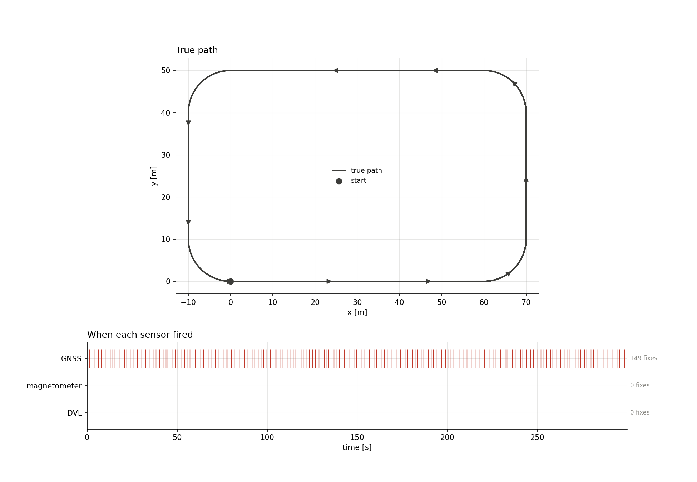

The path with the EKF and ERTS estimates, and a zoom on the turn where the filter's position error is largest, with the 95% position ellipses of both estimators.

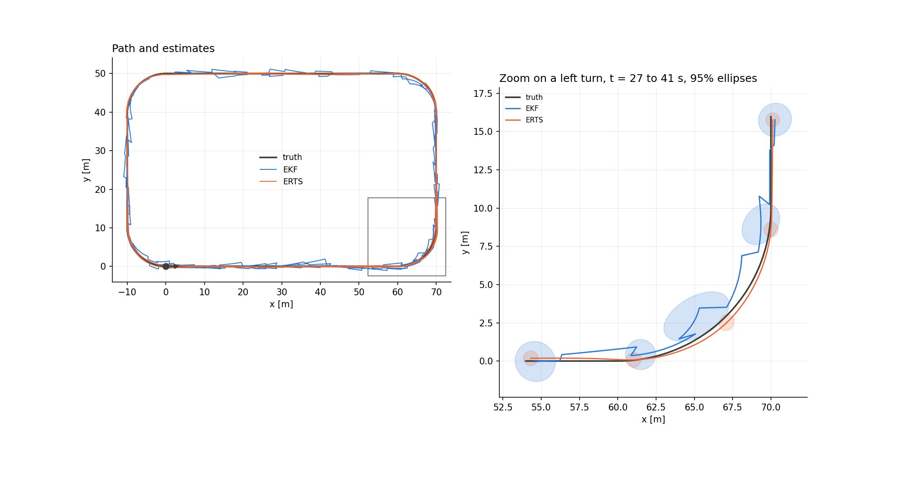

Error against truth with each estimator's own 95% band.

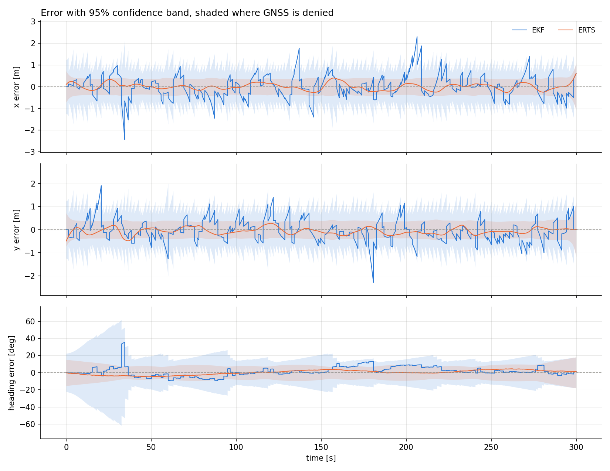

The position spread $\sqrt{\mathrm{tr}\,P_{xy}}$ each estimator reports about itself, on a log scale.

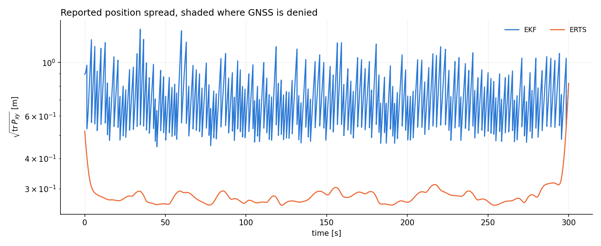

True and estimated sensor biases.

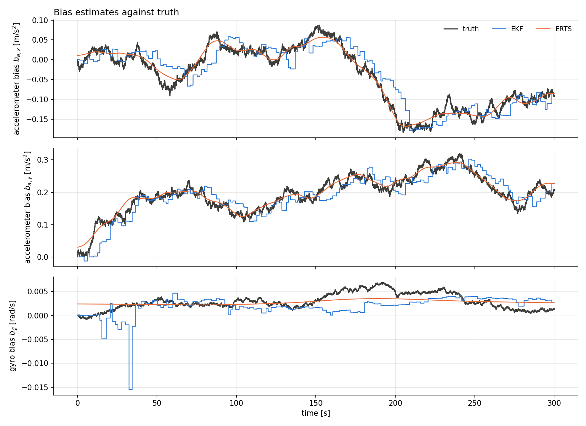

NIS of every fix against its 95% interval, and the running mean of the position NEES.

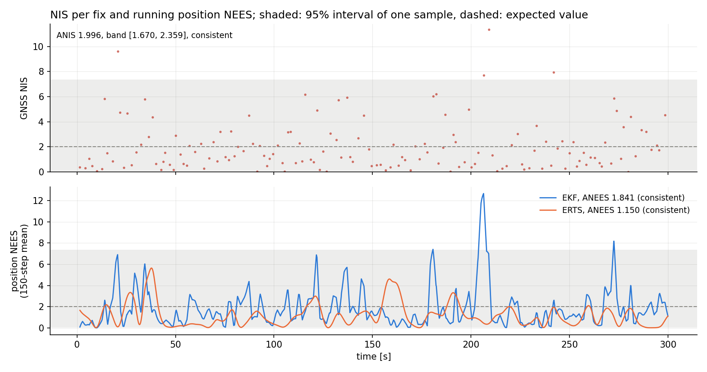

| statistic | value | 95% band | verdict |
| --- | --- | --- | --- |
| ANIS GNSS | 1.9965 | [1.6704, 2.3589] | consistent |
| ANEES position filter (EKF) | 1.8411 | [1.4344, 2.6582] | consistent |
| ANEES position smoother (ERTS) | 1.1497 | [0.0506, 7.3778] | consistent |

| estimator | RMSE position [m] | median [m] | 95th percentile [m] | max [m] | RMSE heading [°] |
| --- | --- | --- | --- | --- | --- |
| EKF | 0.697 | 0.536 | 1.277 | 2.579 | 5.72 |
| ERTS | 0.214 | 0.183 | 0.379 | 0.613 | 2.66 |

| estimator | RMSE $b_{a,x}$ [m/s²] | RMSE $b_{a,y}$ [m/s²] | RMSE $b_g$ [rad/s] | peak $\lvert b_g - \hat b_g \rvert$ [rad/s] |
| --- | --- | --- | --- | --- |
| EKF | 0.0313 | 0.0312 | 0.00268 | 0.0177 |
| ERTS | 0.0133 | 0.0144 | 0.00141 | 0.0034 |

The true position lies inside the filter's reported 95% ellipse on 95.1% of the steps and inside the smoother's on 100.0%.

### Figure-eight

The true path with the direction of travel, and when each sensor fired.

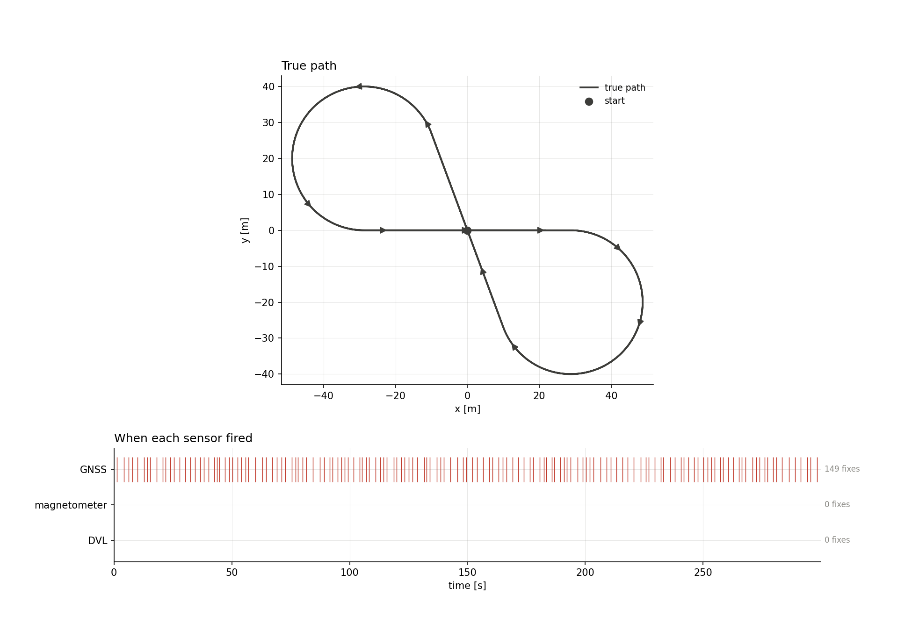

The path with the EKF and ERTS estimates, and a zoom on the turn where the filter's position error is largest, with the 95% position ellipses of both estimators.

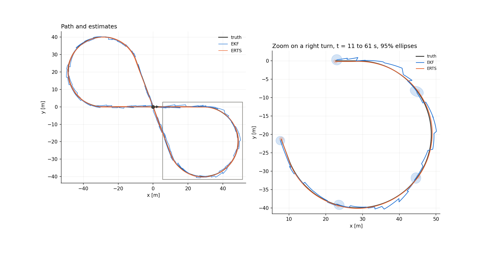

Error against truth with each estimator's own 95% band.

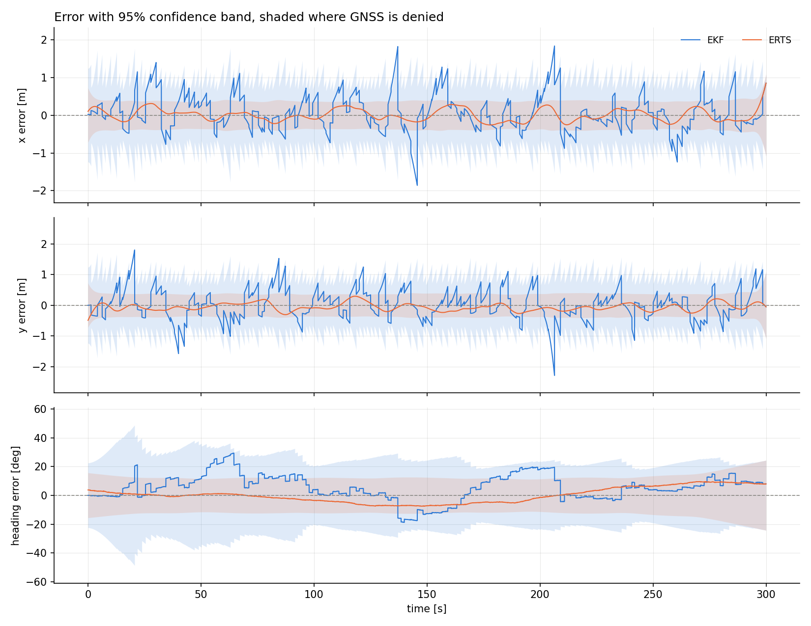

The position spread $\sqrt{\mathrm{tr}\,P_{xy}}$ each estimator reports about itself, on a log scale.

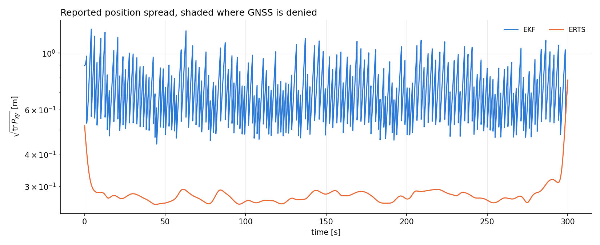

True and estimated sensor biases.

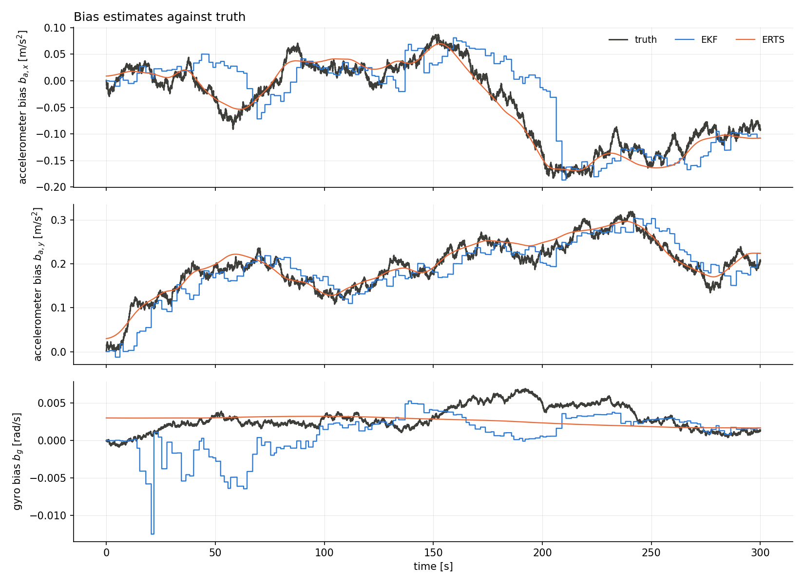

NIS of every fix against its 95% interval, and the running mean of the position NEES.

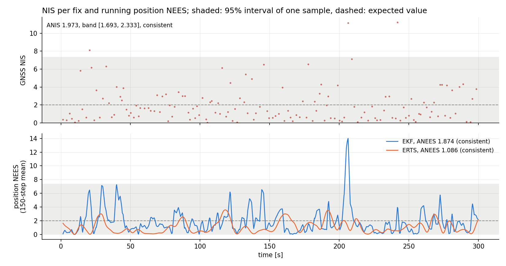

| statistic | value | 95% band | verdict |
| --- | --- | --- | --- |
| ANIS GNSS | 1.9727 | [1.6925, 2.3328] | consistent |
| ANEES position filter (EKF) | 1.8741 | [1.4457, 2.6429] | consistent |
| ANEES position smoother (ERTS) | 1.0864 | [0.0506, 7.3778] | consistent |

| estimator | RMSE position [m] | median [m] | 95th percentile [m] | max [m] | RMSE heading [°] |
| --- | --- | --- | --- | --- | --- |
| EKF | 0.694 | 0.543 | 1.230 | 2.930 | 10.59 |
| ERTS | 0.210 | 0.177 | 0.336 | 0.851 | 5.19 |

| estimator | RMSE $b_{a,x}$ [m/s²] | RMSE $b_{a,y}$ [m/s²] | RMSE $b_g$ [rad/s] | peak $\lvert b_g - \hat b_g \rvert$ [rad/s] |
| --- | --- | --- | --- | --- |
| EKF | 0.0469 | 0.0311 | 0.00346 | 0.0137 |
| ERTS | 0.0169 | 0.0163 | 0.00186 | 0.0045 |

The true position lies inside the filter's reported 95% ellipse on 95.7% of the steps and inside the smoother's on 100.0%.

## Discussion

- **Position is consistent on both paths.** The GNSS ANIS is 1.996 and 1.973 against bands that contain the expected value 2, and the filter's position ANEES is 1.84 and 1.87, inside its bands. The reported covariance matches the error where position is measured every second or two.
- **The smoother is about three times more accurate than the filter.** Position RMSE falls from 0.70 m to 0.21 m on the four-corner test and from 0.69 m to 0.21 m on the figure-eight, reductions of 69% and 70%. The filter's error jumps at every fix and its reported spread $\sqrt{\mathrm{tr}\,P_{xy}}$ swings between about 0.4 and 1.4 m; the smoother has fixes on both sides of every point and removes that sawtooth.
- **Heading is the weakest observed quantity.** The filter's heading RMSE is 5.7° on the four-corner test and 10.6° on the figure-eight (smoother 2.7° and 5.2°), and its 95% band is tens of degrees wide early in the run. The heading only reaches the position through the rotation of the accelerometer reading and the direction of the velocity, so many fixes are needed to pin it down. The figure-eight gives the larger heading error; one seed does not say why.
- **Accelerometer biases are recovered, the gyro bias is not.** The accelerometer bias RMSE is 0.031 and 0.031 m/s² on the four-corner test, and the estimates follow the slow drift of the truth. The filter's gyro-bias estimate swings by up to 0.018 rad/s in the first minute, and the smoothed estimate varies slowly in a narrow range while the true bias rises to about 0.007 rad/s near 190 s.
- **Limits.** One seed, a configured noise model that matches the simulator in value but not in statistics (see the model section), and a truth that starts at the prior mean. No mismatch between the filter and the data is tested here.

## Related results

- [Multi-sensor fusion](../multi_sensor_fusion/README.md) keeps the filter and the paths and adds the magnetometer and the DVL, with GNSS only every 10 to 20 s.
- [Dead reckoning](../dead_reckoning/README.md) removes GNSS and keeps the magnetometer and the DVL.
- [GNSS outage](../gnss_outage/README.md) uses this GNSS rate with the magnetometer and the DVL and takes GNSS away for 210 s in the middle of the run.
