# 2-D strapdown INS, UKF and URTSS

[Back to the overview](../../../README.md) | [Previous: GNSS outage](../gnss_outage/README.md) | [Next: IEKF](../iekf/README.md)

The extended Kalman filter linearises the motion and measurement functions at the current mean, which is accurate when the state is known well and poor when it is not. The unscented Kalman filter propagates a set of sample points through the real functions instead. This page runs the UKF and its smoother (URTSS) next to the EKF and the ERTS on the same data, once where the linearisation should be good and once where it should hurt.

|               |                                  |
| ------------- | -------------------------------- |
| **Status**    | done, UKF and EKF indistinguishable on the outage runs, UKF clearly better on the heading-stress runs |
| **Run**       | 30000 timesteps (300 s at $\Delta t = 0.01$ s), seed 42 |
| **Reproduce** | see [Reproduction](#reproduction) |

## Motivation

The motion model rotates the accelerometer reading by the heading and the DVL rotates the velocity by it, so the model is nonlinear in the heading. An EKF replaces that rotation by its slope at the mean, which is accurate while the heading is known to a few degrees and not when the uncertainty spans most of a turn. Two runs separate the cases:

- **Outage run.** A full sensor set with a GNSS outage, with the heading corrected a few times a second. The heading error stays a few degrees, so the linearisation should be good.
- **Heading-stress run.** The same outage, but the filter starts with a heading that is 1.5 rad (86°) wrong, and the magnetometer fires only every 30 to 60 s, so the heading error survives for a long time and the linearisation should be poor.

Both are run on a four-corner test and a figure-eight. The question is whether the estimator choice matters, and in which of the two runs.

## Problem formulation

### State and motion model

The state collects position, heading, velocity in the navigation frame and the two sensor biases,

$$
x = \begin{bmatrix} p^\top & \psi & v^\top & b_a^\top & b_g \end{bmatrix}^\top \in \mathbb{R}^{8},
\qquad p, v \in \mathbb{R}^2 .
$$

The IMU reading $u_k$ is corrected with the estimated biases, $\tilde a_k = a_k - b_{a,k}$ and
$\tilde\omega_k = \omega_k - b_{g,k}$, and integrated with the heading at the middle of the step,
$\psi_{k+\frac12} = \psi_k + \tfrac{\Delta t}{2}\tilde\omega_k$:

$$
\begin{aligned}
p_{k+1} &= p_k + \Delta t\, v_k + \tfrac{\Delta t^2}{2}\, R(\psi_{k+\frac12})\,\tilde a_k, \\
\psi_{k+1} &= \psi_k + \Delta t\, \tilde\omega_k, \\
v_{k+1} &= v_k + \Delta t\, R(\psi_{k+\frac12})\,\tilde a_k, \\
b_{a,k+1} &= e^{-\Delta t / T_a}\, b_{a,k}, \qquad b_{g,k+1} = e^{-\Delta t / T_g}\, b_{g,k}.
\end{aligned}
$$

Written as $x_k = f(x_{k-1}, u_k) + w_k$ with $w_k \sim \mathcal{N}(0, Q_k)$. The biases are first-order
Gauss-Markov processes with time constant $T$ and stationary variance $\sigma_b^2$, driven by white noise of
intensity $2\sigma_b^2 / T$. White accelerometer noise enters the velocity and white gyro noise the heading. With $G_k$ mapping the
six noise sources into the state and $D$ the diagonal matrix of their intensities, the process noise is the first-order approximation

$$
Q_k = G_k\, D\, G_k^\top\, \Delta t .
$$


| symbol | meaning |
| --- | --- |
| $x_k$ | state: position $p_k$, heading $\psi_k$, navigation-frame velocity $v_k$, accelerometer bias $b_{a,k}$ and gyro bias $b_{g,k}$ |
| $u_k$ | IMU reading $(a_k, \omega_k)$: body-frame specific force and yaw rate |
| $R(\psi)$ | rotation from the body to the navigation frame |
| $\bar x_k,\ \bar P_k$ | predicted mean and covariance |
| $\hat x_k,\ \hat P_k$ | updated (filtered) mean and covariance |
| $\hat x^s_k,\ P^s_k$ | smoothed mean and covariance |
| $\eta_k,\ S_k$ | innovation and innovation covariance |
| $W_k$ | Kalman gain |
| $\boxplus,\ \boxminus$ | addition and subtraction that wrap the heading to $(-\pi, \pi]$ |


| parameter | value |
| --- | --- |
| time step $\Delta t$, steps, duration | 0.01 s, 30000, 300 s |
| speed along the path | 2 m/s |
| accelerometer bias: variance $\sigma_{b_a}^2$, time constant $T_a$ | $5\cdot10^{-2}$ (m/s²)², 1000 s, both axes |
| gyro bias: variance $\sigma_{b_g}^2$, time constant $T_g$ | $5\cdot10^{-5}$ (rad/s)², 1000 s |
| white noise intensity, accelerometer / gyro | $5\cdot10^{-4}$ (m/s²)²·s / $5\cdot10^{-4}$ rad²/s |
| prior mean $\hat x_0$ | $[0,\ 0,\ 0,\ 2,\ 0,\ 0,\ 0,\ 0]^\top$ |
| prior covariance $\hat P_0$ | $\mathrm{diag}(0.4,\ 0.4,\ 0.04,\ 0.04,\ 0.04,\ 0.004,\ 0.004,\ 0.0004)$ |


The truth is simulated, not generated by $f$. A geometric path (below) gives position, heading and curvature at constant
speed; the velocity is the speed along the heading, the specific force is the centripetal acceleration rotated into the body frame, and
each IMU reading is that ideal value plus a simulated Gauss-Markov bias plus white noise. The filter is configured with the same noise
values the simulator uses. The configuration values match; the white-noise intensity is read as a continuous-time intensity by the filter
and drawn as a per-sample variance by the simulator, so the noise statistics differ by a factor $1/\Delta t$ in variance, and the truth starts
exactly at the prior mean. Both push the position covariance in the conservative direction. The study guide (chapter 12) documents them.

### Sensors

**GNSS** observes the position directly,

$$
z^{g}_k = H_g\, x_k + \varepsilon^{g}_k, \qquad H_g = \begin{bmatrix} I_2 & 0_{2\times 6} \end{bmatrix}, \qquad \varepsilon^{g}_k \sim \mathcal{N}(0,\ 0.2\, I_2)\ \mathrm{m^2}.
$$

**Magnetometer** observes the heading,

$$
z^{m}_k = \psi_k + \varepsilon^{m}_k, \qquad \varepsilon^{m}_k \sim \mathcal{N}(0,\ 3\cdot 10^{-3})\ \mathrm{rad^2},
$$

and its innovation is wrapped, $\eta^m_k = z^m_k \boxminus h^m(\bar x_k)$.

**DVL** observes the velocity in the body frame, which makes it the one nonlinear sensor,

$$
z^{d}_k = R(\psi_k)^\top v_k + \varepsilon^{d}_k, \qquad
H_d = \begin{bmatrix} 0_{2\times 2} & \dfrac{\partial R^\top}{\partial \psi}\, v & R(\psi)^\top & 0_{2\times 3} \end{bmatrix}, \qquad
\varepsilon^{d}_k \sim \mathcal{N}(0,\ 10^{-2}\, I_2)\ \mathrm{(m/s)^2}.
$$


GNSS fires at random intervals drawn uniformly from 1 to 3 s and is denied between $t = 45$ s and $t = 255$ s. The DVL fires every 0.2 to 1 s. The runs differ in the filter's initial belief and in the magnetometer rate:

| run | filter's initial heading $\hat\psi_0$ | initial heading variance $\hat P_0^{\psi\psi}$ | magnetometer interval |
| --- | --- | --- | --- |
| outage | 0 rad (the true value) | 0.04 rad² | 0.25 to 1 s |
| heading stress | 1.5 rad (86°) | 2.25 rad² | 30 to 60 s |

The stress run changes the filter's belief and never the truth: $\hat x_0$ and $\hat P_0$ only seed the filter, the truth comes from the path. The sparse magnetometer is what keeps the heading error alive; with a reading every second the heading is corrected within about a second and the two filters end up equal.


### Trajectories

Both paths are traced at constant speed starting at the origin heading $+x$.

| trajectory | geometry | length per lap | laps in 300 s |
| --- | --- | --- | --- |
| four-corner test (`rounded_rectangle`) | $80 \times 50$ m rectangle with corner radius 10 m, counterclockwise: left turns only | 242.8 m | 2.5 |
| figure-eight (`figure_eight`) | two circles of radius 20 m with centres 70 m apart, joined by two straights that cross at the origin: one right and one left turn per lap | 289.2 m | 2.1 |

### Estimators

When several sensors fire in the same step they update in turn, each starting from the result of the previous one.

**Extended Kalman filter.** Prediction and update with sensor model $h$, Jacobians $F$ and $H$, and measurement noise $R$:

$$
\bar x_k = f(\hat x_{k-1}, u_k), \qquad \bar P_k = F_k \hat P_{k-1} F_k^\top + Q_k,
$$

$$
\eta_k = z_k \boxminus h(\bar x_k), \qquad S_k = H_k \bar P_k H_k^\top + R, \qquad W_k = \bar P_k H_k^\top S_k^{-1},
$$

$$
\hat x_k = \bar x_k \boxplus W_k \eta_k, \qquad
\hat P_k = (I - W_k H_k)\, \bar P_k\, (I - W_k H_k)^\top + W_k R\, W_k^\top .
$$

The covariance update is written in Joseph form, which keeps $\hat P_k$ positive semidefinite.

**Extended Rauch-Tung-Striebel smoother (ERTS).** Run backward over the stored filter output, starting from
$\hat x^s_N = \hat x_N$, with $F_k$ evaluated at the filtered state:

$$
G_k = \hat P_k F_k^\top \bar P_{k+1}^{-1}, \qquad
\hat x^s_k = \hat x_k \boxplus G_k\,(\hat x^s_{k+1} \boxminus \bar x_{k+1}), \qquad
P^s_k = \hat P_k + G_k\,(P^s_{k+1} - \bar P_{k+1})\,G_k^\top .
$$


**Unscented Kalman filter (UKF).** Instead of linearising, the distribution $\mathcal{N}(\hat x, \hat P)$ is represented by $2n+1$ sigma points, $n = 8$, that are pushed through the
nonlinear functions:

$$
\mathcal{X}_0 = \hat x, \qquad
\mathcal{X}_{i} = \hat x \boxplus \sqrt{n+\lambda}\,\big(\sqrt{\hat P}\big)_{i}, \qquad
\mathcal{X}_{n+i} = \hat x \boxminus \sqrt{n+\lambda}\,\big(\sqrt{\hat P}\big)_{i}, \qquad i = 1, \dots, n,
$$

with $\lambda = \alpha^2 (n + \kappa) - n$ and the weights

$$
w^m_0 = \frac{\lambda}{n+\lambda}, \qquad w^c_0 = w^m_0 + 1 - \alpha^2 + \beta, \qquad w_i = \frac{1}{2(n+\lambda)}, \quad i = 1, \dots, 2n .
$$

The parameters are $\alpha = 1$, $\beta = 2$, $\kappa = 0$, which gives $\lambda = 0$, $w^m_0 = 0$ and $w^c_0 = 2$. The prediction and the update replace the Jacobians by weighted sample moments of the propagated points
$\mathcal{Y}_i = f(\mathcal{X}_i, u_k)$ and $\mathcal{Z}_i = h(\mathcal{X}_i)$:

$$
\bar x_k = \sum_i w^m_i\, \mathcal{Y}_i, \qquad
\bar P_k = \sum_i w^c_i\, (\mathcal{Y}_i \boxminus \bar x_k)(\mathcal{Y}_i \boxminus \bar x_k)^\top + Q_k,
$$

$$
\bar z = \sum_i w^m_i\, \mathcal{Z}_i, \qquad
S_k = \sum_i w^c_i\, (\mathcal{Z}_i \boxminus \bar z)(\mathcal{Z}_i \boxminus \bar z)^\top + R, \qquad
C_k = \sum_i w^c_i\, (\mathcal{X}_i \boxminus \bar x_k)(\mathcal{Z}_i \boxminus \bar z)^\top,
$$

$$
W_k = C_k S_k^{-1}, \qquad \hat x_k = \bar x_k \boxplus W_k\,(z_k \boxminus \bar z), \qquad \hat P_k = \bar P_k - W_k S_k W_k^\top .
$$

The centre weight $w^c_0$ can be negative for other parameter choices, in which case nothing keeps $\bar P_k$ positive semidefinite; with the values above the smallest eigenvalue of the
full covariance stays positive at every step of every run on this page.

**Unscented Rauch-Tung-Striebel smoother (URTSS).** The backward pass is the ERTS recursion with the gain built from the sigma points of the filtered estimate, with the cross covariance

$$
D_{k+1} = \sum_i w^c_i\, (\mathcal{X}_i \boxminus \hat x_k)\,(f(\mathcal{X}_i, u_{k+1}) \boxminus \bar x_{k+1})^\top, \qquad
G_k = D_{k+1}\, \bar P_{k+1}^{-1},
$$

followed by the same mean and covariance updates as in the ERTS.

### Consistency

A filter is consistent if the errors it makes agree with the covariance it reports. Two statistics test this, with the truth $x_k$ known from the simulation.

$$
\mathrm{NIS}_k = \eta_k^\top S_k^{-1} \eta_k \sim \chi^2_{m}, \qquad
\mathrm{NEES}_k = (p_k - \hat p_k)^\top \big(\hat P^{pp}_k\big)^{-1} (p_k - \hat p_k) \sim \chi^2_{2},
$$

where $m$ is the measurement dimension (2 for GNSS and DVL, 1 for the magnetometer) and $\hat P^{pp}_k$ is the position block of the covariance.
The NIS is evaluated at every fix of a sensor. The NEES is evaluated for the position at every step, for the filter and for the smoother.
The time average $\bar\epsilon = \frac{1}{N}\sum_k \epsilon_k$ of either statistic with $d$ degrees of freedom is held against the interval

$$
\left[\ \frac{\chi^2_{\alpha/2}(N_{\mathrm{eff}}\, d)}{N_{\mathrm{eff}}},\ \ \frac{\chi^2_{1-\alpha/2}(N_{\mathrm{eff}}\, d)}{N_{\mathrm{eff}}}\ \right], \qquad
N_{\mathrm{eff}} = \max\!\Big(1,\ N\,\frac{1-\rho}{1+\rho}\Big), \qquad \alpha = 0.05,
$$

where $\rho$ is the lag-one autocorrelation of the series. A statistic is "consistent" if its time average lies inside the interval. A value below the interval
means the errors are smaller than the reported covariance says, the estimator is underconfident (conservative). A value above means the errors are larger than it says, the estimator is overconfident (too optimistic).
The position NEES is strongly autocorrelated, so $N_{\mathrm{eff}}$ is small and the interval wide; for the smoother it is so wide that it excludes almost nothing. The
share of steps with the true position inside the reported 95% ellipse is a second check that does not depend on it.
All numbers are from one run with seed 42, so they carry no error bars.

## Reproduction

Build once, then simulate and analyse each case:

```bash
cmake -S . -B build && cmake --build build
./build/kalman_filtering_and_smoothing results/INS2D/ukf/outage
python3 scripts/analyze_ins_2d.py results/INS2D/ukf/outage/data
./build/kalman_filtering_and_smoothing results/INS2D/ukf/figure_eight_outage
python3 scripts/analyze_ins_2d.py results/INS2D/ukf/figure_eight_outage/data
./build/kalman_filtering_and_smoothing results/INS2D/ukf/heading_stress
python3 scripts/analyze_ins_2d.py results/INS2D/ukf/heading_stress/data
./build/kalman_filtering_and_smoothing results/INS2D/ukf/figure_eight_heading_stress
python3 scripts/analyze_ins_2d.py results/INS2D/ukf/figure_eight_heading_stress/data
```

The executable reads `<case>/config.yaml` and writes `<case>/data`. Given a folder that holds several cases, it runs all of them, so
`./build/kalman_filtering_and_smoothing results/INS2D/ukf` simulates every case of this page in one command. The analysis reads `<case>/data`
and writes `<case>/stats.txt`, which holds every number quoted below, and the figures in `<case>/figures`.

`data/` holds one CSV file per quantity with one row per timestep and a shared `timestep` column. `truth.csv` has the true state `x_true_0 ... x_true_7`;
`filter.csv` and `smoother.csv` have the predicted and updated (or smoothed) mean and the full covariance; `*_fixes.csv` has, for each fix of one sensor, the raw measurement,
the innovation and $S$, which is what the NIS is computed from.

One run writes the EKF/ERTS and the UKF/URTSS files; the UKF files carry the prefix `ukf_`.

## Results

The figures per run: the true path and when each sensor fired, the path with the EKF and ERTS estimates and a zoom on the turn with the largest filter error, the EKF/ERTS error, the UKF/URTSS error, and the variants against each other (position error of the filters and smoothers, gyro bias, and the distance of each variant to the EKF-based estimate). In the variants figure the EKF-based estimates are drawn wide and the variants dashed over them, because they lie almost exactly on top of each other.

### Outage run

#### Four-corner test

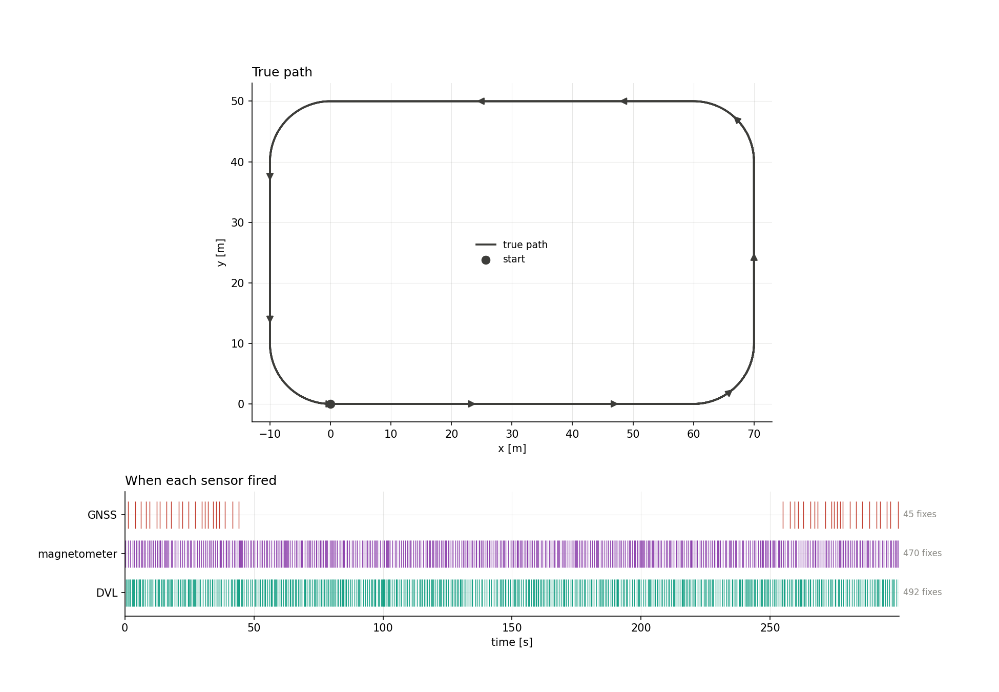

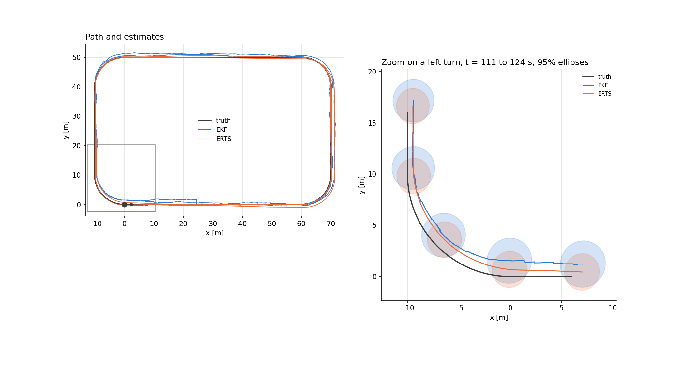

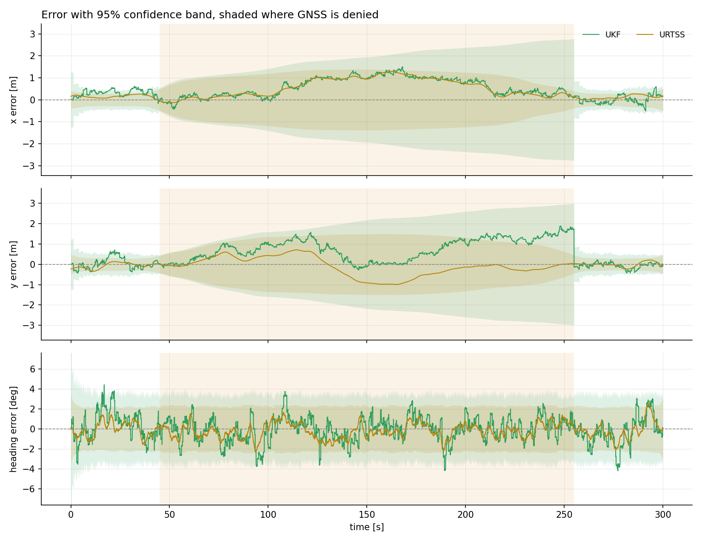


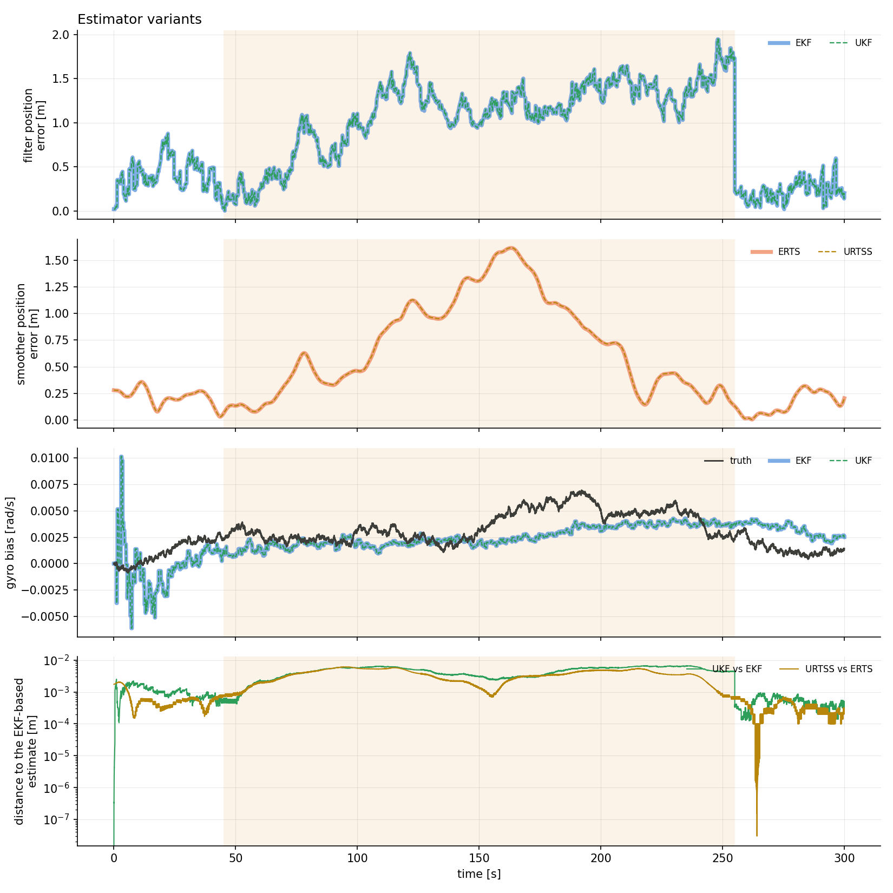

| statistic | EKF / ERTS | UKF / URTSS |
| --- | --- | --- |
| ANIS GNSS | 1.9989 (consistent) | 1.9987 (consistent) |
| ANIS magnetometer | 0.8573 (underconfident) | 0.8574 (underconfident) |
| ANIS DVL | 1.9935 (consistent) | 1.9931 (consistent) |
| ANEES position filter | 1.4470 (consistent) | 1.4500 (consistent) |
| ANEES position smoother | 1.5674 (consistent) | 1.5733 (consistent) |

| estimator | RMSE position [m] | median [m] | 95th percentile [m] | max [m] | RMSE heading [°] |
| --- | --- | --- | --- | --- | --- |
| EKF | 0.999 | 0.987 | 1.573 | 1.945 | 1.31 |
| UKF | 1.001 | 0.989 | 1.577 | 1.949 | 1.31 |
| ERTS | 0.706 | 0.348 | 1.453 | 1.616 | 0.79 |
| URTSS | 0.707 | 0.350 | 1.455 | 1.619 | 0.79 |

| estimator | RMSE $b_{a,x}$ [m/s²] | RMSE $b_{a,y}$ [m/s²] | RMSE $b_g$ [rad/s] | peak $\lvert b_g - \hat b_g \rvert$ [rad/s] |
| --- | --- | --- | --- | --- |
| EKF | 0.0212 | 0.0242 | 0.00186 | 0.0106 |
| UKF | 0.0212 | 0.0242 | 0.00186 | 0.0106 |
| ERTS | 0.0099 | 0.0110 | 0.00133 | 0.0034 |
| URTSS | 0.0099 | 0.0110 | 0.00133 | 0.0034 |

| distance | position median [mm] | position max [mm] | heading max [°] | position $\mathrm{tr}\,P$ ratio range |
| --- | --- | --- | --- | --- |
| UKF vs EKF | 3.5 | 6.6 | 0.016 | [1.0000, 1.0004] |
| URTSS vs ERTS | 2.4 | 6.1 | 0.003 | [0.9999, 1.0006] |

Share of steps with the true position inside the reported 95% ellipse: EKF 97.6%, UKF 97.6%, ERTS 100.0%, URTSS 100.0%.

#### Figure-eight

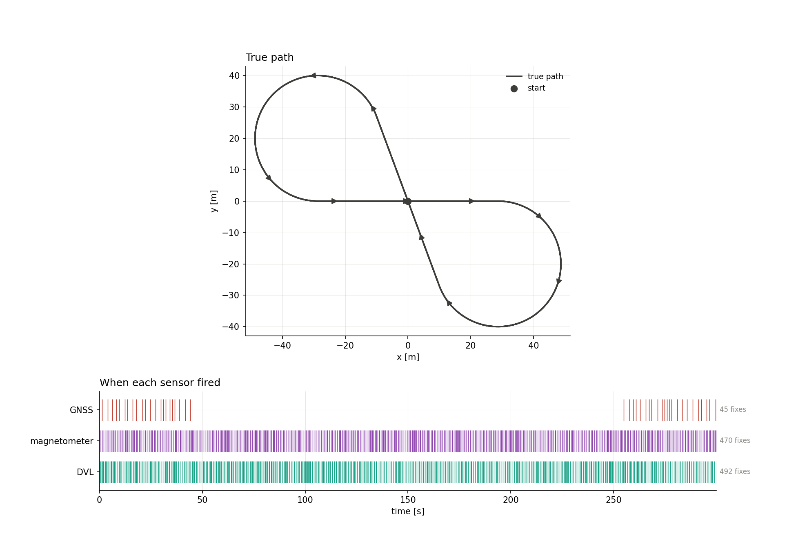

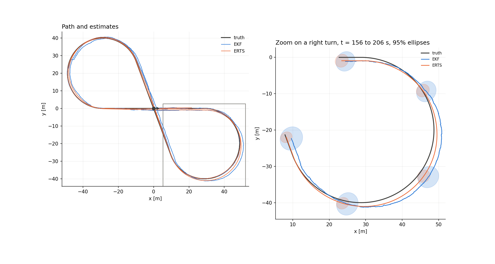

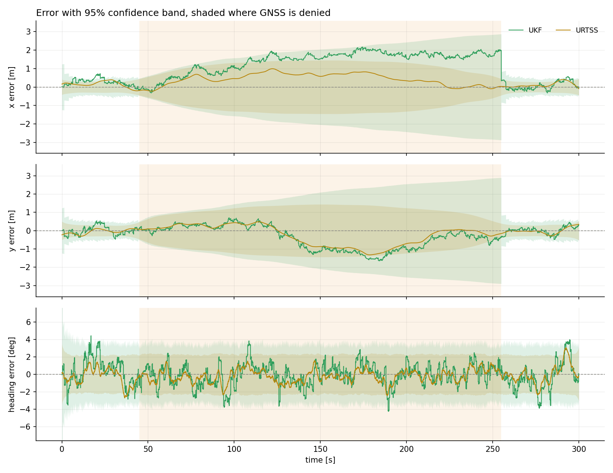


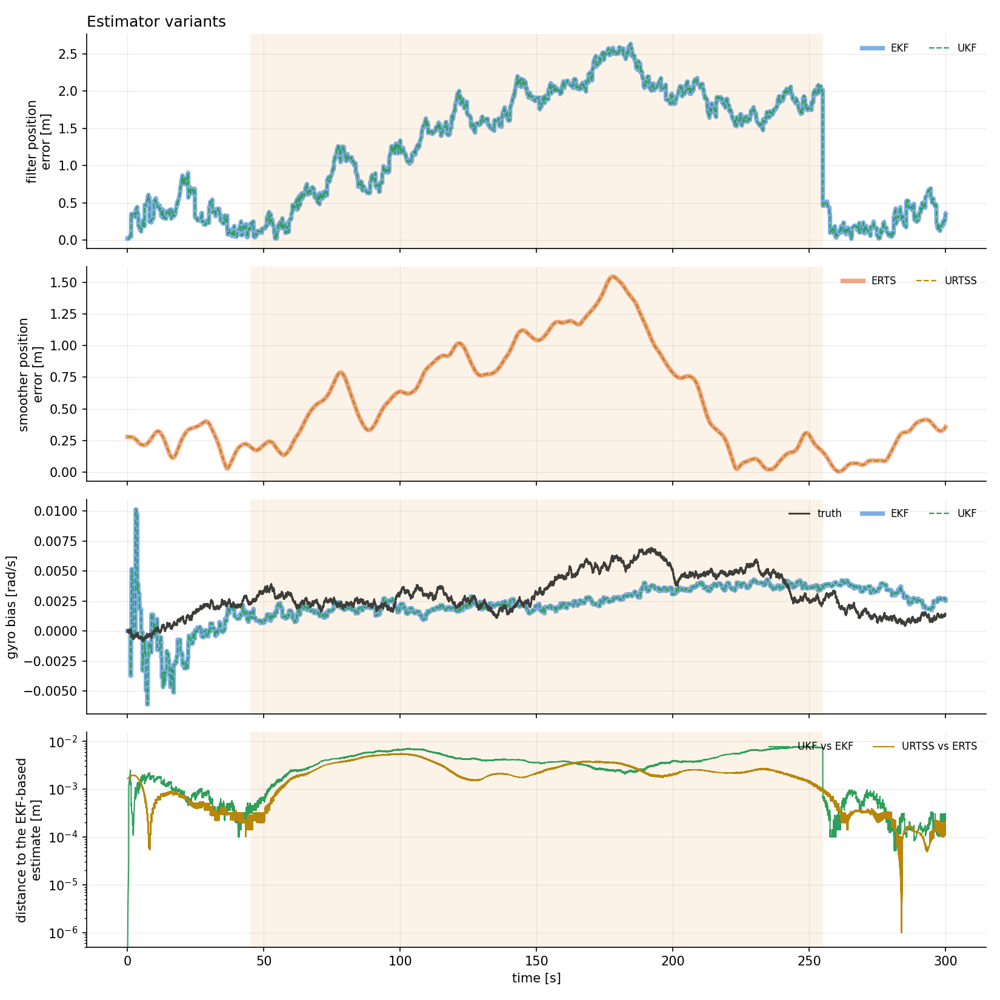

| statistic | EKF / ERTS | UKF / URTSS |
| --- | --- | --- |
| ANIS GNSS | 1.8012 (consistent) | 1.8013 (consistent) |
| ANIS magnetometer | 0.8593 (underconfident) | 0.8593 (underconfident) |
| ANIS DVL | 1.9876 (consistent) | 1.9872 (consistent) |
| ANEES position filter | 2.3378 (consistent) | 2.3414 (consistent) |
| ANEES position smoother | 1.7506 (consistent) | 1.7479 (consistent) |

| estimator | RMSE position [m] | median [m] | 95th percentile [m] | max [m] | RMSE heading [°] |
| --- | --- | --- | --- | --- | --- |
| EKF | 1.419 | 1.247 | 2.380 | 2.634 | 1.36 |
| UKF | 1.421 | 1.248 | 2.382 | 2.636 | 1.36 |
| ERTS | 0.684 | 0.394 | 1.321 | 1.548 | 0.84 |
| URTSS | 0.684 | 0.393 | 1.319 | 1.545 | 0.84 |

| estimator | RMSE $b_{a,x}$ [m/s²] | RMSE $b_{a,y}$ [m/s²] | RMSE $b_g$ [rad/s] | peak $\lvert b_g - \hat b_g \rvert$ [rad/s] |
| --- | --- | --- | --- | --- |
| EKF | 0.0207 | 0.0239 | 0.00186 | 0.0106 |
| UKF | 0.0207 | 0.0239 | 0.00186 | 0.0106 |
| ERTS | 0.0100 | 0.0109 | 0.00134 | 0.0034 |
| URTSS | 0.0100 | 0.0109 | 0.00134 | 0.0034 |

| distance | position median [mm] | position max [mm] | heading max [°] | position $\mathrm{tr}\,P$ ratio range |
| --- | --- | --- | --- | --- |
| UKF vs EKF | 3.5 | 7.9 | 0.016 | [1.0000, 1.0004] |
| URTSS vs ERTS | 2.0 | 5.5 | 0.003 | [0.9999, 1.0006] |

Share of steps with the true position inside the reported 95% ellipse: EKF 97.9%, UKF 97.9%, ERTS 97.3%, URTSS 97.3%.

### Heading-stress run

#### Four-corner test

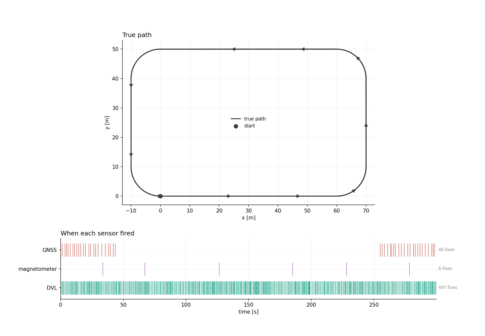

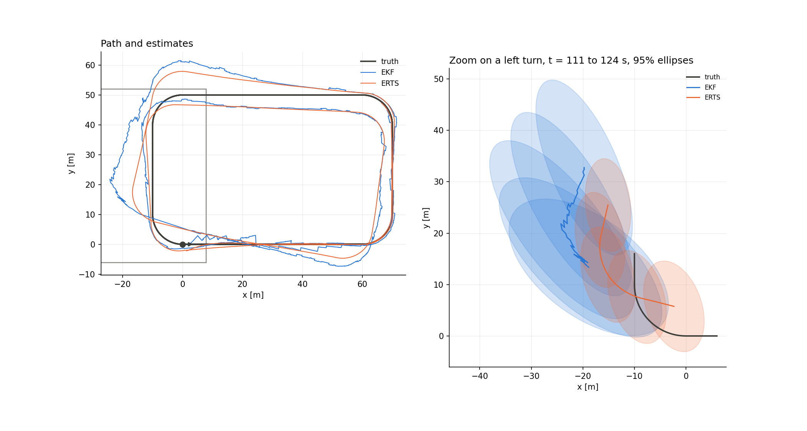


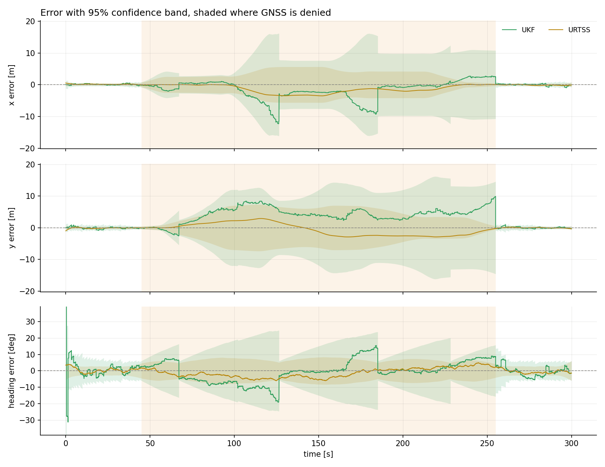

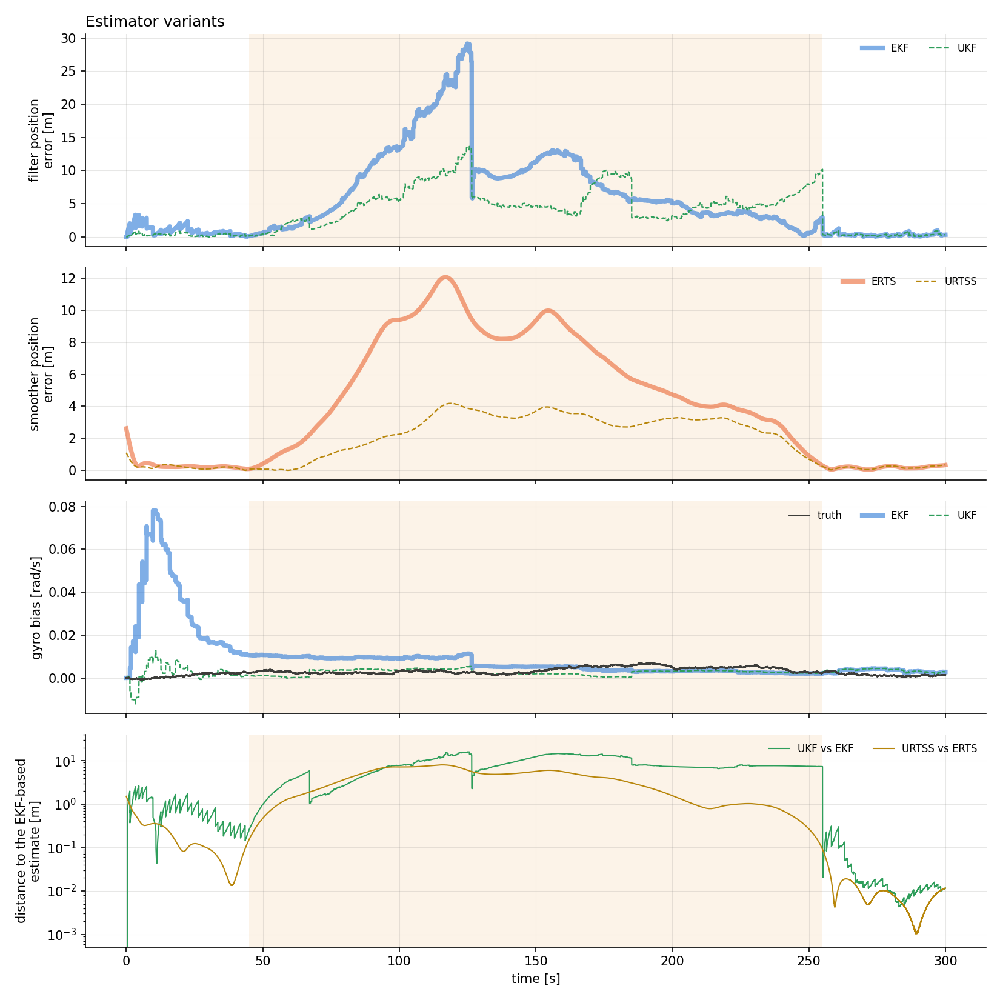

| statistic | EKF / ERTS | UKF / URTSS |
| --- | --- | --- |
| ANIS GNSS | 5.1769 (overconfident) | 2.0967 (consistent) |
| ANIS magnetometer | 2.2892 (overconfident) | 1.1308 (consistent) |
| ANIS DVL | 2.3314 (consistent) | 1.7308 (underconfident) |
| ANEES position filter | 4.2239 (overconfident) | 0.9915 (underconfident) |
| ANEES position smoother | 5.8035 (consistent) | 1.4242 (consistent) |

| estimator | RMSE position [m] | median [m] | 95th percentile [m] | max [m] | RMSE heading [°] |
| --- | --- | --- | --- | --- | --- |
| EKF | 8.486 | 3.437 | 19.361 | 29.142 | 13.65 |
| UKF | 4.902 | 3.519 | 9.526 | 13.626 | 6.89 |
| ERTS | 5.640 | 3.757 | 10.356 | 12.067 | 6.98 |
| URTSS | 2.305 | 1.884 | 3.881 | 4.182 | 2.69 |

| estimator | RMSE $b_{a,x}$ [m/s²] | RMSE $b_{a,y}$ [m/s²] | RMSE $b_g$ [rad/s] | peak $\lvert b_g - \hat b_g \rvert$ [rad/s] |
| --- | --- | --- | --- | --- |
| EKF | 0.0407 | 0.0265 | 0.01500 | 0.0781 |
| UKF | 0.0223 | 0.0244 | 0.00273 | 0.0127 |
| ERTS | 0.0122 | 0.0159 | 0.00352 | 0.0102 |
| URTSS | 0.0105 | 0.0146 | 0.00161 | 0.0040 |

| distance | position median [mm] | position max [mm] | heading max [°] | position $\mathrm{tr}\,P$ ratio range |
| --- | --- | --- | --- | --- |
| UKF vs EKF | 6813.2 | 15958.8 | 60.342 | [0.9506, 1.2878] |
| URTSS vs ERTS | 1105.3 | 8006.1 | 23.407 | [0.9798, 1.1403] |

Share of steps with the true position inside the reported 95% ellipse: EKF 71.0%, UKF 100.0%, ERTS 64.4%, URTSS 99.3%.

#### Figure-eight

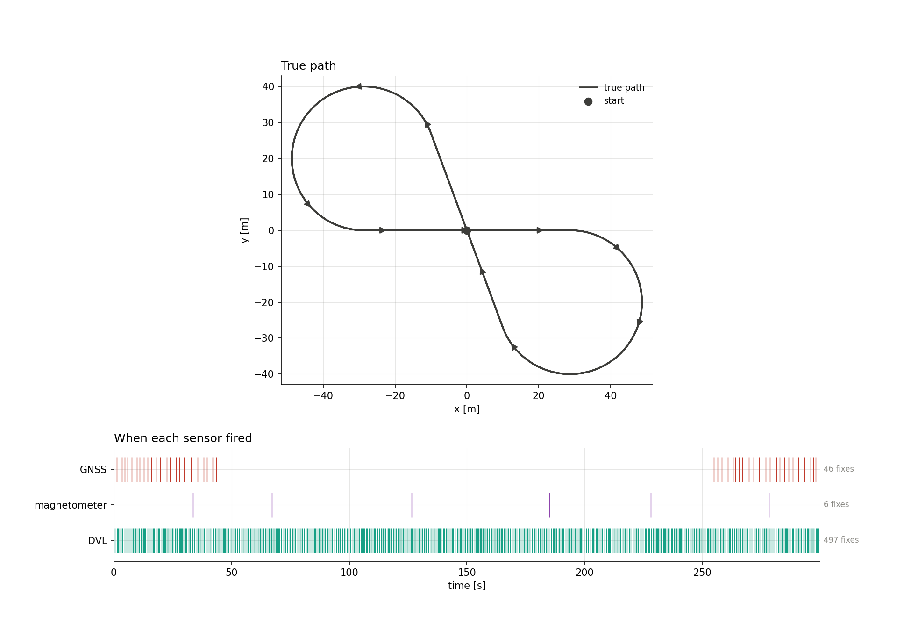

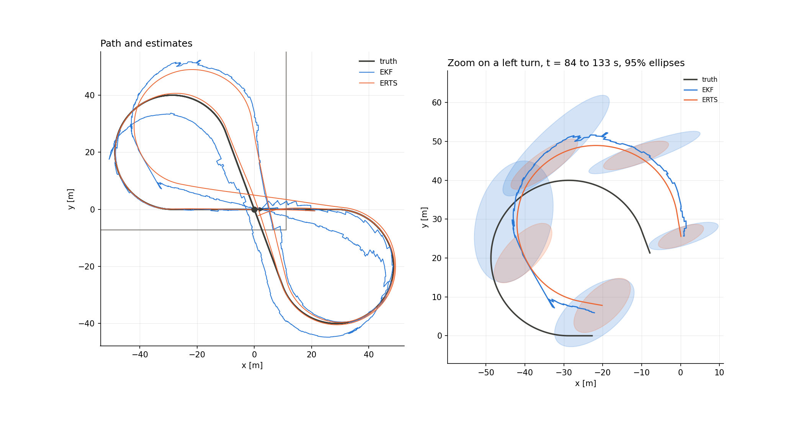

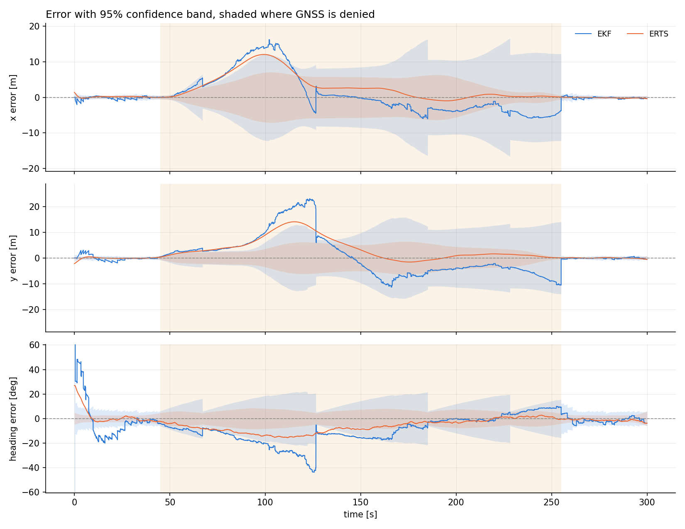

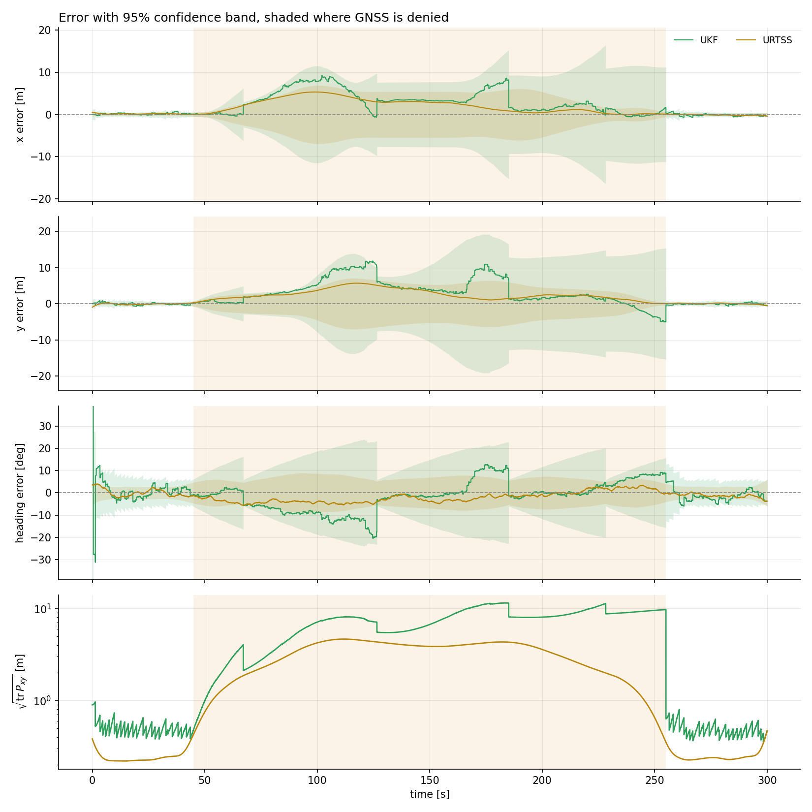

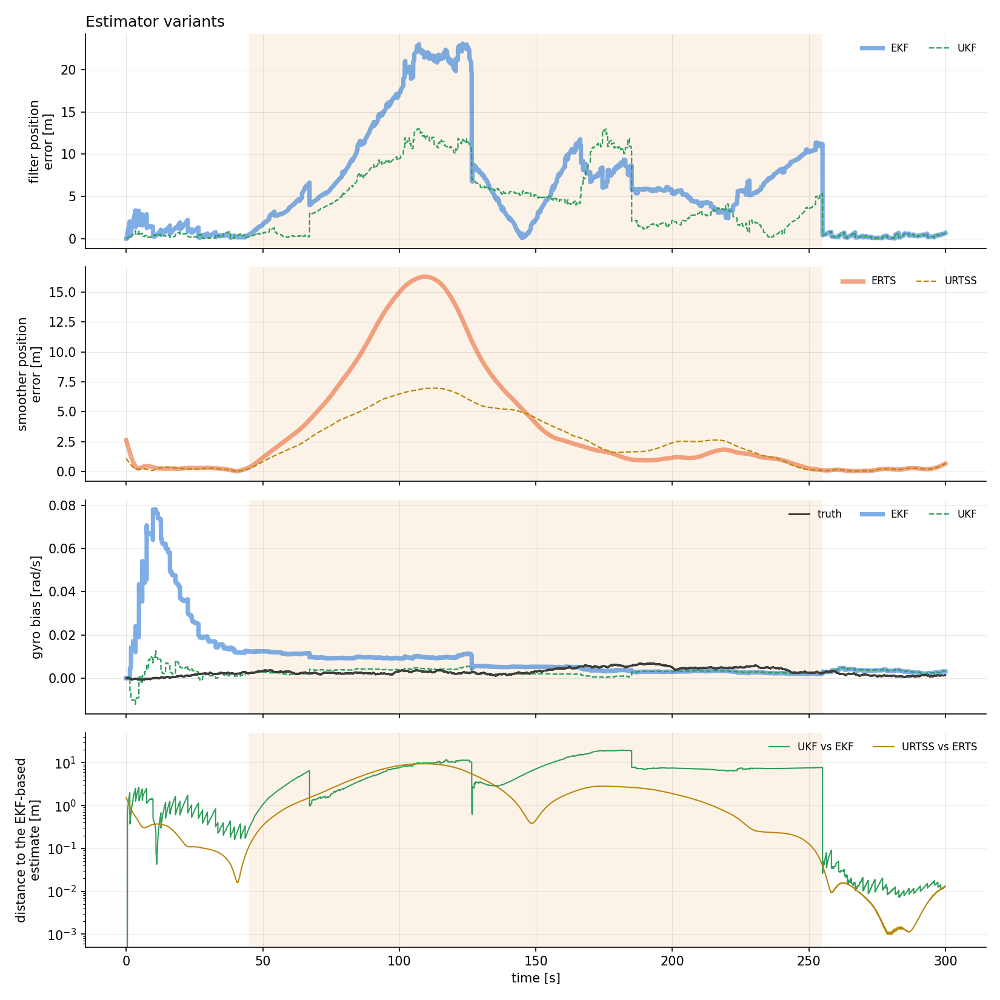

| statistic | EKF / ERTS | UKF / URTSS |
| --- | --- | --- |
| ANIS GNSS | 5.2337 (overconfident) | 2.0960 (consistent) |
| ANIS magnetometer | 2.5148 (overconfident) | 1.2417 (consistent) |
| ANIS DVL | 2.3328 (consistent) | 1.7391 (underconfident) |
| ANEES position filter | 4.4048 (overconfident) | 1.2375 (underconfident) |
| ANEES position smoother | 5.8867 (consistent) | 1.7880 (consistent) |

| estimator | RMSE position [m] | median [m] | 95th percentile [m] | max [m] | RMSE heading [°] |
| --- | --- | --- | --- | --- | --- |
| EKF | 8.565 | 4.846 | 21.274 | 23.073 | 14.07 |
| UKF | 5.361 | 2.122 | 11.513 | 13.022 | 7.03 |
| ERTS | 6.022 | 1.343 | 15.370 | 16.295 | 7.27 |
| URTSS | 3.279 | 1.838 | 6.728 | 6.968 | 2.78 |

| estimator | RMSE $b_{a,x}$ [m/s²] | RMSE $b_{a,y}$ [m/s²] | RMSE $b_g$ [rad/s] | peak $\lvert b_g - \hat b_g \rvert$ [rad/s] |
| --- | --- | --- | --- | --- |
| EKF | 0.0408 | 0.0260 | 0.01510 | 0.0781 |
| UKF | 0.0226 | 0.0237 | 0.00268 | 0.0127 |
| ERTS | 0.0121 | 0.0157 | 0.00359 | 0.0104 |
| URTSS | 0.0105 | 0.0146 | 0.00165 | 0.0042 |

| distance | position median [mm] | position max [mm] | heading max [°] | position $\mathrm{tr}\,P$ ratio range |
| --- | --- | --- | --- | --- |
| UKF vs EKF | 4917.8 | 19541.6 | 60.342 | [0.9763, 1.2878] |
| URTSS vs ERTS | 883.5 | 9435.6 | 23.362 | [0.9299, 1.1396] |

Share of steps with the true position inside the reported 95% ellipse: EKF 75.2%, UKF 99.8%, ERTS 73.5%, URTSS 99.4%.

## Discussion

**Outage run**

- **The filters are indistinguishable.** The UKF is 3.5 mm from the EKF in median on the four-corner test and 3.5 mm on the figure-eight (at most 6.6 and 7.9 mm, and 0.02° and 0.02° in heading). The reported position $\mathrm{tr}\,P$ of the two stays within 0.04% of each other. Position RMSE is 0.999 and 1.001 m on the four-corner test and 1.419 and 1.421 m on the figure-eight.
- **Consistency is the same for both.** Every verdict agrees; the one failure is the magnetometer ANIS, 0.857 and 0.859 against lower band edges of 0.868 and 0.868, for the EKF and the UKF alike. It belongs to the setup and not to either filter.
- **The model is too mildly nonlinear here for the choice to matter.** The heading is known to a degree or so, so the linearisation is good over the whole spread.

**Heading-stress run**

- **The UKF is better in the tail and on RMSE.** Position RMSE is 8.49 m (EKF) and 4.90 m (UKF) on the four-corner test, and 8.57 and 5.36 m on the figure-eight. The 95th percentile of the error is 19.4 against 9.5 m and 21.3 against 11.5 m. The median error is 3.44 against 3.52 m on the four-corner test and 4.85 against 2.12 m on the figure-eight, so the gap in the middle of the distribution is small on one path and large on the other.
- **The smoother choice matters more than in the outage run.** The URTSS has the lowest RMSE (2.30 and 3.28 m); the ERTS (5.64 and 6.02 m) is worse than the UKF filter itself on RMSE.
- **The two filters fail in opposite directions.** The EKF is overconfident: position ANEES 4.22 and 4.40 against upper band edges of 2.85 and 2.94, with the true position inside its 95% ellipse on 71% and 75% of the steps. The UKF is conservative: 0.99 and 1.24 against lower edges of 1.49 and 1.31, inside its ellipse on 100% and 100%. Neither is consistent. The smoother ANEES rows read "consistent" only because their band is wide for the autocorrelation reason in the model section; the ellipse coverage of the ERTS (64% and 74%) shows its overconfidence.
- **The wrong heading leaks into the gyro bias.** The EKF's gyro-bias estimate peaks at an error of 0.078 and 0.078 rad/s against 0.013 and 0.013 rad/s for the UKF, and the EKF takes much longer to settle (the gyro-bias panel of the variants figure). A likely explanation, not tested here: with the heading wrong the filter explains the mismatch between the heading and the direction of travel with a bias, and the EKF's linearisation lets the bias absorb far more of it.
- **The filters are far apart.** The UKF and EKF are 6.8 m and 4.9 m apart in median, up to 16.0 and 19.5 m and up to 60° and 60° in heading.
- **Why the UKF can be expected to win here.** A likely explanation, not tested separately: with a heading error of 1.5 rad, the rotation in $f$ and in the DVL's $h$ changes a lot over the heading spread, so the Jacobian at the mean says little about how the whole distribution moves, while sigma points spread across the heading uncertainty see the curvature.

**Limits.** One seed per run. The stress run was built to separate the filters, and the size of the gap is for this seed and this stress; no Monte Carlo, so no error bars. The mismatch is in the filter's prior only, so nothing is said about a mistuned $Q$ or $R$. The unscented parameters $\alpha$, $\beta$, $\kappa$ were not varied, and the conservative consistency of the UKF might move with them.

## Related results

- [GNSS outage](../gnss_outage/README.md) is the outage run with the EKF only and a mistuned-filter comparison.
- [IEKF](../iekf/README.md) runs the iterated EKF on the figure-eight with an outage and with multi-sensor fusion; it does not include the heading-stress case.
- [Multi-sensor fusion](../multi_sensor_fusion/README.md) is the same sensor set with sparse GNSS throughout.
