# 2-D strapdown INS, UKF and URTSS

[Back to the overview](../../../README.md) | [Previous: GNSS outage](../gnss_outage/README.md) | [Next: IEKF](../iekf/README.md)

The extended Kalman filter linearises the motion and measurement functions at the current mean, which is accurate when the state is known well and poor when it is not. The unscented Kalman filter propagates a set of sample points through the real functions instead. This page runs the UKF and its smoother (URTSS) next to the EKF and the ERTS on the same data, once where the linearisation should be good and once where it should hurt.

|               |                                  |
| ------------- | -------------------------------- |
| **Status**    | done, UKF and EKF indistinguishable on the outage runs, UKF better and consistent on the heading-stress runs |
| **Run**       | 30000 timesteps (300 s at $\Delta t = 0.01$ s), seed 42 |
| **Reproduce** | see [Reproduction](#reproduction) |

## Motivation

The motion model rotates the accelerometer reading by the heading and the DVL rotates the velocity by it, so the model is nonlinear in the heading. An EKF replaces that rotation by its slope at the mean, which is accurate while the heading is known to a few degrees and not when the uncertainty spans most of a turn. Two runs separate the cases:

- **Outage run.** A full sensor set with a GNSS outage, with the heading corrected a few times a second. The heading error stays a few degrees, so the linearisation should be good.
- **Heading-stress run.** The same outage, but the filter starts with a heading that is 1.5 rad (86°) wrong, and the magnetometer fires only every 30 to 60 s, so the heading error survives for a long time and the linearisation should be poor.

Both are run on a four-corner test and a figure-eight. The question is whether the estimator choice matters, and in which of the two runs.

## Problem formulation

### State and motion model

The state collects position, velocity in the navigation frame, heading and the two sensor biases,

$$
x = \begin{bmatrix} p^\top & v^\top & \psi & b_a^\top & b_g \end{bmatrix}^\top \in \mathbb{R}^{8},
\qquad p, v \in \mathbb{R}^2 .
$$

The IMU reading $u_k$ is corrected with the estimated biases, $\tilde a_k = a_k - b_{a,k}$ and
$\tilde\omega_k = \omega_k - b_{g,k}$, and integrated with the heading at the middle of the step,
$\psi_{k+\frac12} = \psi_k + \tfrac{\Delta t}{2}\tilde\omega_k$:

$$
\begin{aligned}
p_{k+1} &= p_k + \Delta t\, v_k + \tfrac{\Delta t^2}{2}\, R(\psi_{k+\frac12})\,\tilde a_k, \\
v_{k+1} &= v_k + \Delta t\, R(\psi_{k+\frac12})\,\tilde a_k, \\
\psi_{k+1} &= \psi_k + \Delta t\, \tilde\omega_k, \\
b_{a,k+1} &= e^{-\Delta t / T_a}\, b_{a,k}, \qquad b_{g,k+1} = e^{-\Delta t / T_g}\, b_{g,k}.
\end{aligned}
$$

Written as $x_k = f(x_{k-1}, u_k) + w_k$ with $w_k \sim \mathcal{N}(0, Q_k)$. The biases are first-order
Gauss-Markov processes with time constant $T$ and stationary variance $\sigma_b^2$, driven by white noise of
intensity $2\sigma_b^2 / T$. White accelerometer noise enters the velocity and white gyro noise the heading. With $G_k$ mapping the
six noise sources into the state, $D$ the diagonal matrix of their intensities and $A$ the continuous-time Jacobian of the model at the
current estimate, the process noise is the exact discretization by Van Loan's formula,

$$
\exp\!\left( \begin{bmatrix} -A & G_k D G_k^\top \\ 0 & A^\top \end{bmatrix} \Delta t \right)
= \begin{bmatrix} \cdot & E_{12} \\ 0 & E_{22} \end{bmatrix},
\qquad Q_k = E_{22}^\top E_{12} .
$$


| symbol | meaning |
| --- | --- |
| $x_k$ | state: position $p_k$, navigation-frame velocity $v_k$, heading $\psi_k$, accelerometer bias $b_{a,k}$ and gyro bias $b_{g,k}$ |
| $u_k$ | IMU reading $(a_k, \omega_k)$: body-frame specific force and yaw rate |
| $R(\psi)$ | rotation from the body to the navigation frame |
| $\bar x_k,\ \bar P_k$ | predicted mean and covariance |
| $\hat x_k,\ \hat P_k$ | updated (filtered) mean and covariance |
| $\hat x^s_k,\ P^s_k$ | smoothed mean and covariance |
| $\eta_k,\ S_k$ | innovation and innovation covariance |
| $W_k$ | Kalman gain |
| $\boxplus,\ \boxminus$ | addition and subtraction that wrap the heading to $(-\pi, \pi]$ |


| parameter | value |
| --- | --- |
| time step $\Delta t$, steps, duration | 0.01 s, 30000, 300 s |
| speed along the path | 2 m/s |
| accelerometer bias: variance $\sigma_{b_a}^2$, time constant $T_a$ | $5\cdot10^{-2}$ (m/s²)², 200 s, both axes |
| gyro bias: variance $\sigma_{b_g}^2$, time constant $T_g$ | $5\cdot10^{-5}$ (rad/s)², 200 s |
| white noise intensity, accelerometer / gyro | $5\cdot10^{-4}$ (m/s²)²·s / $5\cdot10^{-4}$ rad²/s |
| true initial state $x_0$ | $[0,\ 0,\ 0,\ 2,\ 0,\ 0,\ 0,\ 0]^\top$ |
| prior mean $\hat x_0$ | drawn from $\mathcal{N}(x_0,\ \hat P_0)$ |
| prior covariance $\hat P_0$ | $\mathrm{diag}(0.4,\ 0.4,\ 0.04,\ 0.04,\ 0.04,\ 0.004,\ 0.004,\ 0.0004)$ |


The truth is simulated, not generated by $f$. A geometric path (below) gives position, heading and curvature at constant
speed; the velocity is the speed along the heading, the specific force is the centripetal acceleration rotated into the body frame, and
each IMU reading is that ideal value plus a simulated Gauss-Markov bias plus white noise. The filter is configured with the same noise
values the simulator uses. The white noise is a continuous-time intensity in both, so the simulator draws each sample with variance
intensity$/\Delta t$. The biases start at zero and are simulated with the exact discretization $b_k = e^{-\Delta t/T} b_{k-1} + w_k$,
$w_k \sim \mathcal{N}(0,\ \sigma_b^2 (1 - e^{-2\Delta t/T}))$, so with $T = 200$ s their variance reaches 95% of $\sigma_b^2$ by the end of the run.
The prior mean is drawn around the true initial state from the prior covariance, so the initial error is a sample from $\hat P_0$, as the consistency
tests assume.

### Sensors

**GNSS** observes the position directly,

$$
z^{g}_k = H_g\, x_k + \varepsilon^{g}_k, \qquad H_g = \begin{bmatrix} I_2 & 0_{2\times 6} \end{bmatrix}, \qquad \varepsilon^{g}_k \sim \mathcal{N}(0,\ 0.2\, I_2)\ \mathrm{m^2}.
$$

**Magnetometer** observes the heading,

$$
z^{m}_k = \psi_k + \varepsilon^{m}_k, \qquad \varepsilon^{m}_k \sim \mathcal{N}(0,\ 3\cdot 10^{-3})\ \mathrm{rad^2},
$$

and its innovation is wrapped, $\eta^m_k = z^m_k \boxminus h^m(\bar x_k)$.

**DVL** observes the velocity in the body frame, which makes it the one nonlinear sensor,

$$
z^{d}_k = R(\psi_k)^\top v_k + \varepsilon^{d}_k, \qquad
H_d = \begin{bmatrix} 0_{2\times 2} & R(\psi)^\top & \dfrac{\partial R^\top}{\partial \psi}\, v & 0_{2\times 3} \end{bmatrix}, \qquad
\varepsilon^{d}_k \sim \mathcal{N}(0,\ 10^{-2}\, I_2)\ \mathrm{(m/s)^2}.
$$


GNSS fires at random intervals drawn uniformly from 1 to 3 s and is denied between $t = 45$ s and $t = 255$ s. The DVL fires every 0.2 to 1 s. The runs differ in the filter's initial belief and in the magnetometer rate:

| run | filter's initial heading $\hat\psi_0$ | initial heading variance $\hat P_0^{\psi\psi}$ | magnetometer interval |
| --- | --- | --- | --- |
| outage | drawn around the true value 0 rad | 0.04 rad² | 0.25 to 1 s |
| heading stress | 1.5 rad (86°) | 2.25 rad² | 30 to 60 s |

The stress run changes the filter's belief and never the truth: $\hat x_0$ and $\hat P_0$ only seed the filter, the truth comes from the path. In the outage run the prior mean is drawn from $\hat P_0$ around the truth as on the other pages, while the stress run keeps the fixed 1.5 rad error instead of drawing one. The sparse magnetometer is what keeps the heading error alive; with a reading every second the heading is corrected within about a second and the two filters end up equal.


### Trajectories

Both paths are traced at constant speed starting at the origin heading $+x$.

| trajectory | geometry | length per lap | laps in 300 s |
| --- | --- | --- | --- |
| four-corner test (`rounded_rectangle`) | $80 \times 50$ m rectangle with corner radius 10 m, counterclockwise: left turns only | 242.8 m | 2.5 |
| figure-eight (`figure_eight`) | two circles of radius 20 m with centres 70 m apart, joined by two straights that cross at the origin: one right and one left turn per lap | 289.2 m | 2.1 |

### Estimators

When several sensors fire in the same step they update in turn, each starting from the result of the previous one.

**Extended Kalman filter.** Prediction and update with sensor model $h$, Jacobians $F$ and $H$, and measurement noise $R$:

$$
\bar x_k = f(\hat x_{k-1}, u_k), \qquad \bar P_k = F_k \hat P_{k-1} F_k^\top + Q_k,
$$

$$
\eta_k = z_k \boxminus h(\bar x_k), \qquad S_k = H_k \bar P_k H_k^\top + R, \qquad W_k = \bar P_k H_k^\top S_k^{-1},
$$

$$
\hat x_k = \bar x_k \boxplus W_k \eta_k, \qquad
\hat P_k = (I - W_k H_k)\, \bar P_k\, (I - W_k H_k)^\top + W_k R\, W_k^\top .
$$

The covariance update is written in Joseph form, which keeps $\hat P_k$ positive semidefinite.

**Extended Rauch-Tung-Striebel smoother (ERTS).** Run backward over the stored filter output, starting from
$\hat x^s_N = \hat x_N$, with $F_k$ evaluated at the filtered state:

$$
G_k = \hat P_k F_k^\top \bar P_{k+1}^{-1}, \qquad
\hat x^s_k = \hat x_k \boxplus G_k\,(\hat x^s_{k+1} \boxminus \bar x_{k+1}), \qquad
P^s_k = \hat P_k + G_k\,(P^s_{k+1} - \bar P_{k+1})\,G_k^\top .
$$


**Unscented Kalman filter (UKF).** Instead of linearising, the distribution $\mathcal{N}(\hat x, \hat P)$ is represented by $2n+1$ sigma points, $n = 8$, that are pushed through the
nonlinear functions:

$$
\mathcal{X}_0 = \hat x, \qquad
\mathcal{X}_{i} = \hat x \boxplus \sqrt{n+\lambda}\,\big(\sqrt{\hat P}\big)_{i}, \qquad
\mathcal{X}_{n+i} = \hat x \boxminus \sqrt{n+\lambda}\,\big(\sqrt{\hat P}\big)_{i}, \qquad i = 1, \dots, n,
$$

with $\lambda = \alpha^2 (n + \kappa) - n$ and the weights

$$
w^m_0 = \frac{\lambda}{n+\lambda}, \qquad w^c_0 = w^m_0 + 1 - \alpha^2 + \beta, \qquad w_i = \frac{1}{2(n+\lambda)}, \quad i = 1, \dots, 2n .
$$

The parameters are $\alpha = 1$, $\beta = 2$, $\kappa = 0$, which gives $\lambda = 0$, $w^m_0 = 0$ and $w^c_0 = 2$. The prediction and the update replace the Jacobians by weighted sample moments of the propagated points
$\mathcal{Y}_i = f(\mathcal{X}_i, u_k)$ and $\mathcal{Z}_i = h(\mathcal{X}_i)$:

$$
\bar x_k = \sum_i w^m_i\, \mathcal{Y}_i, \qquad
\bar P_k = \sum_i w^c_i\, (\mathcal{Y}_i \boxminus \bar x_k)(\mathcal{Y}_i \boxminus \bar x_k)^\top + Q_k,
$$

$$
\bar z = \sum_i w^m_i\, \mathcal{Z}_i, \qquad
S_k = \sum_i w^c_i\, (\mathcal{Z}_i \boxminus \bar z)(\mathcal{Z}_i \boxminus \bar z)^\top + R, \qquad
C_k = \sum_i w^c_i\, (\mathcal{X}_i \boxminus \bar x_k)(\mathcal{Z}_i \boxminus \bar z)^\top,
$$

$$
W_k = C_k S_k^{-1}, \qquad \hat x_k = \bar x_k \boxplus W_k\,(z_k \boxminus \bar z), \qquad \hat P_k = \bar P_k - W_k S_k W_k^\top .
$$

The centre weight $w^c_0$ can be negative for other parameter choices, in which case nothing keeps $\bar P_k$ positive semidefinite; with the values above the smallest eigenvalue of the
full covariance stays positive at every step of every run on this page.

**Unscented Rauch-Tung-Striebel smoother (URTSS).** The backward pass is the ERTS recursion with the gain built from the sigma points of the filtered estimate, with the cross covariance

$$
D_{k+1} = \sum_i w^c_i\, (\mathcal{X}_i \boxminus \hat x_k)\,(f(\mathcal{X}_i, u_{k+1}) \boxminus \bar x_{k+1})^\top, \qquad
G_k = D_{k+1}\, \bar P_{k+1}^{-1},
$$

followed by the same mean and covariance updates as in the ERTS.

### Consistency

A filter is consistent if the errors it makes agree with the covariance it reports. Two statistics test this, with the truth $x_k$ known from the simulation.

$$
\mathrm{NIS}_k = \eta_k^\top S_k^{-1} \eta_k \sim \chi^2_{m}, \qquad
\mathrm{NEES}_k = (p_k - \hat p_k)^\top \big(\hat P^{pp}_k\big)^{-1} (p_k - \hat p_k) \sim \chi^2_{2},
$$

where $m$ is the measurement dimension (2 for GNSS and DVL, 1 for the magnetometer) and $\hat P^{pp}_k$ is the position block of the covariance.
The NIS is evaluated at every fix of a sensor. The NEES is evaluated for the position at every step, for the filter and for the smoother.
The time average $\bar\epsilon = \frac{1}{N}\sum_k \epsilon_k$ of either statistic with $d$ degrees of freedom is held against the interval

$$
\left[\ \frac{\chi^2_{\alpha/2}(N_{\mathrm{eff}}\, d)}{N_{\mathrm{eff}}},\ \ \frac{\chi^2_{1-\alpha/2}(N_{\mathrm{eff}}\, d)}{N_{\mathrm{eff}}}\ \right], \qquad
N_{\mathrm{eff}} = \max\!\Big(1,\ N\,\frac{1-\rho}{1+\rho}\Big), \qquad \alpha = 0.05,
$$

where $\rho$ is the lag-one autocorrelation of the series. A statistic is "consistent" if its time average lies inside the interval. A value below the interval
means the errors are smaller than the reported covariance says, the estimator is underconfident (conservative). A value above means the errors are larger than it says, the estimator is overconfident (too optimistic).
The position NEES is strongly autocorrelated, so $N_{\mathrm{eff}}$ is small and the interval wide; for the smoother it is so wide that it excludes almost nothing. The
share of steps with the true position inside the reported 95% ellipse is a second check that does not depend on it.
All numbers are from one run with seed 42, so they carry no error bars.

## Reproduction

Build once, then simulate and analyse each case:

```bash
cmake -S . -B build && cmake --build build
./build/kalman_filtering_and_smoothing results/INS2D/ukf/outage
python3 scripts/analyze_ins_2d.py results/INS2D/ukf/outage/data
./build/kalman_filtering_and_smoothing results/INS2D/ukf/figure_eight_outage
python3 scripts/analyze_ins_2d.py results/INS2D/ukf/figure_eight_outage/data
./build/kalman_filtering_and_smoothing results/INS2D/ukf/heading_stress
python3 scripts/analyze_ins_2d.py results/INS2D/ukf/heading_stress/data
./build/kalman_filtering_and_smoothing results/INS2D/ukf/figure_eight_heading_stress
python3 scripts/analyze_ins_2d.py results/INS2D/ukf/figure_eight_heading_stress/data
```

The executable reads `<case>/config.yaml` and writes `<case>/data`. Given a folder that holds several cases, it runs all of them, so
`./build/kalman_filtering_and_smoothing results/INS2D/ukf` simulates every case of this page in one command. The analysis reads `<case>/data`
and writes `<case>/stats.txt`, which holds every number quoted below, and the figures in `<case>/figures`.

`data/` holds one CSV file per quantity with one row per timestep and a shared `timestep` column. `truth.csv` has the true state `x_true_0 ... x_true_7`, ordered as in the state $x$ above;
`ekf_filter.csv` and `ekf_smoother.csv` have the predicted and updated (or smoothed) mean and the full covariance; `ekf_*_fixes.csv` has, for each fix of one sensor, the raw measurement,
the innovation and $S$, which is what the NIS is computed from.

One run writes the EKF/ERTS and the UKF/URTSS files; the EKF files carry the prefix `ekf_` and the UKF files `ukf_`.

## Results

The figures per run: the true path and when each sensor fired, the path with the UKF and URTSS estimates and a zoom on the turn where the UKF position error is largest, the UKF and URTSS error with its 95% bands, and the variants against each other (position error of the filters and smoothers, gyro bias, and the distance of each variant to the EKF-based estimate). In the path figure the EKF and ERTS are drawn wide and faint underneath, so they only show where they differ from the UKF. In the variants figure the EKF-based estimates are drawn wide and the variants dashed over them, because they lie almost exactly on top of each other.

### Outage run

#### Four-corner test

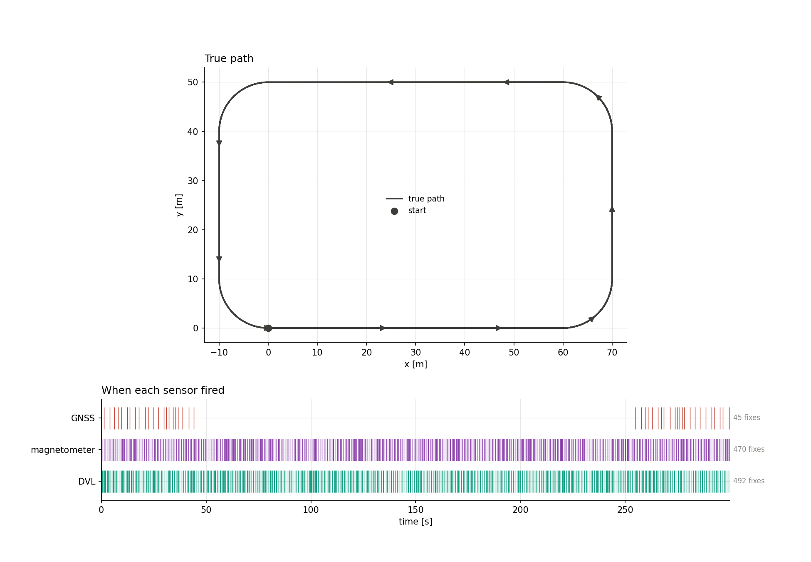

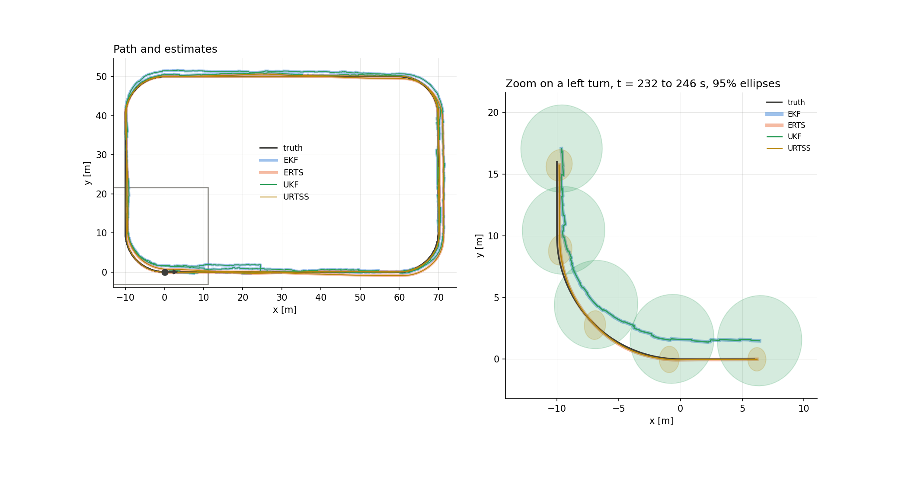

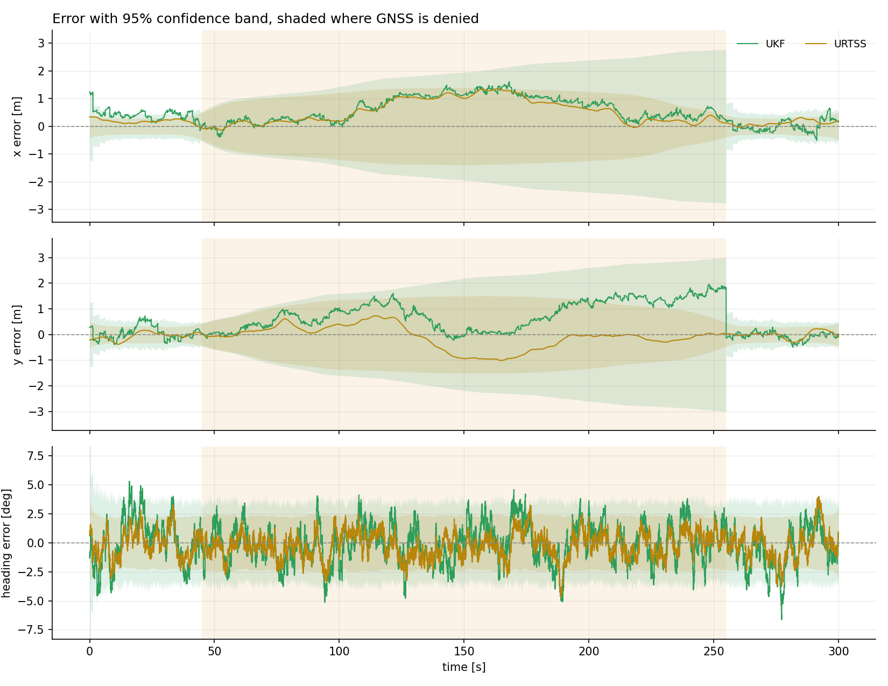

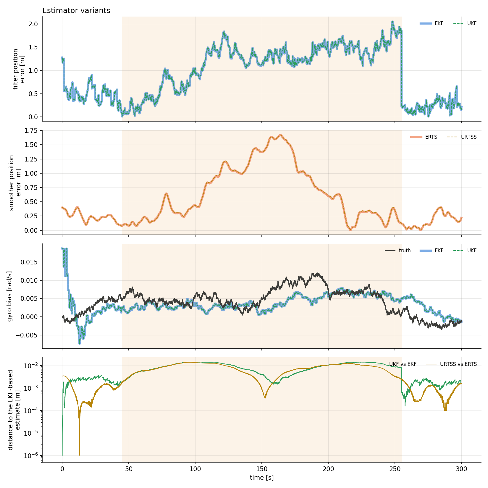

| statistic | EKF / ERTS | UKF / URTSS |
| --- | --- | --- |
| ANIS GNSS | 2.0675 (consistent) | 2.0663 (consistent) |
| ANIS magnetometer | 0.9272 (consistent) | 0.9271 (consistent) |
| ANIS DVL | 2.1775 (overconfident) | 2.1767 (consistent) |
| ANEES position filter | 1.6477 (consistent) | 1.6485 (consistent) |
| ANEES position smoother | 1.5950 (consistent) | 1.6036 (consistent) |

| estimator | RMSE position [m] | median [m] | 95th percentile [m] | max [m] | RMSE heading [°] |
| --- | --- | --- | --- | --- | --- |
| EKF | 1.068 | 1.069 | 1.661 | 2.048 | 1.75 |
| UKF | 1.071 | 1.075 | 1.666 | 2.055 | 1.75 |
| ERTS | 0.705 | 0.323 | 1.523 | 1.670 | 1.17 |
| URTSS | 0.707 | 0.329 | 1.525 | 1.672 | 1.17 |

| estimator | RMSE $b_{a,x}$ [m/s²] | RMSE $b_{a,y}$ [m/s²] | RMSE $b_g$ [rad/s] | peak $\lvert b_g - \hat b_g \rvert$ [rad/s] |
| --- | --- | --- | --- | --- |
| EKF | 0.0395 | 0.0437 | 0.00383 | 0.0197 |
| UKF | 0.0394 | 0.0437 | 0.00383 | 0.0197 |
| ERTS | 0.0206 | 0.0206 | 0.00204 | 0.0054 |
| URTSS | 0.0205 | 0.0206 | 0.00204 | 0.0054 |

| distance | position median [mm] | position max [mm] | heading max [°] | position $\mathrm{tr}\,P$ ratio range |
| --- | --- | --- | --- | --- |
| UKF vs EKF | 6.2 | 14.3 | 0.012 | [1.0000, 1.0005] |
| URTSS vs ERTS | 5.5 | 14.0 | 0.004 | [1.0000, 1.0011] |

Share of steps with the true position inside the reported 95% ellipse: EKF 96.9%, UKF 96.9%, ERTS 99.8%, URTSS 99.8%.

#### Figure-eight

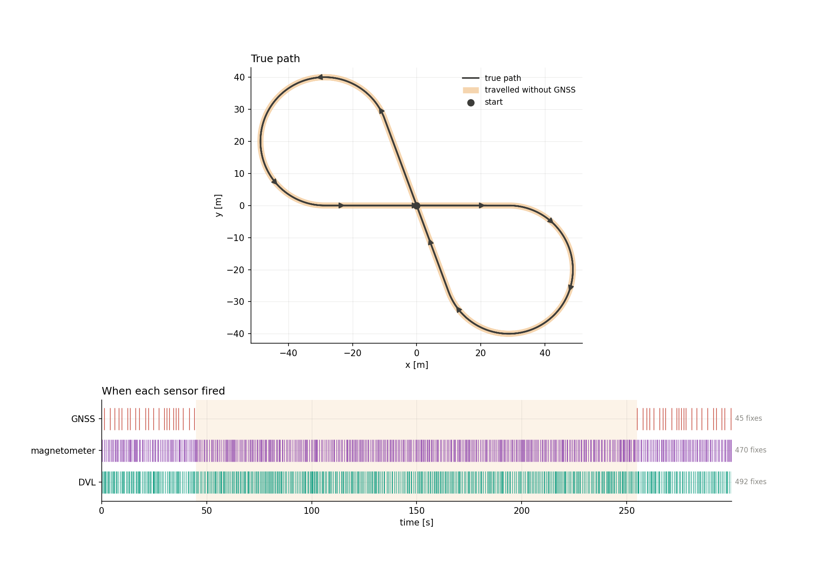

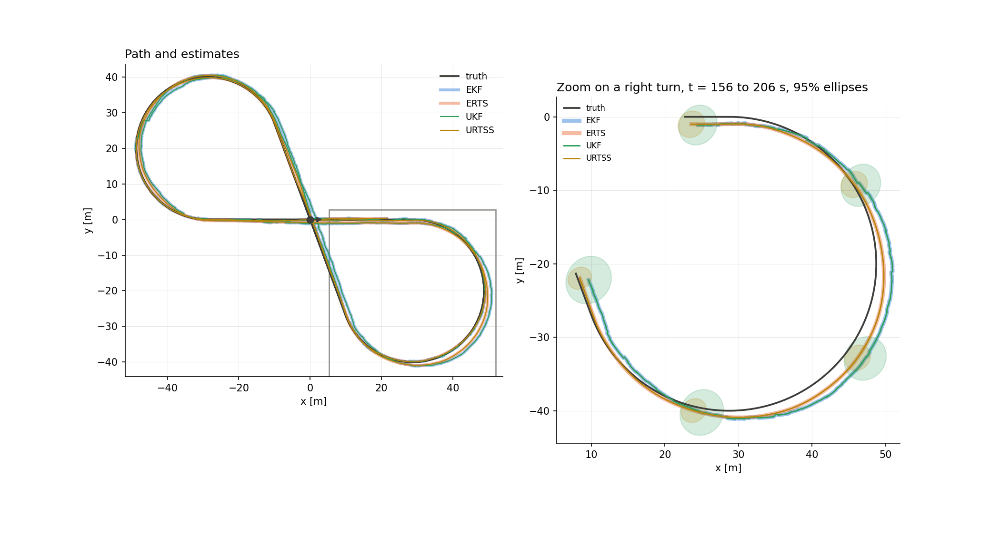

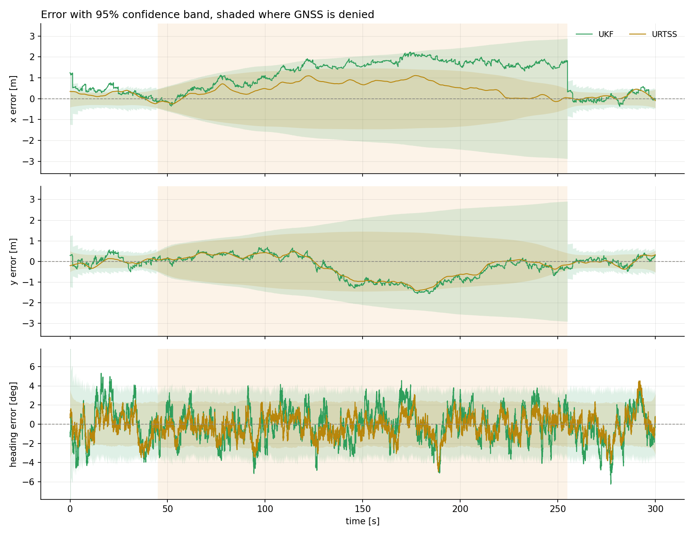

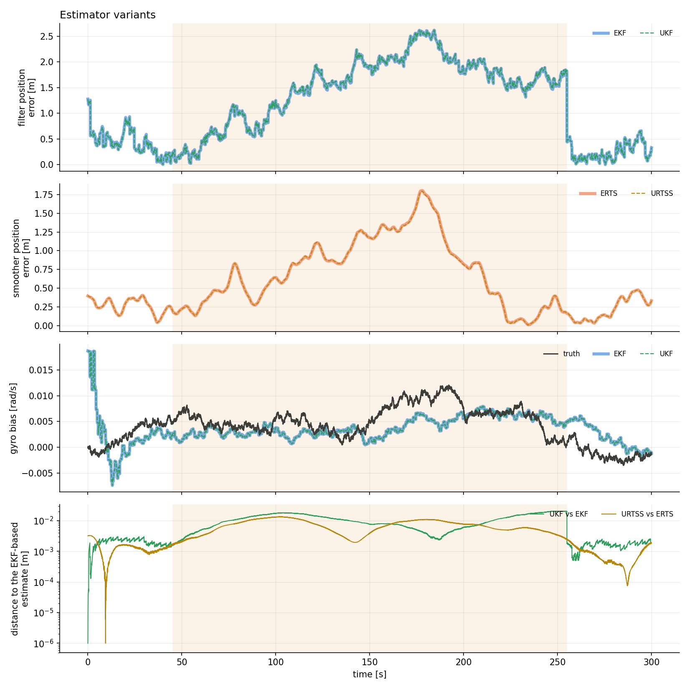

| statistic | EKF / ERTS | UKF / URTSS |
| --- | --- | --- |
| ANIS GNSS | 1.8616 (consistent) | 1.8612 (consistent) |
| ANIS magnetometer | 0.9262 (consistent) | 0.9262 (consistent) |
| ANIS DVL | 2.1712 (consistent) | 2.1704 (consistent) |
| ANEES position filter | 2.3143 (consistent) | 2.3230 (consistent) |
| ANEES position smoother | 1.9839 (consistent) | 1.9750 (consistent) |

| estimator | RMSE position [m] | median [m] | 95th percentile [m] | max [m] | RMSE heading [°] |
| --- | --- | --- | --- | --- | --- |
| EKF | 1.383 | 1.205 | 2.365 | 2.616 | 1.78 |
| UKF | 1.388 | 1.210 | 2.366 | 2.618 | 1.78 |
| ERTS | 0.737 | 0.425 | 1.431 | 1.804 | 1.21 |
| URTSS | 0.735 | 0.421 | 1.423 | 1.795 | 1.21 |

| estimator | RMSE $b_{a,x}$ [m/s²] | RMSE $b_{a,y}$ [m/s²] | RMSE $b_g$ [rad/s] | peak $\lvert b_g - \hat b_g \rvert$ [rad/s] |
| --- | --- | --- | --- | --- |
| EKF | 0.0389 | 0.0434 | 0.00383 | 0.0197 |
| UKF | 0.0388 | 0.0434 | 0.00383 | 0.0197 |
| ERTS | 0.0204 | 0.0206 | 0.00205 | 0.0054 |
| URTSS | 0.0204 | 0.0206 | 0.00205 | 0.0054 |

| distance | position median [mm] | position max [mm] | heading max [°] | position $\mathrm{tr}\,P$ ratio range |
| --- | --- | --- | --- | --- |
| UKF vs EKF | 6.8 | 20.3 | 0.012 | [1.0000, 1.0005] |
| URTSS vs ERTS | 4.9 | 13.3 | 0.003 | [1.0000, 1.0011] |

Share of steps with the true position inside the reported 95% ellipse: EKF 97.2%, UKF 97.2%, ERTS 94.8%, URTSS 94.9%.

### Heading-stress run

#### Four-corner test

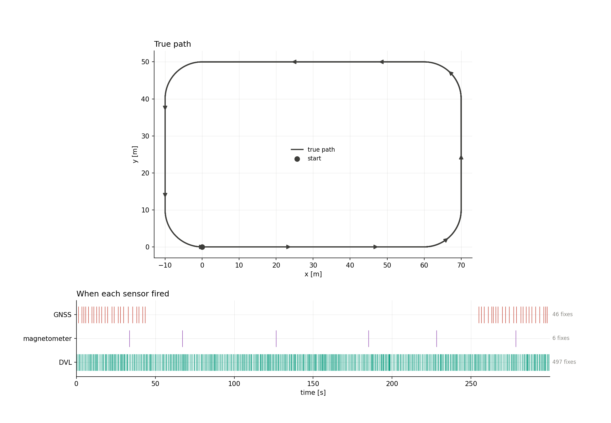

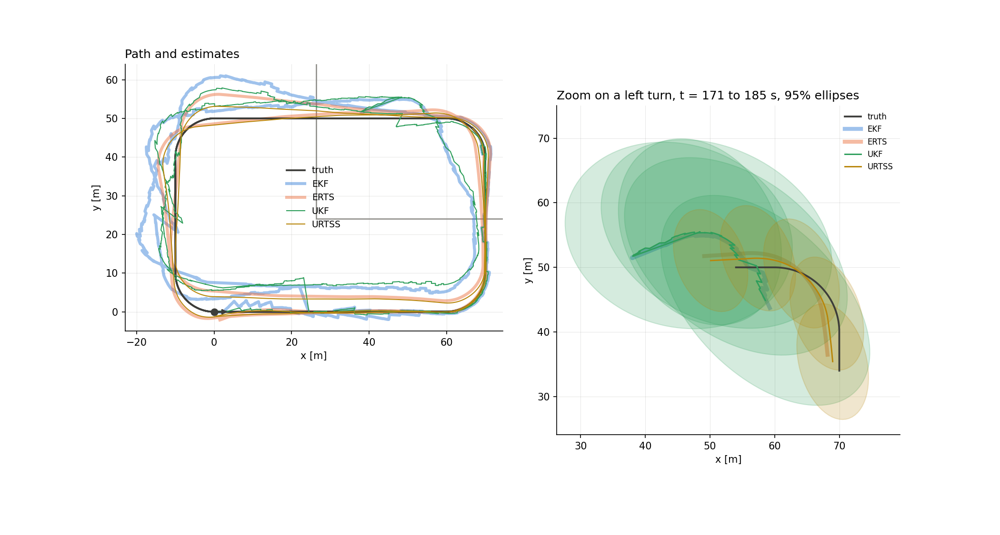

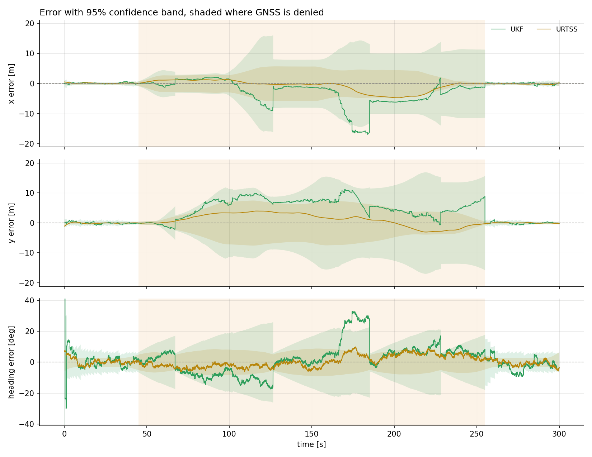

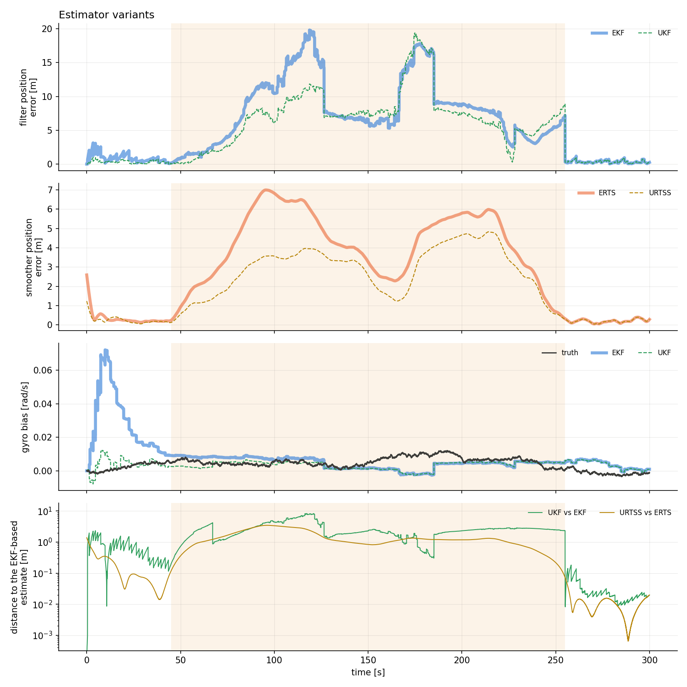

| statistic | EKF / ERTS | UKF / URTSS |
| --- | --- | --- |
| ANIS GNSS | 4.7461 (overconfident) | 2.2008 (consistent) |
| ANIS magnetometer | 2.5189 (consistent) | 2.4315 (overconfident) |
| ANIS DVL | 2.4046 (overconfident) | 1.8406 (consistent) |
| ANEES position filter | 3.2084 (overconfident) | 1.5728 (consistent) |
| ANEES position smoother | 3.2130 (consistent) | 1.6063 (consistent) |

| estimator | RMSE position [m] | median [m] | 95th percentile [m] | max [m] | RMSE heading [°] |
| --- | --- | --- | --- | --- | --- |
| EKF | 7.874 | 5.327 | 16.668 | 19.781 | 12.43 |
| UKF | 6.743 | 5.375 | 15.151 | 19.357 | 9.77 |
| ERTS | 3.770 | 2.876 | 6.488 | 6.996 | 5.04 |
| URTSS | 2.598 | 1.824 | 4.593 | 4.824 | 3.51 |

| estimator | RMSE $b_{a,x}$ [m/s²] | RMSE $b_{a,y}$ [m/s²] | RMSE $b_g$ [rad/s] | peak $\lvert b_g - \hat b_g \rvert$ [rad/s] |
| --- | --- | --- | --- | --- |
| EKF | 0.0531 | 0.0450 | 0.01369 | 0.0723 |
| UKF | 0.0399 | 0.0453 | 0.00472 | 0.0132 |
| ERTS | 0.0267 | 0.0243 | 0.00481 | 0.0185 |
| URTSS | 0.0214 | 0.0236 | 0.00268 | 0.0073 |

| distance | position median [mm] | position max [mm] | heading max [°] | position $\mathrm{tr}\,P$ ratio range |
| --- | --- | --- | --- | --- |
| UKF vs EKF | 1880.3 | 8300.0 | 56.057 | [0.9853, 1.3604] |
| URTSS vs ERTS | 952.0 | 3477.1 | 20.628 | [0.9837, 1.1006] |

Share of steps with the true position inside the reported 95% ellipse: EKF 89.0%, UKF 99.8%, ERTS 88.1%, URTSS 99.0%.

#### Figure-eight

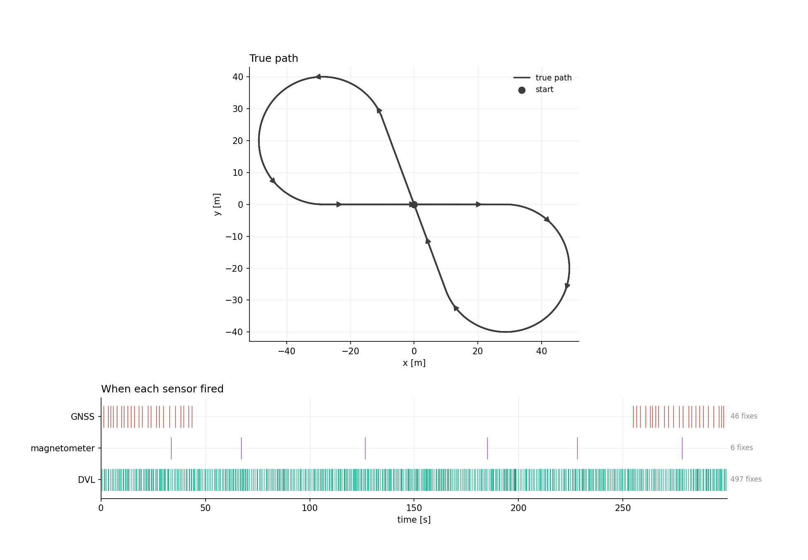

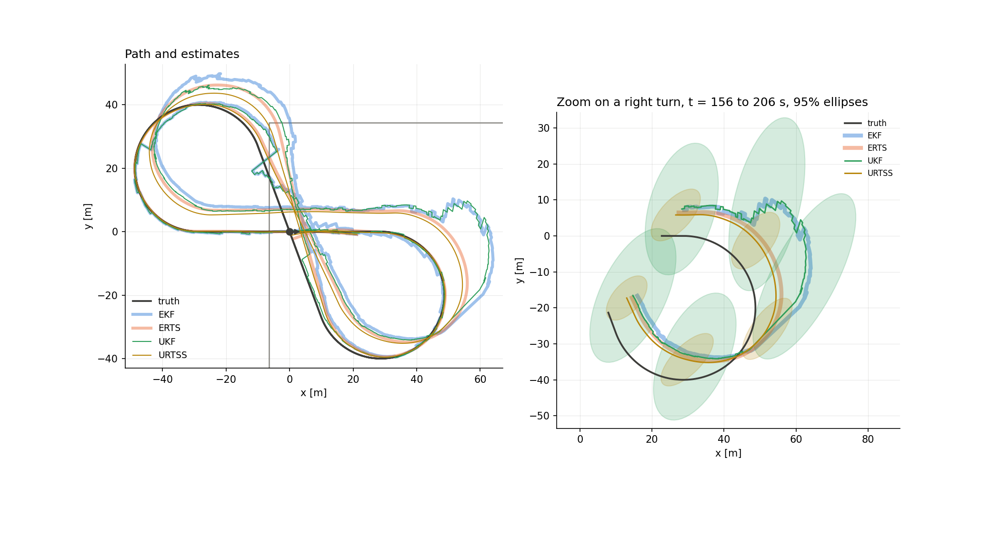

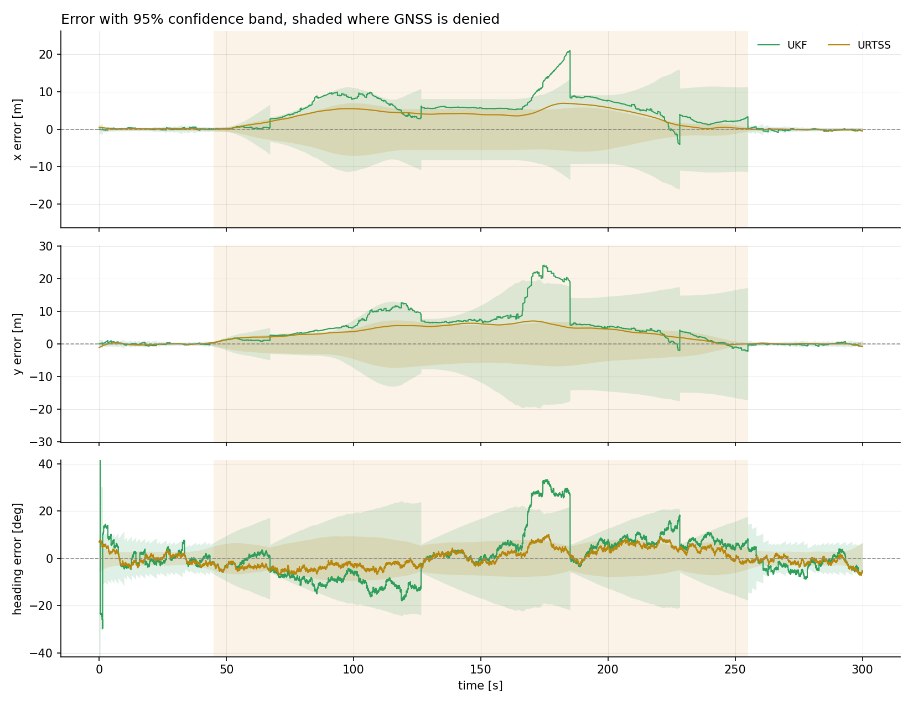

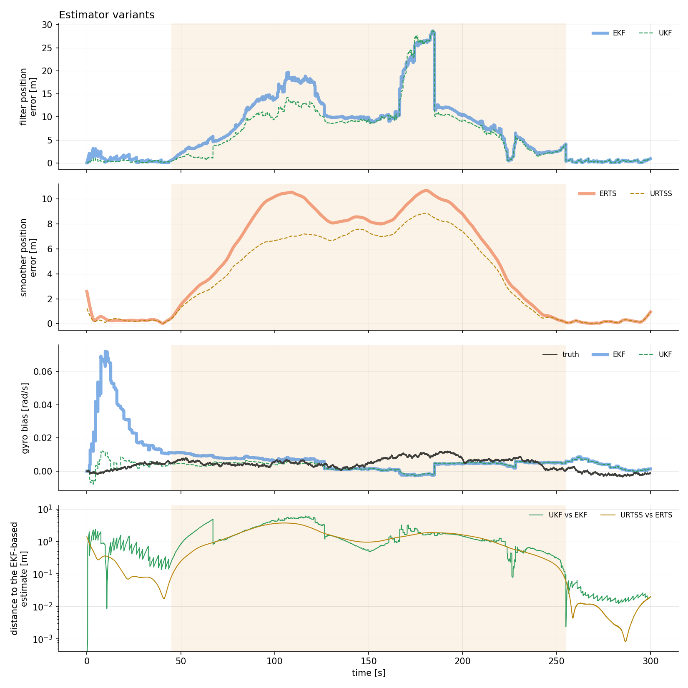

| statistic | EKF / ERTS | UKF / URTSS |
| --- | --- | --- |
| ANIS GNSS | 4.7085 (overconfident) | 2.1356 (consistent) |
| ANIS magnetometer | 2.7979 (overconfident) | 2.9071 (overconfident) |
| ANIS DVL | 2.4051 (overconfident) | 1.8499 (consistent) |
| ANEES position filter | 4.5829 (overconfident) | 2.3121 (consistent) |
| ANEES position smoother | 5.6699 (consistent) | 3.0930 (consistent) |

| estimator | RMSE position [m] | median [m] | 95th percentile [m] | max [m] | RMSE heading [°] |
| --- | --- | --- | --- | --- | --- |
| EKF | 10.042 | 5.569 | 21.150 | 28.643 | 12.70 |
| UKF | 8.904 | 4.738 | 22.206 | 28.855 | 9.97 |
| ERTS | 6.260 | 4.473 | 10.382 | 10.646 | 5.22 |
| URTSS | 4.973 | 3.512 | 8.338 | 8.840 | 3.64 |

| estimator | RMSE $b_{a,x}$ [m/s²] | RMSE $b_{a,y}$ [m/s²] | RMSE $b_g$ [rad/s] | peak $\lvert b_g - \hat b_g \rvert$ [rad/s] |
| --- | --- | --- | --- | --- |
| EKF | 0.0534 | 0.0441 | 0.01375 | 0.0723 |
| UKF | 0.0403 | 0.0444 | 0.00464 | 0.0133 |
| ERTS | 0.0269 | 0.0236 | 0.00488 | 0.0187 |
| URTSS | 0.0218 | 0.0230 | 0.00270 | 0.0076 |

| distance | position median [mm] | position max [mm] | heading max [°] | position $\mathrm{tr}\,P$ ratio range |
| --- | --- | --- | --- | --- |
| UKF vs EKF | 1013.9 | 6049.2 | 56.057 | [0.9999, 1.2815] |
| URTSS vs ERTS | 951.9 | 3704.7 | 20.586 | [0.9827, 1.1551] |

Share of steps with the true position inside the reported 95% ellipse: EKF 72.2%, UKF 95.1%, ERTS 60.2%, URTSS 98.0%.

## Discussion

**Outage run**

- **The filters are indistinguishable.** The UKF is 6.2 mm from the EKF in median on the four-corner test and 6.8 mm on the figure-eight (at most 14.3 and 20.3 mm, and 0.01° in heading). The reported position $\mathrm{tr}\,P$ of the two stays within 0.05% of each other. Position RMSE is 1.068 and 1.071 m on the four-corner test and 1.383 and 1.388 m on the figure-eight.
- **Consistency is the same for both.** Every ANIS and ANEES agrees between the two filters. The only flag is the EKF's DVL ANIS on the four-corner test, 2.1775 against an upper band edge of 2.177, with the UKF at 2.1767 just inside. That is the same number on either side of the edge, not a difference between the filters.
- **The model is too mildly nonlinear here for the choice to matter.** The heading is known to a degree or so, so the linearisation is good over the whole spread.

**Heading-stress run**

- **The UKF is better, but by less than the setup might suggest.** Position RMSE is 7.87 m (EKF) and 6.74 m (UKF) on the four-corner test, and 10.04 and 8.90 m on the figure-eight. The 95th percentile of the error is 16.7 against 15.2 m on the four-corner test, but 21.2 against 22.2 m on the figure-eight, so the UKF does not win everywhere. Over the 21-run Monte Carlo the RMSE is 9.41 against 7.78 m and 9.35 against 8.14 m, with a run-to-run spread of 3 to 4.5 m, so the gap of about 1.2 to 1.6 m is real on average but small next to the spread.
- **The smoother choice matters more than the filter choice.** The URTSS has the lowest RMSE (2.60 and 4.97 m) and the ERTS is next (3.77 and 6.26 m), both far below either filter. The smoother gains more than the switch from EKF to UKF does.
- **The EKF is overconfident, the UKF is consistent for this seed.** The EKF's position ANEES is 3.21 and 4.58 against upper band edges of 2.75 and 2.84, with the true position inside its 95% ellipse on 89% and 72% of the steps. The UKF's is 1.57 and 2.31, inside its bands, with coverage 99.8% and 95.1%. The smoother ANEES rows read "consistent" only because their band is wide for the autocorrelation reason in the model section, and the ellipse coverage of the ERTS (88% and 60%) shows its overconfidence. Over the 21 runs both filters are overconfident on average, the EKF strongly (7.8 and 6.6) and the UKF mildly (3.0 and 2.9).
- **The wrong heading leaks into the gyro bias.** The EKF's gyro-bias estimate peaks at an error of 0.072 rad/s on both paths against 0.013 rad/s for the UKF, and the EKF takes much longer to settle (the gyro-bias panel of the variants figure). A likely explanation, not tested here, is that with the heading wrong the filter explains the mismatch between the heading and the direction of travel with a bias, and the EKF's linearisation lets the bias absorb far more of it.
- **The filters are far apart.** The UKF and EKF are 1.9 m and 1.0 m apart in median, up to 8.3 and 6.0 m and up to 56° in heading.
- **Why the UKF can be expected to win here.** A likely explanation, not tested separately, is that with a heading error of 1.5 rad the rotation in $f$ and in the DVL's $h$ changes a lot over the heading spread. The Jacobian at the mean then says little about how the whole distribution moves, while sigma points spread across the heading uncertainty see the curvature.

**Limits.** One seed per run on this page. The stress run was built to separate the filters, and the size of the gap is for this stress. The mismatch is in the filter's prior only, so nothing is said about a mistuned $Q$ or $R$. The unscented parameters $\alpha$, $\beta$, $\kappa$ were not varied.

## Related results

- [GNSS outage](../gnss_outage/README.md) is the outage run with the EKF only and a mistuned-filter comparison.
- [IEKF](../iekf/README.md) runs the iterated EKF on the figure-eight with an outage and with multi-sensor fusion; it does not include the heading-stress case.
- [Multi-sensor fusion](../multi_sensor_fusion/README.md) is the same sensor set with sparse GNSS throughout.
