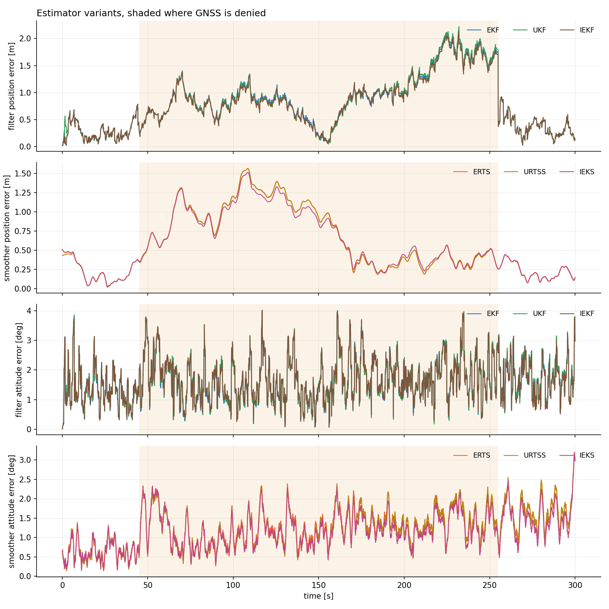
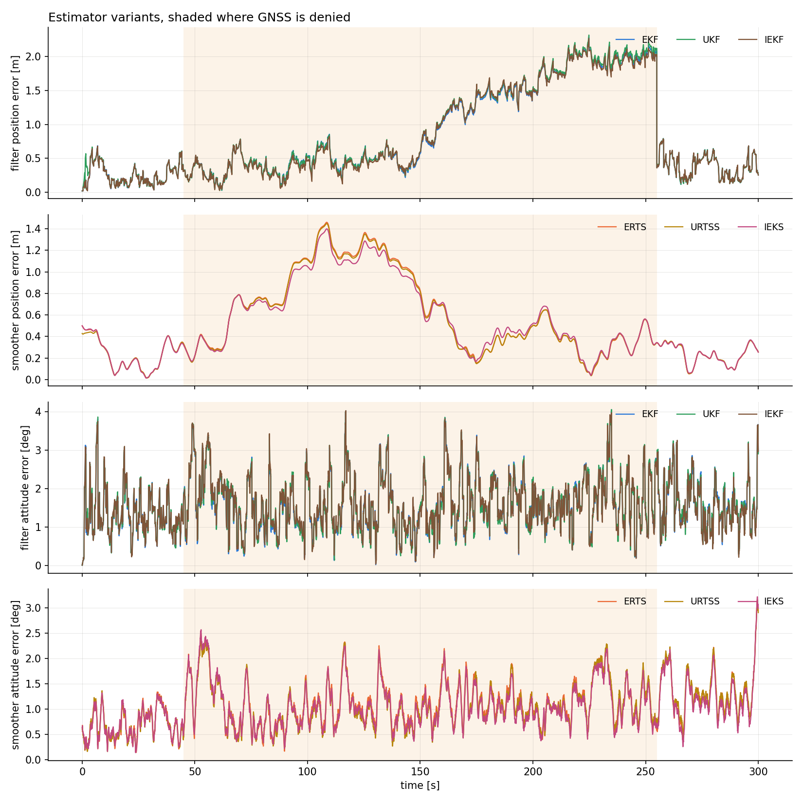

# 3-D strapdown INS, base case: all estimators compared

[Back to the base case](../README.md) | [Extended Kalman filter and ERTS](../extended/README.md) | [Unscented Kalman filter and URTSS](../unscented/README.md) | [Iterated extended Kalman filter and smoother](../iterated/README.md)

## Problem and setup

An underwater vehicle estimates its pose in three dimensions from an IMU, aided by GNSS, a magnetometer, a DVL and an altimeter. GNSS is denied from 45 s to 255 s. The filter prior is centred on the true initial state.

The EKF with the ERTS, the UKF with the URTSS and the IEKF with the IEKS are run on the same data, so every estimate below has seen exactly the same IMU readings and fixes.

The truth and the prior mean start at the origin, level, heading north at 2 m/s, with zero biases. Prior standard deviations: 0.63 m in position, 0.2 m/s in velocity, 0.2 rad in attitude.

The state, motion model, sensors and parameters are given in the [base case overview](../README.md).

| run | trajectory | magnetometer period |
| --- | --- | --- |
| [`figure_eight`](figure_eight/) | figure-eight | 0.25 to 1 s |
| [`rounded_rectangle`](rounded_rectangle/) | four-corner | 0.25 to 1 s |

## Reproduction

From the project root, after building:

```bash
./build/kalman_filtering_and_smoothing results/INS3D/base_case/comparison
for run in results/INS3D/base_case/comparison/*/; do
    python3 scripts/analyze_ins_3d.py "$run/data"
done
```

Every number below is taken from the run's `stats.txt`.

## Results

### Figure-eight


*The true path with the body axes, and when each sensor fired.*



*From the top: position error of the filters, position error of the smoothers, attitude error of the filters and attitude error of the smoothers. Shaded where GNSS is denied.*

| estimator | RMSE position [m] | median [m] | 95th percentile [m] | max [m] | RMSE attitude [°] | max attitude [°] | true position inside 95% ellipsoid |
| --- | --- | --- | --- | --- | --- | --- | --- |
| EKF | 0.930 | 0.752 | 1.79 | 2.19 | 1.79 | 4.1 | 98.2% |
| UKF | 0.942 | 0.739 | 1.84 | 2.23 | 1.80 | 4.1 | 98.1% |
| IEKF | 0.913 | 0.731 | 1.76 | 2.15 | 1.79 | 4.0 | 98.2% |
| ERTS | 0.716 | 0.430 | 1.32 | 1.57 | 1.37 | 3.2 | 98.5% |
| URTSS | 0.709 | 0.423 | 1.31 | 1.56 | 1.36 | 3.2 | 98.6% |
| IEKS | 0.692 | 0.446 | 1.27 | 1.52 | 1.27 | 3.2 | 98.6% |

| statistic | dof | EKF / ERTS | UKF / URTSS | IEKF / IEKS |
| --- | --- | --- | --- | --- |
| NIS, GNSS | 3 | 3.540 (consistent) | 3.557 (consistent) | 3.530 (consistent) |
| NIS, magnetometer | 1 | 0.803 (underconfident) | 0.803 (underconfident) | 0.802 (underconfident) |
| NIS, DVL | 3 | 2.298 (underconfident) | 2.261 (underconfident) | 2.298 (underconfident) |
| NIS, altimeter | 1 | 1.015 (consistent) | 1.009 (consistent) | 1.015 (consistent) |
| NEES, full state, filter | 15 | 9.000 (underconfident) | 9.199 (underconfident) | 8.998 (underconfident) |
| NEES, position, filter | 3 | 2.344 (underconfident) | 2.354 (underconfident) | 2.304 (underconfident) |
| NEES, attitude, filter | 3 | 1.319 (underconfident) | 1.331 (underconfident) | 1.320 (underconfident) |
| NEES, full state, smoother | 15 | 10.768 (underconfident) | 10.451 (underconfident) | 9.981 (underconfident) |
| NEES, position, smoother | 3 | 2.930 (consistent) | 2.887 (consistent) | 2.866 (consistent) |
| NEES, attitude, smoother | 3 | 2.106 (consistent) | 2.025 (consistent) | 1.779 (consistent) |

### Four-corner


*The true path with the body axes, and when each sensor fired.*



*From the top: position error of the filters, position error of the smoothers, attitude error of the filters and attitude error of the smoothers. Shaded where GNSS is denied.*

| estimator | RMSE position [m] | median [m] | 95th percentile [m] | max [m] | RMSE attitude [°] | max attitude [°] | true position inside 95% ellipsoid |
| --- | --- | --- | --- | --- | --- | --- | --- |
| EKF | 1.083 | 0.485 | 2.11 | 2.40 | 1.73 | 4.1 | 98.9% |
| UKF | 1.101 | 0.484 | 2.16 | 2.42 | 1.73 | 4.1 | 98.8% |
| IEKF | 1.081 | 0.487 | 2.09 | 2.37 | 1.73 | 4.0 | 98.9% |
| ERTS | 0.610 | 0.373 | 1.22 | 1.40 | 1.20 | 3.3 | 99.7% |
| URTSS | 0.604 | 0.378 | 1.20 | 1.39 | 1.19 | 3.3 | 99.7% |
| IEKS | 0.591 | 0.407 | 1.15 | 1.35 | 1.15 | 3.3 | 99.7% |

| statistic | dof | EKF / ERTS | UKF / URTSS | IEKF / IEKS |
| --- | --- | --- | --- | --- |
| NIS, GNSS | 3 | 3.521 (consistent) | 3.540 (consistent) | 3.515 (consistent) |
| NIS, magnetometer | 1 | 0.799 (underconfident) | 0.799 (underconfident) | 0.798 (underconfident) |
| NIS, DVL | 3 | 2.308 (underconfident) | 2.271 (underconfident) | 2.307 (underconfident) |
| NIS, altimeter | 1 | 1.014 (consistent) | 1.007 (consistent) | 1.014 (consistent) |
| NEES, full state, filter | 15 | 8.361 (underconfident) | 8.534 (underconfident) | 8.406 (underconfident) |
| NEES, position, filter | 3 | 2.148 (underconfident) | 2.178 (underconfident) | 2.146 (underconfident) |
| NEES, attitude, filter | 3 | 1.224 (underconfident) | 1.232 (underconfident) | 1.229 (underconfident) |
| NEES, full state, smoother | 15 | 9.227 (underconfident) | 8.949 (underconfident) | 8.780 (underconfident) |
| NEES, position, smoother | 3 | 2.420 (consistent) | 2.389 (consistent) | 2.375 (consistent) |
| NEES, attitude, smoother | 3 | 1.618 (underconfident) | 1.555 (underconfident) | 1.465 (underconfident) |
