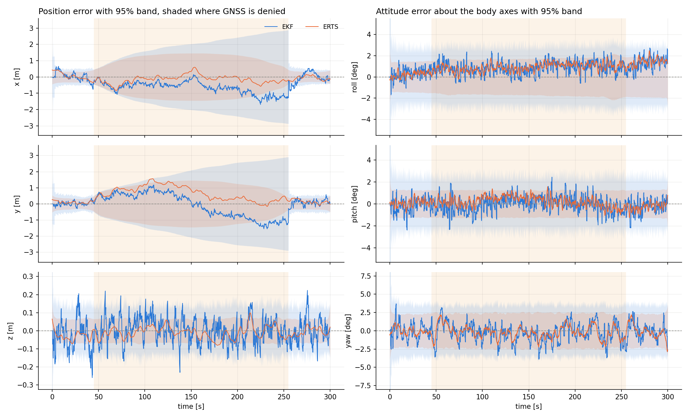
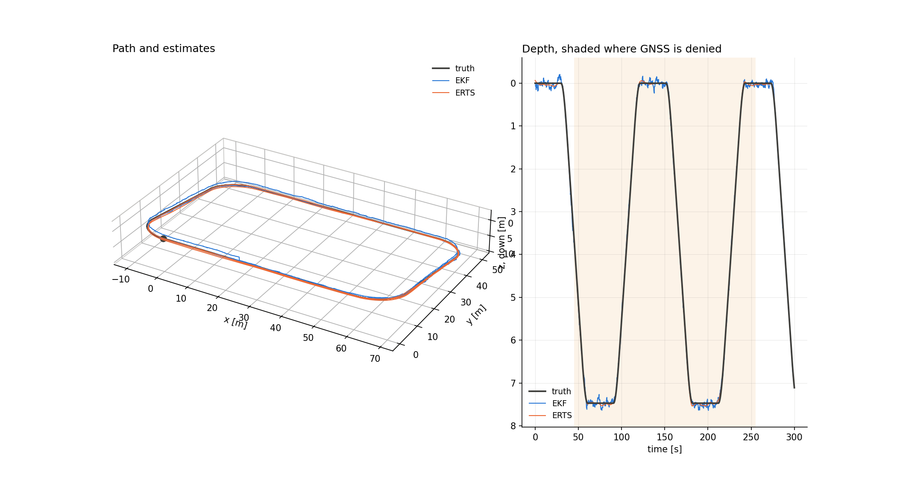
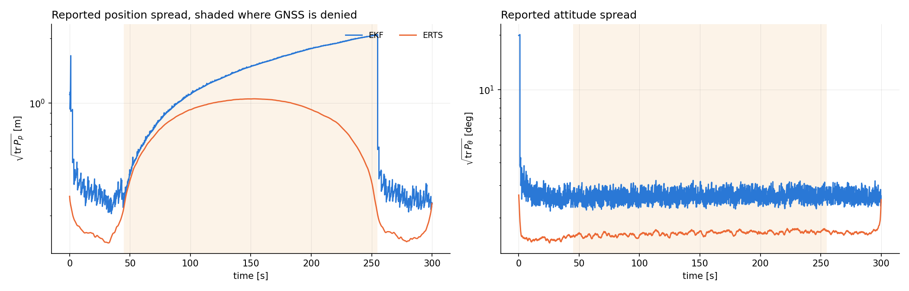
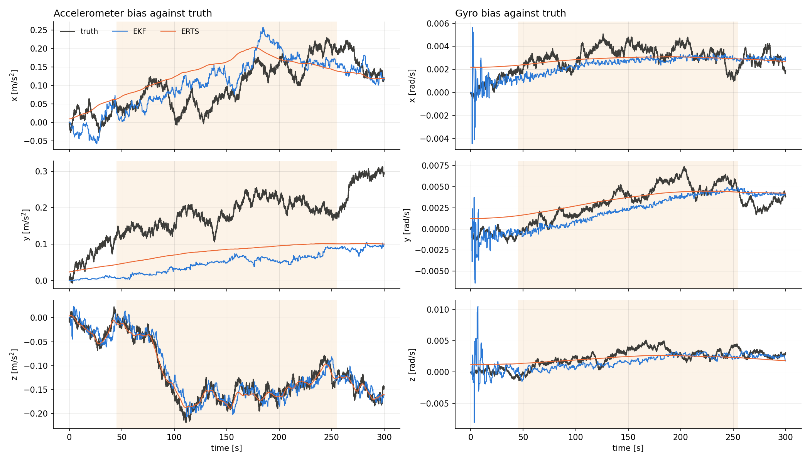
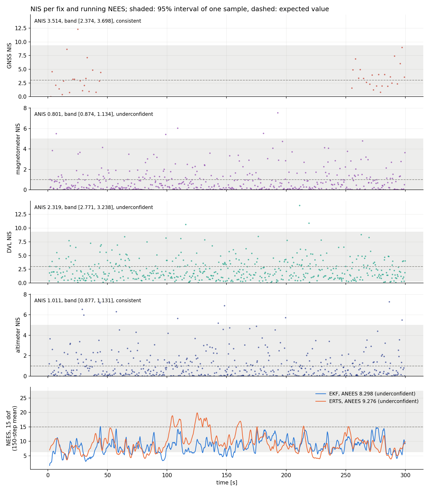

# 3-D strapdown INS, base case: Extended Kalman filter and ERTS

[Back to the base case](../README.md) | [Unscented Kalman filter and URTSS](../unscented/README.md) | [Iterated extended Kalman filter and smoother](../iterated/README.md) | [All estimators compared](../comparison/README.md)

## Problem and setup

An underwater vehicle estimates its pose in three dimensions from an IMU, aided by GNSS, a magnetometer, a DVL and an altimeter. GNSS is denied from 45 s to 255 s. The filter prior is centred on the true initial state.

The extended Kalman filter (EKF) linearises the motion and measurement models at the current estimate. The extended Rauch-Tung-Striebel smoother (ERTS) runs backward over the stored EKF output with the same Jacobians.

The truth and the prior mean start at the origin, level, heading north at 2 m/s, with zero biases. Prior standard deviations: 0.63 m in position, 0.2 m/s in velocity, 0.2 rad in attitude.

The state, motion model, sensors and parameters are given in the [base case overview](../README.md).

| run | trajectory | magnetometer period |
| --- | --- | --- |
| [`figure_eight`](figure_eight/) | figure-eight | 0.25 to 1 s |
| [`rounded_rectangle`](rounded_rectangle/) | four-corner | 0.25 to 1 s |

## Reproduction

From the project root, after building:

```bash
./build/kalman_filtering_and_smoothing results/INS3D/base_case/extended
for run in results/INS3D/base_case/extended/*/; do
    python3 scripts/analyze_ins_3d.py "$run/data"
done
```

Every number below is taken from the run's `stats.txt`.

## Results

### Figure-eight


*The true path with the body $x$ (forward) and $z$ (down) axes, and when each sensor fired.*


*The true path with the EKF and ERTS estimates in 3D, and the depth against time.*



*Position error per axis and attitude error about each body axis, with each estimator's 95% band. Shaded where GNSS is denied.*


*The position and attitude standard deviation the EKF and ERTS report, on a log scale.*


*True and estimated accelerometer and gyro biases.*


*NIS of every fix per sensor against its 95% interval, and the running mean of the full-state NEES.*

| estimator | RMSE position [m] | median [m] | 95th percentile [m] | max [m] | RMSE attitude [°] | max attitude [°] | true position inside 95% ellipsoid |
| --- | --- | --- | --- | --- | --- | --- | --- |
| EKF | 0.930 | 0.752 | 1.79 | 2.19 | 1.79 | 4.1 | 98.2% |
| ERTS | 0.716 | 0.430 | 1.32 | 1.57 | 1.37 | 3.2 | 98.5% |

| statistic | dof | average | 95% interval | verdict |
| --- | --- | --- | --- | --- |
| NIS, GNSS | 3 | 3.540 | [2.443, 3.614] | consistent |
| NIS, magnetometer | 1 | 0.803 | [0.874, 1.135] | underconfident |
| NIS, DVL | 3 | 2.298 | [2.773, 3.236] | underconfident |
| NIS, altimeter | 1 | 1.015 | [0.876, 1.132] | consistent |
| NEES, full state, EKF | 15 | 9.000 | [13.929, 16.110] | underconfident |
| NEES, position, EKF | 3 | 2.344 | [2.480, 3.568] | underconfident |
| NEES, attitude, EKF | 3 | 1.319 | [2.683, 3.334] | underconfident |
| NEES, full state, ERTS | 15 | 10.768 | [12.287, 17.980] | underconfident |
| NEES, position, ERTS | 3 | 2.930 | [0.216, 9.348] | consistent |
| NEES, attitude, ERTS | 3 | 2.106 | [1.656, 4.737] | consistent |

### Four-corner


*The true path with the body $x$ (forward) and $z$ (down) axes, and when each sensor fired.*



*The true path with the EKF and ERTS estimates in 3D, and the depth against time.*


*Position error per axis and attitude error about each body axis, with each estimator's 95% band. Shaded where GNSS is denied.*



*The position and attitude standard deviation the EKF and ERTS report, on a log scale.*



*True and estimated accelerometer and gyro biases.*



*NIS of every fix per sensor against its 95% interval, and the running mean of the full-state NEES.*

| estimator | RMSE position [m] | median [m] | 95th percentile [m] | max [m] | RMSE attitude [°] | max attitude [°] | true position inside 95% ellipsoid |
| --- | --- | --- | --- | --- | --- | --- | --- |
| EKF | 1.083 | 0.485 | 2.11 | 2.40 | 1.73 | 4.1 | 98.9% |
| ERTS | 0.610 | 0.373 | 1.22 | 1.40 | 1.20 | 3.3 | 99.7% |

| statistic | dof | average | 95% interval | verdict |
| --- | --- | --- | --- | --- |
| NIS, GNSS | 3 | 3.521 | [2.372, 3.701] | consistent |
| NIS, magnetometer | 1 | 0.799 | [0.875, 1.133] | underconfident |
| NIS, DVL | 3 | 2.308 | [2.773, 3.236] | underconfident |
| NIS, altimeter | 1 | 1.014 | [0.877, 1.131] | consistent |
| NEES, full state, EKF | 15 | 8.361 | [13.966, 16.070] | underconfident |
| NEES, position, EKF | 3 | 2.148 | [2.518, 3.524] | underconfident |
| NEES, attitude, EKF | 3 | 1.224 | [2.680, 3.338] | underconfident |
| NEES, full state, ERTS | 15 | 9.227 | [12.425, 17.814] | underconfident |
| NEES, position, ERTS | 3 | 2.420 | [0.216, 9.348] | consistent |
| NEES, attitude, ERTS | 3 | 1.618 | [1.742, 4.595] | underconfident |
