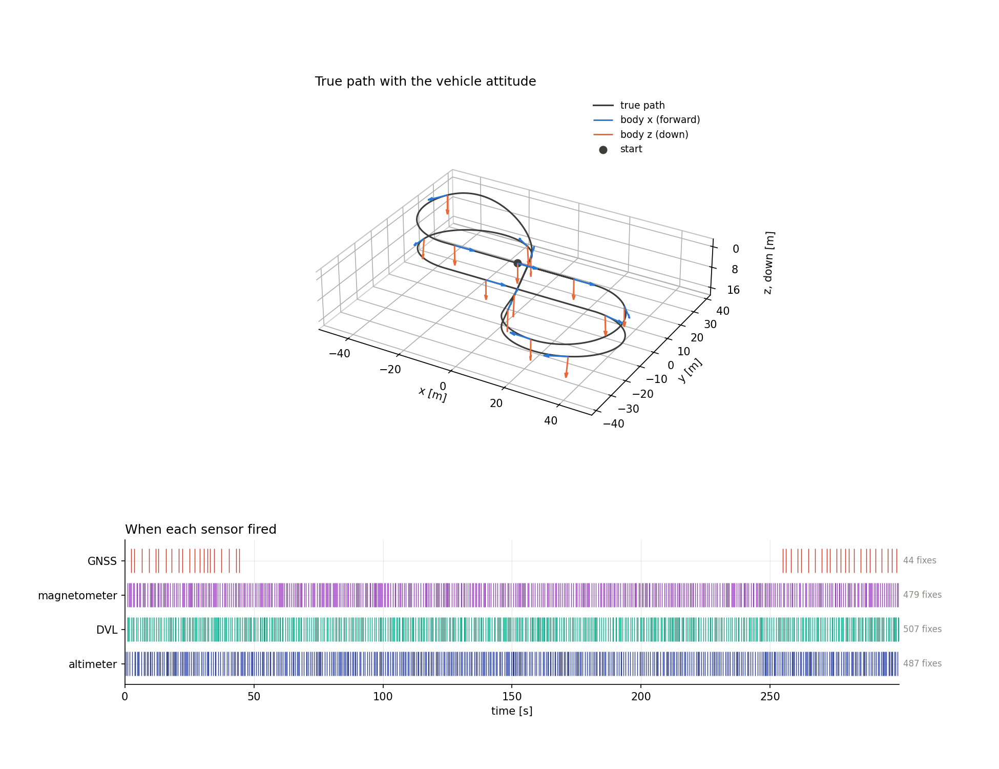
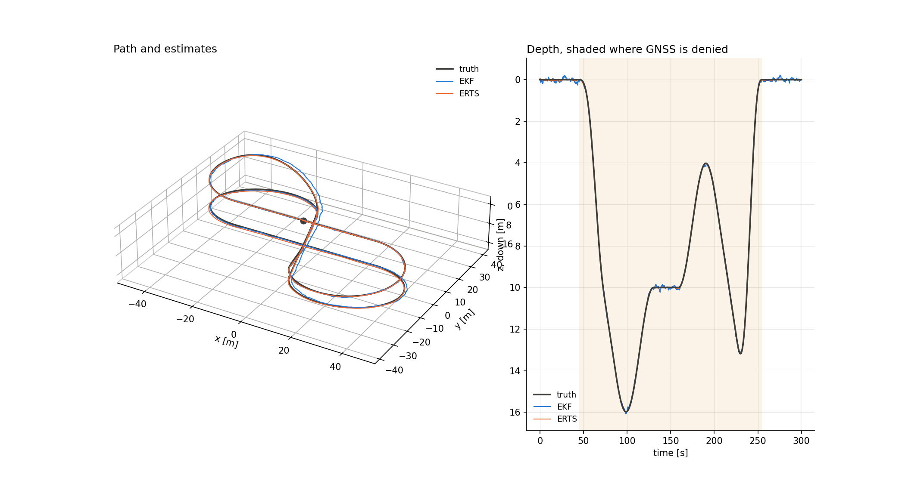
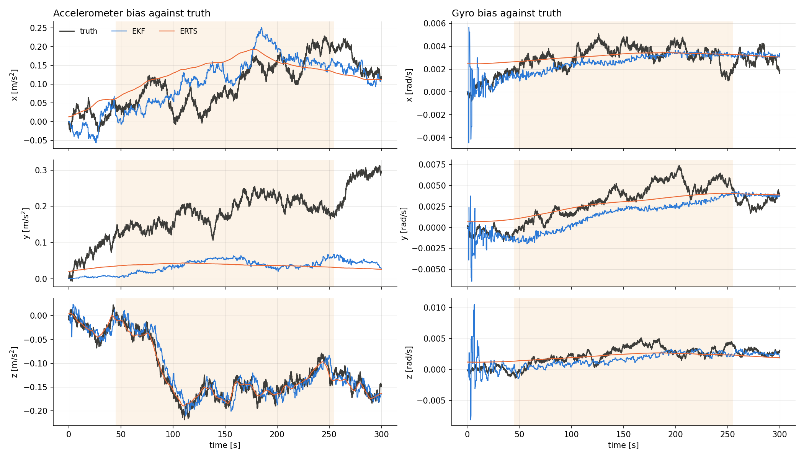
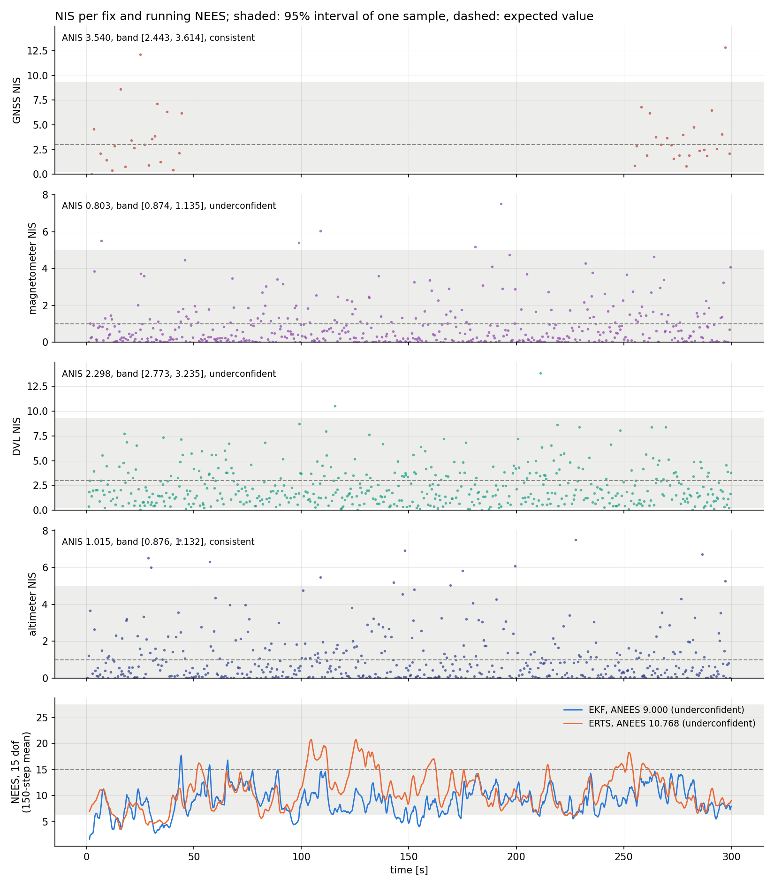
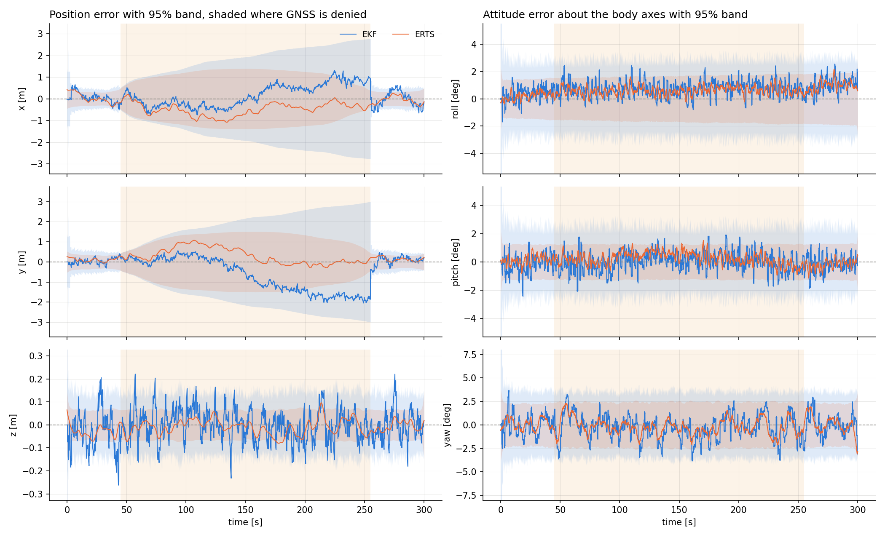

# 3-D strapdown INS, base case: Extended Kalman filter and ERTS

[Back to the base case](../README.md) | [Unscented Kalman filter and URTSS](../unscented/README.md) | [Iterated extended Kalman filter and smoother](../iterated/README.md) | [All estimators compared](../comparison/README.md)

## Problem and setup

An underwater vehicle estimates its pose in three dimensions from an IMU, aided by GNSS, a magnetometer, a DVL and an altimeter. GNSS is denied from 45 s to 255 s. The filter prior is centred on the true initial state.

The extended Kalman filter (EKF) linearises the motion and measurement models at the current estimate. The extended Rauch-Tung-Striebel smoother (ERTS) runs backward over the stored EKF output with the same Jacobians.

The truth and the prior mean start at the origin, level, heading north at 2 m/s, with zero biases. Prior standard deviations: 0.63 m in position, 0.2 m/s in velocity, 0.2 rad in attitude.

The state, motion model, sensors and parameters are given in the [base case overview](../README.md).

| run | trajectory | magnetometer period |
| --- | --- | --- |
| [`figure_eight`](figure_eight/) | figure-eight | 0.25 to 1 s |
| [`rounded_rectangle`](rounded_rectangle/) | four-corner | 0.25 to 1 s |

## Reproduction

From the project root, after building:

```bash
./build/kalman_filtering_and_smoothing results/INS3D/base_case/extended
for run in results/INS3D/base_case/extended/*/; do
    python3 scripts/analyze_ins_3d.py "$run/data"
done
```

Every number below is taken from the run's `stats.txt`.

## Results

### Figure-eight



*The true path with the body $x$ (forward) and $z$ (down) axes, and when each sensor fired.*



*The true path with the EKF and ERTS estimates in 3D, and the depth against time.*


*Position error per axis and attitude error about each body axis, with each estimator's 95% band. Shaded where GNSS is denied.*


*The position and attitude standard deviation the EKF and ERTS report, on a log scale.*



*True and estimated accelerometer and gyro biases.*



*NIS of every fix per sensor against its 95% interval, and the running mean of the full-state NEES.*

| estimator | RMSE position [m] | median [m] | 95th percentile [m] | max [m] | RMSE attitude [°] | max attitude [°] | true position inside 95% ellipsoid |
| --- | --- | --- | --- | --- | --- | --- | --- |
| EKF | 0.931 | 0.752 | 1.79 | 2.17 | 1.78 | 4.0 | 98.3% |
| ERTS | 0.708 | 0.424 | 1.31 | 1.56 | 1.35 | 3.2 | 98.6% |

| statistic | dof | average | 95% interval | verdict |
| --- | --- | --- | --- | --- |
| NIS, GNSS | 3 | 3.548 | [2.440, 3.617] | consistent |
| NIS, magnetometer | 1 | 0.805 | [0.873, 1.135] | underconfident |
| NIS, DVL | 3 | 2.300 | [2.772, 3.236] | underconfident |
| NIS, altimeter | 1 | 1.015 | [0.877, 1.131] | consistent |
| NEES, full state, EKF | 15 | 8.829 | [13.954, 16.083] | underconfident |
| NEES, position, EKF | 3 | 2.341 | [2.480, 3.569] | underconfident |
| NEES, attitude, EKF | 3 | 1.302 | [2.683, 3.334] | underconfident |
| NEES, full state, ERTS | 15 | 10.536 | [12.336, 17.920] | underconfident |
| NEES, position, ERTS | 3 | 2.913 | [0.216, 9.348] | consistent |
| NEES, attitude, ERTS | 3 | 2.058 | [1.684, 4.690] | consistent |

### Four-corner


*The true path with the body $x$ (forward) and $z$ (down) axes, and when each sensor fired.*


*The true path with the EKF and ERTS estimates in 3D, and the depth against time.*



*Position error per axis and attitude error about each body axis, with each estimator's 95% band. Shaded where GNSS is denied.*


*The position and attitude standard deviation the EKF and ERTS report, on a log scale.*


*True and estimated accelerometer and gyro biases.*


*NIS of every fix per sensor against its 95% interval, and the running mean of the full-state NEES.*

| estimator | RMSE position [m] | median [m] | 95th percentile [m] | max [m] | RMSE attitude [°] | max attitude [°] | true position inside 95% ellipsoid |
| --- | --- | --- | --- | --- | --- | --- | --- |
| EKF | 1.029 | 0.492 | 2.02 | 2.29 | 1.72 | 4.1 | 99.0% |
| ERTS | 0.637 | 0.378 | 1.26 | 1.46 | 1.18 | 3.2 | 99.7% |

| statistic | dof | average | 95% interval | verdict |
| --- | --- | --- | --- | --- |
| NIS, GNSS | 3 | 3.514 | [2.374, 3.698] | consistent |
| NIS, magnetometer | 1 | 0.801 | [0.875, 1.134] | underconfident |
| NIS, DVL | 3 | 2.319 | [2.771, 3.238] | underconfident |
| NIS, altimeter | 1 | 1.011 | [0.877, 1.131] | consistent |
| NEES, full state, EKF | 15 | 8.298 | [13.967, 16.070] | underconfident |
| NEES, position, EKF | 3 | 2.111 | [2.521, 3.520] | underconfident |
| NEES, attitude, EKF | 3 | 1.217 | [2.682, 3.336] | underconfident |
| NEES, full state, ERTS | 15 | 9.276 | [12.360, 17.892] | underconfident |
| NEES, position, ERTS | 3 | 2.519 | [0.216, 9.348] | consistent |
| NEES, attitude, ERTS | 3 | 1.588 | [1.749, 4.582] | underconfident |
