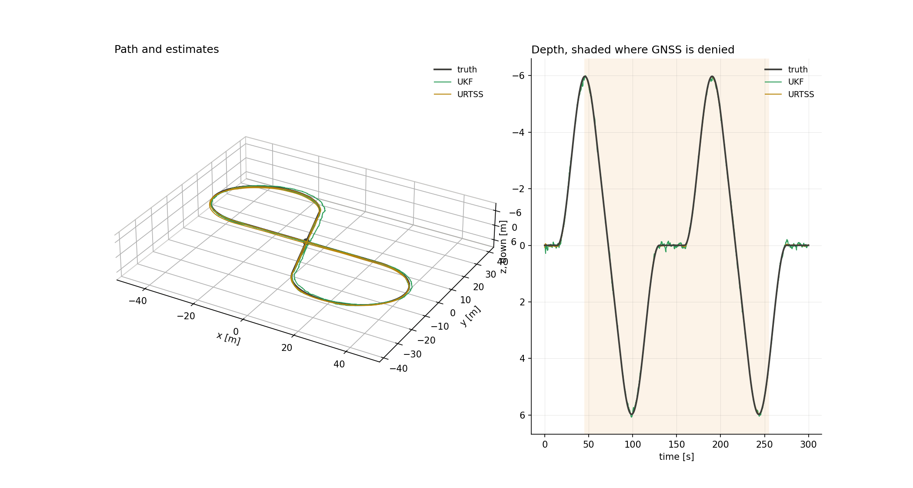
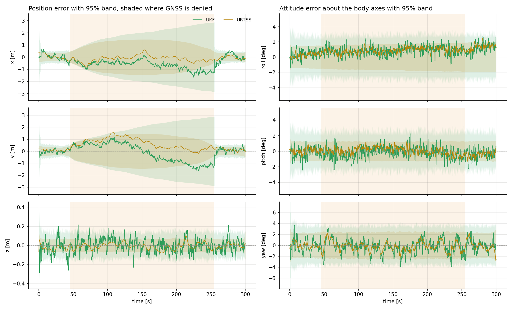
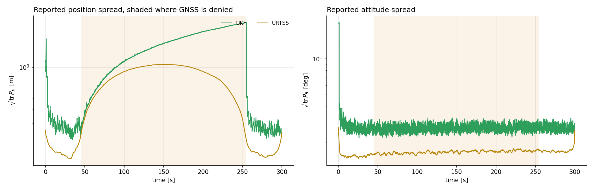
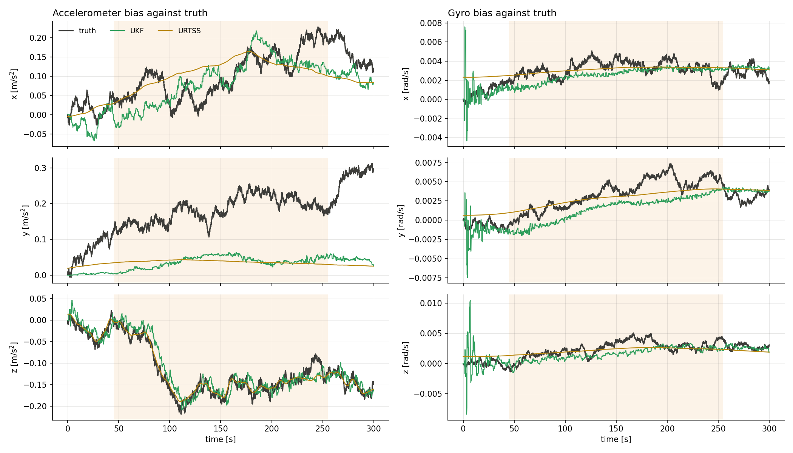
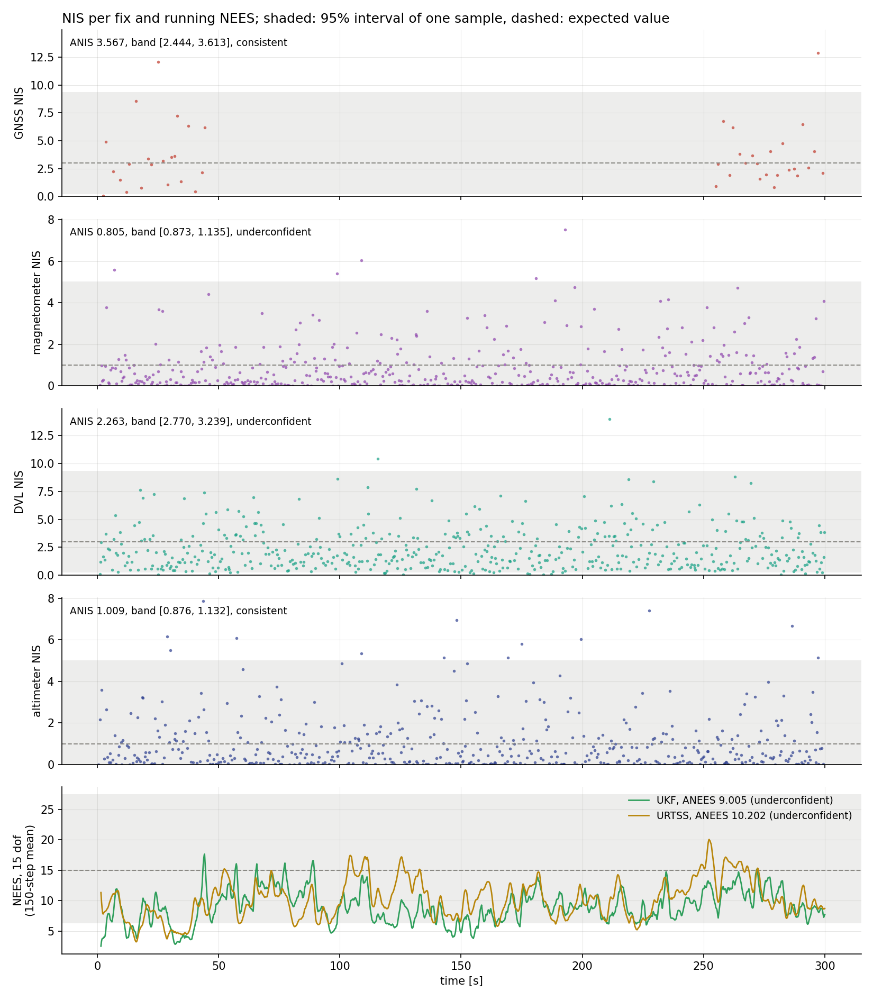
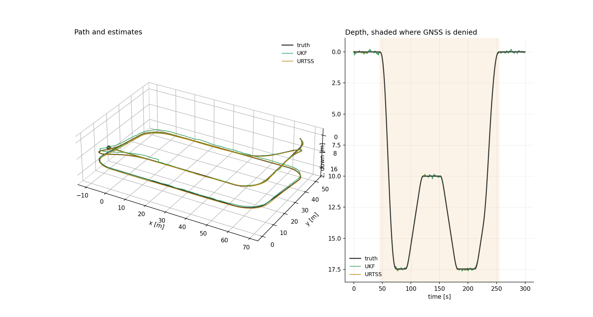
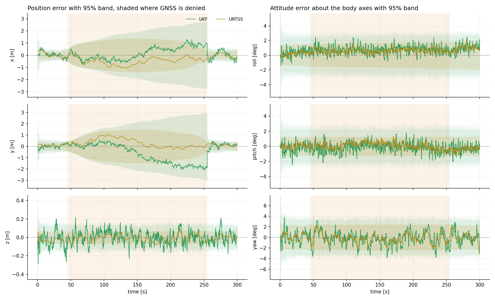
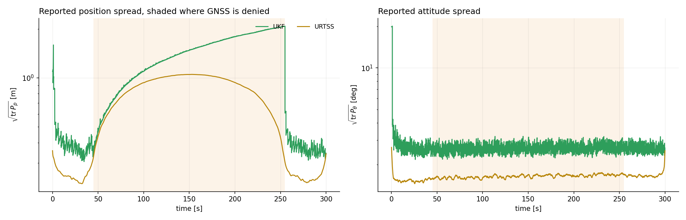
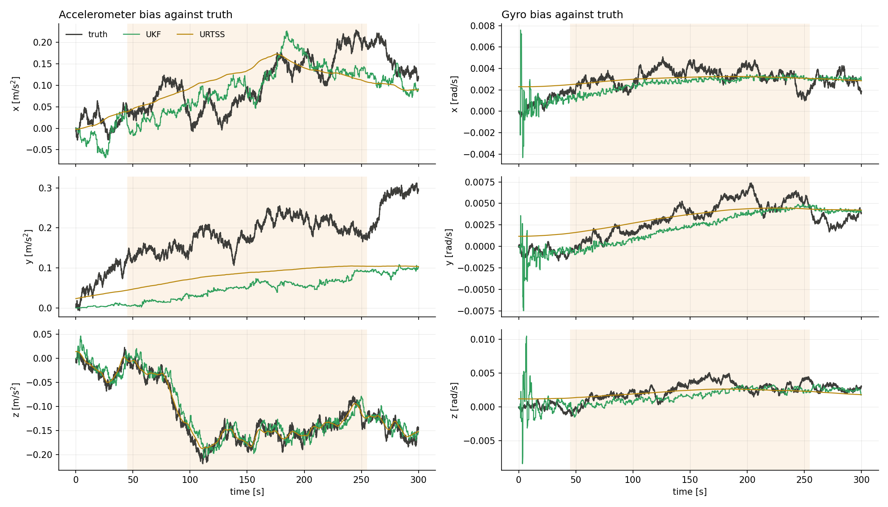
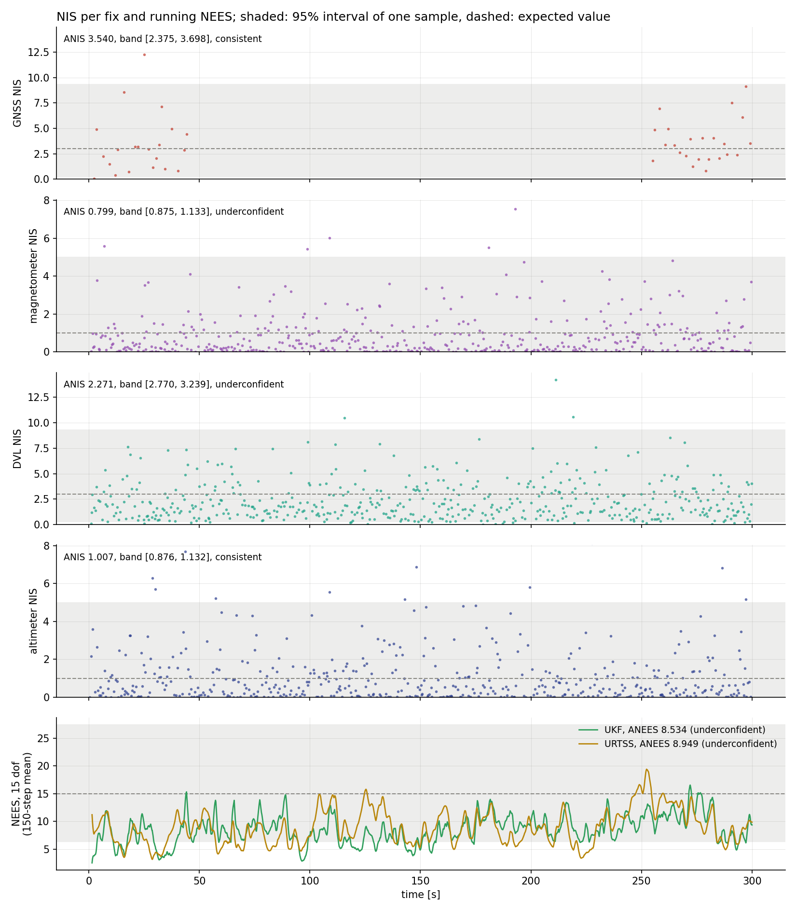

# 3-D strapdown INS, base case: Unscented Kalman filter and URTSS

[Back to the base case](../README.md) | [Extended Kalman filter and ERTS](../extended/README.md) | [Iterated extended Kalman filter and smoother](../iterated/README.md) | [All estimators compared](../comparison/README.md)

## Problem and setup

An underwater vehicle estimates its pose in three dimensions from an IMU, aided by GNSS, a magnetometer, a DVL and an altimeter. GNSS is denied from 45 s to 255 s. The filter prior is centred on the true initial state.

The unscented Kalman filter (UKF) carries the mean and covariance through the models with sigma points on the error state, with $\alpha = 1$, $\beta = 2$, $\kappa = 0$. The unscented Rauch-Tung-Striebel smoother (URTSS) runs backward over the stored UKF output.

The truth and the prior mean start at the origin, level, heading north at 2 m/s, with zero biases. Prior standard deviations: 0.63 m in position, 0.2 m/s in velocity, 0.2 rad in attitude.

The state, motion model, sensors and parameters are given in the [base case overview](../README.md).

| run | trajectory | magnetometer period |
| --- | --- | --- |
| [`figure_eight`](figure_eight/) | figure-eight | 0.25 to 1 s |
| [`rounded_rectangle`](rounded_rectangle/) | four-corner | 0.25 to 1 s |

## Reproduction

From the project root, after building:

```bash
./build/kalman_filtering_and_smoothing results/INS3D/base_case/unscented
for run in results/INS3D/base_case/unscented/*/; do
    python3 scripts/analyze_ins_3d.py "$run/data"
done
```

Every number below is taken from the run's `stats.txt`.

## Results

### Figure-eight


*The true path with the body $x$ (forward) and $z$ (down) axes, and when each sensor fired.*



*The true path with the UKF and URTSS estimates in 3D, and the depth against time.*



*Position error per axis and attitude error about each body axis, with each estimator's 95% band. Shaded where GNSS is denied.*



*The position and attitude standard deviation the UKF and URTSS report, on a log scale.*



*True and estimated accelerometer and gyro biases.*



*NIS of every fix per sensor against its 95% interval, and the running mean of the full-state NEES.*

| estimator | RMSE position [m] | median [m] | 95th percentile [m] | max [m] | RMSE attitude [°] | max attitude [°] | true position inside 95% ellipsoid |
| --- | --- | --- | --- | --- | --- | --- | --- |
| UKF | 0.942 | 0.739 | 1.84 | 2.23 | 1.80 | 4.1 | 98.1% |
| URTSS | 0.709 | 0.423 | 1.31 | 1.56 | 1.36 | 3.2 | 98.6% |

| statistic | dof | average | 95% interval | verdict |
| --- | --- | --- | --- | --- |
| NIS, GNSS | 3 | 3.557 | [2.446, 3.610] | consistent |
| NIS, magnetometer | 1 | 0.803 | [0.873, 1.135] | underconfident |
| NIS, DVL | 3 | 2.261 | [2.771, 3.238] | underconfident |
| NIS, altimeter | 1 | 1.009 | [0.876, 1.132] | consistent |
| NEES, full state, UKF | 15 | 9.199 | [13.868, 16.175] | underconfident |
| NEES, position, UKF | 3 | 2.354 | [2.482, 3.567] | underconfident |
| NEES, attitude, UKF | 3 | 1.331 | [2.685, 3.332] | underconfident |
| NEES, full state, URTSS | 15 | 10.451 | [12.479, 17.750] | underconfident |
| NEES, position, URTSS | 3 | 2.887 | [0.216, 9.348] | consistent |
| NEES, attitude, URTSS | 3 | 2.025 | [1.625, 4.789] | consistent |

### Four-corner


*The true path with the body $x$ (forward) and $z$ (down) axes, and when each sensor fired.*



*The true path with the UKF and URTSS estimates in 3D, and the depth against time.*



*Position error per axis and attitude error about each body axis, with each estimator's 95% band. Shaded where GNSS is denied.*



*The position and attitude standard deviation the UKF and URTSS report, on a log scale.*



*True and estimated accelerometer and gyro biases.*



*NIS of every fix per sensor against its 95% interval, and the running mean of the full-state NEES.*

| estimator | RMSE position [m] | median [m] | 95th percentile [m] | max [m] | RMSE attitude [°] | max attitude [°] | true position inside 95% ellipsoid |
| --- | --- | --- | --- | --- | --- | --- | --- |
| UKF | 1.101 | 0.484 | 2.16 | 2.42 | 1.73 | 4.1 | 98.8% |
| URTSS | 0.604 | 0.378 | 1.20 | 1.39 | 1.19 | 3.3 | 99.7% |

| statistic | dof | average | 95% interval | verdict |
| --- | --- | --- | --- | --- |
| NIS, GNSS | 3 | 3.540 | [2.374, 3.697] | consistent |
| NIS, magnetometer | 1 | 0.799 | [0.875, 1.133] | underconfident |
| NIS, DVL | 3 | 2.271 | [2.771, 3.239] | underconfident |
| NIS, altimeter | 1 | 1.007 | [0.876, 1.132] | consistent |
| NEES, full state, UKF | 15 | 8.534 | [13.953, 16.084] | underconfident |
| NEES, position, UKF | 3 | 2.178 | [2.514, 3.529] | underconfident |
| NEES, attitude, UKF | 3 | 1.232 | [2.681, 3.336] | underconfident |
| NEES, full state, URTSS | 15 | 8.949 | [12.671, 17.522] | underconfident |
| NEES, position, URTSS | 3 | 2.389 | [0.216, 9.348] | consistent |
| NEES, attitude, URTSS | 3 | 1.555 | [1.727, 4.619] | underconfident |
