# 3-D strapdown INS, EKF

[Back to the overview](../../../README.md) | [Next: IEKF](../iekf/README.md)

An extended Kalman filter and its Rauch-Tung-Striebel smoother estimate the pose of an underwater vehicle in three dimensions from an IMU, aided by a GNSS receiver, a magnetometer, a DVL and an altimeter. The attitude is a unit quaternion, so the covariance lives on a 15-dimensional error state while the state has 16 elements. The vehicle follows a figure-eight and a four-corner path that are tilted out of the horizontal plane, so the depth changes along the loop. GNSS is lost for most of the run.

|               |                                  |
| ------------- | -------------------------------- |
| **Status**    | done, position error about 0.9 to 1.0 m for the filter and 0.6 to 0.7 m for the smoother on both paths; the filter is underconfident for the magnetometer, the DVL and the attitude, which is a known property of the simulation |
| **Run**       | 30000 timesteps (300 s at $\Delta t = 0.01$ s), seed 42 |
| **Reproduce** | see [Reproduction](#reproduction) |

## Motivation

The 2-D scenario hides the difficulties of a real vehicle: attitude is one angle, gravity does not enter, and depth does not exist. In three dimensions the attitude has three degrees of freedom and no minimal parametrisation without singularities, a wrong attitude leaks gravity into the horizontal acceleration, and a DVL and a magnetometer measure through the rotation matrix. This page asks:

- Does the EKF with an error-state covariance on the attitude manifold estimate position, attitude and both IMU biases on a tilted path?
- How far does the estimate drift while GNSS is denied, and which quantities stay observable from the other three sensors?
- Is the reported covariance consistent with the actual errors?

Both a figure-eight and a four-corner (rounded rectangle) path are run.

## Problem formulation

### State and error state

The state collects position, velocity in the navigation frame (north, east, down), the attitude quaternion from body to navigation frame, and the accelerometer and gyro biases,

$$
x = \begin{bmatrix} p^\top & v^\top & q^\top & b_a^\top & b_g^\top \end{bmatrix}^\top \in \mathbb{R}^{16},
\qquad p, v, b_a, b_g \in \mathbb{R}^3, \quad q = \begin{bmatrix} q_w & q_x & q_y & q_z \end{bmatrix}^\top, \quad \lVert q \rVert = 1 .
$$

The unit quaternion has four numbers for three degrees of freedom, so a covariance on it would be singular. The covariance therefore lives on the error state, with the attitude error $\delta\theta$ as a rotation vector applied in the body frame,

$$
\delta x = \begin{bmatrix} \delta p^\top & \delta v^\top & \delta\theta^\top & \delta b_a^\top & \delta b_g^\top \end{bmatrix}^\top \in \mathbb{R}^{15},
\qquad q_{\mathrm{true}} = q \otimes \mathrm{Exp}(\delta\theta) .
$$

The operators that the filter uses to add and subtract states are

$$
x \boxplus \delta x:\ \ q \leftarrow q \otimes \mathrm{Exp}(\delta\theta),\ \text{all other parts added},
\qquad
x_a \boxminus x_b = \begin{bmatrix} p_a - p_b \\ v_a - v_b \\ \mathrm{Log}(q_b^{*} \otimes q_a) \\ b_{a,a} - b_{a,b} \\ b_{g,a} - b_{g,b} \end{bmatrix} .
$$

Every filter and smoother touches the state only through $\boxplus$ and $\boxminus$, so the same code runs with a 16-dimensional mean and a 15-dimensional covariance. The convention is the one of Sola and Brekke.

### Motion model

The IMU reading $u_k = (a_k, \omega_k)$ is corrected with the estimated biases, $\tilde a_k = a_k - b_{a,k}$ and $\tilde\omega_k = \omega_k - b_{g,k}$. The accelerometer measures specific force, $a_k = R(q)^\top (a_t - g) + b_a + n_a$, with the gravity vector $g = [0, 0, 9.81]^\top$ in the navigation frame (z down). Position and velocity are integrated with the attitude at the middle of the step, and the attitude with the exact rotation of the whole step:

$$
\begin{aligned}
R_{\mathrm{mid}} &= R\big(q_k \otimes \mathrm{Exp}(\tfrac{\Delta t}{2}\tilde\omega_k)\big), \qquad a_k' = R_{\mathrm{mid}}\,\tilde a_k + g, \\
p_{k+1} &= p_k + \Delta t\, v_k + \tfrac{\Delta t^2}{2}\, a_k', \qquad v_{k+1} = v_k + \Delta t\, a_k', \\
q_{k+1} &= \big(q_k \otimes \mathrm{Exp}(\Delta t\,\tilde\omega_k)\big) \big/ \lVert \cdot \rVert, \\
b_{a,k+1} &= e^{-\Delta t / T_a}\, b_{a,k}, \qquad b_{g,k+1} = e^{-\Delta t / T_g}\, b_{g,k}.
\end{aligned}
$$

Written as $x_{k+1} = f(x_k, u_k) \boxplus w_k$ with $w_k \sim \mathcal{N}(0, Q_k)$. The biases are first-order Gauss-Markov processes with time constant $T$ and stationary variance $\sigma_b^2$, driven by white noise of intensity $2\sigma_b^2 / T$. The Jacobian of $f$ with respect to the error state, with the right Jacobian $J_r$ of SO(3), the skew matrix $[\cdot]_\times$ and $R_h = \mathrm{Exp}(\tfrac{\Delta t}{2}\tilde\omega)$, uses

$$
A_\theta = -R\,[R_h \tilde a]_\times, \qquad A_{b_a} = -R_{\mathrm{mid}}, \qquad A_{b_g} = \tfrac{\Delta t}{2}\, R_{\mathrm{mid}}\,[\tilde a]_\times\, J_r\big(\tfrac{\Delta t}{2}\tilde\omega\big),
$$

$$
F_k = \begin{bmatrix}
I & \Delta t\, I & \tfrac{\Delta t^2}{2} A_\theta & \tfrac{\Delta t^2}{2} A_{b_a} & \tfrac{\Delta t^2}{2} A_{b_g} \\
0 & I & \Delta t\, A_\theta & \Delta t\, A_{b_a} & \Delta t\, A_{b_g} \\
0 & 0 & \mathrm{Exp}(\Delta t\,\tilde\omega)^\top & 0 & -\Delta t\, J_r(\Delta t\,\tilde\omega) \\
0 & 0 & 0 & e^{-\Delta t / T_a} I & 0 \\
0 & 0 & 0 & 0 & e^{-\Delta t / T_g} I
\end{bmatrix}.
$$

White accelerometer noise enters the velocity through $R_{\mathrm{mid}}$ and white gyro noise the attitude error. With $G_k$ mapping the twelve noise sources into the error state and $D$ the diagonal matrix of their intensities, the process noise is the first-order approximation

$$
Q_k = G_k\, D\, G_k^\top\, \Delta t .
$$

| symbol | meaning |
| --- | --- |
| $x_k$ | state: position $p_k$, velocity $v_k$, attitude quaternion $q_k$, accelerometer bias $b_{a,k}$ and gyro bias $b_{g,k}$ |
| $\delta x_k$ | error state, the attitude part $\delta\theta_k$ is a rotation vector in the body frame |
| $u_k$ | IMU reading $(a_k, \omega_k)$: body-frame specific force and angular rate |
| $R(q)$ | rotation matrix from the body to the navigation frame |
| $\mathrm{Exp}, \mathrm{Log}$ | map between a rotation vector and a unit quaternion |
| $\boxplus, \boxminus$ | addition and subtraction of an error state to a state |

### Sensors

Four sensors aid the IMU. The state is observed through the error state, so each Jacobian $H$ has 15 columns. When several sensors fire in the same step they update in turn.

| sensor | measures | $h(x)$ | noise variance | period | linear |
| --- | --- | --- | --- | --- | --- |
| GNSS | 3-D position | $p$ | $0.2\ \mathrm{m^2}$ | 1 to 3 s, off from 45 s to 255 s | yes |
| altimeter | depth, positive down | $p_z$ | $10^{-2}\ \mathrm{m^2}$ | 0.2 to 1 s | yes |
| DVL | body-frame velocity | $R(q)^\top v$ | $10^{-2}\ \mathrm{(m/s)^2}$ per axis | 0.2 to 1 s | no |
| magnetometer | heading | $\psi = \mathrm{atan2}(R_{10}, R_{00})$ | $3 \cdot 10^{-3}\ \mathrm{rad^2}$ | 0.25 to 1 s | no |

The Jacobians are, with $R = R(q)$ and the attitude error acting as $R(q \otimes \mathrm{Exp}(\delta\theta)) \approx R\,(I + [\delta\theta]_\times)$,

$$
H_{\mathrm{GNSS}} = \begin{bmatrix} I_3 & 0 & 0 & 0 & 0 \end{bmatrix}, \qquad
H_{\mathrm{alt}} = \begin{bmatrix} 0\ 0\ 1 & 0 & 0 & 0 & 0 \end{bmatrix}, \qquad
H_{\mathrm{DVL}} = \begin{bmatrix} 0 & R^\top & [R^\top v]_\times & 0 & 0 \end{bmatrix},
$$

$$
H_{\mathrm{mag}} = \begin{bmatrix} 0 & 0 & h_x\ \ h_y\ \ h_z & 0 & 0 \end{bmatrix}, \quad
h_x = 0, \quad
h_y = -\frac{R_{00} R_{12} - R_{10} R_{02}}{R_{00}^2 + R_{10}^2}, \quad
h_z = \frac{R_{00} R_{11} - R_{10} R_{01}}{R_{00}^2 + R_{10}^2},
$$

and the magnetometer residual is wrapped to $[-\pi, \pi]$. Only the DVL and the magnetometer are nonlinear in the state. Every Jacobian above and $F$ were checked against central finite differences through $\boxplus$ and $\boxminus$, with a largest error of $1.4 \cdot 10^{-9}$.

### Trajectory

Both paths are laid in a plane that is tilted about the $x$ axis by $0.15$ rad, so a point $(x, y)$ of the planar shape lies at $(x,\ y\cos 0.15,\ y\sin 0.15)$ and the depth reaches about $\pm 6$ m. The vehicle moves at $2$ m/s. Its heading follows the path, and its roll is the bank of a coordinated turn, $\phi = \arctan(v^2 \kappa / g)$ for a path curvature $\kappa$, built up over 5 m of path length. Position, velocity, acceleration and angular rate are closed-form functions of time.

- **Figure-eight.** Two circles of radius 20 m with centres 70 m apart, joined by two crossing straights. It turns both ways and crosses itself.
- **Four-corner.** A rectangle of 80 m by 50 m with quarter-circle corners of radius 10 m. It turns one way only.

### Estimators

**Extended Kalman filter.** Prediction and update with sensor model $h$, Jacobians $F$ and $H$, and measurement noise $R$:

$$
\bar x_k = f(\hat x_{k-1}, u_k), \qquad \bar P_k = F_k \hat P_{k-1} F_k^\top + Q_k,
$$

$$
\eta_k = z_k \boxminus h(\bar x_k), \qquad S_k = H_k \bar P_k H_k^\top + R, \qquad W_k = \bar P_k H_k^\top S_k^{-1},
$$

$$
\hat x_k = \bar x_k \boxplus W_k \eta_k, \qquad
\hat P_k = (I - W_k H_k)\, \bar P_k\, (I - W_k H_k)^\top + W_k R\, W_k^\top .
$$

The covariance update is in Joseph form, which keeps $\hat P_k$ positive semidefinite.

**Extended Rauch-Tung-Striebel smoother (ERTS).** Run backward over the stored filter output, starting from $\hat x^s_N = \hat x_N$, with $F_k$ evaluated at the filtered state:

$$
G_k = \hat P_k F_k^\top \bar P_{k+1}^{-1}, \qquad
\hat x^s_k = \hat x_k \boxplus G_k\,(\hat x^s_{k+1} \boxminus \bar x_{k+1}), \qquad
P^s_k = \hat P_k + G_k\,(P^s_{k+1} - \bar P_{k+1})\,G_k^\top .
$$

### Consistency

A filter is consistent if the errors it makes agree with the covariance it reports. Two statistics test this, with the truth $x_k$ known from the simulation:

$$
\mathrm{NIS}_k = \eta_k^\top S_k^{-1} \eta_k \sim \chi^2_{m}, \qquad
\mathrm{NEES}_k = (x_k \boxminus \hat x_k)^\top \hat P_k^{-1} (x_k \boxminus \hat x_k) \sim \chi^2_{d},
$$

where $m$ is the measurement dimension (3 for GNSS and DVL, 1 for the altimeter and the magnetometer) and $d$ is the dimension of the part of the error state that is tested: 15 for the full state, 3 for position and 3 for attitude.
The NIS is evaluated at every fix of a sensor, the NEES at every step, for the filter and for the smoother. The time average $\bar\epsilon = \frac{1}{N}\sum_k \epsilon_k$ of either statistic is held against the interval

$$
\left[\ \frac{\chi^2_{\alpha/2}(N_{\mathrm{eff}}\, d)}{N_{\mathrm{eff}}},\ \ \frac{\chi^2_{1-\alpha/2}(N_{\mathrm{eff}}\, d)}{N_{\mathrm{eff}}}\ \right], \qquad
N_{\mathrm{eff}} = \max\!\Big(1,\ N\,\frac{1-\rho}{1+\rho}\Big), \qquad \alpha = 0.05,
$$

where $\rho$ is the lag-one autocorrelation of the series. A statistic is "consistent" if its time average lies inside the interval. A value below the interval means the errors are smaller than the reported covariance says, the estimator is underconfident (conservative). A value above means the errors are larger than it says, the estimator is overconfident (too optimistic). The NEES is strongly autocorrelated, so $N_{\mathrm{eff}}$ is small and the interval wide; for the smoother it is so wide that it excludes little. The share of steps with the true position inside the reported 95% ellipsoid is a second check that does not depend on it. All numbers are from one run with seed 42, so they carry no error bars.

## Reproduction

Build once, then simulate and analyse each case:

```bash
cmake -S . -B build && cmake --build build
./build/kalman_filtering_and_smoothing results/INS3D/ekf/figure_eight
python3 scripts/analyze_ins_3d.py results/INS3D/ekf/figure_eight/data
./build/kalman_filtering_and_smoothing results/INS3D/ekf/rounded_rectangle
python3 scripts/analyze_ins_3d.py results/INS3D/ekf/rounded_rectangle/data
```

The executable reads `<case>/config.yaml` and writes `<case>/data`. Given a folder that holds several cases, it runs all of them, so `./build/kalman_filtering_and_smoothing results/INS3D/ekf` simulates both cases of this page in one command. The analysis writes `<case>/stats.txt`, which holds every number quoted below, and the figures in `<case>/figures`. The 3-D figures need a matplotlib whose `mpl_toolkits` matches it.

`data/` is not tracked in git, since the CSV files of the 3-D runs are hundreds of MB; the commands above create it. It holds one CSV file per quantity with one row per timestep and a shared `timestep` column. `truth.csv` has the true state `x_true_0 ... x_true_15`, ordered as in the state $x$ above; `filter.csv` and `smoother.csv` have the predicted and updated (or smoothed) 16-dimensional mean and the full $15 \times 15$ covariance; `*_fixes.csv` has, for each fix of one sensor, the raw measurement, the innovation and $S$, which is what the NIS is computed from. The case folders of the other pages hold the same data, since the simulation depends only on the seed.

## Results

The figures per case: the true path with the vehicle attitude and when each sensor fired, the path and depth with the estimates, the error of each position axis and each attitude axis with its 95% band, the position uncertainty alone, the two bias estimates against the truth, and the consistency statistics.

### Figure-eight

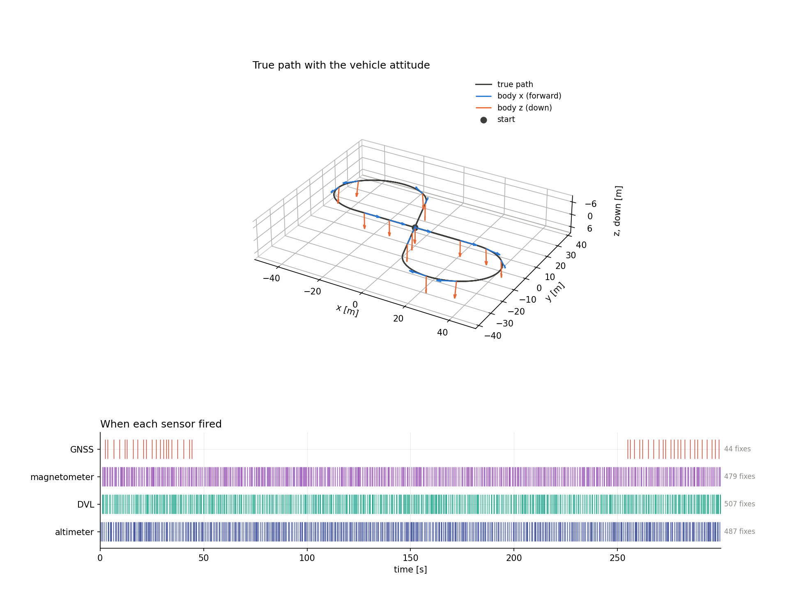

*The true path with the body $x$ axis (forward) and the body $z$ axis (down) drawn along it, and the times at which each sensor fired. GNSS fires only before 45 s and after 255 s.*

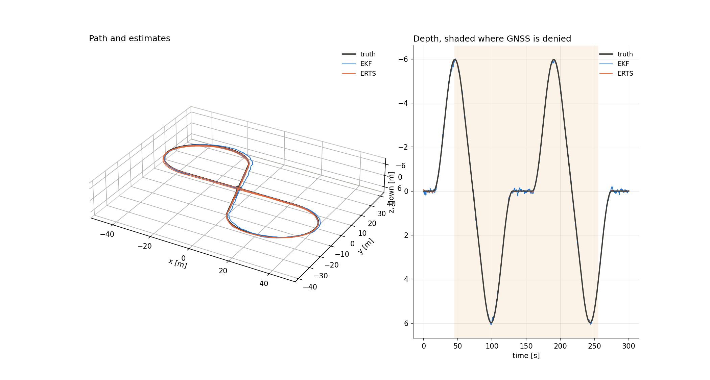

*The path and the depth with the EKF and ERTS estimates. Both follow the truth closely; the filter is visibly noisier than the smoother.*

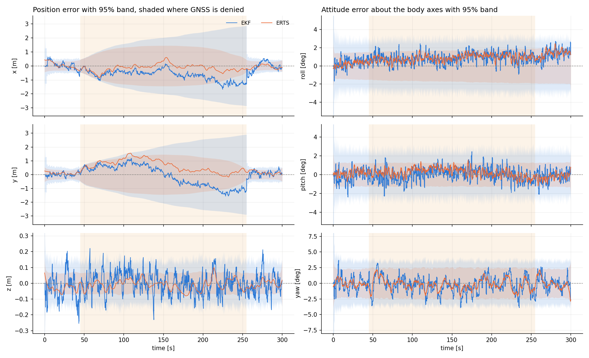

*Position error per axis and attitude error per body axis, with the 95% band from the reported covariance, shaded where GNSS is denied.*


*The position standard deviation $\sqrt{\mathrm{tr}\,P_{pp}}$ on a log scale. It grows during the outage and drops when GNSS returns.*

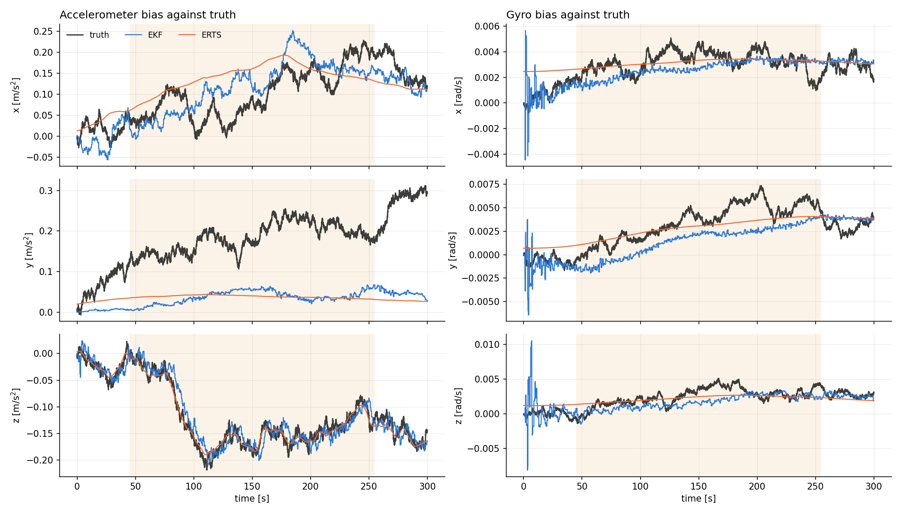

*Accelerometer and gyro bias estimates against the truth.*

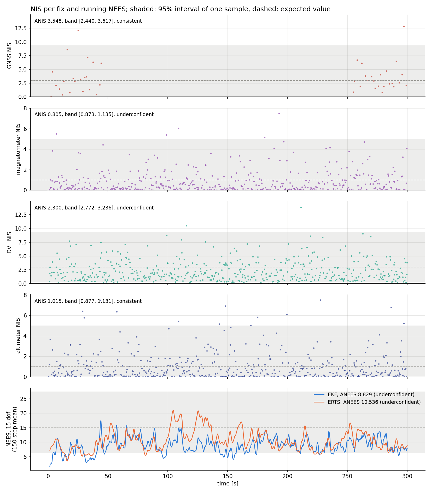

*NIS per sensor and the running NEES of the full state, with the 95% interval of one sample shaded and the expected value dashed.*

| quantity | EKF | ERTS |
| --- | --- | --- |
| position RMSE | 0.931 m | 0.708 m |
| position error, 95th percentile | 1.79 m | 1.31 m |
| position error, maximum | 2.17 m | 1.56 m |
| attitude RMSE | 1.78 deg | 1.35 deg |
| true position inside the 95% ellipsoid | 98.3% | 98.6% |

| statistic | average | 95% interval | verdict |
| --- | --- | --- | --- |
| NIS, GNSS (3 dof) | 3.55 | [2.44, 3.62] | consistent |
| NIS, altimeter (1 dof) | 1.01 | [0.88, 1.13] | consistent |
| NIS, magnetometer (1 dof) | 0.81 | [0.87, 1.14] | underconfident |
| NIS, DVL (3 dof) | 2.30 | [2.77, 3.24] | underconfident |
| NEES, full state, EKF (15 dof) | 8.83 | [13.95, 16.08] | underconfident |
| NEES, full state, ERTS (15 dof) | 10.54 | [12.34, 17.92] | underconfident |
| NEES, position, EKF (3 dof) | 2.34 | [2.48, 3.57] | underconfident |
| NEES, attitude, EKF (3 dof) | 1.30 | [2.68, 3.33] | underconfident |

### Four-corner

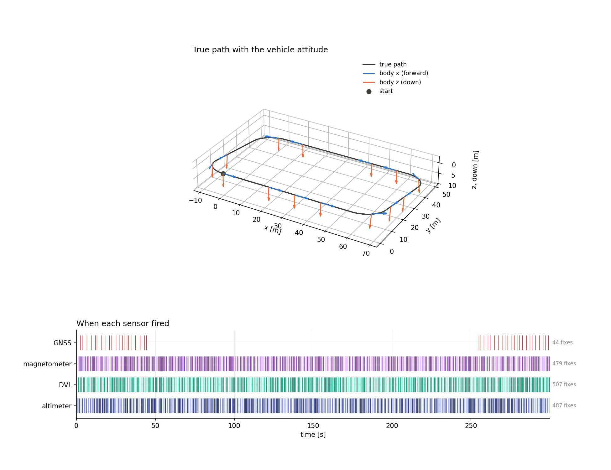

*The true path with the vehicle attitude and the sensor timeline. The same four sensors and the same GNSS outage as the figure-eight.*

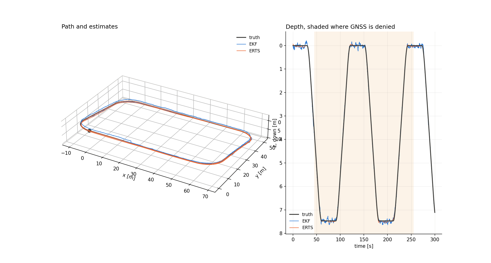

*The path and the depth with the EKF and ERTS estimates.*

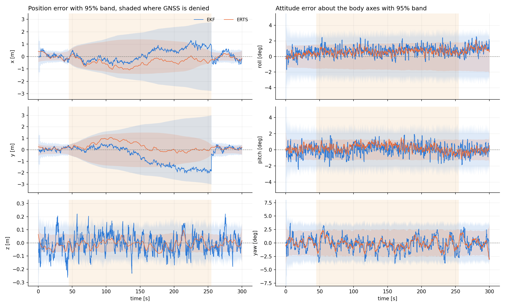

*Position error per axis and attitude error per body axis with the 95% band.*

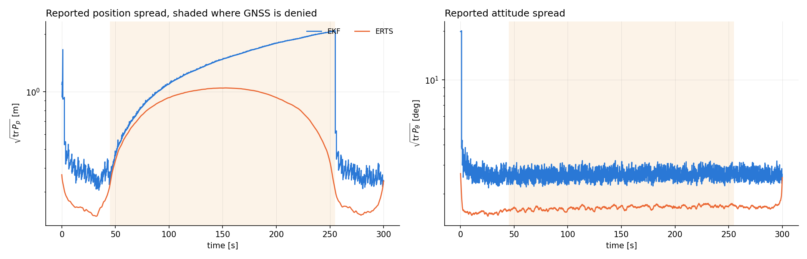

*The position standard deviation on a log scale.*

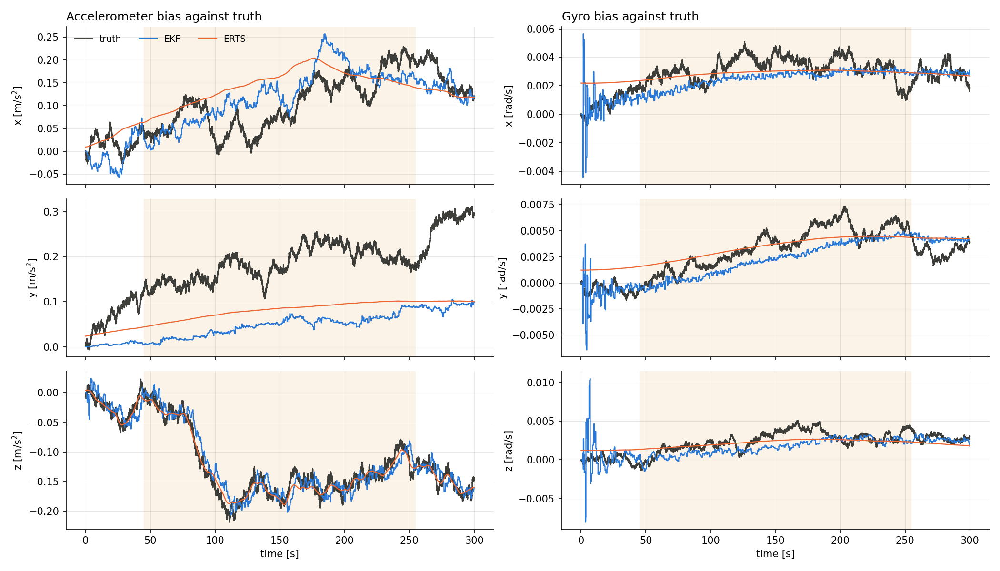

*Accelerometer and gyro bias estimates against the truth.*

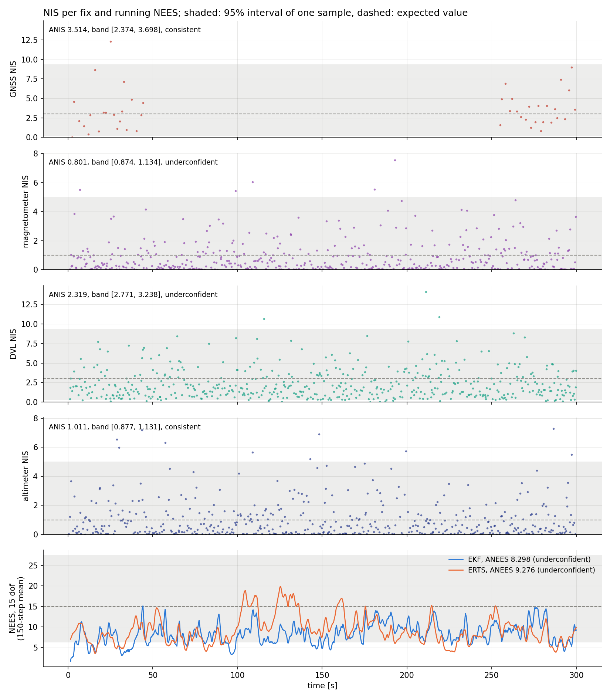

*NIS per sensor and the running NEES of the full state.*

| quantity | EKF | ERTS |
| --- | --- | --- |
| position RMSE | 1.029 m | 0.637 m |
| position error, 95th percentile | 2.02 m | 1.26 m |
| position error, maximum | 2.29 m | 1.46 m |
| attitude RMSE | 1.72 deg | 1.18 deg |
| true position inside the 95% ellipsoid | 99.0% | 99.7% |

| statistic | average | 95% interval | verdict |
| --- | --- | --- | --- |
| NIS, GNSS (3 dof) | 3.51 | [2.37, 3.70] | consistent |
| NIS, altimeter (1 dof) | 1.01 | [0.88, 1.13] | consistent |
| NIS, magnetometer (1 dof) | 0.80 | [0.87, 1.13] | underconfident |
| NIS, DVL (3 dof) | 2.32 | [2.77, 3.24] | underconfident |
| NEES, full state, EKF (15 dof) | 8.30 | [13.97, 16.07] | underconfident |
| NEES, full state, ERTS (15 dof) | 9.28 | [12.36, 17.89] | underconfident |
| NEES, position, EKF (3 dof) | 2.11 | [2.52, 3.52] | underconfident |
| NEES, attitude, EKF (3 dof) | 1.22 | [2.68, 3.34] | underconfident |

## Discussion

- **Accuracy.** The filter is within about 1 m of the truth on both paths and the smoother about 0.65 to 0.7 m, an improvement of 24% on the figure-eight and 38% on the four-corner path. The depth is the best-determined quantity, with an RMSE of 0.07 m for the filter and 0.03 m for the smoother, since the altimeter measures it directly every 0.2 to 1 s. The attitude error is 1.2 to 1.8 deg, and the position error grows only while GNSS is denied, and falls back when it returns.
- **The outage.** During the 210 s without GNSS the horizontal error reaches about 1.5 to 2 m while its 95% band grows to about 3 m. The DVL measures the body-frame velocity and the magnetometer the heading, so velocity and heading are held, and what drifts is the integral of the remaining velocity error. The error jumps back as soon as the first fixes return.
- **Biases.** The gyro biases are recovered to about $10^{-3}$ rad/s after a transient in the first seconds. The vertical accelerometer bias is recovered well, since gravity makes it observable together with the altimeter. The horizontal accelerometer biases are not: the $y$ bias stays near zero in the estimate while the truth wanders to 0.3 m/s$^2$, presumably because, with the DVL holding the velocity, a constant horizontal acceleration bias is hard to tell from a small attitude error. This was not tested separately.
- **Consistency.** The GNSS and altimeter innovations are consistent. The magnetometer and DVL innovations, and the attitude, position and full-state NEES of the filter, are underconfident: the filter reports more uncertainty than it has. The cause is in the simulation. The white IMU noise is drawn with a per-sample variance equal to its intensity, while the filter's $Q_k = G D G^\top \Delta t$ corresponds to an intensity divided by $\Delta t$ per sample, so at $\Delta t = 0.01$ s the filter assumes about a hundred times too much IMU noise. In a scratch run with the simulated intensities set to the value that matches the filter, the magnetometer, DVL, attitude and position statistics were consistent; the full-state NEES stayed slightly under. This is the same simplification as in the 2-D scenario and it is kept on purpose, so that the 2-D and 3-D pages can be compared.
- **The smoother.** The ERTS lowers every error and its position and attitude NEES are consistent, since the smoother's band is wide. Its full-state NEES is still underconfident, and it is closer to the band than the filter's.

## Related results

- [IEKF](../iekf/README.md): iterates the update of the nonlinear sensors, on the same two paths.
- [UKF](../ukf/README.md): propagates sigma points instead of linearising, compared with the EKF and the IEKF.
- [2-D strapdown INS](../../INS2D/only_gnss/README.md): the same filter with a one-angle attitude.
