# 3-D strapdown INS, exaggerated poor initialization: Extended Kalman filter and ERTS

[Back to the exaggerated poor initialization](../README.md) | [Unscented Kalman filter and URTSS](../unscented/README.md) | [Iterated extended Kalman filter and smoother](../iterated/README.md) | [All estimators compared](../comparison/README.md)

## Problem and setup

An underwater vehicle estimates its pose in three dimensions from an IMU, aided by GNSS, a magnetometer, a DVL and an altimeter. GNSS is denied from 45 s to 255 s. The filter starts from a prior far from the truth, and the magnetometer fires only every 30 to 60 s instead of every 0.25 to 1 s, so the yaw error of the prior is corrected only rarely.

The extended Kalman filter (EKF) linearises the motion and measurement models at the current estimate. The extended Rauch-Tung-Striebel smoother (ERTS) runs backward over the stored EKF output with the same Jacobians.

The truth starts at the origin, level, heading north at 2 m/s. The prior mean is off by $(3, -3, 1)$ m in position, $(-0.5, 0.5, 0.2)$ m/s in velocity and by the rotation vector $(0.3, -0.3, 1.5)$ rad in attitude, 89° in total. Each offset is one standard deviation of the prior.

The state, motion model, sensors and parameters are given in the [exaggerated poor initialization overview](../README.md).

| run | trajectory | magnetometer period |
| --- | --- | --- |
| [`figure_eight`](figure_eight/) | figure-eight | 30 to 60 s |
| [`rounded_rectangle`](rounded_rectangle/) | four-corner | 30 to 60 s |

## Reproduction

From the project root, after building:

```bash
./build/kalman_filtering_and_smoothing results/INS3D/exaggerated_poor_initialization/extended
for run in results/INS3D/exaggerated_poor_initialization/extended/*/; do
    python3 scripts/analyze_ins_3d.py "$run/data"
done
```

Every number below is taken from the run's `stats.txt`.

## Results

### Figure-eight

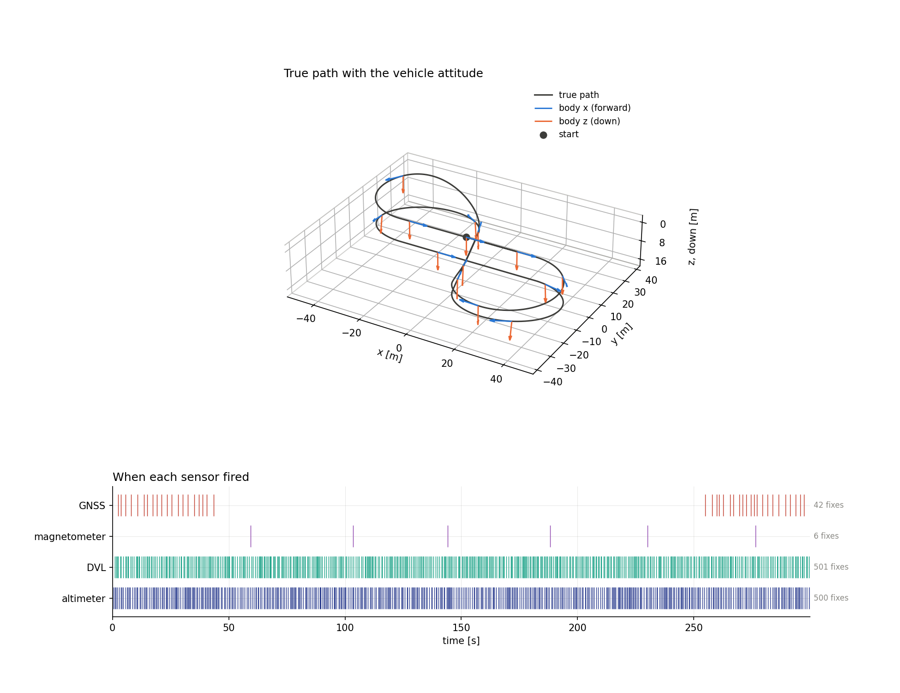

*The true path with the body $x$ (forward) and $z$ (down) axes, and when each sensor fired.*

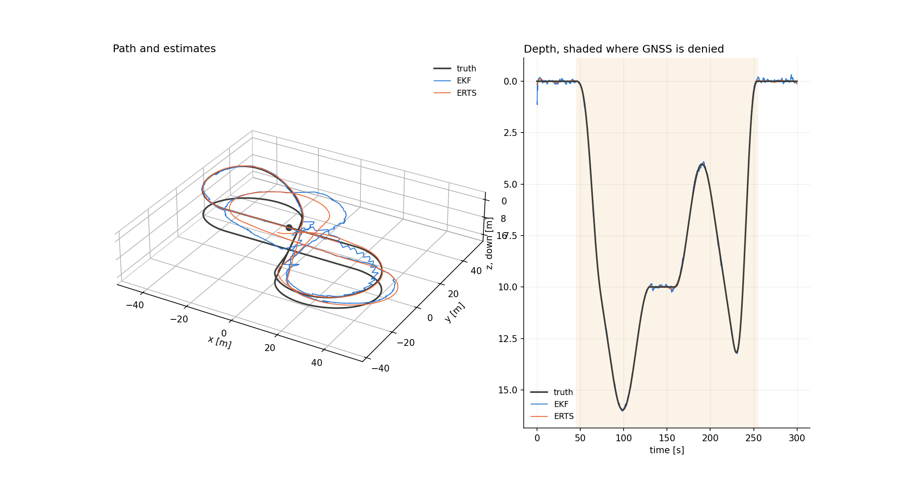

*The true path with the EKF and ERTS estimates in 3D, and the depth against time.*

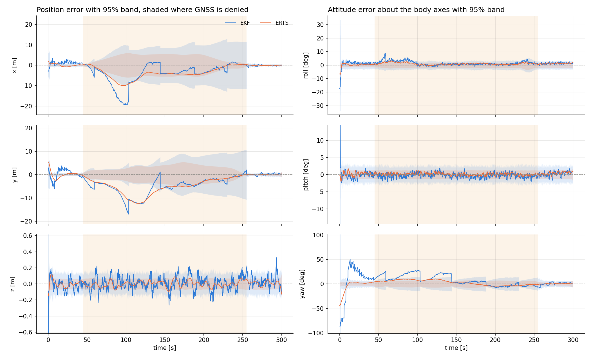

*Position error per axis and attitude error about each body axis, with each estimator's 95% band. Shaded where GNSS is denied.*

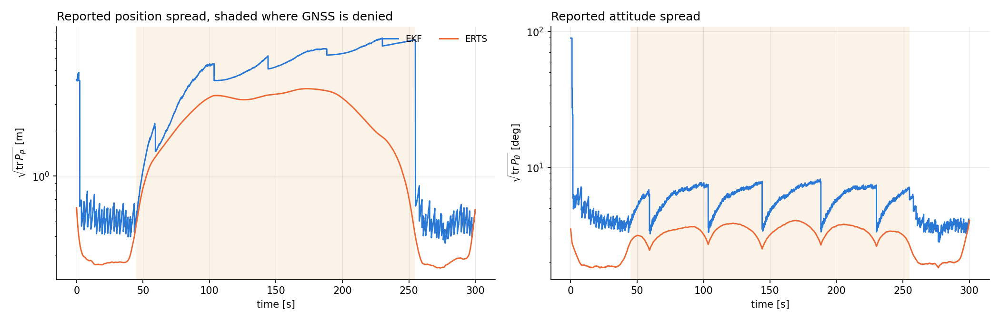

*The position and attitude standard deviation the EKF and ERTS report, on a log scale.*

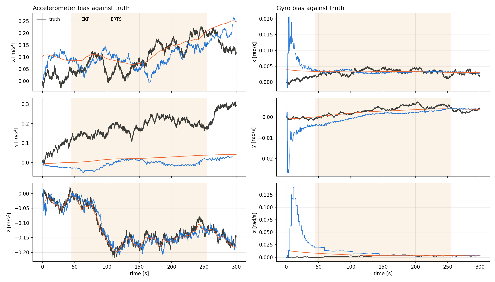

*True and estimated accelerometer and gyro biases.*

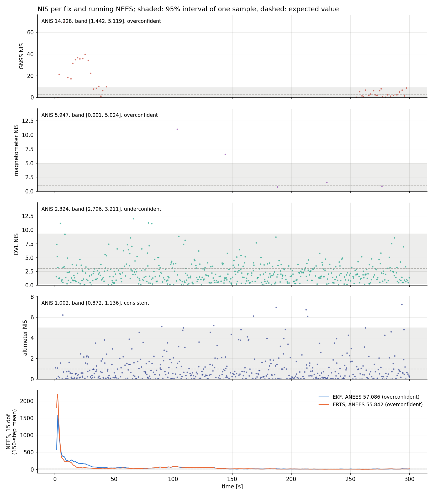

*NIS of every fix per sensor against its 95% interval, and the running mean of the full-state NEES.*

| estimator | RMSE position [m] | median [m] | 95th percentile [m] | max [m] | RMSE attitude [°] | max attitude [°] | true position inside 95% ellipsoid |
| --- | --- | --- | --- | --- | --- | --- | --- |
| EKF | 7.517 | 3.880 | 17.03 | 25.10 | 17.72 | 89.4 | 55.3% |
| ERTS | 6.429 | 3.523 | 14.03 | 14.43 | 7.05 | 44.2 | 51.1% |

| statistic | dof | average | 95% interval | verdict |
| --- | --- | --- | --- | --- |
| NIS, GNSS | 3 | 14.228 | [1.442, 5.119] | overconfident |
| NIS, magnetometer | 1 | 5.947 | [0.001, 5.024] | overconfident |
| NIS, DVL | 3 | 2.324 | [2.796, 3.211] | underconfident |
| NIS, altimeter | 1 | 1.002 | [0.872, 1.137] | consistent |
| NEES, full state, EKF | 15 | 57.086 | [13.605, 16.462] | overconfident |
| NEES, position, EKF | 3 | 16.108 | [1.816, 4.476] | overconfident |
| NEES, attitude, EKF | 3 | 12.330 | [2.012, 4.183] | overconfident |
| NEES, full state, ERTS | 15 | 55.842 | [6.262, 27.488] | overconfident |
| NEES, position, ERTS | 3 | 20.225 | [0.216, 9.348] | overconfident |
| NEES, attitude, ERTS | 3 | 9.678 | [0.216, 9.348] | overconfident |

### Four-corner

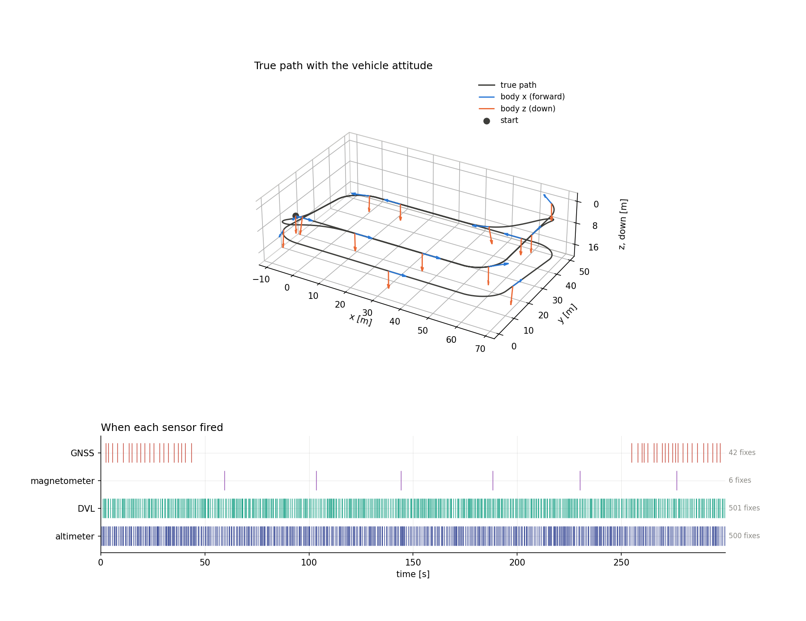

*The true path with the body $x$ (forward) and $z$ (down) axes, and when each sensor fired.*

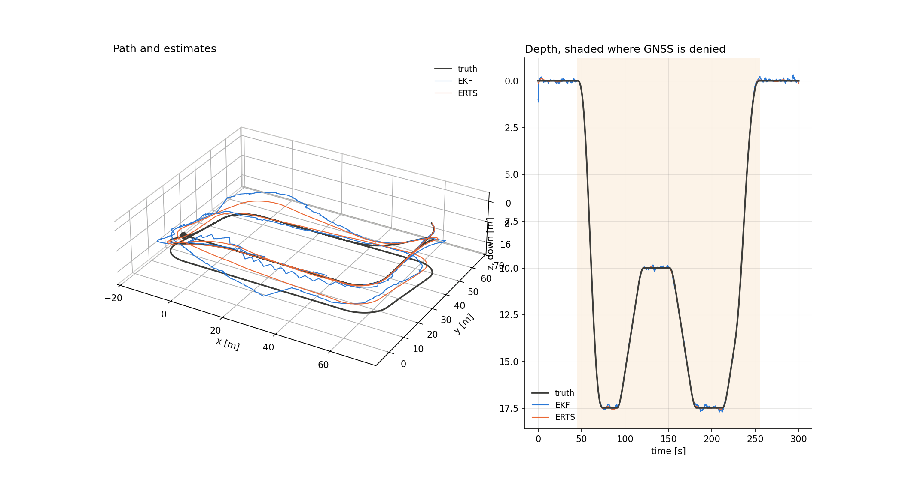

*The true path with the EKF and ERTS estimates in 3D, and the depth against time.*

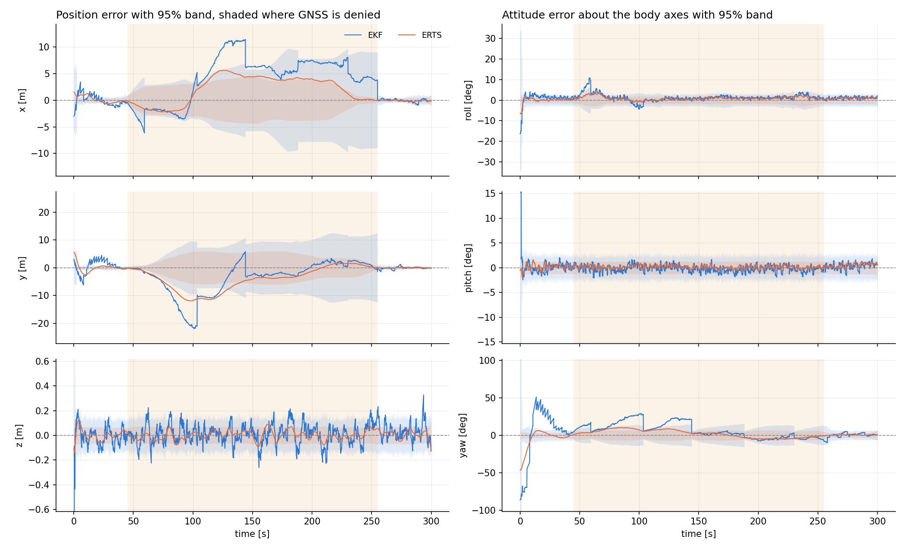

*Position error per axis and attitude error about each body axis, with each estimator's 95% band. Shaded where GNSS is denied.*


*The position and attitude standard deviation the EKF and ERTS report, on a log scale.*

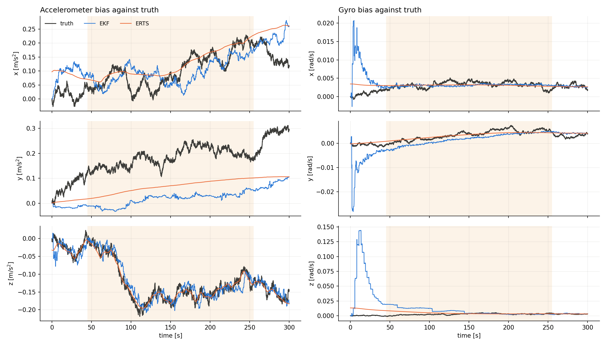

*True and estimated accelerometer and gyro biases.*

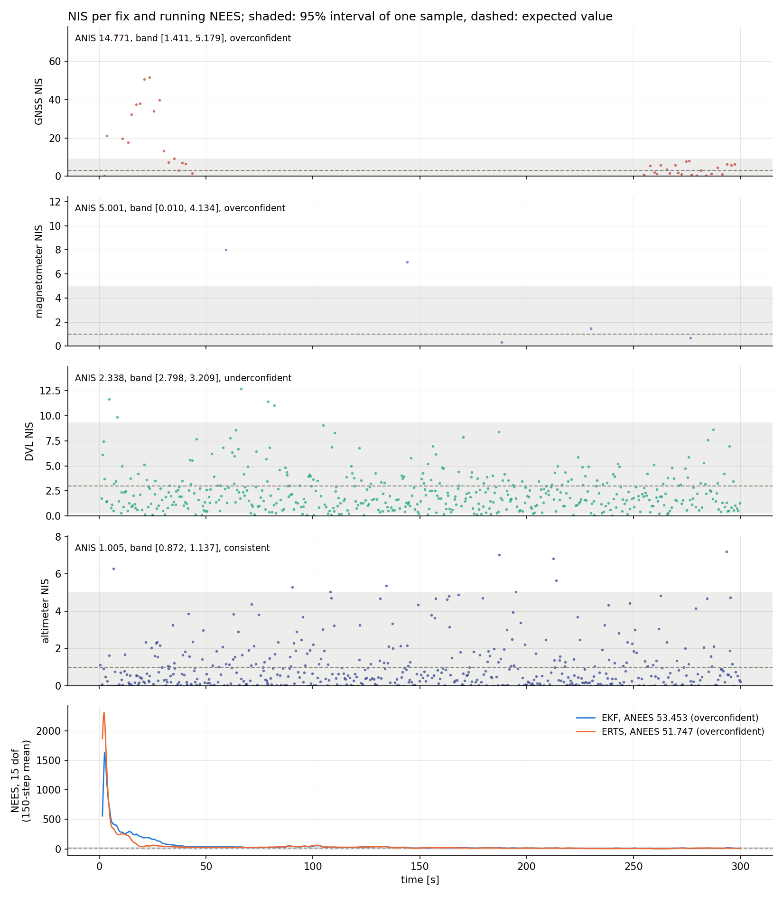

*NIS of every fix per sensor against its 95% interval, and the running mean of the full-state NEES.*

| estimator | RMSE position [m] | median [m] | 95th percentile [m] | max [m] | RMSE attitude [°] | max attitude [°] | true position inside 95% ellipsoid |
| --- | --- | --- | --- | --- | --- | --- | --- |
| EKF | 7.743 | 5.569 | 15.68 | 22.15 | 17.30 | 89.1 | 55.3% |
| ERTS | 5.583 | 3.571 | 11.74 | 12.19 | 7.14 | 47.0 | 51.7% |

| statistic | dof | average | 95% interval | verdict |
| --- | --- | --- | --- | --- |
| NIS, GNSS | 3 | 14.771 | [1.411, 5.179] | overconfident |
| NIS, magnetometer | 1 | 5.002 | [0.010, 4.134] | overconfident |
| NIS, DVL | 3 | 2.338 | [2.798, 3.209] | underconfident |
| NIS, altimeter | 1 | 1.005 | [0.872, 1.137] | consistent |
| NEES, full state, EKF | 15 | 53.453 | [13.575, 16.496] | overconfident |
| NEES, position, EKF | 3 | 13.595 | [1.932, 4.300] | overconfident |
| NEES, attitude, EKF | 3 | 11.829 | [2.074, 4.095] | overconfident |
| NEES, full state, ERTS | 15 | 51.747 | [6.262, 27.488] | overconfident |
| NEES, position, ERTS | 3 | 16.481 | [0.216, 9.348] | overconfident |
| NEES, attitude, ERTS | 3 | 10.177 | [0.216, 9.348] | overconfident |
