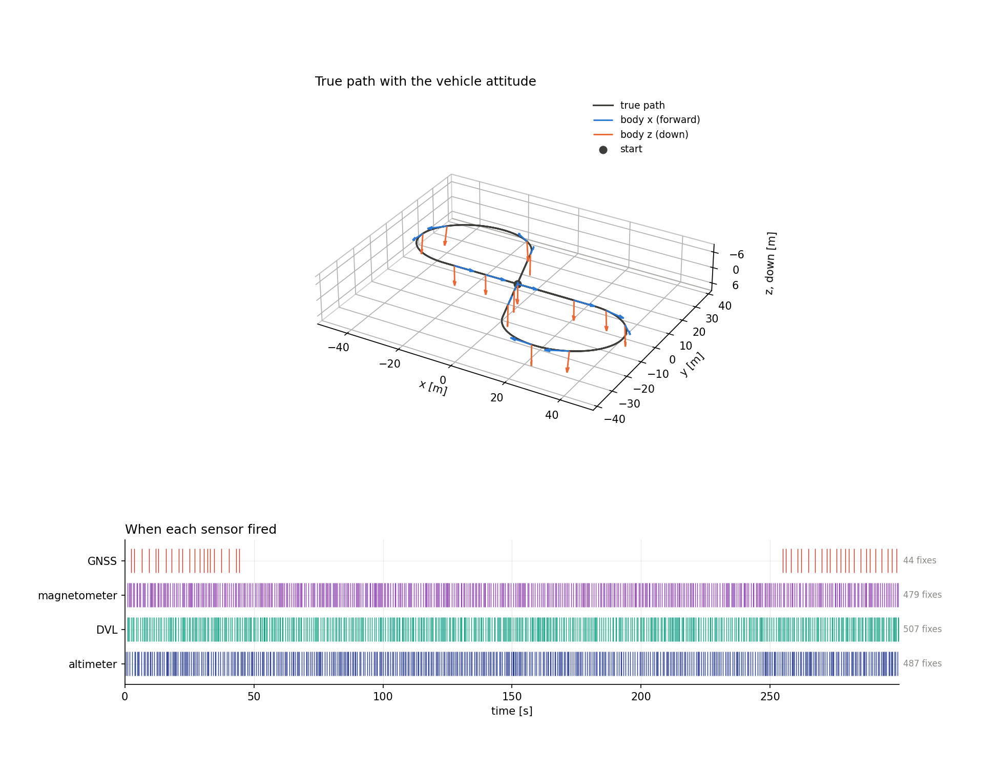
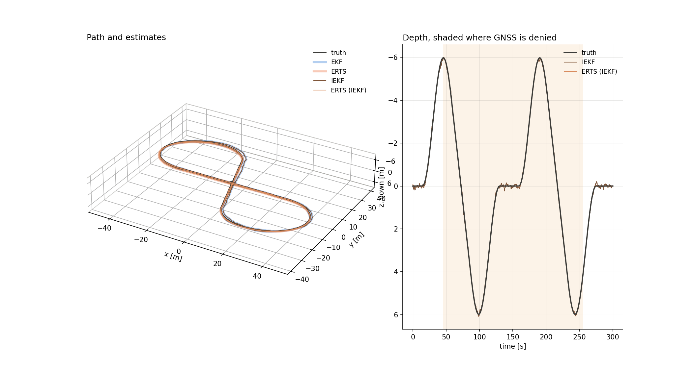
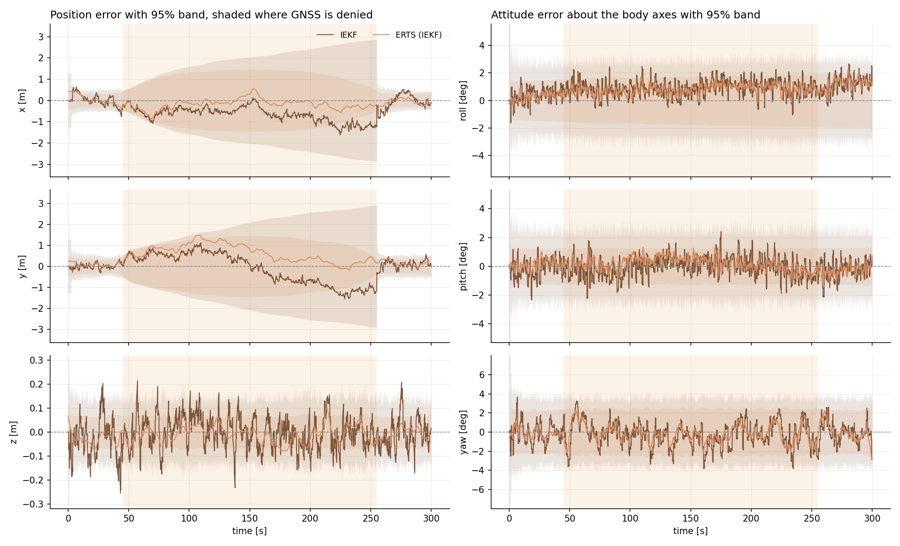
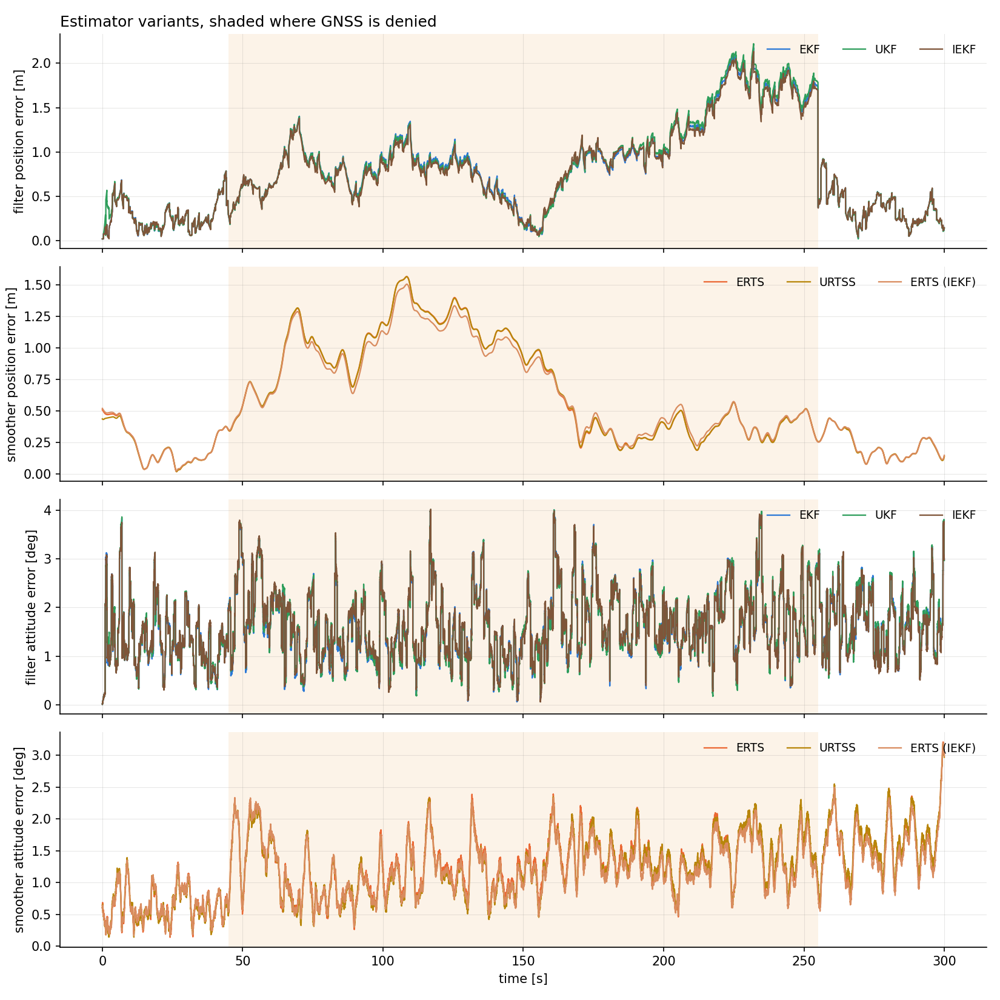
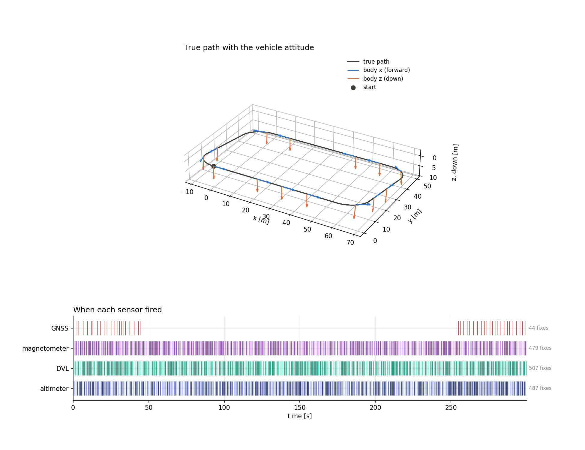
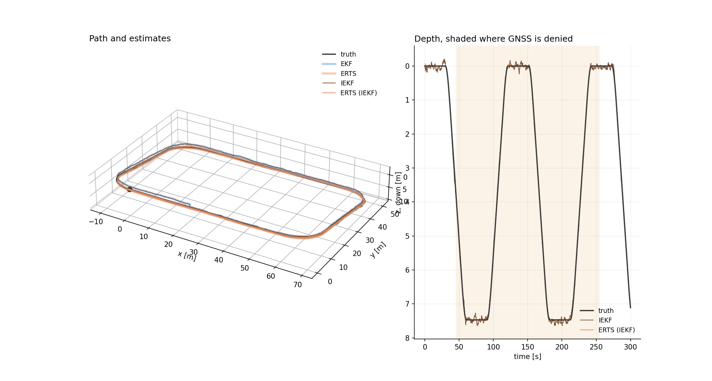
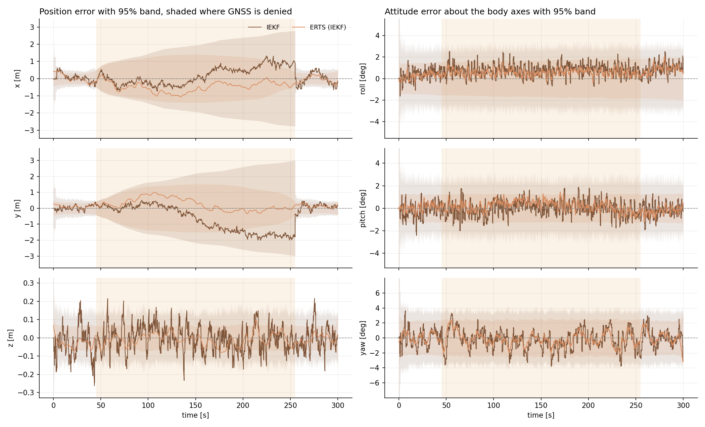
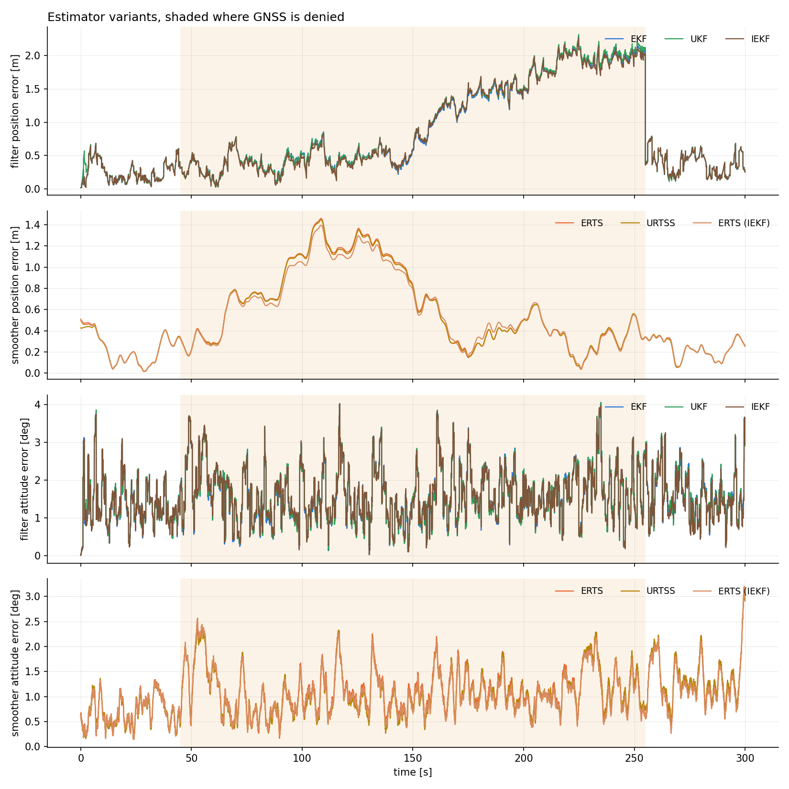

# 3-D strapdown INS, IEKF

[Back to the overview](../../../README.md) | [Previous: EKF](../ekf/README.md) | [Next: UKF](../ukf/README.md)

The extended Kalman filter linearises the measurement function once per update, at the prediction. If the prediction is far from the posterior the linearisation point is poor. The iterated extended Kalman filter relinearises at each improved estimate until the update settles, and a Levenberg-Marquardt damping keeps each step from overshooting. This page runs it on a three-dimensional strapdown INS with an attitude quaternion, on a tilted figure-eight and a tilted four-corner path with a long GNSS outage, and compares it with the EKF it is built on.

|               |                                  |
| ------------- | -------------------------------- |
| **Status**    | done, the IEKF stays within about 3 cm (median) and 9 cm (maximum) of the EKF on both paths and has the same consistency verdicts; its accuracy is 0.5% to 2% better for the filter and 3% to 4% better for the smoother, which a single seed cannot separate from noise |
| **Run**       | 30000 timesteps (300 s at $\Delta t = 0.01$ s), seed 42 |
| **Reproduce** | see [Reproduction](#reproduction) |

## Motivation

Two of the four sensors are nonlinear in the state: the DVL measures the velocity rotated into the body frame, $R(q)^\top v$, and the magnetometer measures the heading $\mathrm{atan2}(R_{10}, R_{00})$ of the rotation matrix. Both depend on the attitude, which is the least well known part of the state after a long GNSS outage. GNSS and the altimeter are linear in the state, so for them the EKF update is already the exact minimiser and the iteration cannot change anything. The scenario asks:

- Does iterating the DVL and magnetometer updates change the estimate, the reported covariance or the consistency compared with the EKF?
- Does it matter more in a long outage, where the prediction drifts away from the truth?
- Does the iteration remain stable when the state is on a manifold, with the attitude updated as $q \otimes \mathrm{Exp}(\delta\theta)$?

## Problem formulation

### State and error state

The state is 16-dimensional, position, velocity (navigation frame, z down), the attitude quaternion from body to navigation frame, and the accelerometer and gyro biases,

$$
x = \begin{bmatrix} p^\top & v^\top & q^\top & b_a^\top & b_g^\top \end{bmatrix}^\top \in \mathbb{R}^{16}, \qquad \lVert q \rVert = 1 .
$$

The covariance lives on the 15-dimensional error state $\delta x = [\delta p, \delta v, \delta\theta, \delta b_a, \delta b_g]$ with the attitude error applied in the body frame, $q_{\mathrm{true}} = q \otimes \mathrm{Exp}(\delta\theta)$. A state is updated by $x \boxplus \delta x$ (the quaternion is rotated, everything else is added) and two states are subtracted by

$$
x_a \boxminus x_b = \begin{bmatrix} p_a - p_b \\ v_a - v_b \\ \mathrm{Log}(q_b^{*} \otimes q_a) \\ b_{a,a} - b_{a,b} \\ b_{g,a} - b_{g,b} \end{bmatrix} .
$$

### Motion model

The IMU reading is corrected with the estimated biases, $\tilde a_k = a_k - b_{a,k}$ and $\tilde\omega_k = \omega_k - b_{g,k}$, and integrated with the attitude at the middle of the step (gravity $g = [0, 0, 9.81]^\top$ in the navigation frame):

$$
\begin{aligned}
R_{\mathrm{mid}} &= R\big(q_k \otimes \mathrm{Exp}(\tfrac{\Delta t}{2}\tilde\omega_k)\big), \qquad a_k' = R_{\mathrm{mid}}\,\tilde a_k + g, \\
p_{k+1} &= p_k + \Delta t\, v_k + \tfrac{\Delta t^2}{2}\, a_k', \qquad v_{k+1} = v_k + \Delta t\, a_k', \\
q_{k+1} &= \big(q_k \otimes \mathrm{Exp}(\Delta t\,\tilde\omega_k)\big) \big/ \lVert \cdot \rVert, \\
b_{a,k+1} &= e^{-\Delta t / T_a}\, b_{a,k}, \qquad b_{g,k+1} = e^{-\Delta t / T_g}\, b_{g,k},
\end{aligned}
$$

with Gauss-Markov biases of time constant $T$, and process noise $Q_k = G_k D G_k^\top \Delta t$ on the error state. The Jacobian $F_k$ of this model with respect to the error state is the exact first-order one; it is written out on the [EKF page](../ekf/README.md#motion-model).

| symbol | meaning |
| --- | --- |
| $x_k$ | state: position, velocity, attitude quaternion, accelerometer bias, gyro bias |
| $\delta x_k$ | error state, the attitude part is a rotation vector in the body frame |
| $u_k$ | IMU reading: body-frame specific force and angular rate |
| $R(q)$ | rotation matrix from the body to the navigation frame |
| $\boxplus, \boxminus$ | addition and subtraction of an error state to a state |

### Sensors

| sensor | $h(x)$ | noise variance | period | linear |
| --- | --- | --- | --- | --- |
| GNSS | $p$ | $0.2\ \mathrm{m^2}$ | 1 to 3 s, off from 45 s to 255 s | yes |
| altimeter | $p_z$ | $10^{-2}\ \mathrm{m^2}$ | 0.2 to 1 s | yes |
| DVL | $R(q)^\top v$ | $10^{-2}\ \mathrm{(m/s)^2}$ per axis | 0.2 to 1 s | no |
| magnetometer | $\mathrm{atan2}(R_{10}, R_{00})$, residual wrapped to $\pm\pi$ | $3 \cdot 10^{-3}\ \mathrm{rad^2}$ | 0.25 to 1 s | no |

When several sensors fire in the same step they update in turn, each starting from the result of the previous one. The Jacobians of the DVL, $[0,\ R^\top,\ [R^\top v]_\times,\ 0,\ 0]$, and of the magnetometer are those of the EKF page.

### Trajectory

Both paths are laid in a plane tilted about the $x$ axis by $0.15$ rad, so the depth reaches about $\pm 6$ m, and flown at $2$ m/s with the roll of a coordinated turn.

- **Figure-eight.** Two circles of radius 20 m with centres 70 m apart, joined by two crossing straights. It turns both ways.
- **Four-corner.** A rectangle of 80 m by 50 m with quarter-circle corners of radius 10 m. It turns one way only.

### Estimators

**Extended Kalman filter, the reference.** Prediction and update with Jacobians $F$ and $H$ and measurement noise $R$:

$$
\bar x_k = f(\hat x_{k-1}, u_k), \qquad \bar P_k = F_k \hat P_{k-1} F_k^\top + Q_k,
$$

$$
\eta_k = z_k \boxminus h(\bar x_k), \qquad S_k = H_k \bar P_k H_k^\top + R, \qquad W_k = \bar P_k H_k^\top S_k^{-1},
$$

$$
\hat x_k = \bar x_k \boxplus W_k \eta_k, \qquad
\hat P_k = (I - W_k H_k)\, \bar P_k\, (I - W_k H_k)^\top + W_k R\, W_k^\top .
$$

**Iterated extended Kalman filter (IEKF) with Levenberg-Marquardt.** The prediction is the EKF prediction. The EKF update linearises $h$ once, at the prediction $\bar x$. The IEKF update instead finds the maximum a posteriori estimate of the state for this one measurement, the minimiser of the cost

$$
J(x) = \tfrac12\, \big\lVert z \boxminus h(x) \big\rVert^2_{R^{-1}} + \tfrac12\, \big\lVert x \boxminus \bar x \big\rVert^2_{\bar P^{-1}},
$$

by iterating on the linearisation point $x_i$, starting at $x_0 = \bar x$. On the manifold both residuals are taken with $\boxminus$, so the prior term $x \boxminus \bar x$ includes the attitude difference $\mathrm{Log}(\bar q^{*} \otimes q)$. With $\eta_i = z \boxminus h(x_i)$, $H_i = H(x_i)$ and the offset $d_i = x_i \boxminus \bar x$, the Gauss-Newton step $\delta$ solves

$$
\big(\bar P^{-1} + H_i^\top R^{-1} H_i + \lambda\, \bar P^{-1}\big)\,\delta = H_i^\top R^{-1} \eta_i - \bar P^{-1} d_i ,
$$

where $\lambda = 0$ is Gauss-Newton and $\lambda > 0$ is the Levenberg-Marquardt damping. Adding $\lambda \bar P^{-1}$ is the same as shrinking the prior covariance to $\bar P_\lambda = \bar P / (1+\lambda)$, so the step has the form of a Kalman update:

$$
S_\lambda = H_i \bar P_\lambda H_i^\top + R, \qquad W_\lambda = \bar P_\lambda H_i^\top S_\lambda^{-1}, \qquad
\delta = W_\lambda\, \eta_i - (I - W_\lambda H_i)\,\frac{d_i}{1+\lambda}, \qquad x_{i+1} = x_i \boxplus \delta .
$$

A step is accepted if $J(x_i \boxplus \delta) < J(x_i)$, and then $\lambda \leftarrow \lambda / \lambda_f$; otherwise the iterate stays and $\lambda \leftarrow \lambda_f\, \lambda$. The iteration stops when the step in the $\bar P$ norm, or the relative decrease of $J$, falls below a tolerance, or when the iteration or rejection limits are reached. The posterior covariance is the Joseph form of the EKF with the undamped $W$ and $H$ evaluated at the final iterate $\hat x$. The innovation and $S$ that are reported, and used for the NIS, are the EKF's, evaluated at $\bar x$, so that they are comparable between the filters.

**What differs from the EKF.** There are three differences, and only the first one changes the number that is computed:

1. The measurement function is relinearised at the improved estimate, so $H$ and the residual $\eta$ are evaluated at $x_i$ and not at $\bar x$. For a linear sensor $J$ is quadratic and the first step already reaches the minimiser, so the update equals the EKF's. Here only the DVL and the magnetometer can differ.
2. The prior is kept in the cost. The step uses the offset $d_i$ from the prediction, which is how the iterate stays tied to the prior, and the damping $\lambda$ protects against overshooting when $H$ varies quickly.
3. The attitude is iterated on the manifold: each candidate is $x_i \boxplus \delta$ with the attitude rotated by $\mathrm{Exp}(\delta\theta)$, and $d_i$ contains the rotation vector between $q_i$ and $\bar q$.

| parameter | value | meaning |
| --- | --- | --- |
| $\lambda_0$ | $10^{-2}$ | initial damping |
| $\lambda_{\min},\ \lambda_{\max}$ | $10^{-12},\ 10^{12}$ | floor, and ceiling at which an update gives up |
| $\lambda_f$ | 10 | factor applied to $\lambda$ on a rejection or an accept |
| maximum iterations, maximum consecutive rejections | 50, 30 | |
| step tolerance, relative cost tolerance | $10^{-8}$, $10^{-12}$ | stopping thresholds |

**Smoother.** The smoother is the standard extended Rauch-Tung-Striebel smoother (ERTS) run over the IEKF's output, labelled ERTS (IEKF); only the filter is iterated:

$$
G_k = \hat P_k F_k^\top \bar P_{k+1}^{-1}, \qquad
\hat x^s_k = \hat x_k \boxplus G_k\,(\hat x^s_{k+1} \boxminus \bar x_{k+1}), \qquad
P^s_k = \hat P_k + G_k\,(P^s_{k+1} - \bar P_{k+1})\,G_k^\top .
$$

### Consistency

A filter is consistent if the errors it makes agree with the covariance it reports. With the truth $x_k$ known from the simulation,

$$
\mathrm{NIS}_k = \eta_k^\top S_k^{-1} \eta_k \sim \chi^2_{m}, \qquad
\mathrm{NEES}_k = (x_k \boxminus \hat x_k)^\top \hat P_k^{-1} (x_k \boxminus \hat x_k) \sim \chi^2_{d},
$$

with $m$ the measurement dimension (3 for GNSS and DVL, 1 for the altimeter and the magnetometer) and $d$ the dimension of the tested part of the error state: 15 for the full state, 3 for position and 3 for attitude. The time average $\bar\epsilon$ of either statistic is held against the interval

$$
\left[\ \frac{\chi^2_{\alpha/2}(N_{\mathrm{eff}}\, d)}{N_{\mathrm{eff}}},\ \ \frac{\chi^2_{1-\alpha/2}(N_{\mathrm{eff}}\, d)}{N_{\mathrm{eff}}}\ \right], \qquad
N_{\mathrm{eff}} = \max\!\Big(1,\ N\,\frac{1-\rho}{1+\rho}\Big), \qquad \alpha = 0.05,
$$

where $\rho$ is the lag-one autocorrelation of the series. A statistic is "consistent" if its time average lies inside the interval. A value below the interval means the errors are smaller than the reported covariance says, the estimator is underconfident (conservative). A value above means the errors are larger than it says, the estimator is overconfident (too optimistic). The NEES interval of the smoother is wide because of the autocorrelation. All numbers are from one run with seed 42, so they carry no error bars.

## Reproduction

Build once, then simulate and analyse each case:

```bash
cmake -S . -B build && cmake --build build
./build/kalman_filtering_and_smoothing results/INS3D/iekf/figure_eight
python3 scripts/analyze_ins_3d.py results/INS3D/iekf/figure_eight/data
./build/kalman_filtering_and_smoothing results/INS3D/iekf/rounded_rectangle
python3 scripts/analyze_ins_3d.py results/INS3D/iekf/rounded_rectangle/data
```

The executable reads `<case>/config.yaml` and writes `<case>/data`, which is not tracked in git since the CSV files of the 3-D runs are hundreds of MB; given the folder `results/INS3D/iekf` it runs both cases. The analysis writes `<case>/stats.txt`, which holds every number quoted below, and the figures in `<case>/figures`. `run_iekf: true` in `config.yaml` switches the IEKF on, together with the Levenberg-Marquardt parameters of the table above, and its files carry the prefix `iekf_`. The EKF and the UKF are always run next to it, on the same simulated data, and their files have no prefix and the prefix `ukf_`. `truth.csv` holds the 16 true state elements, `filter.csv` and `smoother.csv` the mean and the full $15 \times 15$ covariance, and `*_fixes.csv` the raw measurement, innovation and $S$ of each fix.

## Results

The figures per case: the true path with the vehicle attitude and the sensor timeline, the IEKF and ERTS (IEKF) path and depth with the EKF and ERTS drawn wide and faint underneath, the IEKF's own error per axis with its 95% band, and the position and attitude error of every variant. The EKF is only a reference here; the subject is the IEKF.

### Figure-eight



*The true path with the body $x$ axis (forward) and body $z$ axis (down), and when each sensor fired. GNSS fires only before 45 s and after 255 s.*



*Path and depth with the IEKF and ERTS (IEKF). The EKF and ERTS lie wide and faint underneath: where the IEKF line covers them they agree.*



*The IEKF's and ERTS (IEKF)'s position error per axis and attitude error per body axis with their 95% bands, shaded where GNSS is denied.*



*Position and attitude error of the filters (EKF, UKF, IEKF) and of the smoothers over the whole run. The filters nearly coincide, and the IEKF and the EKF differ by less than the width of the lines for most of the run.*

| quantity | IEKF | ERTS (IEKF) | EKF | ERTS |
| --- | --- | --- | --- | --- |
| position RMSE | 0.912 m | 0.684 m | 0.931 m | 0.708 m |
| position error, 95th percentile | 1.75 m | 1.26 m | 1.79 m | 1.31 m |
| position error, maximum | 2.13 m | 1.50 m | 2.17 m | 1.56 m |
| attitude RMSE | 1.79 deg | 1.29 deg | 1.78 deg | 1.35 deg |
| true position inside the 95% ellipsoid | 98.4% | 98.7% | 98.3% | 98.6% |

| statistic | IEKF average | 95% interval | verdict | EKF average |
| --- | --- | --- | --- | --- |
| NIS, GNSS (3 dof) | 3.54 | [2.44, 3.62] | consistent | 3.55 |
| NIS, altimeter (1 dof) | 1.02 | [0.88, 1.13] | consistent | 1.01 |
| NIS, magnetometer (1 dof) | 0.80 | [0.87, 1.14] | underconfident | 0.81 |
| NIS, DVL (3 dof) | 2.30 | [2.77, 3.24] | underconfident | 2.30 |
| NEES, full state, filter (15 dof) | 8.84 | [13.95, 16.09] | underconfident | 8.83 |
| NEES, position, filter (3 dof) | 2.30 | [2.49, 3.56] | underconfident | 2.34 |
| NEES, attitude, filter (3 dof) | 1.31 | [2.69, 3.33] | underconfident | 1.30 |
| NEES, full state, ERTS (IEKF) (15 dof) | 9.94 | [12.47, 17.76] | underconfident | 10.54 |

Distance of the IEKF estimate to the EKF estimate: median 35 mm, maximum 85 mm in position and 0.44 deg in attitude; for the smoothers the median is 37 mm and the maximum 84 mm. The ratio of the reported position $\mathrm{tr}\,P$ lies between 0.987 and 1.018.

### Four-corner



*The true path with the vehicle attitude and the sensor timeline.*



*Path and depth with the IEKF and ERTS (IEKF), the EKF and ERTS faint underneath.*



*The IEKF's and ERTS (IEKF)'s position and attitude error per axis with their 95% bands.*



*Position and attitude error of every filter and smoother.*

| quantity | IEKF | ERTS (IEKF) | EKF | ERTS |
| --- | --- | --- | --- | --- |
| position RMSE | 1.024 m | 0.612 m | 1.029 m | 0.637 m |
| position error, 95th percentile | 1.99 m | 1.20 m | 2.02 m | 1.26 m |
| position error, maximum | 2.27 m | 1.40 m | 2.29 m | 1.46 m |
| attitude RMSE | 1.72 deg | 1.14 deg | 1.72 deg | 1.18 deg |
| true position inside the 95% ellipsoid | 99.0% | 99.7% | 99.0% | 99.7% |

| statistic | IEKF average | 95% interval | verdict | EKF average |
| --- | --- | --- | --- | --- |
| NIS, GNSS (3 dof) | 3.51 | [2.37, 3.70] | consistent | 3.51 |
| NIS, altimeter (1 dof) | 1.01 | [0.88, 1.13] | consistent | 1.01 |
| NIS, magnetometer (1 dof) | 0.80 | [0.87, 1.13] | underconfident | 0.80 |
| NIS, DVL (3 dof) | 2.32 | [2.77, 3.24] | underconfident | 2.32 |
| NEES, full state, filter (15 dof) | 8.32 | [13.98, 16.06] | underconfident | 8.30 |
| NEES, position, filter (3 dof) | 2.10 | [2.52, 3.52] | underconfident | 2.11 |
| NEES, attitude, filter (3 dof) | 1.22 | [2.68, 3.34] | underconfident | 1.22 |
| NEES, full state, ERTS (IEKF) (15 dof) | 8.82 | [12.51, 17.71] | underconfident | 9.28 |

Distance of the IEKF estimate to the EKF estimate: median 28 mm, maximum 75 mm in position and 0.44 deg in attitude; for the smoothers the median is 37 mm and the maximum 90 mm. The ratio of the reported position $\mathrm{tr}\,P$ lies between 0.985 and 1.019.

## Discussion

- **How it performs.** The IEKF is accurate to the same degree as the EKF: the filter's position RMSE is 0.91 m against 0.93 m on the figure-eight and 1.02 m against 1.03 m on the four-corner path, and the attitude RMSE is the same to within 0.01 deg. The smoother over the IEKF is 3% to 4% better, 0.68 m against 0.71 m and 0.61 m against 0.64 m. These differences are of the order of a few centimetres, and with one seed and no error bars I would not call them a result.
- **Why it changes so little.** Only the DVL and the magnetometer can make the iteration differ from the EKF, and with an attitude error of about 1 to 2 deg the linearisation of $R(q)^\top v$ and of the yaw is accurate at the prediction. The two estimates stay within a median of about 3 cm and at most 9 cm of each other, and the reported covariances differ by under 2%. Nothing in the figures shows the long outage making the iteration matter more: the filter errors of the IEKF and the EKF overlap there as they do elsewhere.
- **Consistency is unchanged.** Every verdict of the IEKF is the one of the EKF: GNSS and altimeter consistent, magnetometer, DVL, attitude, position and full-state NEES underconfident. The averages differ in the second decimal. The underconfidence has the cause described on the [EKF page](../ekf/README.md#discussion), a white IMU noise that is simulated with too small a variance for the process noise the filter assumes, so the iteration cannot remove it.
- **Stability on the manifold.** Both 300 s runs finished with finite estimates, no covariance lost positive semidefiniteness (the smallest eigenvalue is $6.6 \cdot 10^{-6}$ for the filter), and the smoother's position trace never exceeded the filter's. How often the iteration hit its limits is not recorded. The attitude was iterated through $\boxplus$ and $\boxminus$ without any special case.
- **What I did not measure.** The cost of the iteration (the number of iterations per update, run time) is not recorded, so no claim is made about it, and the IEKF has been run only at this noise level and with a well-initialised attitude. A larger initial attitude error or a coarser $\Delta t$ is where the iteration would be expected to separate from the EKF.

## Related results

- [EKF](../ekf/README.md): the filter this one is built on, with the full derivation of the model and the sensors.
- [UKF](../ukf/README.md): compared with both the EKF and the IEKF.
- [2-D strapdown INS, IEKF](../../INS2D/iekf/README.md): the same filter with a one-angle attitude.
