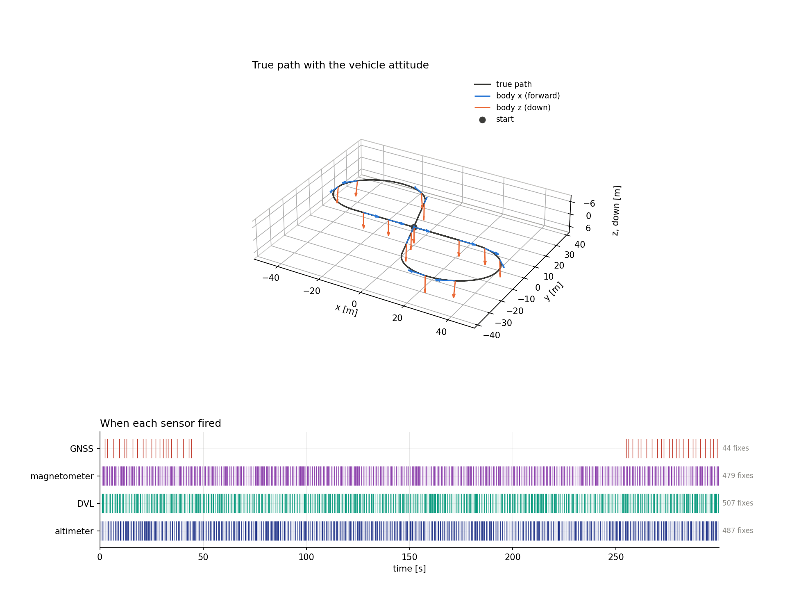
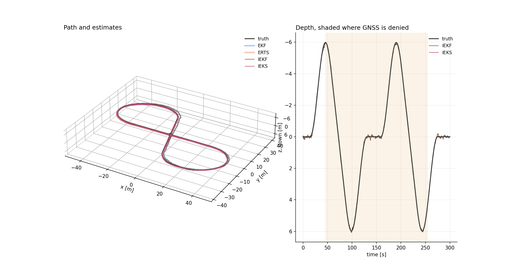
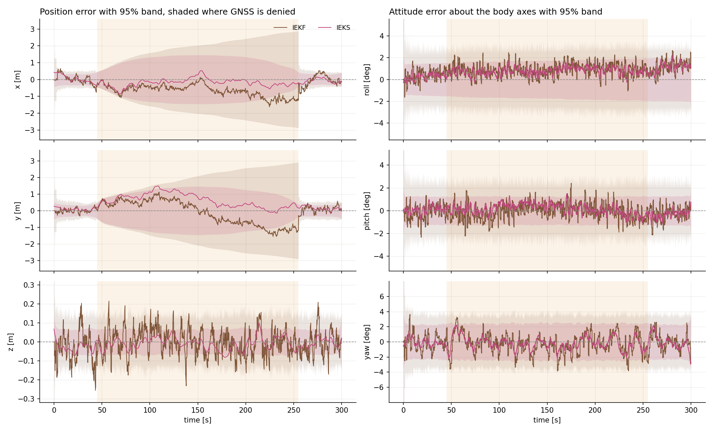
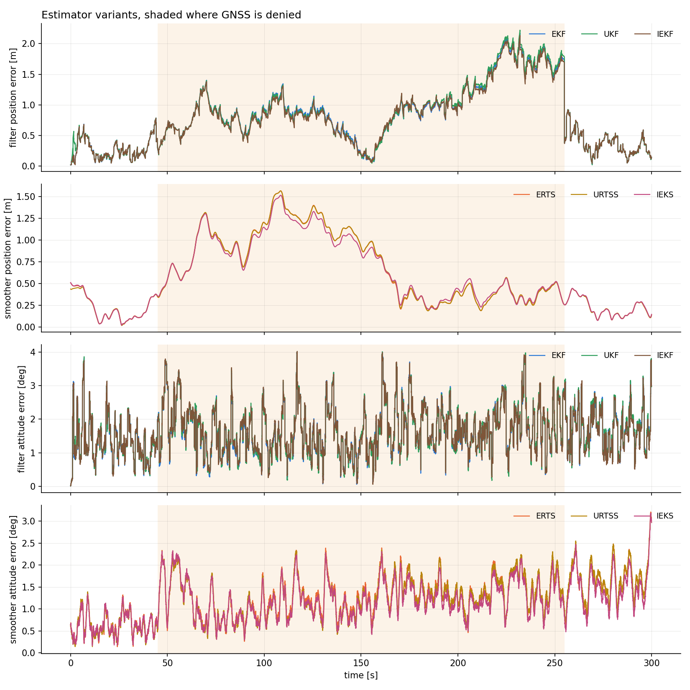
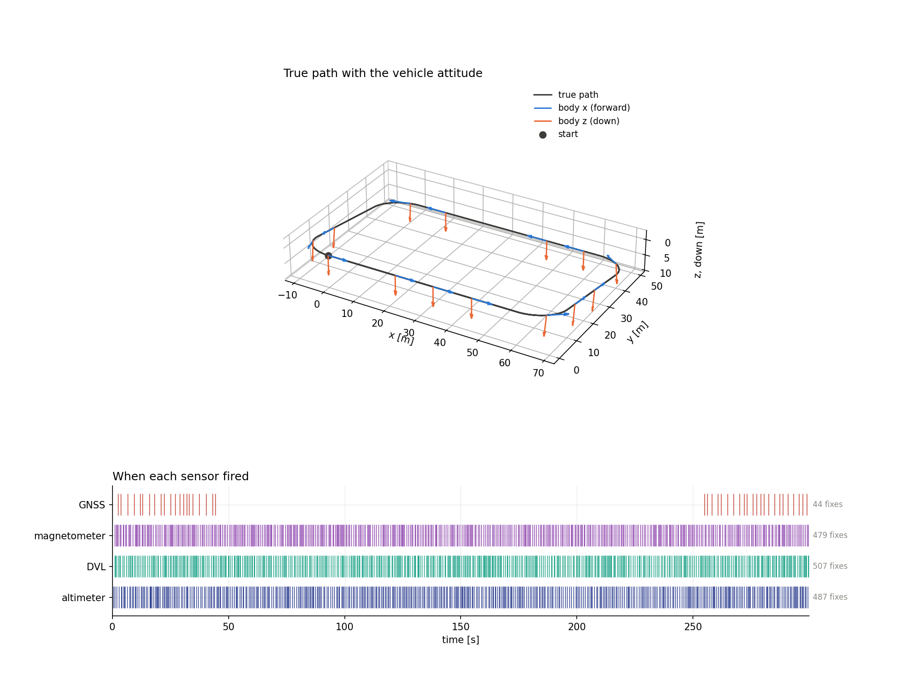
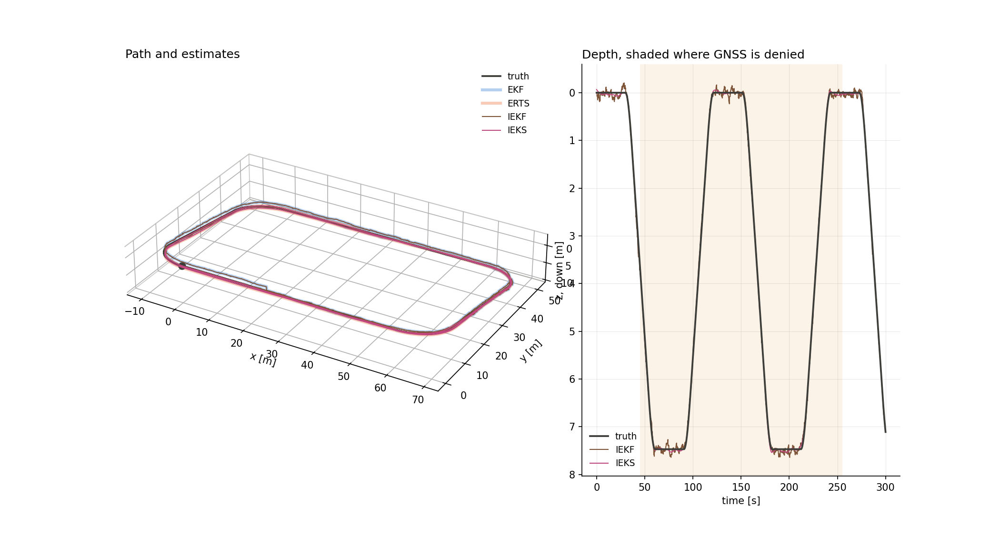
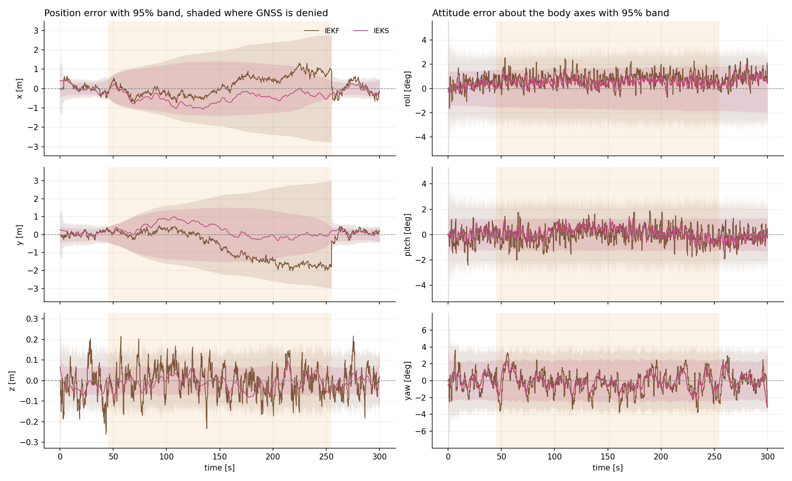
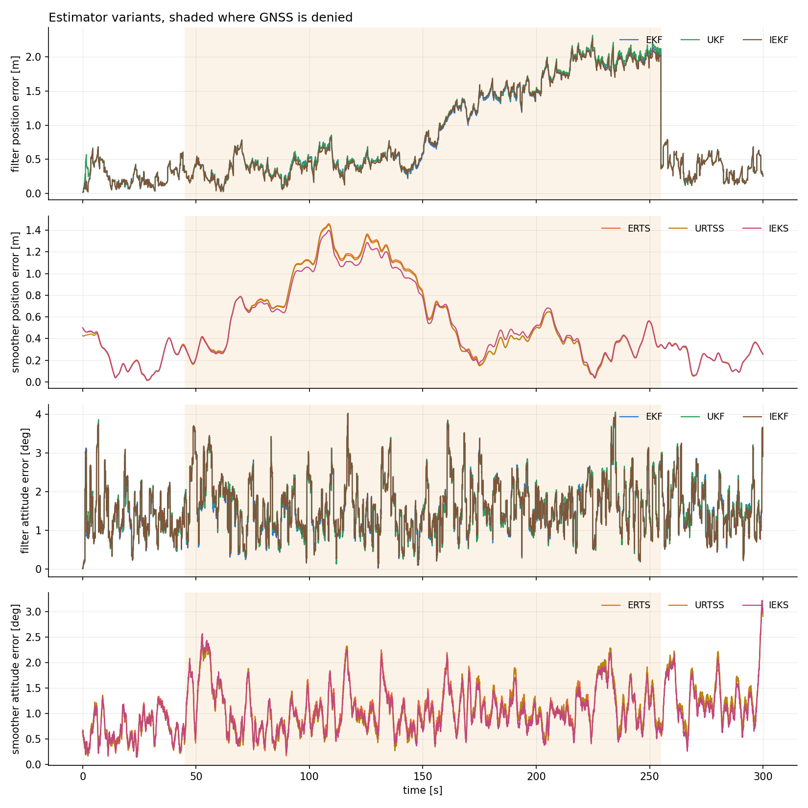

# 3-D strapdown INS, IEKS

[Back to the overview](../../../README.md) | [Previous: UKF](../ukf/README.md)

The extended Rauch-Tung-Striebel smoother linearises the motion model once, at the filtered estimates, and those were computed from the measurements up to each step only. The iterated extended Kalman smoother (IEKS) relinearises both the motion and the measurement models at the smoothed trajectory itself and repeats, with a Levenberg-Marquardt damping, until the whole trajectory settles. This page runs it, over the IEKF, on a three-dimensional strapdown INS with an attitude quaternion, on a tilted figure-eight and a tilted four-corner path with a long GNSS outage, next to the EKF with the ERTS and the UKF with the URTSS.

|               |                                  |
| ------------- | -------------------------------- |
| **Status**    | done, with the same consistency verdicts as the ERTS and the URTSS; the IEKS has the lowest position and attitude RMSE of the three smoothers (3% to 4% in position over the ERTS), but nearly all of the position gain is already in the ERTS over the IEKF it starts from, and a single seed cannot separate the rest from noise |
| **Run**       | 30000 timesteps (300 s at $\Delta t = 0.01$ s), seed 42 |
| **Reproduce** | see [Reproduction](#reproduction) |

## Motivation

A smoother that is built on a filter inherits its linearisation points. The ERTS evaluates $F_k$ at the filtered state $\hat x_k$, which does not yet know about later measurements, and the filter's own updates were linearised at the predictions. With a quaternion attitude the motion model and two of the four sensors, the DVL ($R(q)^\top v$) and the magnetometer (the yaw of $R(q)$), depend nonlinearly on the least well known part of the state, the attitude after a long GNSS outage. The IEKS evaluates every Jacobian at the current smoothed trajectory and improves the trajectory until it minimises the cost of the whole run. The scenario asks:

- Does iterating over the whole trajectory change the smoothed estimate, the reported covariance or the consistency compared with the ERTS and the URTSS?
- Does it matter more in a long outage, where the filter's linearisation points drift away from the truth?
- Does the iteration remain stable when the state is on a manifold, with the attitude updated as $q \otimes \mathrm{Exp}(\delta\theta)$?

## Problem formulation

### State and error state

The state is 16-dimensional, position, velocity (navigation frame, z down), the attitude quaternion from body to navigation frame, and the accelerometer and gyro biases,

$$
x = \begin{bmatrix} p^\top & v^\top & q^\top & b_a^\top & b_g^\top \end{bmatrix}^\top \in \mathbb{R}^{16}, \qquad \lVert q \rVert = 1 .
$$

The covariance lives on the 15-dimensional error state $\delta x = [\delta p, \delta v, \delta\theta, \delta b_a, \delta b_g]$ with the attitude error applied in the body frame, $q_{\mathrm{true}} = q \otimes \mathrm{Exp}(\delta\theta)$. A state is updated by $x \boxplus \delta x$ (the quaternion is rotated, everything else is added) and two states are subtracted by

$$
x_a \boxminus x_b = \begin{bmatrix} p_a - p_b \\ v_a - v_b \\ \mathrm{Log}(q_b^{*} \otimes q_a) \\ b_{a,a} - b_{a,b} \\ b_{g,a} - b_{g,b} \end{bmatrix} .
$$

### Motion model

The IMU reading is corrected with the estimated biases, $\tilde a_k = a_k - b_{a,k}$ and $\tilde\omega_k = \omega_k - b_{g,k}$, and integrated with the attitude at the middle of the step (gravity $g = [0, 0, 9.81]^\top$ in the navigation frame):

$$
\begin{aligned}
R_{\mathrm{mid}} &= R\big(q_k \otimes \mathrm{Exp}(\tfrac{\Delta t}{2}\tilde\omega_k)\big), \qquad a_k' = R_{\mathrm{mid}}\,\tilde a_k + g, \\
p_{k+1} &= p_k + \Delta t\, v_k + \tfrac{\Delta t^2}{2}\, a_k', \qquad v_{k+1} = v_k + \Delta t\, a_k', \\
q_{k+1} &= \big(q_k \otimes \mathrm{Exp}(\Delta t\,\tilde\omega_k)\big) \big/ \lVert \cdot \rVert, \\
b_{a,k+1} &= e^{-\Delta t / T_a}\, b_{a,k}, \qquad b_{g,k+1} = e^{-\Delta t / T_g}\, b_{g,k},
\end{aligned}
$$

with Gauss-Markov biases of time constant $T$, and process noise $Q_k = G_k D G_k^\top \Delta t$ on the error state. The Jacobian $F_k$ of this model with respect to the error state is the exact first-order one; it is written out on the [EKF page](../ekf/README.md#motion-model).

| symbol | meaning |
| --- | --- |
| $x_k$ | state: position, velocity, attitude quaternion, accelerometer bias, gyro bias |
| $\delta x_k$ | error state, the attitude part is a rotation vector in the body frame |
| $u_k$ | IMU reading: body-frame specific force and angular rate |
| $R(q)$ | rotation matrix from the body to the navigation frame |
| $\boxplus, \boxminus$ | addition and subtraction of an error state to a state |

### Sensors

| sensor | $h(x)$ | noise variance | period | linear |
| --- | --- | --- | --- | --- |
| GNSS | $p$ | $0.2\ \mathrm{m^2}$ | 1 to 3 s, off from 45 s to 255 s | yes |
| altimeter | $p_z$ | $10^{-2}\ \mathrm{m^2}$ | 0.2 to 1 s | yes |
| DVL | $R(q)^\top v$ | $10^{-2}\ \mathrm{(m/s)^2}$ per axis | 0.2 to 1 s | no |
| magnetometer | $\mathrm{atan2}(R_{10}, R_{00})$, residual wrapped to $\pm\pi$ | $3 \cdot 10^{-3}\ \mathrm{rad^2}$ | 0.25 to 1 s | no |

When several sensors fire in the same step they update in turn, each starting from the result of the previous one. The Jacobians of the DVL, $[0,\ R^\top,\ [R^\top v]_\times,\ 0,\ 0]$, and of the magnetometer are those of the EKF page.

### Trajectory

Both paths are laid in a plane tilted about the $x$ axis by $0.15$ rad, so the depth reaches about $\pm 6$ m, and flown at $2$ m/s with the roll of a coordinated turn.

- **Figure-eight.** Two circles of radius 20 m with centres 70 m apart, joined by two crossing straights. It turns both ways.
- **Four-corner.** A rectangle of 80 m by 50 m with quarter-circle corners of radius 10 m. It turns one way only.


### Estimators

**Extended Kalman filter, the reference.** Prediction and update with Jacobians $F$ and $H$ and measurement noise $R$:

$$
\bar x_k = f(\hat x_{k-1}, u_k), \qquad \bar P_k = F_k \hat P_{k-1} F_k^\top + Q_k,
$$

$$
\eta_k = z_k \boxminus h(\bar x_k), \qquad S_k = H_k \bar P_k H_k^\top + R, \qquad W_k = \bar P_k H_k^\top S_k^{-1},
$$

$$
\hat x_k = \bar x_k \boxplus W_k \eta_k, \qquad
\hat P_k = (I - W_k H_k)\, \bar P_k\, (I - W_k H_k)^\top + W_k R\, W_k^\top .
$$

**Iterated extended Kalman filter (IEKF) with Levenberg-Marquardt.** The prediction is the EKF prediction. The EKF update linearises $h$ once, at the prediction $\bar x$. The IEKF update instead finds the maximum a posteriori estimate of the state for this one measurement, the minimiser of the cost

$$
J(x) = \tfrac12\, \big\lVert z \boxminus h(x) \big\rVert^2_{R^{-1}} + \tfrac12\, \big\lVert x \boxminus \bar x \big\rVert^2_{\bar P^{-1}},
$$

by iterating on the linearisation point $x_i$, starting at $x_0 = \bar x$. On the manifold both residuals are taken with $\boxminus$, so the prior term $x \boxminus \bar x$ includes the attitude difference $\mathrm{Log}(\bar q^{*} \otimes q)$. With $\eta_i = z \boxminus h(x_i)$, $H_i = H(x_i)$ and the offset $d_i = x_i \boxminus \bar x$, the Gauss-Newton step $\delta$ solves

$$
\big(\bar P^{-1} + H_i^\top R^{-1} H_i + \lambda\, \bar P^{-1}\big)\,\delta = H_i^\top R^{-1} \eta_i - \bar P^{-1} d_i ,
$$

where $\lambda = 0$ is Gauss-Newton and $\lambda > 0$ is the Levenberg-Marquardt damping. Adding $\lambda \bar P^{-1}$ is the same as shrinking the prior covariance to $\bar P_\lambda = \bar P / (1+\lambda)$, so the step has the form of a Kalman update:

$$
S_\lambda = H_i \bar P_\lambda H_i^\top + R, \qquad W_\lambda = \bar P_\lambda H_i^\top S_\lambda^{-1}, \qquad
\delta = W_\lambda\, \eta_i - (I - W_\lambda H_i)\,\frac{d_i}{1+\lambda}, \qquad x_{i+1} = x_i \boxplus \delta .
$$

A step is accepted if $J(x_i \boxplus \delta) < J(x_i)$, and then $\lambda \leftarrow \lambda / \lambda_f$; otherwise the iterate stays and $\lambda \leftarrow \lambda_f\, \lambda$. The iteration stops when the step in the $\bar P$ norm, or the relative decrease of $J$, falls below a tolerance, or when the iteration or rejection limits are reached. The posterior covariance is the Joseph form of the EKF with the undamped $W$ and $H$ evaluated at the final iterate $\hat x$. The innovation and $S$ that are reported, and used for the NIS, are the EKF's, evaluated at $\bar x$, so that they are comparable between the filters.

**What differs from the EKF.** There are three differences, and only the first one changes the number that is computed:

1. The measurement function is relinearised at the improved estimate, so $H$ and the residual $\eta$ are evaluated at $x_i$ and not at $\bar x$. For a linear sensor $J$ is quadratic and the first step already reaches the minimiser, so the update equals the EKF's. Here only the DVL and the magnetometer can differ.
2. The prior is kept in the cost. The step uses the offset $d_i$ from the prediction, which is how the iterate stays tied to the prior, and the damping $\lambda$ protects against overshooting when $H$ varies quickly.
3. The attitude is iterated on the manifold: each candidate is $x_i \boxplus \delta$ with the attitude rotated by $\mathrm{Exp}(\delta\theta)$, and $d_i$ contains the rotation vector between $q_i$ and $\bar q$.

| parameter | value | meaning |
| --- | --- | --- |
| $\lambda_0$ | $10^{-2}$ | initial damping |
| $\lambda_{\min},\ \lambda_{\max}$ | $10^{-12},\ 10^{12}$ | floor, and ceiling at which an update gives up |
| $\lambda_f$ | 10 | factor applied to $\lambda$ on a rejection or an accept |
| maximum iterations, maximum consecutive rejections | 50, 30 | |
| step tolerance, relative cost tolerance | $10^{-8}$, $10^{-12}$ | stopping thresholds |

**Extended Rauch-Tung-Striebel smoother (ERTS).** Run backward over a filter's output, starting from $\hat x^s_N = \hat x_N$, with $F_k$ evaluated at the filtered state:

$$
G_k = \hat P_k F_k^\top \bar P_{k+1}^{-1}, \qquad
\hat x^s_k = \hat x_k \boxplus G_k\,(\hat x^s_{k+1} \boxminus \bar x_{k+1}), \qquad
P^s_k = \hat P_k + G_k\,(P^s_{k+1} - \bar P_{k+1})\,G_k^\top .
$$

**Unscented Kalman filter and URTSS.** The UKF and the URTSS replace the Jacobians by sigma points, with $\alpha = 1$, $\beta = 2$ and $\kappa = 0$, taken on the 15-dimensional error state; they are derived on the [UKF page](../ukf/README.md) and only appear here as the second reference.

**Iterated extended Kalman smoother (IEKS) with Levenberg-Marquardt.** The IEKF iterates one update at a time. The IEKS iterates the whole run. Number the nodes $0, \dots, N$, with node $0$ the prior and node $k$ the state at step $k$, so that the transition from $k-1$ to $k$ uses $u_k$ and the measurements $z_k$ belong to node $k$. The smoother minimises the cost of the whole trajectory $x_{0:N}$,

$$
J(x_{0:N}) = \tfrac12\, \big\lVert x_0 \boxminus \hat x_0 \big\rVert^2_{\hat P_0^{-1}}
+ \sum_{k=1}^{N} \tfrac12\, \big\lVert x_k \boxminus f(x_{k-1}, u_k) \big\rVert^2_{Q_k^{+}}
+ \sum_{k=1}^{N} \sum_{s} \tfrac12\, \big\lVert z^{s}_k \boxminus h^{s}(x_k) \big\rVert^2_{R_s^{-1}},
$$

where the sum over $s$ runs over the sensors that fired at step $k$ and the residuals are taken with $\boxminus$, so the attitude part is the rotation vector $\mathrm{Log}(q_b^{*} \otimes q_a)$. Position has no process noise in this model, so $Q_k$ has rank 12 of 15 and the motion term uses its pseudo-inverse $Q_k^{+}$: only the part of the residual that the noise can drive is penalised.

Given a reference trajectory $x^{\mathrm{ref}}_{0:N}$, write $x_k = x^{\mathrm{ref}}_k \boxplus \delta_k$ with $\delta_k$ in the 15-dimensional error state and linearise the models there. The problem in $\delta$ is linear and Gaussian,

$$
\delta_k = c_k + F_k\, \delta_{k-1} + w_k, \qquad c_k = f(x^{\mathrm{ref}}_{k-1}, u_k) \boxminus x^{\mathrm{ref}}_k, \qquad w_k \sim \mathcal{N}(0, Q_k),
$$

$$
z^{s}_k \boxminus h^{s}(x^{\mathrm{ref}}_k) = H^{s}_k\, \delta_k + \varepsilon^{s}_k, \qquad \delta_0 \sim \mathcal{N}\big(\hat x_0 \boxminus x^{\mathrm{ref}}_0,\ \hat P_0\big),
$$

with $F_k$ and $Q_k$ evaluated at $x^{\mathrm{ref}}_{k-1}$ and $H^{s}_k$ at $x^{\mathrm{ref}}_k$. The offset $c_k$ is how far the reference is from satisfying the motion model, and it is zero for a trajectory the model could have produced. The step $\delta^s_{0:N}$ that minimises this quadratic cost is found with a Kalman filter that carries the offset $c_k$ and applies the sensors of a step in turn, followed by an RTS smoother in $\delta$:

$$
\bar\delta_k = c_k + F_k \hat\delta_{k-1}, \qquad \bar P_k = F_k \hat P_{k-1} F_k^\top + Q_k, \qquad
G_k = \hat P_k F_k^\top \bar P_{k+1}^{-1}, \qquad \delta^s_k = \hat\delta_k + G_k\,(\delta^s_{k+1} - \bar\delta_{k+1}),
$$

and the reference is moved to $x^{\mathrm{ref}}_k \boxplus \delta^s_k$, which rotates the quaternion by $\mathrm{Exp}$ of the attitude part and keeps it a unit quaternion. This is one Gauss-Newton iteration of the whole trajectory. One approximation is made on the manifold: $F_k$ is the EKF's error-state Jacobian, which is exact when $c_k = 0$. When the reference is not an exact solution of the motion model, the Jacobian of $\boxminus$ with respect to the reference attitude is neglected. It goes to zero with $c_k$, the same kind of first-order approximation the EKF and the ERTS already make.

Levenberg-Marquardt damping is added to every node as one more measurement, $0 = \delta_k + \varepsilon_k$ with $\varepsilon_k \sim \mathcal{N}(0, D_k / \lambda)$, so that a large $\lambda$ keeps the step small and $\lambda = 0$ is Gauss-Newton. The scale $D_k$ is the covariance the filter reported at node $k$, here the IEKF's, which makes the damping independent of the units of the state. A step is accepted if $J$ decreased, and then $\lambda \leftarrow \lambda / \lambda_f$; otherwise the trajectory stays and $\lambda \leftarrow \lambda_f\, \lambda$. The iteration stops when the step, measured in the filter's covariance and averaged over the nodes, or the relative decrease of $J$, falls below a tolerance, or when the iteration or rejection limits are reached. The reported covariance is $P^s_k$ of one more undamped pass at the final trajectory.

The iteration starts from the IEKF's filtered trajectory, with the prior mean as node $0$. The Levenberg-Marquardt parameters are those of the IEKF in the table above.

**What differs from the ERTS.** The ERTS makes one backward pass over the filter's output, linearised at the filtered states. The IEKS repeats forward and backward passes over all the data, relinearising $f$ and every $h$ at the smoothed trajectory. For a linear model the cost is quadratic and an undamped step reaches the minimiser. On a four-state linear test model, run once outside this repository, the IEKS reached the RTS smoother's mean to $3 \cdot 10^{-9}$ and its covariance to the printed precision. The reported covariance is the linearised one at the final trajectory, and it can differ slightly from the ERTS's because it is evaluated at a different linearisation point.

### Consistency

A filter is consistent if the errors it makes agree with the covariance it reports. With the truth $x_k$ known from the simulation,

$$
\mathrm{NIS}_k = \eta_k^\top S_k^{-1} \eta_k \sim \chi^2_{m}, \qquad
\mathrm{NEES}_k = (x_k \boxminus \hat x_k)^\top \hat P_k^{-1} (x_k \boxminus \hat x_k) \sim \chi^2_{d},
$$

with $m$ the measurement dimension (3 for GNSS and DVL, 1 for the altimeter and the magnetometer) and $d$ the dimension of the tested part of the error state: 15 for the full state, 3 for position and 3 for attitude. The time average $\bar\epsilon$ of either statistic is held against the interval

$$
\left[\ \frac{\chi^2_{\alpha/2}(N_{\mathrm{eff}}\, d)}{N_{\mathrm{eff}}},\ \ \frac{\chi^2_{1-\alpha/2}(N_{\mathrm{eff}}\, d)}{N_{\mathrm{eff}}}\ \right], \qquad
N_{\mathrm{eff}} = \max\!\Big(1,\ N\,\frac{1-\rho}{1+\rho}\Big), \qquad \alpha = 0.05,
$$

where $\rho$ is the lag-one autocorrelation of the series. A statistic is "consistent" if its time average lies inside the interval. A value below the interval means the errors are smaller than the reported covariance says, the estimator is underconfident (conservative). A value above means the errors are larger than it says, the estimator is overconfident (too optimistic). The NEES interval of the smoother is wide because of the autocorrelation. All numbers are from one run with seed 42, so they carry no error bars.


## Reproduction

Build once, then simulate and analyse each case:

```bash
cmake -S . -B build && cmake --build build
./build/kalman_filtering_and_smoothing results/INS3D/ieks/figure_eight
python3 scripts/analyze_ins_3d.py results/INS3D/ieks/figure_eight/data
./build/kalman_filtering_and_smoothing results/INS3D/ieks/rounded_rectangle
python3 scripts/analyze_ins_3d.py results/INS3D/ieks/rounded_rectangle/data
```

The executable reads `<case>/config.yaml` and writes `<case>/data`, which is not tracked in git since the CSV files of the 3-D runs are hundreds of MB; given the folder `results/INS3D/ieks` it runs both cases. The analysis writes `<case>/stats.txt`, which holds every number quoted below, and the figures in `<case>/figures`. The estimators a case runs are listed in its `config.yaml`, `estimators: [ekf, ukf, ieks]`, and each one's files carry its name as prefix: `ekf` is the EKF with the ERTS, `ukf` the UKF with the URTSS and `ieks` the IEKF with the IEKS, so the IEKF and the IEKS share the prefix `ieks_`. The IEKF and the IEKS use the Levenberg-Marquardt parameters of the table above. `truth.csv` holds the 16 true state elements, `<estimator>_filter.csv` and `<estimator>_smoother.csv` the mean and the full $15 \times 15$ covariance, and `<estimator>_*_fixes.csv` the raw measurement, innovation and $S$ of each fix.

## Results

The figures per case: the true path with the vehicle attitude and the sensor timeline, the IEKF and IEKS path and depth with the EKF and ERTS drawn wide and faint underneath, the IEKF's and IEKS's own error per axis with its 95% band, and the position and attitude error of every variant. The EKF and the UKF are references here; the subject is the IEKS.

### Figure-eight



*The true path with the body $x$ axis (forward) and body $z$ axis (down), and when each sensor fired. GNSS fires only before 45 s and after 255 s.*



*Path and depth with the IEKF and IEKS. The EKF and ERTS lie wide and faint underneath: where the IEKS line covers them they agree.*



*The IEKF's and IEKS's position error per axis and attitude error per body axis with their 95% bands, shaded where GNSS is denied.*



*Position and attitude error of the filters (EKF, UKF, IEKF) and of the smoothers (ERTS, URTSS, IEKS) over the whole run.*

| quantity | EKF | UKF | IEKF | ERTS | URTSS | IEKS |
| --- | --- | --- | --- | --- | --- | --- |
| position RMSE [m] | 0.931 | 0.944 | 0.912 | 0.708 | 0.708 | 0.685 |
| position error, median [m] | 0.752 | 0.742 | 0.730 | 0.424 | 0.423 | 0.441 |
| position error, 95th percentile [m] | 1.79 | 1.83 | 1.75 | 1.31 | 1.31 | 1.26 |
| position error, maximum [m] | 2.17 | 2.22 | 2.13 | 1.56 | 1.56 | 1.51 |
| attitude RMSE [deg] | 1.78 | 1.79 | 1.79 | 1.35 | 1.34 | 1.26 |
| true position inside the 95% ellipsoid | 98.3% | 98.3% | 98.4% | 98.6% | 98.5% | 98.6% |

| statistic | EKF / ERTS | UKF / URTSS | IEKF / IEKS |
| --- | --- | --- | --- |
| NIS, GNSS (3 dof) | 3.548 (consistent) | 3.567 (consistent) | 3.538 (consistent) |
| NIS, altimeter (1 dof) | 1.015 (consistent) | 1.010 (consistent) | 1.016 (consistent) |
| NIS, magnetometer (1 dof) | 0.805 (underconfident) | 0.805 (underconfident) | 0.804 (underconfident) |
| NIS, DVL (3 dof) | 2.300 (underconfident) | 2.263 (underconfident) | 2.300 (underconfident) |
| NEES, full state, filter (15 dof) | 8.83 (underconfident) | 9.00 (underconfident) | 8.84 (underconfident) |
| NEES, position, filter (3 dof) | 2.34 (underconfident) | 2.35 (underconfident) | 2.30 (underconfident) |
| NEES, attitude, filter (3 dof) | 1.30 (underconfident) | 1.32 (underconfident) | 1.31 (underconfident) |
| NEES, full state, smoother (15 dof) | 10.54 (underconfident) | 10.20 (underconfident) | 9.76 (underconfident) |
| NEES, position, smoother (3 dof) | 2.91 (consistent) | 2.90 (consistent) | 2.85 (consistent) |
| NEES, attitude, smoother (3 dof) | 2.06 (consistent) | 1.99 (consistent) | 1.76 (consistent) |

| distance | position median [mm] | position max [mm] | attitude max [deg] | position $\mathrm{tr}\,P$ ratio range |
| --- | --- | --- | --- | --- |
| UKF vs EKF | 24.1 | 410.4 | 0.730 | [0.8486, 1.2344] |
| IEKF vs EKF | 35.4 | 85.4 | 0.440 | [0.9865, 1.0182] |
| URTSS vs ERTS | 6.0 | 158.2 | 0.220 | [0.9196, 1.0057] |
| IEKS vs ERTS | 42.9 | 105.6 | 0.334 | [0.9974, 1.0124] |

### Four-corner



*The true path with the vehicle attitude and the sensor timeline.*



*Path and depth with the IEKF and IEKS, the EKF and ERTS faint underneath.*



*The IEKF's and IEKS's position and attitude error per axis with their 95% bands.*



*Position and attitude error of every filter and smoother.*

| quantity | EKF | UKF | IEKF | ERTS | URTSS | IEKS |
| --- | --- | --- | --- | --- | --- | --- |
| position RMSE [m] | 1.029 | 1.046 | 1.024 | 0.637 | 0.631 | 0.613 |
| position error, median [m] | 0.492 | 0.494 | 0.477 | 0.378 | 0.378 | 0.399 |
| position error, 95th percentile [m] | 2.02 | 2.06 | 1.99 | 1.26 | 1.25 | 1.19 |
| position error, maximum [m] | 2.29 | 2.32 | 2.27 | 1.46 | 1.45 | 1.40 |
| attitude RMSE [deg] | 1.72 | 1.72 | 1.72 | 1.18 | 1.16 | 1.14 |
| true position inside the 95% ellipsoid | 99.0% | 98.9% | 99.0% | 99.7% | 99.7% | 99.7% |

| statistic | EKF / ERTS | UKF / URTSS | IEKF / IEKS |
| --- | --- | --- | --- |
| NIS, GNSS (3 dof) | 3.514 (consistent) | 3.531 (consistent) | 3.507 (consistent) |
| NIS, altimeter (1 dof) | 1.011 (consistent) | 1.006 (consistent) | 1.013 (consistent) |
| NIS, magnetometer (1 dof) | 0.801 (underconfident) | 0.801 (underconfident) | 0.800 (underconfident) |
| NIS, DVL (3 dof) | 2.319 (underconfident) | 2.281 (underconfident) | 2.317 (underconfident) |
| NEES, full state, filter (15 dof) | 8.30 (underconfident) | 8.39 (underconfident) | 8.32 (underconfident) |
| NEES, position, filter (3 dof) | 2.11 (underconfident) | 2.14 (underconfident) | 2.10 (underconfident) |
| NEES, attitude, filter (3 dof) | 1.22 (underconfident) | 1.22 (underconfident) | 1.22 (underconfident) |
| NEES, full state, smoother (15 dof) | 9.28 (underconfident) | 8.79 (underconfident) | 8.73 (underconfident) |
| NEES, position, smoother (3 dof) | 2.52 (consistent) | 2.49 (consistent) | 2.45 (consistent) |
| NEES, attitude, smoother (3 dof) | 1.59 (underconfident) | 1.49 (underconfident) | 1.43 (underconfident) |

| distance | position median [mm] | position max [mm] | attitude max [deg] | position $\mathrm{tr}\,P$ ratio range |
| --- | --- | --- | --- | --- |
| UKF vs EKF | 26.1 | 411.7 | 0.732 | [0.8486, 1.2344] |
| IEKF vs EKF | 28.4 | 74.5 | 0.441 | [0.9846, 1.0187] |
| URTSS vs ERTS | 7.7 | 157.8 | 0.212 | [0.9196, 1.0061] |
| IEKS vs ERTS | 30.3 | 111.3 | 0.241 | [0.9970, 1.0073] |

## Discussion

- **The IEKS is the most accurate smoother, by a small margin.** Its position RMSE is 0.685 m on the figure-eight and 0.613 m on the four-corner path, against 0.708 m and 0.637 m for the ERTS and 0.708 m and 0.631 m for the URTSS, 3% to 4% better than the ERTS. The attitude RMSE is 1.26 deg and 1.14 deg against 1.35 deg and 1.18 deg for the ERTS and 1.34 deg and 1.16 deg for the URTSS. The gain sits in the tails, the 95th percentile and the maximum fall by 3% to 5%, while the median error is about 2 cm higher (0.441 m against 0.424 m, and 0.399 m against 0.378 m). With one seed and no error bars I would not call a few centimetres a result.
- **Most of the position gain is already in the IEKF.** The ERTS run over the IEKF's output, ERTS (IEKF) on the [IEKF page](../iekf/README.md), has a position RMSE of 0.684 m and 0.612 m, against 0.685 m and 0.613 m for the IEKS, and an attitude RMSE of 1.29 deg and 1.14 deg against 1.26 deg and 1.14 deg. Computed from the two pages' CSV files, the IEKS is a median of 9.4 mm and 10.0 mm (at most 32.1 mm and 30.6 mm) away from it. So iterating the smoother adds about a centimetre on top of what the IEKF start gives, and perhaps 0.03 deg of attitude on the figure-eight.
- **Consistency verdicts are unchanged.** Every verdict of the IEKS and the IEKF is the one of the ERTS and the EKF. The IEKS has the lowest smoother NEES of the three on both paths (the full-state value 9.76 against 10.54 for the ERTS on the figure-eight), and since the reported covariance is the ERTS's to within 1.2% in position $\mathrm{tr}\,P$ while the errors are smaller, it is a little more underconfident, not less. The attitude NEES of the smoothers on the figure-eight is the exception to look at: the IEKS's 1.76 is still inside its interval, but only just (lower edge 1.74). The underconfidence of the 3-D runs has the cause described on the [EKF page](../ekf/README.md#discussion), a white IMU noise that is simulated with too small a variance for the process noise the filter assumes, and the smoother cannot remove it.
- **The UKF's distance is a transient, the iterated methods' is spread over the run.** The UKF is up to 0.41 m from the EKF and its position $\mathrm{tr}\,P$ ranges over [0.85, 1.23] of the EKF's, against at most 0.09 m and [0.985, 1.018] for the IEKF, but the UKF's maximum is at 1.6 s and the [UKF page](../ukf/README.md) shows it is near the EKF afterwards. In median the UKF is 24 mm and 26 mm from the EKF and the IEKF 35 mm and 28 mm; for the smoothers the URTSS is 6 mm and 8 mm from the ERTS and the IEKS 43 mm and 30 mm, so the IEKS moves furthest from the ERTS in the bulk of the run.
- **Stability on the manifold.** Both 300 s runs finished with finite estimates, no covariance lost positive semidefiniteness (the smallest eigenvalue is $3.6 \cdot 10^{-6}$ for the smoother), and the quaternion stayed a unit quaternion. The IEKS position $\mathrm{tr}\,P$ exceeded the IEKF's in the last 11 of 30000 steps, by at most 0.25%, because the two are evaluated at different linearisation points and a smoother would equal its filter at the final step only if they were the same. Run with zero iterations, which linearises at the IEKF's own states, the IEKS covariance at the last step equals the IEKF's to the printed precision and its trace is nowhere above the IEKF's. After one iteration the final-step offset is 0.30% on the four-corner path, and it settles at 0.25% from the third iteration on, although the smoother's last position is only 4 mm from the IEKF's. I take the cause to be that the covariance recursion is evaluated along the whole smoothed path, whose attitude differs from the filtered one by 1.2 deg in median; I did not test that directly.
- **What I did not measure.** The number of iterations, how often a step was rejected, the cost of the final trajectory and the run time were not recorded, so no claim is made about the work done, or about how much lower the cost is than the ERTS's trajectory. The IEKS starts from the IEKF, so a start from the EKF or from the ERTS is not compared. The IEKS has been run only at this noise level and with a well-initialised attitude; a larger initial attitude error is where relinearising the whole trajectory would be expected to separate from the ERTS.

## Related results

- [EKF](../ekf/README.md): the reference filter and smoother, with the full derivation of the model and the sensors.
- [IEKF](../iekf/README.md): the filter this smoother runs over, with the same two paths.
- [UKF](../ukf/README.md): the unscented filter and smoother, the other comparison here.
- [2-D strapdown INS, IEKS](../../INS2D/ieks/README.md): the same smoother with a one-angle attitude.
