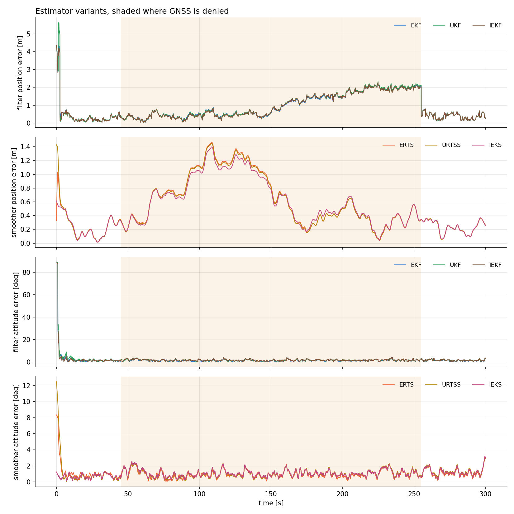
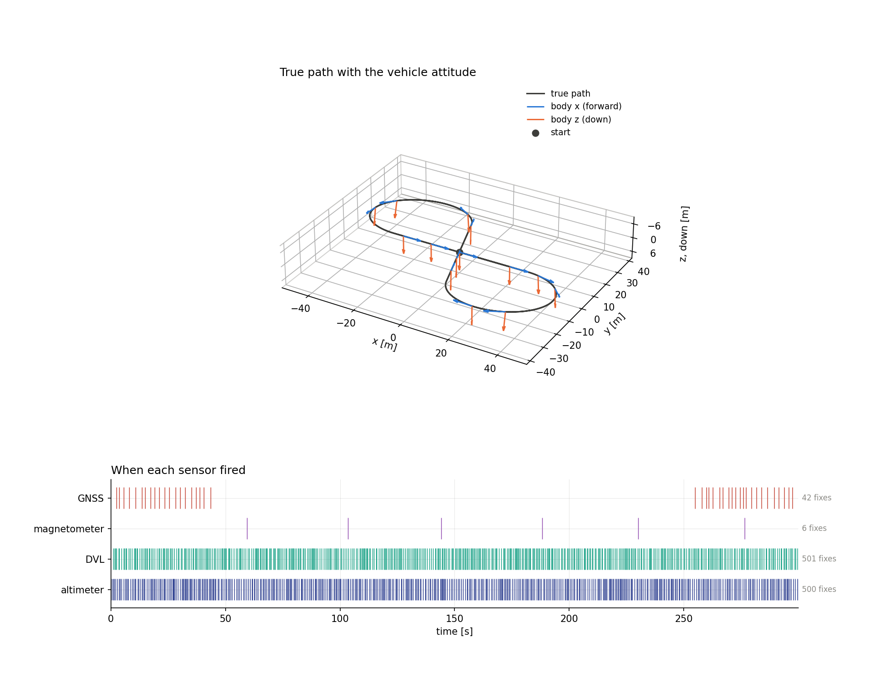
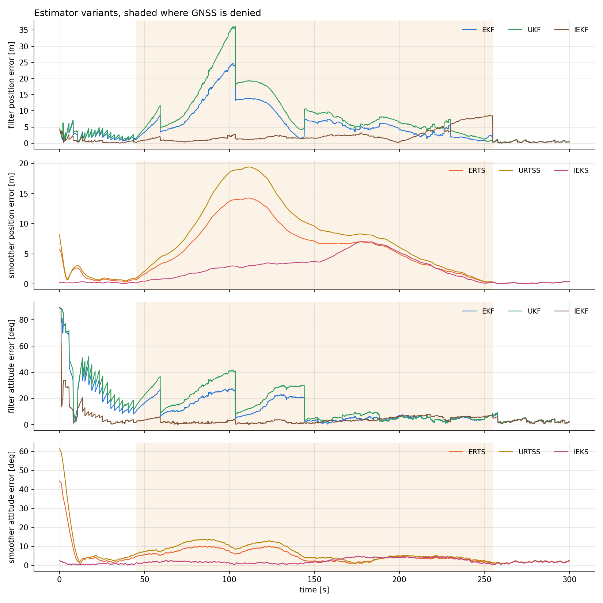
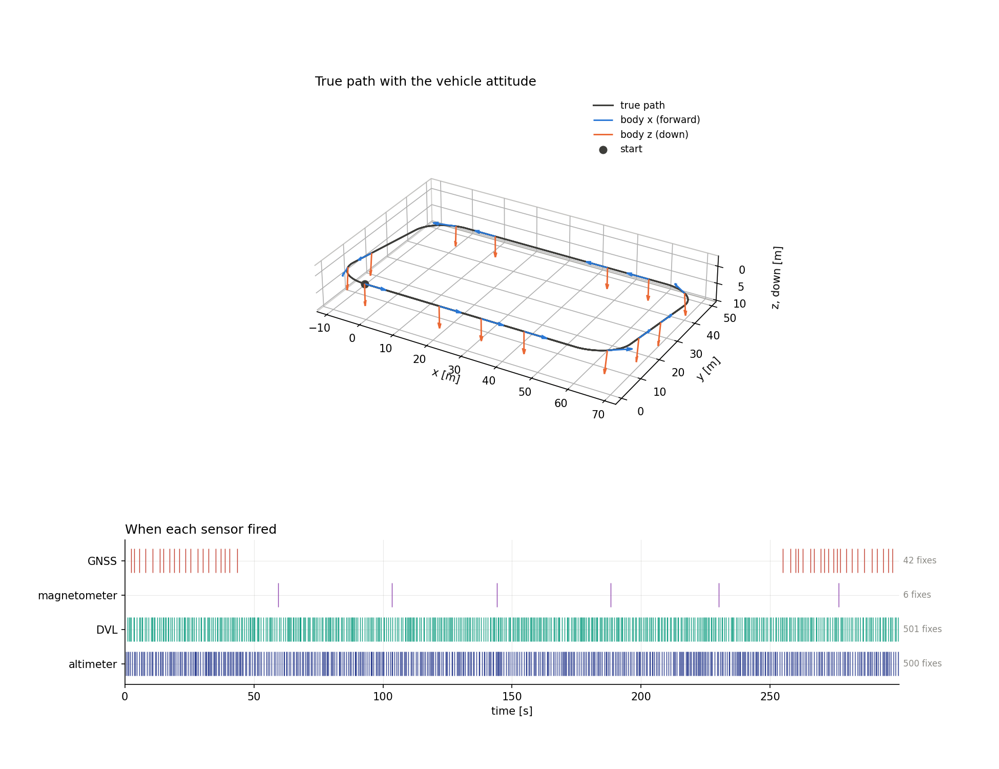
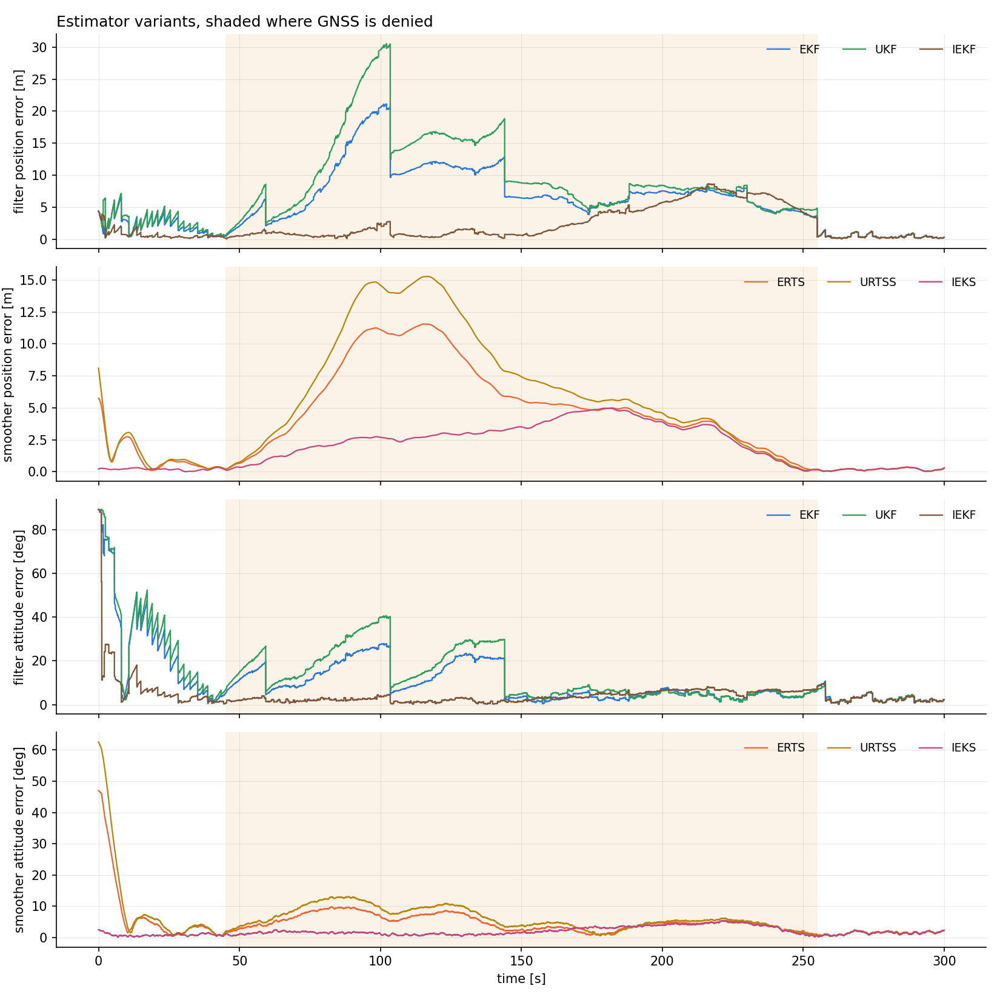

# 3-D strapdown INS, poor initialization: all estimators compared

[Back to the poor initialization](../README.md) | [Extended Kalman filter and ERTS](../extended/README.md) | [Unscented Kalman filter and URTSS](../unscented/README.md) | [Iterated extended Kalman filter and smoother](../iterated/README.md)

## Problem and setup

An underwater vehicle estimates its pose in three dimensions from an IMU, aided by GNSS, a magnetometer, a DVL and an altimeter. GNSS is denied from 45 s to 255 s. The filter starts from a prior far from the truth. In the `*_sparse_magnetometer` runs the magnetometer fires every 30 to 60 s instead of every 0.25 to 1 s, so the yaw error of the prior is corrected only rarely.

The EKF with the ERTS, the UKF with the URTSS and the IEKF with the IEKS are run on the same data, so every estimate below has seen exactly the same IMU readings and fixes.

The truth starts at the origin, level, heading north at 2 m/s. The prior mean is off by $(3, -3, 1)$ m in position, $(-0.5, 0.5, 0.2)$ m/s in velocity and by the rotation vector $(0.3, -0.3, 1.5)$ rad in attitude, 89° in total. Each offset is one standard deviation of the prior.

The state, motion model, sensors and parameters are given in the [poor initialization overview](../README.md).

| run | trajectory | magnetometer period |
| --- | --- | --- |
| [`figure_eight`](figure_eight/) | figure-eight | 0.25 to 1 s |
| [`rounded_rectangle`](rounded_rectangle/) | four-corner | 0.25 to 1 s |
| [`figure_eight_sparse_magnetometer`](figure_eight_sparse_magnetometer/) | figure-eight | 30 to 60 s |
| [`rounded_rectangle_sparse_magnetometer`](rounded_rectangle_sparse_magnetometer/) | four-corner | 30 to 60 s |

## Reproduction

From the project root, after building:

```bash
./build/kalman_filtering_and_smoothing results/INS3D/poor_initialization/comparison
for run in results/INS3D/poor_initialization/comparison/*/; do
    python3 scripts/analyze_ins_3d.py "$run/data"
done
```

Every number below is taken from the run's `stats.txt`.

## Results

### Figure-eight


*The true path with the body axes, and when each sensor fired.*


*From the top: position error of the filters, position error of the smoothers, attitude error of the filters and attitude error of the smoothers. Shaded where GNSS is denied.*

| estimator | RMSE position [m] | median [m] | 95th percentile [m] | max [m] | RMSE attitude [°] | max attitude [°] | true position inside 95% ellipsoid |
| --- | --- | --- | --- | --- | --- | --- | --- |
| EKF | 1.008 | 0.783 | 1.85 | 4.43 | 5.51 | 89.4 | 97.0% |
| UKF | 1.022 | 0.766 | 1.89 | 5.26 | 5.76 | 89.4 | 97.7% |
| IEKF | 0.978 | 0.745 | 1.79 | 4.37 | 5.54 | 89.4 | 98.3% |
| ERTS | 0.718 | 0.428 | 1.32 | 1.58 | 1.31 | 9.2 | 96.7% |
| URTSS | 0.721 | 0.425 | 1.32 | 1.79 | 1.63 | 15.0 | 97.3% |
| IEKS | 0.686 | 0.442 | 1.26 | 1.51 | 1.26 | 3.2 | 98.2% |

| statistic | dof | EKF / ERTS | UKF / URTSS | IEKF / IEKS |
| --- | --- | --- | --- | --- |
| NIS, GNSS | 3 | 3.589 (consistent) | 3.654 (overconfident) | 3.555 (consistent) |
| NIS, magnetometer | 1 | 0.830 (underconfident) | 1.205 (consistent) | 0.826 (underconfident) |
| NIS, DVL | 3 | 2.662 (consistent) | 2.519 (underconfident) | 2.474 (underconfident) |
| NIS, altimeter | 1 | 1.087 (consistent) | 1.055 (consistent) | 1.016 (consistent) |
| NEES, full state, filter | 15 | 10.396 (underconfident) | 12.028 (consistent) | 9.222 (underconfident) |
| NEES, position, filter | 3 | 2.604 (consistent) | 2.492 (consistent) | 2.353 (underconfident) |
| NEES, attitude, filter | 3 | 1.405 (underconfident) | 2.321 (consistent) | 1.513 (underconfident) |
| NEES, full state, smoother | 15 | 12.707 (consistent) | 11.982 (consistent) | 9.766 (underconfident) |
| NEES, position, smoother | 3 | 3.060 (consistent) | 3.138 (consistent) | 2.875 (consistent) |
| NEES, attitude, smoother | 3 | 1.836 (consistent) | 2.272 (consistent) | 1.750 (consistent) |

### Four-corner


*The true path with the body axes, and when each sensor fired.*



*From the top: position error of the filters, position error of the smoothers, attitude error of the filters and attitude error of the smoothers. Shaded where GNSS is denied.*

| estimator | RMSE position [m] | median [m] | 95th percentile [m] | max [m] | RMSE attitude [°] | max attitude [°] | true position inside 95% ellipsoid |
| --- | --- | --- | --- | --- | --- | --- | --- |
| EKF | 1.085 | 0.508 | 2.03 | 4.37 | 5.45 | 89.1 | 98.1% |
| UKF | 1.122 | 0.506 | 2.07 | 5.64 | 5.63 | 89.1 | 98.5% |
| IEKF | 1.081 | 0.488 | 2.00 | 4.37 | 5.47 | 89.1 | 99.0% |
| ERTS | 0.644 | 0.380 | 1.27 | 1.47 | 1.22 | 8.3 | 98.3% |
| URTSS | 0.641 | 0.380 | 1.25 | 1.45 | 1.41 | 12.5 | 98.8% |
| IEKS | 0.614 | 0.400 | 1.19 | 1.40 | 1.13 | 3.2 | 99.5% |

| statistic | dof | EKF / ERTS | UKF / URTSS | IEKF / IEKS |
| --- | --- | --- | --- | --- |
| NIS, GNSS | 3 | 3.545 (consistent) | 3.591 (consistent) | 3.522 (consistent) |
| NIS, magnetometer | 1 | 0.824 (underconfident) | 1.147 (consistent) | 0.818 (underconfident) |
| NIS, DVL | 3 | 2.616 (underconfident) | 2.449 (underconfident) | 2.470 (underconfident) |
| NIS, altimeter | 1 | 1.063 (consistent) | 1.024 (consistent) | 1.012 (consistent) |
| NEES, full state, filter | 15 | 9.418 (underconfident) | 10.479 (underconfident) | 8.747 (underconfident) |
| NEES, position, filter | 3 | 2.304 (underconfident) | 2.227 (underconfident) | 2.144 (underconfident) |
| NEES, attitude, filter | 3 | 1.332 (underconfident) | 2.095 (consistent) | 1.426 (underconfident) |
| NEES, full state, smoother | 15 | 11.374 (consistent) | 10.123 (underconfident) | 8.728 (underconfident) |
| NEES, position, smoother | 3 | 2.636 (consistent) | 2.641 (consistent) | 2.475 (consistent) |
| NEES, attitude, smoother | 3 | 1.581 (consistent) | 1.750 (consistent) | 1.425 (underconfident) |

### Figure-eight, sparse magnetometer



*The true path with the body axes, and when each sensor fired.*



*From the top: position error of the filters, position error of the smoothers, attitude error of the filters and attitude error of the smoothers. Shaded where GNSS is denied.*

| estimator | RMSE position [m] | median [m] | 95th percentile [m] | max [m] | RMSE attitude [°] | max attitude [°] | true position inside 95% ellipsoid |
| --- | --- | --- | --- | --- | --- | --- | --- |
| EKF | 7.388 | 3.816 | 16.73 | 24.74 | 17.73 | 89.4 | 54.8% |
| UKF | 10.445 | 5.505 | 22.63 | 36.18 | 21.65 | 89.4 | 49.6% |
| IEKF | 2.743 | 1.365 | 7.53 | 8.56 | 7.73 | 89.4 | 97.2% |
| ERTS | 6.398 | 3.596 | 13.84 | 14.26 | 7.00 | 44.3 | 49.2% |
| URTSS | 8.546 | 4.656 | 18.80 | 19.40 | 9.68 | 61.5 | 41.9% |
| IEKS | 3.061 | 1.791 | 6.53 | 7.01 | 2.40 | 4.9 | 98.9% |

| statistic | dof | EKF / ERTS | UKF / URTSS | IEKF / IEKS |
| --- | --- | --- | --- | --- |
| NIS, GNSS | 3 | 14.463 (overconfident) | 18.669 (overconfident) | 3.595 (consistent) |
| NIS, magnetometer | 1 | 5.947 (overconfident) | 11.363 (overconfident) | 0.308 (consistent) |
| NIS, DVL | 3 | 2.323 (underconfident) | 2.229 (underconfident) | 2.264 (underconfident) |
| NIS, altimeter | 1 | 0.996 (consistent) | 0.995 (consistent) | 0.995 (consistent) |
| NEES, full state, filter | 15 | 57.465 (overconfident) | 90.279 (overconfident) | 10.112 (underconfident) |
| NEES, position, filter | 3 | 16.343 (overconfident) | 30.744 (overconfident) | 2.269 (underconfident) |
| NEES, attitude, filter | 3 | 12.345 (overconfident) | 20.320 (overconfident) | 1.823 (underconfident) |
| NEES, full state, smoother | 15 | 56.576 (overconfident) | 83.215 (overconfident) | 8.100 (underconfident) |
| NEES, position, smoother | 3 | 20.723 (overconfident) | 36.575 (overconfident) | 2.302 (consistent) |
| NEES, attitude, smoother | 3 | 9.660 (overconfident) | 21.134 (overconfident) | 1.537 (underconfident) |

### Four-corner, sparse magnetometer



*The true path with the body axes, and when each sensor fired.*



*From the top: position error of the filters, position error of the smoothers, attitude error of the filters and attitude error of the smoothers. Shaded where GNSS is denied.*

| estimator | RMSE position [m] | median [m] | 95th percentile [m] | max [m] | RMSE attitude [°] | max attitude [°] | true position inside 95% ellipsoid |
| --- | --- | --- | --- | --- | --- | --- | --- |
| EKF | 7.479 | 5.388 | 15.04 | 21.15 | 17.14 | 89.1 | 57.0% |
| UKF | 10.006 | 5.858 | 20.40 | 30.55 | 20.36 | 89.2 | 47.9% |
| IEKF | 3.249 | 0.864 | 7.29 | 8.66 | 7.36 | 89.1 | 97.6% |
| ERTS | 5.296 | 3.569 | 11.09 | 11.55 | 6.98 | 47.0 | 52.6% |
| URTSS | 6.833 | 3.922 | 14.65 | 15.27 | 9.28 | 62.5 | 47.6% |
| IEKS | 2.525 | 1.994 | 4.75 | 4.97 | 2.31 | 5.4 | 99.4% |

| statistic | dof | EKF / ERTS | UKF / URTSS | IEKF / IEKS |
| --- | --- | --- | --- | --- |
| NIS, GNSS | 3 | 14.764 (overconfident) | 18.084 (overconfident) | 3.300 (consistent) |
| NIS, magnetometer | 1 | 4.740 (overconfident) | 8.789 (overconfident) | 0.225 (consistent) |
| NIS, DVL | 3 | 2.338 (underconfident) | 2.231 (underconfident) | 2.273 (underconfident) |
| NIS, altimeter | 1 | 0.991 (consistent) | 0.991 (consistent) | 0.994 (consistent) |
| NEES, full state, filter | 15 | 53.032 (overconfident) | 72.632 (overconfident) | 9.324 (underconfident) |
| NEES, position, filter | 3 | 13.241 (overconfident) | 19.544 (overconfident) | 2.098 (underconfident) |
| NEES, attitude, filter | 3 | 11.653 (overconfident) | 17.907 (overconfident) | 1.602 (underconfident) |
| NEES, full state, smoother | 15 | 51.784 (overconfident) | 65.737 (overconfident) | 7.807 (underconfident) |
| NEES, position, smoother | 3 | 16.072 (overconfident) | 22.285 (overconfident) | 2.328 (consistent) |
| NEES, attitude, smoother | 3 | 10.052 (overconfident) | 21.109 (overconfident) | 1.319 (underconfident) |
