# 3-D strapdown INS, poor initialization: Extended Kalman filter and ERTS

[Back to the poor initialization](../README.md) | [Unscented Kalman filter and URTSS](../unscented/README.md) | [Iterated extended Kalman filter and smoother](../iterated/README.md) | [All estimators compared](../comparison/README.md)

## Problem and setup

An underwater vehicle estimates its pose in three dimensions from an IMU, aided by GNSS, a magnetometer, a DVL and an altimeter. GNSS is denied from 45 s to 255 s. The filter starts from a prior far from the truth. In the `*_sparse_magnetometer` runs the magnetometer fires every 30 to 60 s instead of every 0.25 to 1 s, so the yaw error of the prior is corrected only rarely.

The extended Kalman filter (EKF) linearises the motion and measurement models at the current estimate. The extended Rauch-Tung-Striebel smoother (ERTS) runs backward over the stored EKF output with the same Jacobians.

The truth starts at the origin, level, heading north at 2 m/s. The prior mean is off by $(3, -3, 1)$ m in position, $(-0.5, 0.5, 0.2)$ m/s in velocity and by the rotation vector $(0.3, -0.3, 1.5)$ rad in attitude, 89° in total. Each offset is one standard deviation of the prior.

The state, motion model, sensors and parameters are given in the [poor initialization overview](../README.md).

| run | trajectory | magnetometer period |
| --- | --- | --- |
| [`figure_eight`](figure_eight/) | figure-eight | 0.25 to 1 s |
| [`rounded_rectangle`](rounded_rectangle/) | four-corner | 0.25 to 1 s |
| [`figure_eight_sparse_magnetometer`](figure_eight_sparse_magnetometer/) | figure-eight | 30 to 60 s |
| [`rounded_rectangle_sparse_magnetometer`](rounded_rectangle_sparse_magnetometer/) | four-corner | 30 to 60 s |

## Reproduction

From the project root, after building:

```bash
./build/kalman_filtering_and_smoothing results/INS3D/poor_initialization/extended
for run in results/INS3D/poor_initialization/extended/*/; do
    python3 scripts/analyze_ins_3d.py "$run/data"
done
```

Every number below is taken from the run's `stats.txt`.

## Results

### Figure-eight


*The true path with the body $x$ (forward) and $z$ (down) axes, and when each sensor fired.*


*The true path with the EKF and ERTS estimates in 3D, and the depth against time.*


*Position error per axis and attitude error about each body axis, with each estimator's 95% band. Shaded where GNSS is denied.*


*The position and attitude standard deviation the EKF and ERTS report, on a log scale.*

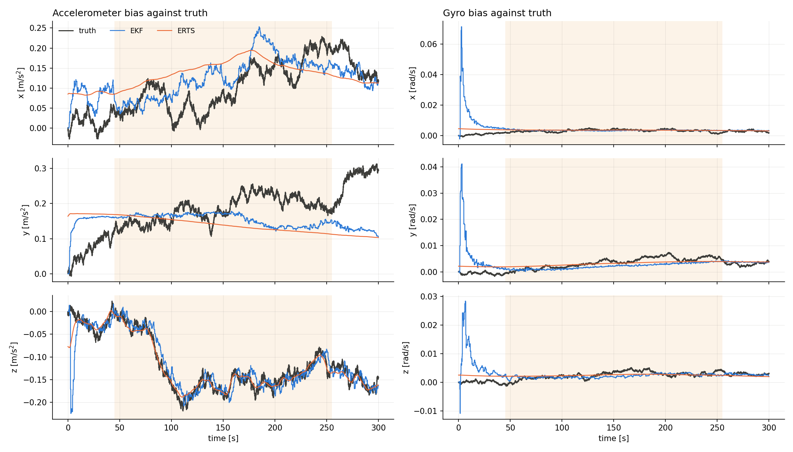

*True and estimated accelerometer and gyro biases.*


*NIS of every fix per sensor against its 95% interval, and the running mean of the full-state NEES.*

| estimator | RMSE position [m] | median [m] | 95th percentile [m] | max [m] | RMSE attitude [°] | max attitude [°] | true position inside 95% ellipsoid |
| --- | --- | --- | --- | --- | --- | --- | --- |
| EKF | 1.008 | 0.783 | 1.85 | 4.43 | 5.51 | 89.4 | 97.0% |
| ERTS | 0.718 | 0.428 | 1.32 | 1.58 | 1.31 | 9.2 | 96.7% |

| statistic | dof | average | 95% interval | verdict |
| --- | --- | --- | --- | --- |
| NIS, GNSS | 3 | 3.589 | [2.436, 3.622] | consistent |
| NIS, magnetometer | 1 | 0.830 | [0.874, 1.134] | underconfident |
| NIS, DVL | 3 | 2.662 | [2.647, 3.375] | consistent |
| NIS, altimeter | 1 | 1.087 | [0.864, 1.146] | consistent |
| NEES, full state, EKF | 15 | 10.396 | [13.422, 16.665] | underconfident |
| NEES, position, EKF | 3 | 2.604 | [2.434, 3.625] | consistent |
| NEES, attitude, EKF | 3 | 1.405 | [2.637, 3.386] | underconfident |
| NEES, full state, ERTS | 15 | 12.707 | [6.663, 26.662] | consistent |
| NEES, position, ERTS | 3 | 3.060 | [0.216, 9.348] | consistent |
| NEES, attitude, ERTS | 3 | 1.836 | [0.820, 6.568] | consistent |

### Four-corner

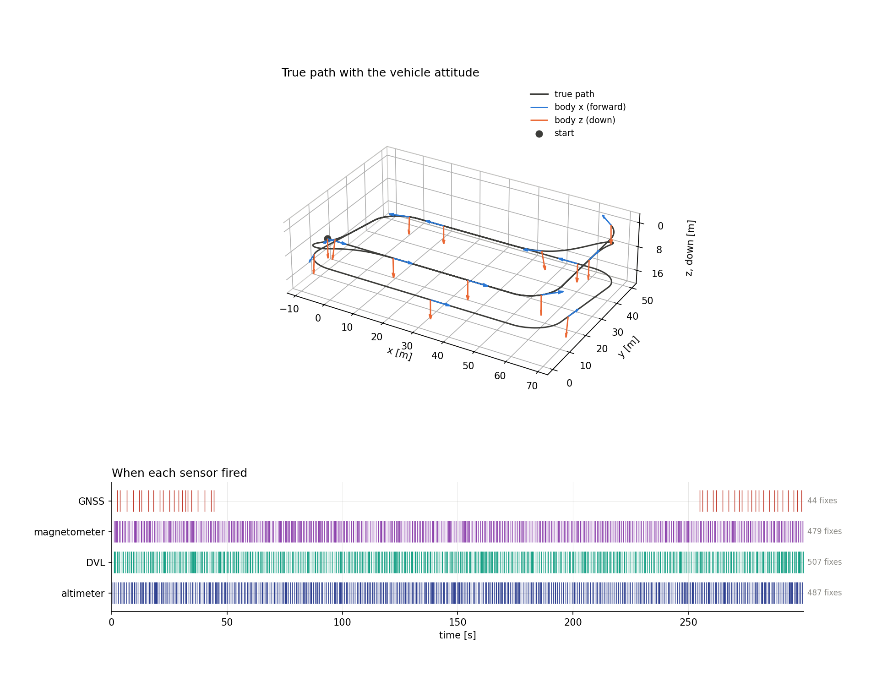

*The true path with the body $x$ (forward) and $z$ (down) axes, and when each sensor fired.*

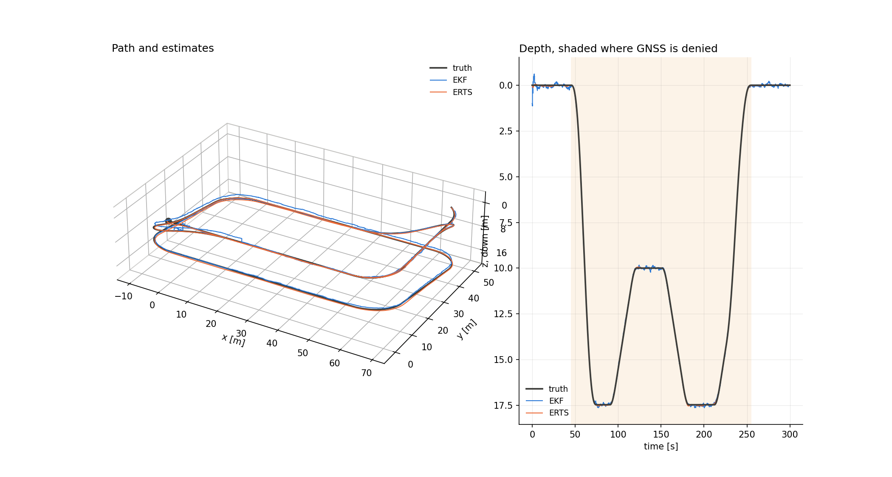

*The true path with the EKF and ERTS estimates in 3D, and the depth against time.*

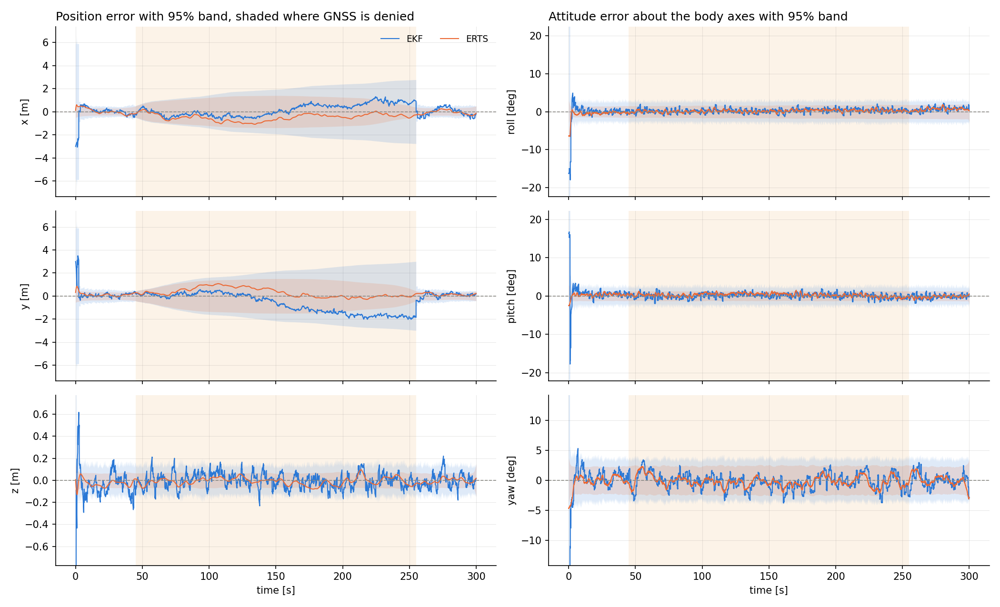

*Position error per axis and attitude error about each body axis, with each estimator's 95% band. Shaded where GNSS is denied.*


*The position and attitude standard deviation the EKF and ERTS report, on a log scale.*


*True and estimated accelerometer and gyro biases.*


*NIS of every fix per sensor against its 95% interval, and the running mean of the full-state NEES.*

| estimator | RMSE position [m] | median [m] | 95th percentile [m] | max [m] | RMSE attitude [°] | max attitude [°] | true position inside 95% ellipsoid |
| --- | --- | --- | --- | --- | --- | --- | --- |
| EKF | 1.085 | 0.508 | 2.03 | 4.37 | 5.45 | 89.1 | 98.1% |
| ERTS | 0.644 | 0.380 | 1.27 | 1.47 | 1.22 | 8.3 | 98.3% |

| statistic | dof | average | 95% interval | verdict |
| --- | --- | --- | --- | --- |
| NIS, GNSS | 3 | 3.545 | [2.364, 3.711] | consistent |
| NIS, magnetometer | 1 | 0.824 | [0.876, 1.132] | underconfident |
| NIS, DVL | 3 | 2.616 | [2.664, 3.356] | underconfident |
| NIS, altimeter | 1 | 1.063 | [0.870, 1.139] | consistent |
| NEES, full state, EKF | 15 | 9.418 | [13.440, 16.644] | underconfident |
| NEES, position, EKF | 3 | 2.304 | [2.462, 3.590] | underconfident |
| NEES, attitude, EKF | 3 | 1.332 | [2.641, 3.381] | underconfident |
| NEES, full state, ERTS | 15 | 11.374 | [6.450, 27.096] | consistent |
| NEES, position, ERTS | 3 | 2.636 | [0.216, 9.348] | consistent |
| NEES, attitude, ERTS | 3 | 1.581 | [0.846, 6.493] | consistent |

### Figure-eight, sparse magnetometer


*The true path with the body $x$ (forward) and $z$ (down) axes, and when each sensor fired.*

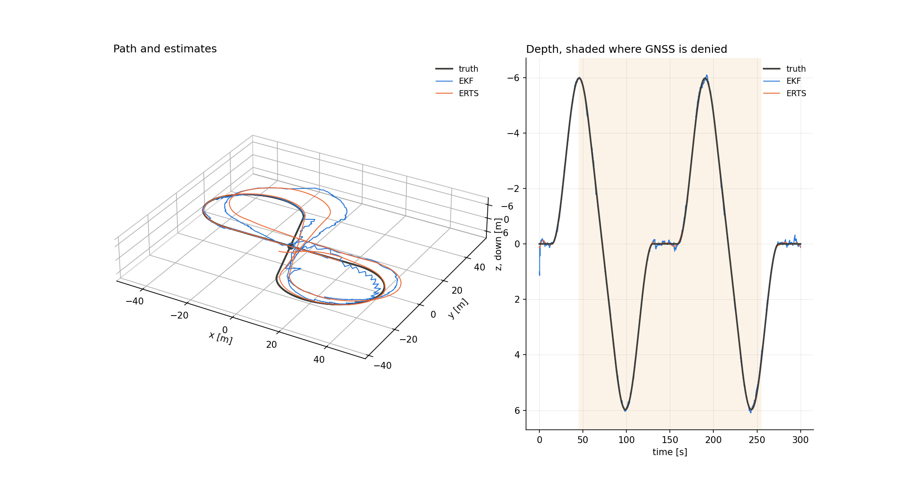

*The true path with the EKF and ERTS estimates in 3D, and the depth against time.*

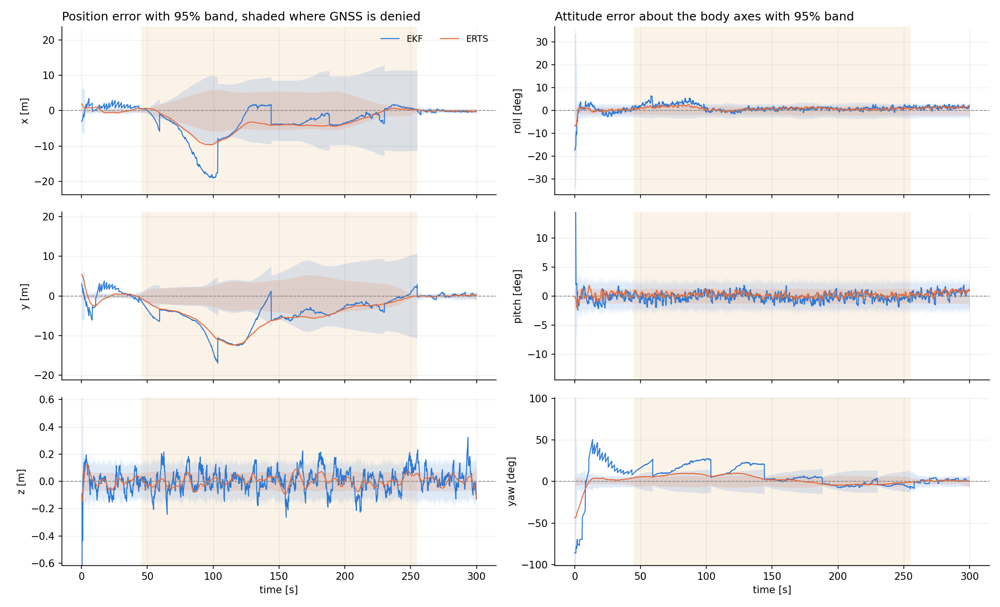

*Position error per axis and attitude error about each body axis, with each estimator's 95% band. Shaded where GNSS is denied.*

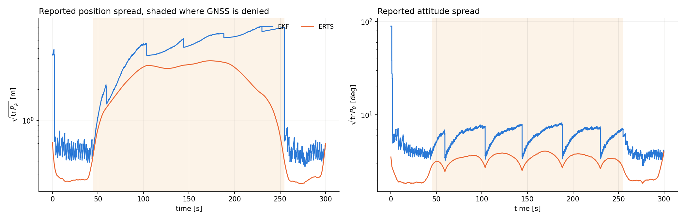

*The position and attitude standard deviation the EKF and ERTS report, on a log scale.*

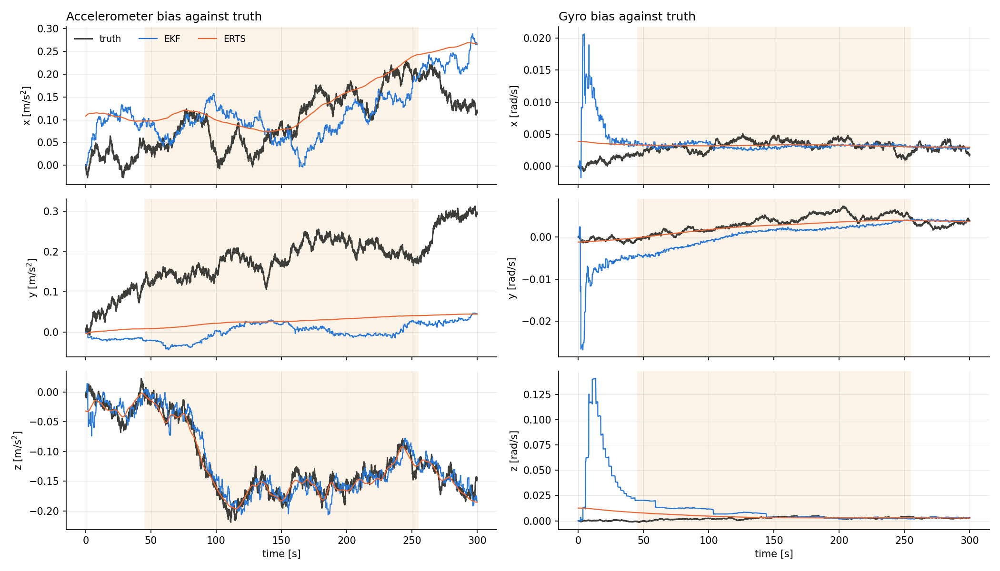

*True and estimated accelerometer and gyro biases.*

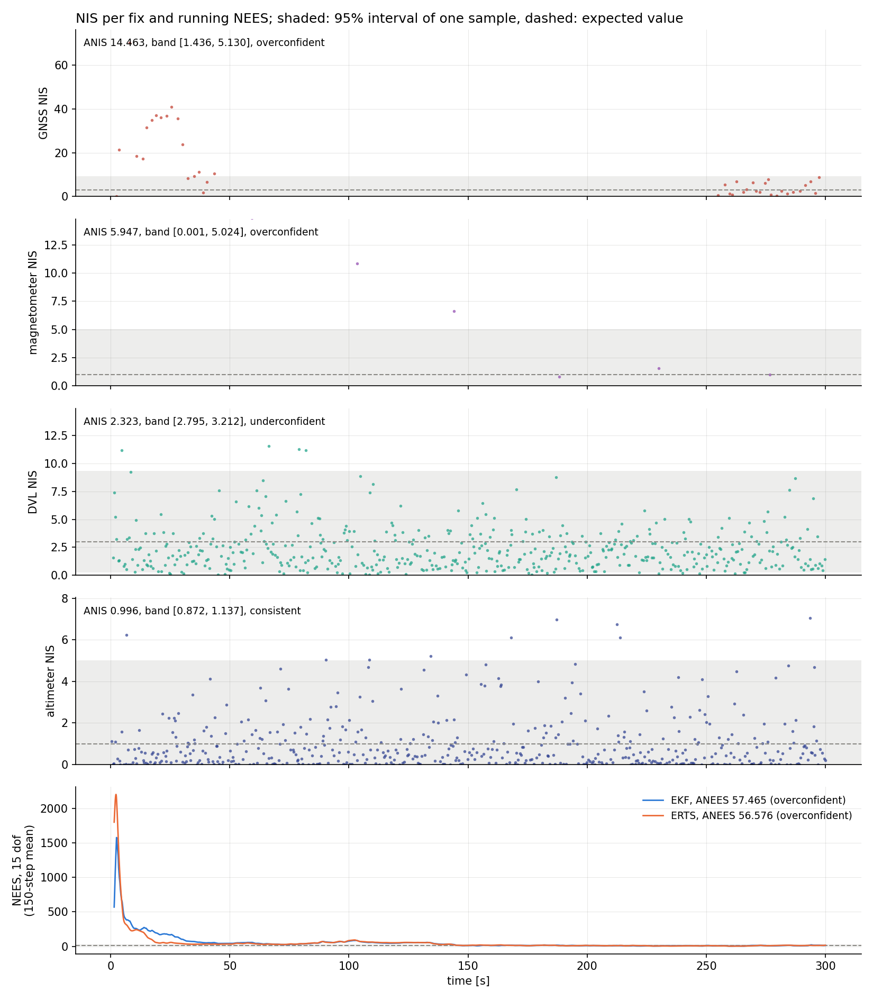

*NIS of every fix per sensor against its 95% interval, and the running mean of the full-state NEES.*

| estimator | RMSE position [m] | median [m] | 95th percentile [m] | max [m] | RMSE attitude [°] | max attitude [°] | true position inside 95% ellipsoid |
| --- | --- | --- | --- | --- | --- | --- | --- |
| EKF | 7.388 | 3.816 | 16.73 | 24.74 | 17.73 | 89.4 | 54.8% |
| ERTS | 6.398 | 3.596 | 13.84 | 14.26 | 7.00 | 44.3 | 49.2% |

| statistic | dof | average | 95% interval | verdict |
| --- | --- | --- | --- | --- |
| NIS, GNSS | 3 | 14.463 | [1.436, 5.130] | overconfident |
| NIS, magnetometer | 1 | 5.947 | [0.001, 5.024] | overconfident |
| NIS, DVL | 3 | 2.323 | [2.796, 3.212] | underconfident |
| NIS, altimeter | 1 | 0.996 | [0.872, 1.137] | consistent |
| NEES, full state, EKF | 15 | 57.465 | [13.604, 16.464] | overconfident |
| NEES, position, EKF | 3 | 16.343 | [1.816, 4.476] | overconfident |
| NEES, attitude, EKF | 3 | 12.345 | [2.010, 4.186] | overconfident |
| NEES, full state, ERTS | 15 | 56.576 | [6.262, 27.488] | overconfident |
| NEES, position, ERTS | 3 | 20.723 | [0.216, 9.348] | overconfident |
| NEES, attitude, ERTS | 3 | 9.660 | [0.216, 9.348] | overconfident |

### Four-corner, sparse magnetometer


*The true path with the body $x$ (forward) and $z$ (down) axes, and when each sensor fired.*


*The true path with the EKF and ERTS estimates in 3D, and the depth against time.*

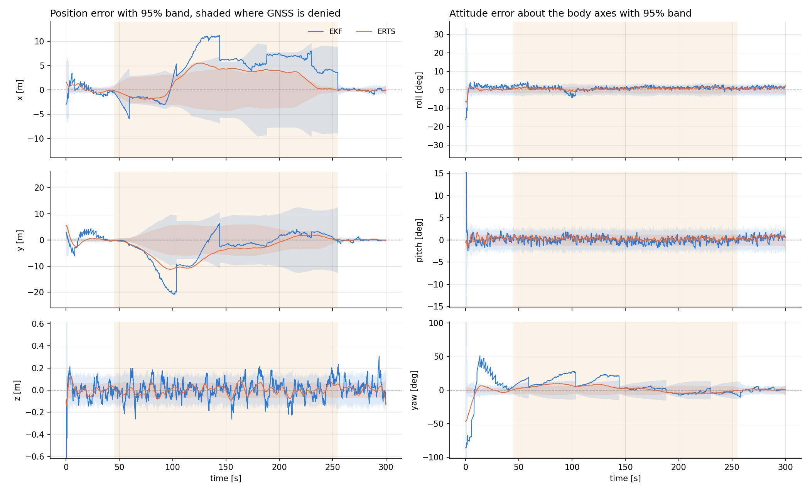

*Position error per axis and attitude error about each body axis, with each estimator's 95% band. Shaded where GNSS is denied.*

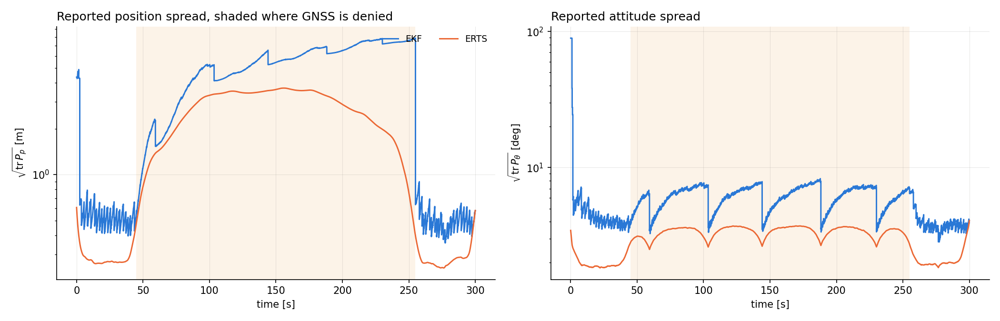

*The position and attitude standard deviation the EKF and ERTS report, on a log scale.*

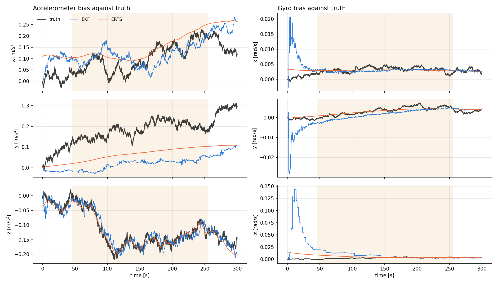

*True and estimated accelerometer and gyro biases.*

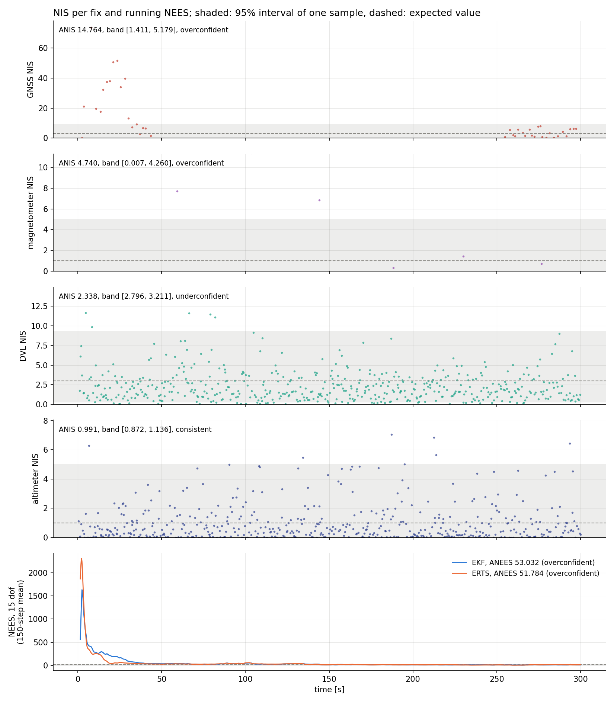

*NIS of every fix per sensor against its 95% interval, and the running mean of the full-state NEES.*

| estimator | RMSE position [m] | median [m] | 95th percentile [m] | max [m] | RMSE attitude [°] | max attitude [°] | true position inside 95% ellipsoid |
| --- | --- | --- | --- | --- | --- | --- | --- |
| EKF | 7.479 | 5.388 | 15.04 | 21.15 | 17.14 | 89.1 | 57.0% |
| ERTS | 5.296 | 3.569 | 11.09 | 11.55 | 6.98 | 47.0 | 52.6% |

| statistic | dof | average | 95% interval | verdict |
| --- | --- | --- | --- | --- |
| NIS, GNSS | 3 | 14.764 | [1.411, 5.179] | overconfident |
| NIS, magnetometer | 1 | 4.740 | [0.007, 4.260] | overconfident |
| NIS, DVL | 3 | 2.338 | [2.796, 3.211] | underconfident |
| NIS, altimeter | 1 | 0.991 | [0.872, 1.137] | consistent |
| NEES, full state, EKF | 15 | 53.032 | [13.574, 16.497] | overconfident |
| NEES, position, EKF | 3 | 13.241 | [1.932, 4.300] | overconfident |
| NEES, attitude, EKF | 3 | 11.653 | [2.073, 4.096] | overconfident |
| NEES, full state, ERTS | 15 | 51.784 | [6.262, 27.488] | overconfident |
| NEES, position, ERTS | 3 | 16.072 | [0.216, 9.348] | overconfident |
| NEES, attitude, ERTS | 3 | 10.052 | [0.216, 9.348] | overconfident |
