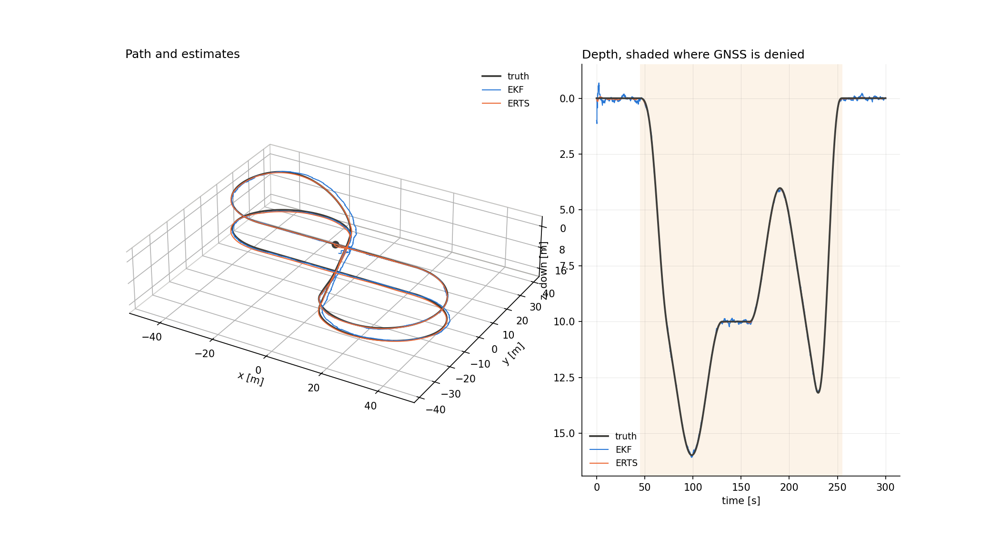
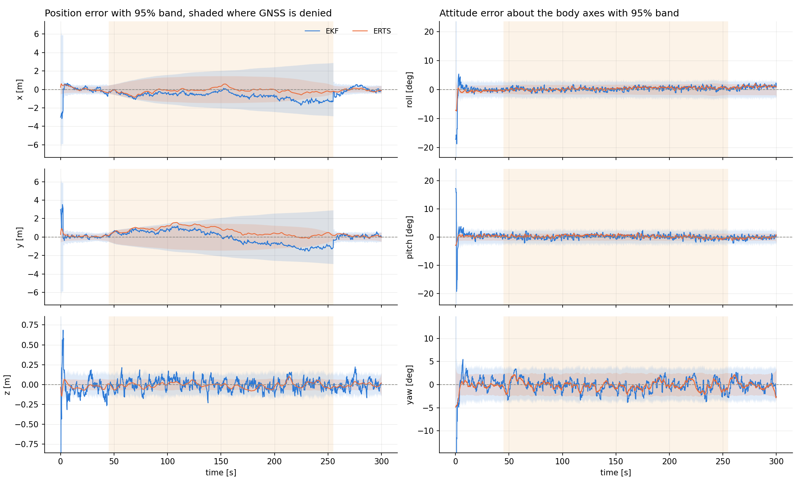
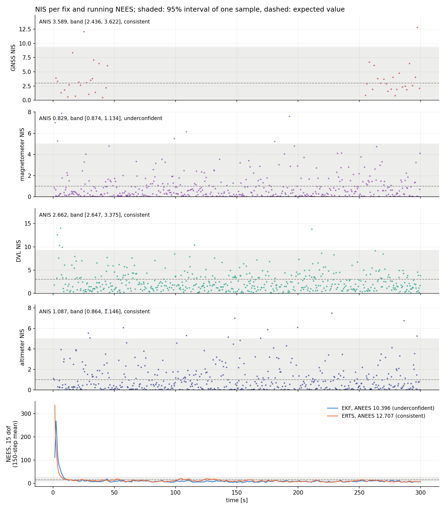
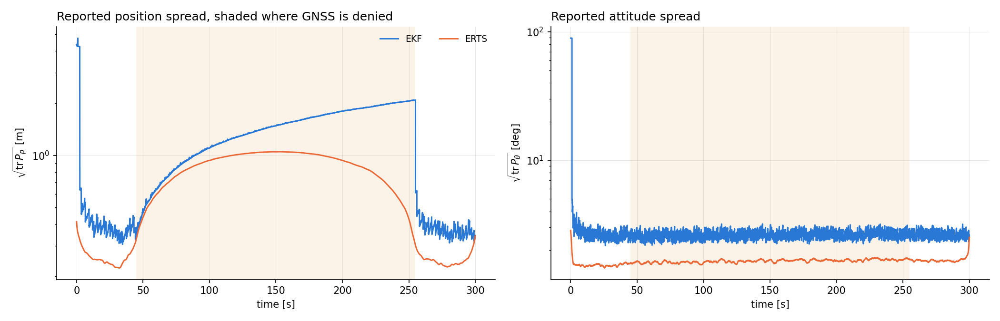
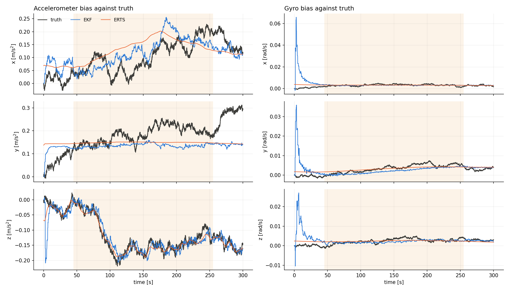
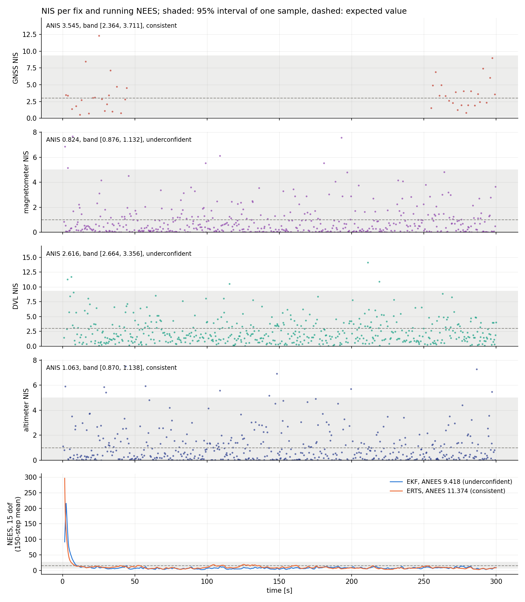

# 3-D strapdown INS, poor initialization: Extended Kalman filter and ERTS

[Back to the poor initialization](../README.md) | [Unscented Kalman filter and URTSS](../unscented/README.md) | [Iterated extended Kalman filter and smoother](../iterated/README.md) | [All estimators compared](../comparison/README.md)

## Problem and setup

An underwater vehicle estimates its pose in three dimensions from an IMU, aided by GNSS, a magnetometer, a DVL and an altimeter. GNSS is denied from 45 s to 255 s. The filter starts from a prior far from the truth.

The extended Kalman filter (EKF) linearises the motion and measurement models at the current estimate. The extended Rauch-Tung-Striebel smoother (ERTS) runs backward over the stored EKF output with the same Jacobians.

The truth starts at the origin, level, heading north at 2 m/s. The prior mean is off by $(3, -3, 1)$ m in position, $(-0.5, 0.5, 0.2)$ m/s in velocity and by the rotation vector $(0.3, -0.3, 1.5)$ rad in attitude, 89° in total. Each offset is one standard deviation of the prior.

The state, motion model, sensors and parameters are given in the [poor initialization overview](../README.md).

| run | trajectory | magnetometer period |
| --- | --- | --- |
| [`figure_eight`](figure_eight/) | figure-eight | 0.25 to 1 s |
| [`rounded_rectangle`](rounded_rectangle/) | four-corner | 0.25 to 1 s |

## Reproduction

From the project root, after building:

```bash
./build/kalman_filtering_and_smoothing results/INS3D/poor_initialization/extended
for run in results/INS3D/poor_initialization/extended/*/; do
    python3 scripts/analyze_ins_3d.py "$run/data"
done
```

Every number below is taken from the run's `stats.txt`.

## Results

### Figure-eight


*The true path with the body $x$ (forward) and $z$ (down) axes, and when each sensor fired.*



*The true path with the EKF and ERTS estimates in 3D, and the depth against time.*



*Position error per axis and attitude error about each body axis, with each estimator's 95% band. Shaded where GNSS is denied.*


*The position and attitude standard deviation the EKF and ERTS report, on a log scale.*


*True and estimated accelerometer and gyro biases.*



*NIS of every fix per sensor against its 95% interval, and the running mean of the full-state NEES.*

| estimator | RMSE position [m] | median [m] | 95th percentile [m] | max [m] | RMSE attitude [°] | max attitude [°] | true position inside 95% ellipsoid |
| --- | --- | --- | --- | --- | --- | --- | --- |
| EKF | 1.008 | 0.786 | 1.84 | 4.43 | 5.52 | 89.4 | 96.9% |
| ERTS | 0.726 | 0.435 | 1.33 | 1.59 | 1.32 | 9.2 | 96.7% |

| statistic | dof | average | 95% interval | verdict |
| --- | --- | --- | --- | --- |
| NIS, GNSS | 3 | 3.584 | [2.439, 3.618] | consistent |
| NIS, magnetometer | 1 | 0.828 | [0.875, 1.133] | underconfident |
| NIS, DVL | 3 | 2.660 | [2.647, 3.374] | consistent |
| NIS, altimeter | 1 | 1.087 | [0.864, 1.146] | consistent |
| NEES, full state, EKF | 15 | 10.528 | [13.423, 16.663] | underconfident |
| NEES, position, EKF | 3 | 2.614 | [2.433, 3.626] | consistent |
| NEES, attitude, EKF | 3 | 1.420 | [2.637, 3.386] | underconfident |
| NEES, full state, ERTS | 15 | 12.815 | [6.699, 26.590] | consistent |
| NEES, position, ERTS | 3 | 3.082 | [0.216, 9.348] | consistent |
| NEES, attitude, ERTS | 3 | 1.855 | [0.819, 6.572] | consistent |

### Four-corner


*The true path with the body $x$ (forward) and $z$ (down) axes, and when each sensor fired.*


*The true path with the EKF and ERTS estimates in 3D, and the depth against time.*


*Position error per axis and attitude error about each body axis, with each estimator's 95% band. Shaded where GNSS is denied.*



*The position and attitude standard deviation the EKF and ERTS report, on a log scale.*



*True and estimated accelerometer and gyro biases.*



*NIS of every fix per sensor against its 95% interval, and the running mean of the full-state NEES.*

| estimator | RMSE position [m] | median [m] | 95th percentile [m] | max [m] | RMSE attitude [°] | max attitude [°] | true position inside 95% ellipsoid |
| --- | --- | --- | --- | --- | --- | --- | --- |
| EKF | 1.140 | 0.505 | 2.12 | 4.37 | 5.46 | 89.1 | 98.1% |
| ERTS | 0.617 | 0.376 | 1.22 | 1.41 | 1.23 | 8.4 | 98.3% |

| statistic | dof | average | 95% interval | verdict |
| --- | --- | --- | --- | --- |
| NIS, GNSS | 3 | 3.552 | [2.361, 3.714] | consistent |
| NIS, magnetometer | 1 | 0.822 | [0.876, 1.132] | underconfident |
| NIS, DVL | 3 | 2.606 | [2.664, 3.355] | underconfident |
| NIS, altimeter | 1 | 1.066 | [0.870, 1.139] | consistent |
| NEES, full state, EKF | 15 | 9.480 | [13.441, 16.643] | underconfident |
| NEES, position, EKF | 3 | 2.346 | [2.461, 3.591] | underconfident |
| NEES, attitude, EKF | 3 | 1.341 | [2.641, 3.381] | underconfident |
| NEES, full state, ERTS | 15 | 11.188 | [6.453, 27.089] | consistent |
| NEES, position, ERTS | 3 | 2.536 | [0.216, 9.348] | consistent |
| NEES, attitude, ERTS | 3 | 1.581 | [0.841, 6.507] | consistent |
