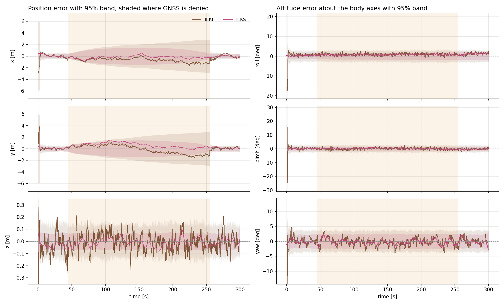
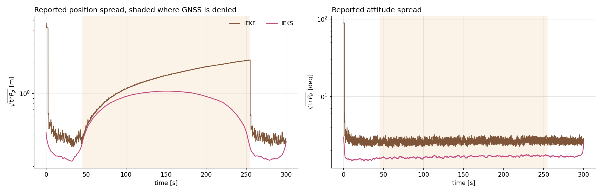
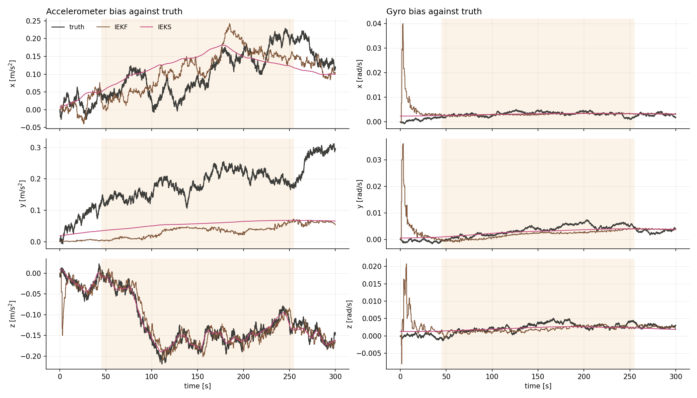
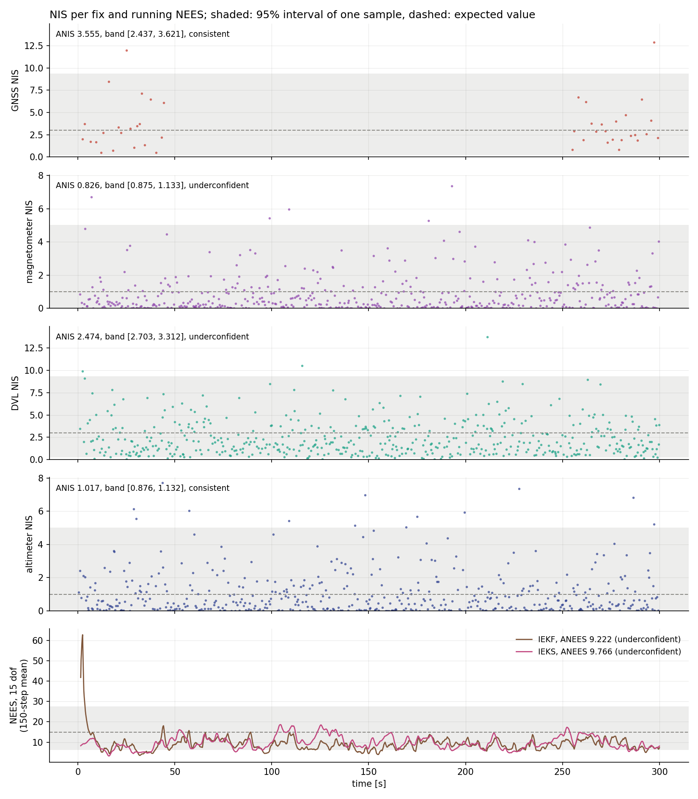
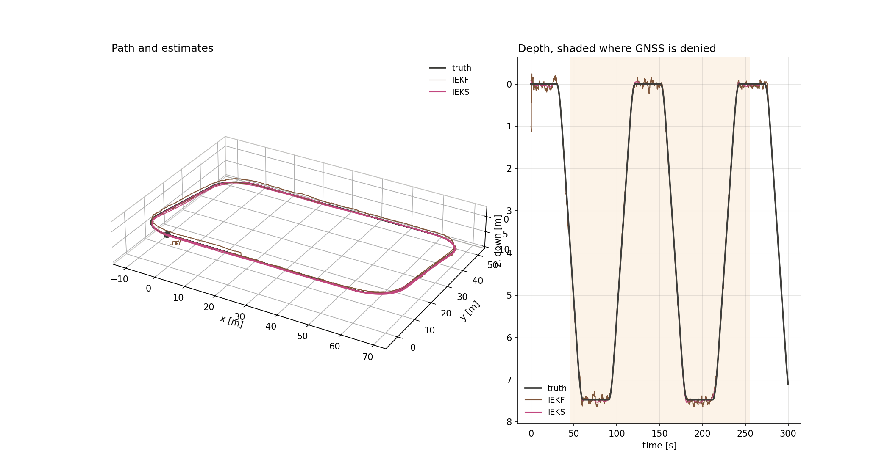
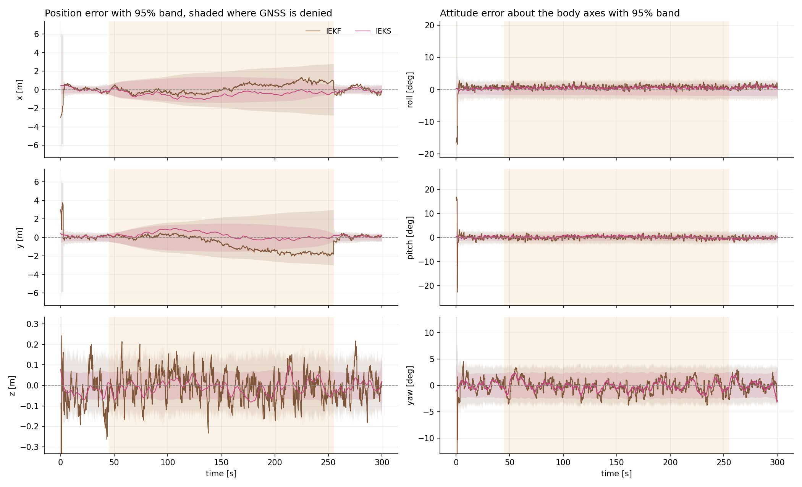
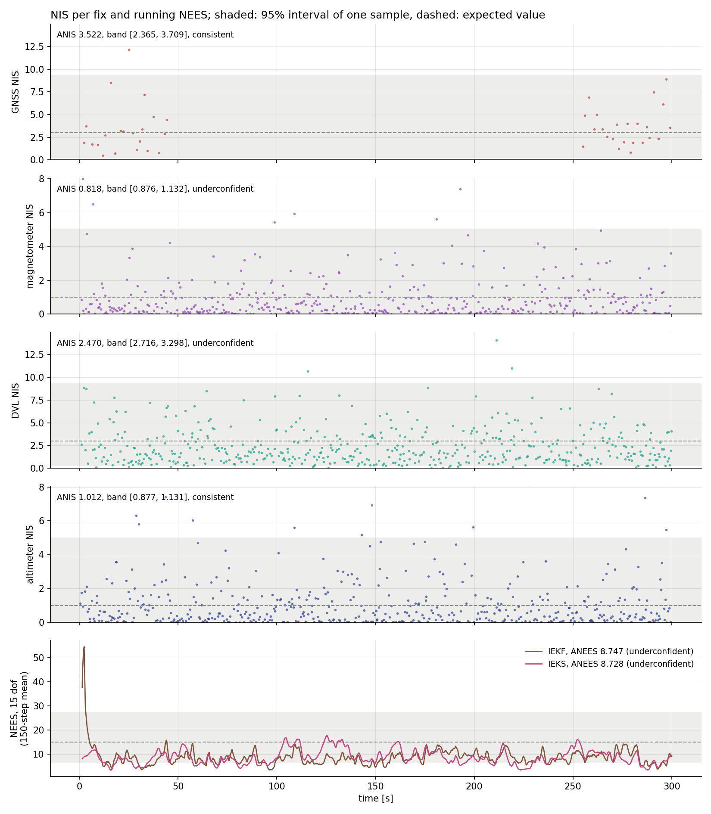

# 3-D strapdown INS, poor initialization: Iterated extended Kalman filter and smoother

[Back to the poor initialization](../README.md) | [Extended Kalman filter and ERTS](../extended/README.md) | [Unscented Kalman filter and URTSS](../unscented/README.md) | [All estimators compared](../comparison/README.md)

## Problem and setup

An underwater vehicle estimates its pose in three dimensions from an IMU, aided by GNSS, a magnetometer, a DVL and an altimeter. GNSS is denied from 45 s to 255 s. The filter starts from a prior far from the truth.

The iterated extended Kalman filter (IEKF) relinearises each measurement update at the improved estimate until it settles. The iterated extended Kalman smoother (IEKS) starts from the IEKF output and relinearises the motion and measurement models at the whole smoothed trajectory until it settles. Both use Levenberg-Marquardt damping, starting at $\lambda = 10^{-2}$, multiplying it by 10 after a rejected step and dividing it by 10 after an accepted one.

The truth starts at the origin, level, heading north at 2 m/s. The prior mean is off by $(3, -3, 1)$ m in position, $(-0.5, 0.5, 0.2)$ m/s in velocity and by the rotation vector $(0.3, -0.3, 1.5)$ rad in attitude, 89° in total. Each offset is one standard deviation of the prior.

The state, motion model, sensors and parameters are given in the [poor initialization overview](../README.md).

| run | trajectory | magnetometer period |
| --- | --- | --- |
| [`figure_eight`](figure_eight/) | figure-eight | 0.25 to 1 s |
| [`rounded_rectangle`](rounded_rectangle/) | four-corner | 0.25 to 1 s |

## Reproduction

From the project root, after building:

```bash
./build/kalman_filtering_and_smoothing results/INS3D/poor_initialization/iterated
for run in results/INS3D/poor_initialization/iterated/*/; do
    python3 scripts/analyze_ins_3d.py "$run/data"
done
```

Every number below is taken from the run's `stats.txt`.

## Results

### Figure-eight


*The true path with the body $x$ (forward) and $z$ (down) axes, and when each sensor fired.*


*The true path with the IEKF and IEKS estimates in 3D, and the depth against time.*



*Position error per axis and attitude error about each body axis, with each estimator's 95% band. Shaded where GNSS is denied.*



*The position and attitude standard deviation the IEKF and IEKS report, on a log scale.*



*True and estimated accelerometer and gyro biases.*



*NIS of every fix per sensor against its 95% interval, and the running mean of the full-state NEES.*

| estimator | RMSE position [m] | median [m] | 95th percentile [m] | max [m] | RMSE attitude [°] | max attitude [°] | true position inside 95% ellipsoid |
| --- | --- | --- | --- | --- | --- | --- | --- |
| IEKF | 0.980 | 0.749 | 1.79 | 4.37 | 5.54 | 89.4 | 98.1% |
| IEKS | 0.693 | 0.447 | 1.27 | 1.52 | 1.27 | 3.2 | 98.3% |

| statistic | dof | average | 95% interval | verdict |
| --- | --- | --- | --- | --- |
| NIS, GNSS | 3 | 3.548 | [2.440, 3.618] | consistent |
| NIS, magnetometer | 1 | 0.824 | [0.875, 1.133] | underconfident |
| NIS, DVL | 3 | 2.472 | [2.704, 3.312] | underconfident |
| NIS, altimeter | 1 | 1.016 | [0.876, 1.133] | consistent |
| NEES, full state, IEKF | 15 | 9.369 | [14.047, 15.984] | underconfident |
| NEES, position, IEKF | 3 | 2.360 | [2.487, 3.561] | underconfident |
| NEES, attitude, IEKF | 3 | 1.520 | [2.703, 3.312] | underconfident |
| NEES, full state, IEKS | 15 | 9.985 | [12.389, 17.856] | underconfident |
| NEES, position, IEKS | 3 | 2.887 | [0.216, 9.348] | consistent |
| NEES, attitude, IEKS | 3 | 1.773 | [1.719, 4.632] | consistent |

### Four-corner


*The true path with the body $x$ (forward) and $z$ (down) axes, and when each sensor fired.*



*The true path with the IEKF and IEKS estimates in 3D, and the depth against time.*



*Position error per axis and attitude error about each body axis, with each estimator's 95% band. Shaded where GNSS is denied.*


*The position and attitude standard deviation the IEKF and IEKS report, on a log scale.*


*True and estimated accelerometer and gyro biases.*



*NIS of every fix per sensor against its 95% interval, and the running mean of the full-state NEES.*

| estimator | RMSE position [m] | median [m] | 95th percentile [m] | max [m] | RMSE attitude [°] | max attitude [°] | true position inside 95% ellipsoid |
| --- | --- | --- | --- | --- | --- | --- | --- |
| IEKF | 1.137 | 0.502 | 2.10 | 4.37 | 5.47 | 89.1 | 98.9% |
| IEKS | 0.592 | 0.407 | 1.15 | 1.35 | 1.15 | 3.3 | 99.4% |

| statistic | dof | average | 95% interval | verdict |
| --- | --- | --- | --- | --- |
| NIS, GNSS | 3 | 3.529 | [2.362, 3.713] | consistent |
| NIS, magnetometer | 1 | 0.817 | [0.876, 1.132] | underconfident |
| NIS, DVL | 3 | 2.460 | [2.716, 3.297] | underconfident |
| NIS, altimeter | 1 | 1.013 | [0.876, 1.132] | consistent |
| NEES, full state, IEKF | 15 | 8.825 | [14.055, 15.976] | underconfident |
| NEES, position, IEKF | 3 | 2.192 | [2.520, 3.521] | underconfident |
| NEES, attitude, IEKF | 3 | 1.432 | [2.700, 3.315] | underconfident |
| NEES, full state, IEKS | 15 | 8.775 | [12.547, 17.669] | underconfident |
| NEES, position, IEKS | 3 | 2.396 | [0.216, 9.348] | consistent |
| NEES, attitude, IEKS | 3 | 1.456 | [1.753, 4.577] | underconfident |
