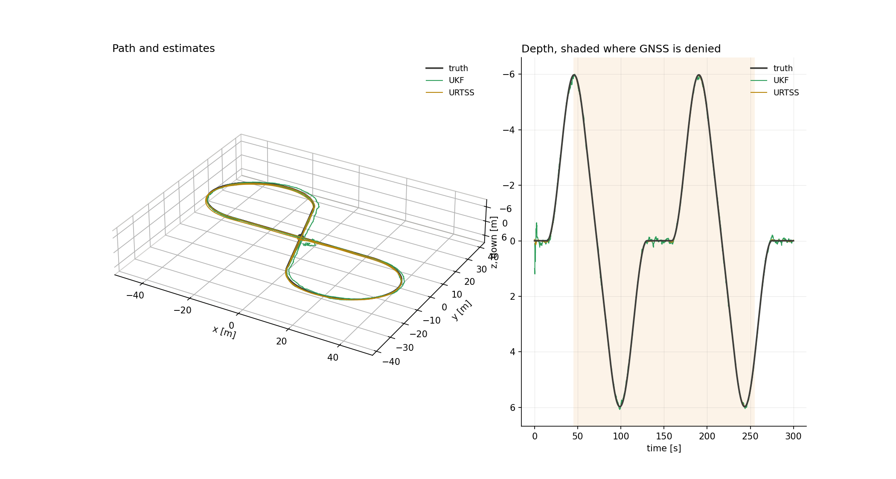
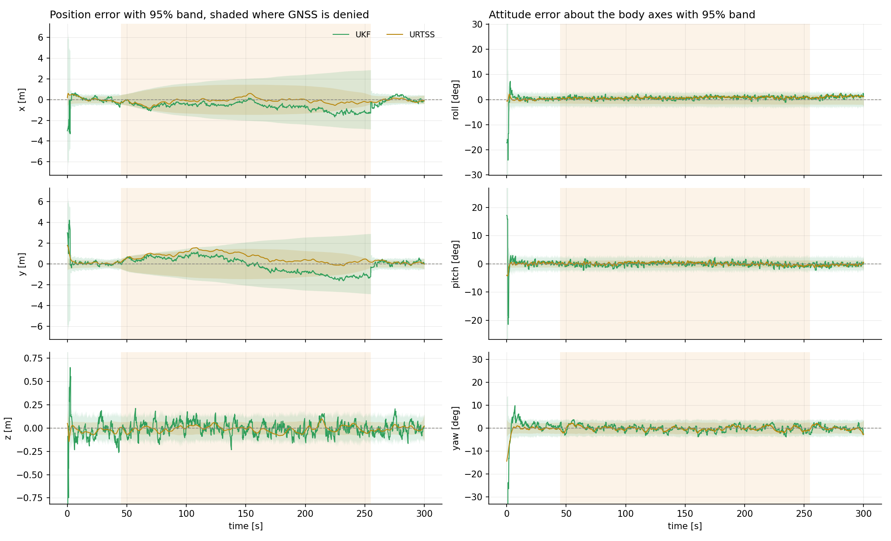
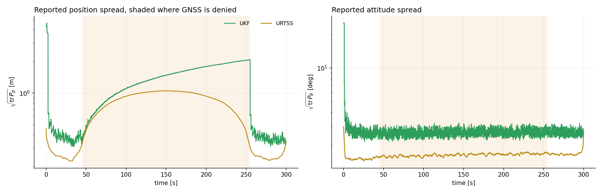
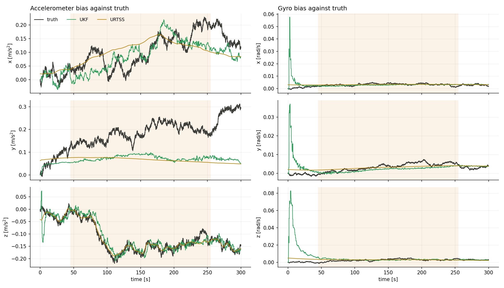
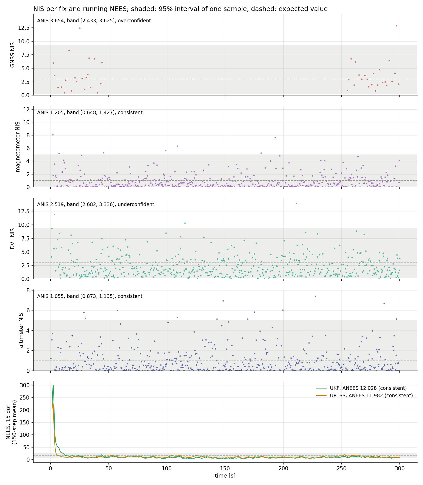
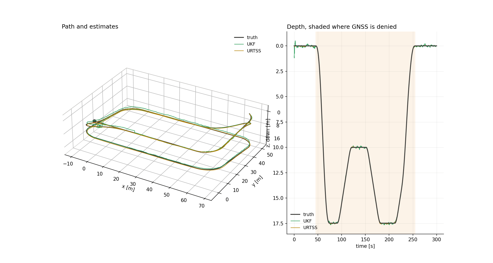
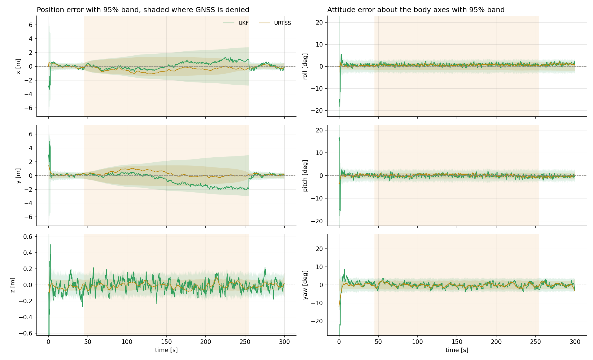
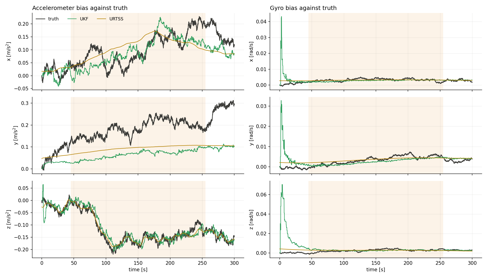

# 3-D strapdown INS, poor initialization: Unscented Kalman filter and URTSS

[Back to the poor initialization](../README.md) | [Extended Kalman filter and ERTS](../extended/README.md) | [Iterated extended Kalman filter and smoother](../iterated/README.md) | [All estimators compared](../comparison/README.md)

## Problem and setup

An underwater vehicle estimates its pose in three dimensions from an IMU, aided by GNSS, a magnetometer, a DVL and an altimeter. GNSS is denied from 45 s to 255 s. The filter starts from a prior far from the truth.

The unscented Kalman filter (UKF) carries the mean and covariance through the models with sigma points on the error state, with $\alpha = 1$, $\beta = 2$, $\kappa = 0$. The unscented Rauch-Tung-Striebel smoother (URTSS) runs backward over the stored UKF output.

The truth starts at the origin, level, heading north at 2 m/s. The prior mean is off by $(3, -3, 1)$ m in position, $(-0.5, 0.5, 0.2)$ m/s in velocity and by the rotation vector $(0.3, -0.3, 1.5)$ rad in attitude, 89° in total. Each offset is one standard deviation of the prior.

The state, motion model, sensors and parameters are given in the [poor initialization overview](../README.md).

| run | trajectory | magnetometer period |
| --- | --- | --- |
| [`figure_eight`](figure_eight/) | figure-eight | 0.25 to 1 s |
| [`rounded_rectangle`](rounded_rectangle/) | four-corner | 0.25 to 1 s |

## Reproduction

From the project root, after building:

```bash
./build/kalman_filtering_and_smoothing results/INS3D/poor_initialization/unscented
for run in results/INS3D/poor_initialization/unscented/*/; do
    python3 scripts/analyze_ins_3d.py "$run/data"
done
```

Every number below is taken from the run's `stats.txt`.

## Results

### Figure-eight


*The true path with the body $x$ (forward) and $z$ (down) axes, and when each sensor fired.*



*The true path with the UKF and URTSS estimates in 3D, and the depth against time.*



*Position error per axis and attitude error about each body axis, with each estimator's 95% band. Shaded where GNSS is denied.*



*The position and attitude standard deviation the UKF and URTSS report, on a log scale.*



*True and estimated accelerometer and gyro biases.*



*NIS of every fix per sensor against its 95% interval, and the running mean of the full-state NEES.*

| estimator | RMSE position [m] | median [m] | 95th percentile [m] | max [m] | RMSE attitude [°] | max attitude [°] | true position inside 95% ellipsoid |
| --- | --- | --- | --- | --- | --- | --- | --- |
| UKF | 1.021 | 0.763 | 1.87 | 5.26 | 5.76 | 89.4 | 97.6% |
| URTSS | 0.722 | 0.425 | 1.32 | 1.79 | 1.65 | 15.1 | 97.4% |

| statistic | dof | average | 95% interval | verdict |
| --- | --- | --- | --- | --- |
| NIS, GNSS | 3 | 3.646 | [2.436, 3.622] | overconfident |
| NIS, magnetometer | 1 | 1.203 | [0.648, 1.427] | consistent |
| NIS, DVL | 3 | 2.518 | [2.682, 3.336] | underconfident |
| NIS, altimeter | 1 | 1.055 | [0.873, 1.136] | consistent |
| NEES, full state, UKF | 15 | 12.209 | [11.778, 18.605] | consistent |
| NEES, position, UKF | 3 | 2.495 | [2.481, 3.567] | consistent |
| NEES, attitude, UKF | 3 | 2.334 | [1.952, 4.270] | consistent |
| NEES, full state, URTSS | 15 | 12.194 | [11.407, 19.077] | consistent |
| NEES, position, URTSS | 3 | 3.130 | [0.216, 9.348] | consistent |
| NEES, attitude, URTSS | 3 | 2.303 | [0.216, 9.348] | consistent |

### Four-corner


*The true path with the body $x$ (forward) and $z$ (down) axes, and when each sensor fired.*



*The true path with the UKF and URTSS estimates in 3D, and the depth against time.*



*Position error per axis and attitude error about each body axis, with each estimator's 95% band. Shaded where GNSS is denied.*


*The position and attitude standard deviation the UKF and URTSS report, on a log scale.*



*True and estimated accelerometer and gyro biases.*


*NIS of every fix per sensor against its 95% interval, and the running mean of the full-state NEES.*

| estimator | RMSE position [m] | median [m] | 95th percentile [m] | max [m] | RMSE attitude [°] | max attitude [°] | true position inside 95% ellipsoid |
| --- | --- | --- | --- | --- | --- | --- | --- |
| UKF | 1.174 | 0.498 | 2.17 | 5.64 | 5.64 | 89.1 | 98.4% |
| URTSS | 0.615 | 0.379 | 1.22 | 1.43 | 1.43 | 12.5 | 98.8% |

| statistic | dof | average | 95% interval | verdict |
| --- | --- | --- | --- | --- |
| NIS, GNSS | 3 | 3.600 | [2.357, 3.720] | consistent |
| NIS, magnetometer | 1 | 1.145 | [0.694, 1.362] | consistent |
| NIS, DVL | 3 | 2.438 | [2.713, 3.301] | underconfident |
| NIS, altimeter | 1 | 1.024 | [0.878, 1.130] | consistent |
| NEES, full state, UKF | 15 | 10.618 | [11.318, 19.193] | underconfident |
| NEES, position, UKF | 3 | 2.271 | [2.506, 3.538] | underconfident |
| NEES, attitude, UKF | 3 | 2.105 | [1.941, 4.285] | consistent |
| NEES, full state, URTSS | 15 | 10.260 | [10.975, 19.644] | underconfident |
| NEES, position, URTSS | 3 | 2.544 | [0.216, 9.348] | consistent |
| NEES, attitude, URTSS | 3 | 1.807 | [0.291, 8.791] | consistent |
