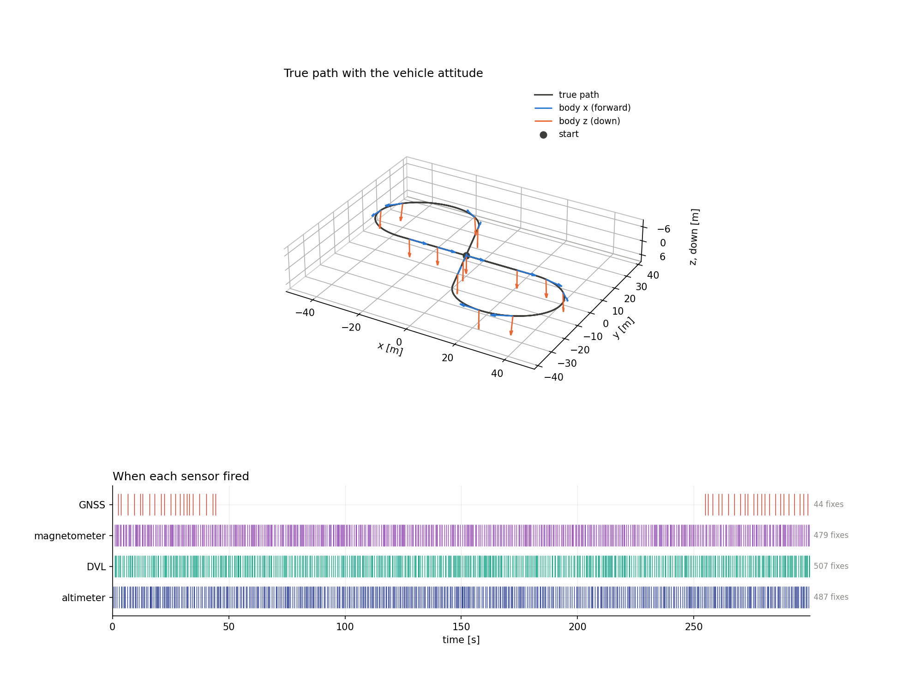
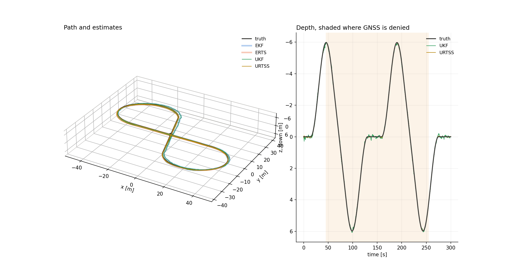
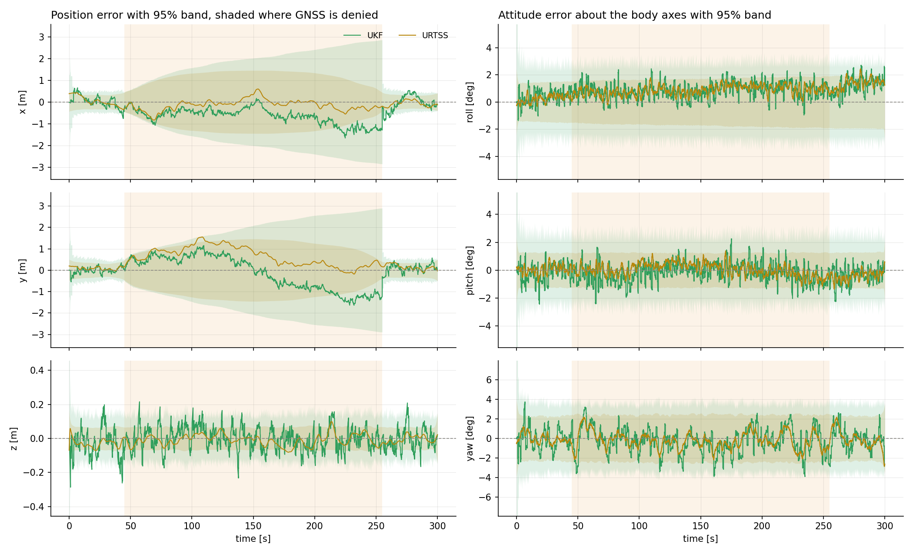
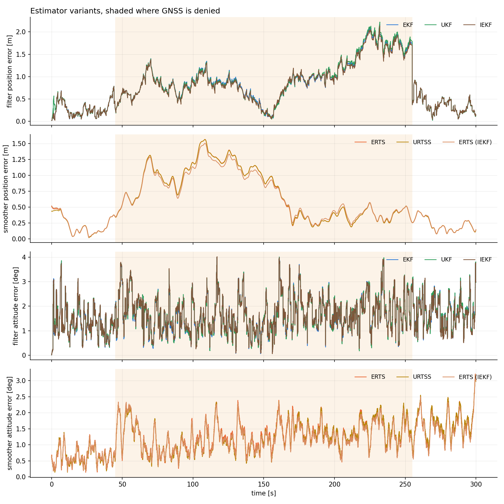
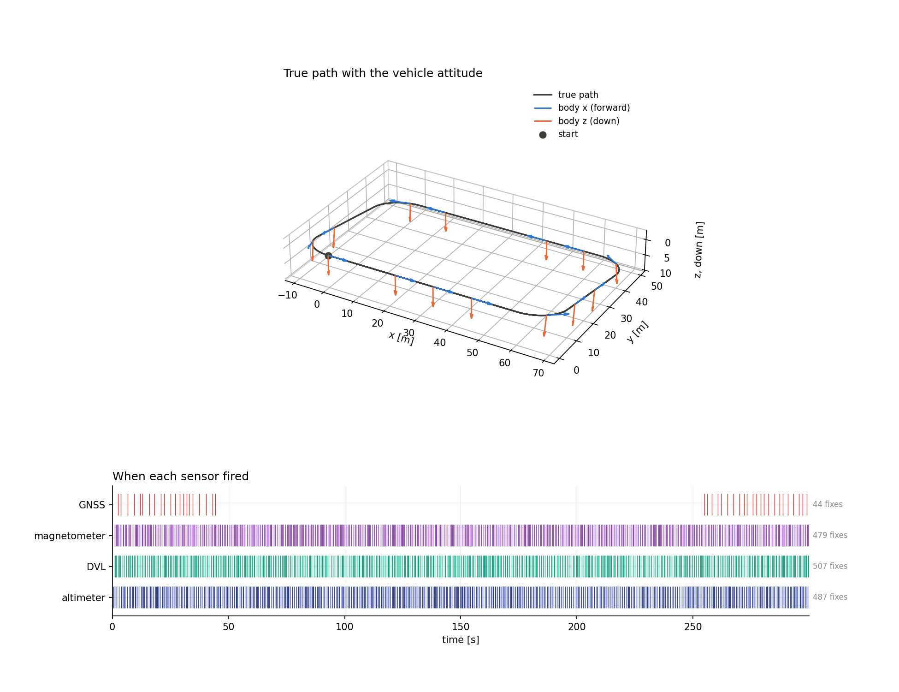
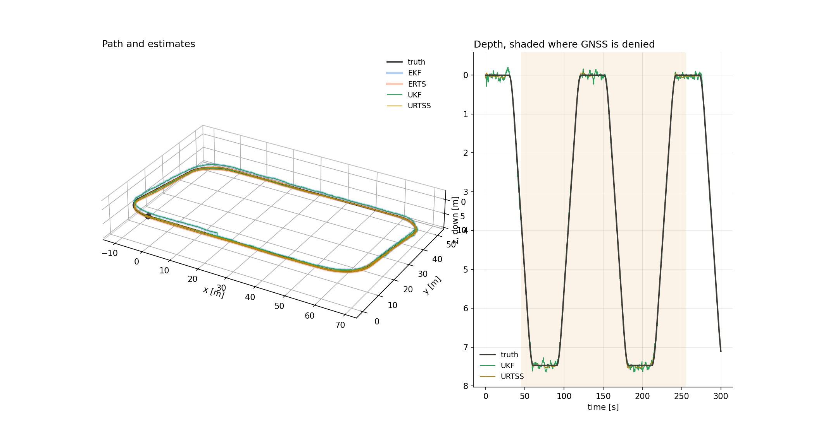
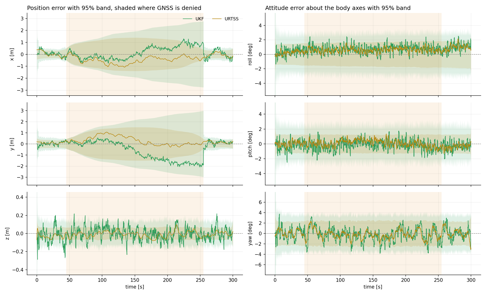
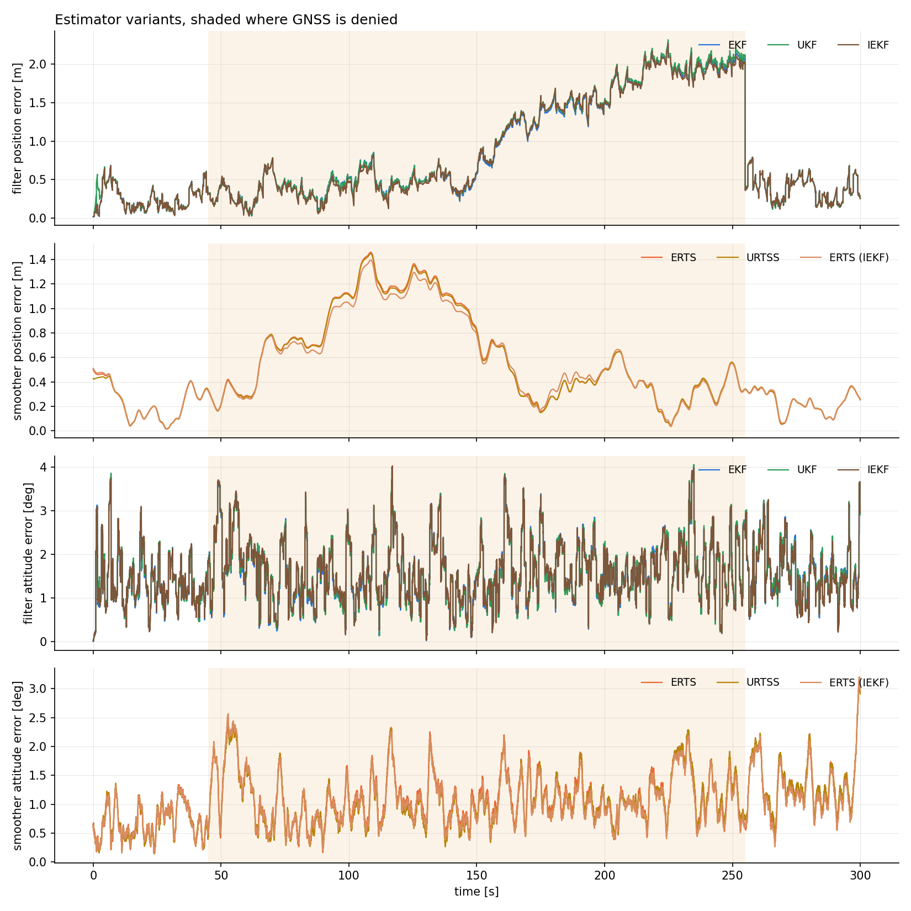

# 3-D strapdown INS, UKF

[Back to the overview](../../../README.md) | [Previous: IEKF](../iekf/README.md)

The extended Kalman filter propagates the mean through the nonlinear model and the covariance through its Jacobian. The unscented Kalman filter replaces the Jacobian with a small set of sigma points that carry the mean and covariance through the nonlinear function itself. This page runs the unscented Kalman filter and its Rauch-Tung-Striebel smoother on a three-dimensional strapdown INS with an attitude quaternion, on a tilted figure-eight and a tilted four-corner path with a long GNSS outage, and compares them with both the EKF and the IEKF.

|               |                                  |
| ------------- | -------------------------------- |
| **Status**    | done, the UKF differs from the EKF and the IEKF only in the first few seconds and by under 9 cm after the first 10 s; it is 1.4% to 1.7% less accurate than the EKF as a filter and equal as a smoother, with the same consistency verdicts |
| **Run**       | 30000 timesteps (300 s at $\Delta t = 0.01$ s), seed 42 |
| **Reproduce** | see [Reproduction](#reproduction) |

## Motivation

The EKF linearises the motion model and the DVL and magnetometer models around one point. The unscented transform instead evaluates the function at $2n+1$ points spread by the covariance and recovers the moments from them, which captures the curvature of the function to second order and needs no Jacobian. The scenario asks:

- Is the transform on a 15-dimensional error state around a quaternion workable, with every sigma point built by $\boxplus$ and averaged through $\boxminus$?
- Does the UKF estimate and its reported covariance differ from the EKF's and the IEKF's, in accuracy and in consistency?
- Does it handle the strong nonlinearity at the start of the run, where the initial attitude and position uncertainty is largest, better than the linearised filters?

## Problem formulation

### State and error state

The state is 16-dimensional, position, velocity (navigation frame, z down), the attitude quaternion from body to navigation frame, and the accelerometer and gyro biases,

$$
x = \begin{bmatrix} p^\top & v^\top & q^\top & b_a^\top & b_g^\top \end{bmatrix}^\top \in \mathbb{R}^{16}, \qquad \lVert q \rVert = 1,
$$

and the covariance lives on the 15-dimensional error state $\delta x = [\delta p, \delta v, \delta\theta, \delta b_a, \delta b_g]$ with the attitude error applied in the body frame, $q_{\mathrm{true}} = q \otimes \mathrm{Exp}(\delta\theta)$. A state is updated by $x \boxplus \delta x$ (the quaternion is rotated, everything else is added) and two states are subtracted by

$$
x_a \boxminus x_b = \begin{bmatrix} p_a - p_b \\ v_a - v_b \\ \mathrm{Log}(q_b^{*} \otimes q_a) \\ b_{a,a} - b_{a,b} \\ b_{g,a} - b_{g,b} \end{bmatrix} .
$$

### Motion model

The IMU reading is corrected with the estimated biases, $\tilde a_k = a_k - b_{a,k}$ and $\tilde\omega_k = \omega_k - b_{g,k}$, and integrated with the attitude at the middle of the step (gravity $g = [0, 0, 9.81]^\top$ in the navigation frame):

$$
\begin{aligned}
R_{\mathrm{mid}} &= R\big(q_k \otimes \mathrm{Exp}(\tfrac{\Delta t}{2}\tilde\omega_k)\big), \qquad a_k' = R_{\mathrm{mid}}\,\tilde a_k + g, \\
p_{k+1} &= p_k + \Delta t\, v_k + \tfrac{\Delta t^2}{2}\, a_k', \qquad v_{k+1} = v_k + \Delta t\, a_k', \\
q_{k+1} &= \big(q_k \otimes \mathrm{Exp}(\Delta t\,\tilde\omega_k)\big) \big/ \lVert \cdot \rVert, \\
b_{a,k+1} &= e^{-\Delta t / T_a}\, b_{a,k}, \qquad b_{g,k+1} = e^{-\Delta t / T_g}\, b_{g,k},
\end{aligned}
$$

with Gauss-Markov biases of time constant $T$, and process noise $Q_k = G_k D G_k^\top \Delta t$ on the error state. The UKF uses only $f$ and not its Jacobian $F_k$; the EKF uses both, and $F_k$ is written out on the [EKF page](../ekf/README.md#motion-model).

| symbol | meaning |
| --- | --- |
| $x_k$ | state: position, velocity, attitude quaternion, accelerometer bias, gyro bias |
| $\delta x_k$ | error state, the attitude part is a rotation vector in the body frame |
| $u_k$ | IMU reading: body-frame specific force and angular rate |
| $R(q)$ | rotation matrix from the body to the navigation frame |
| $\boxplus, \boxminus$ | addition and subtraction of an error state to a state |

### Sensors

| sensor | $h(x)$ | noise variance | period | linear |
| --- | --- | --- | --- | --- |
| GNSS | $p$ | $0.2\ \mathrm{m^2}$ | 1 to 3 s, off from 45 s to 255 s | yes |
| altimeter | $p_z$ | $10^{-2}\ \mathrm{m^2}$ | 0.2 to 1 s | yes |
| DVL | $R(q)^\top v$ | $10^{-2}\ \mathrm{(m/s)^2}$ per axis | 0.2 to 1 s | no |
| magnetometer | $\mathrm{atan2}(R_{10}, R_{00})$, residual wrapped to $\pm\pi$ | $3 \cdot 10^{-3}\ \mathrm{rad^2}$ | 0.25 to 1 s | no |

When several sensors fire in the same step they update in turn. The UKF needs no measurement Jacobian: the same $h$ is evaluated at the sigma points, for the linear sensors too.

### Trajectory

Both paths are laid in a plane tilted about the $x$ axis by $0.15$ rad, so the depth reaches about $\pm 6$ m, and flown at $2$ m/s with the roll of a coordinated turn.

- **Figure-eight.** Two circles of radius 20 m with centres 70 m apart, joined by two crossing straights. It turns both ways.
- **Four-corner.** A rectangle of 80 m by 50 m with quarter-circle corners of radius 10 m. It turns one way only.

### Estimators

The three filters of this scenario share the same simulated data and the same process and measurement noise. They differ in how they carry the mean and covariance through $f$ and $h$.

**Extended Kalman filter (EKF).** Linearises once, at the prediction:

$$
\bar x_k = f(\hat x_{k-1}, u_k), \quad \bar P_k = F_k \hat P_{k-1} F_k^\top + Q_k, \quad
S_k = H_k \bar P_k H_k^\top + R, \quad W_k = \bar P_k H_k^\top S_k^{-1}, \quad \hat x_k = \bar x_k \boxplus W_k\,(z_k \boxminus h(\bar x_k)).
$$

**Iterated extended Kalman filter (IEKF).** The EKF prediction; the update relinearises $h$ at the improved estimate with Levenberg-Marquardt damping until the one-step maximum a posteriori cost settles. For the linear sensors it equals the EKF, so only the DVL and the magnetometer can differ. Derived on the [IEKF page](../iekf/README.md).

**Unscented Kalman filter (UKF).** For a Gaussian with mean $m$ and covariance $P$ on the $n = 15$ dimensional error state, take $L$ with $L L^\top = P$ (Cholesky), the $2n + 1$ sigma points

$$
\chi_0 = m, \qquad \chi_{i} = m \boxplus \sqrt{n + \lambda}\, L_{:,i}, \qquad \chi_{n+i} = m \boxplus \big(-\sqrt{n + \lambda}\, L_{:,i}\big), \qquad i = 1, \dots, n,
$$

and the weights, with the scaling $\lambda = \alpha^2 (n + \kappa) - n$,

$$
w^{m}_0 = \frac{\lambda}{n + \lambda}, \qquad w^{c}_0 = w^{m}_0 + 1 - \alpha^2 + \beta, \qquad w_i = \frac{1}{2(n + \lambda)}, \quad i = 1, \dots, 2n .
$$

The parameters are $\alpha = 1$, $\beta = 2$ and $\kappa = 0$, so $\lambda = 0$: the centre point has mean weight $0$ and covariance weight $2$, and every other point has weight $1/30$. Each point is pushed through the function, $y_i = g(\chi_i)$, and the moments are taken in the tangent space of the output, around the transformed centre point $y_0$:

$$
\bar y = y_0 \boxplus \sum_i w^{m}_i\,(y_i \boxminus y_0), \qquad
P_{yy} = \sum_i w^{c}_i\,(y_i \boxminus \bar y)(y_i \boxminus \bar y)^\top + N, \qquad
P_{xy} = \sum_i w^{c}_i\,\delta_i\,(y_i \boxminus \bar y)^\top,
$$

where $\delta_i$ is the offset that built $\chi_i$ and $N$ the additive noise. The prediction is this transform with $g = f(\cdot, u_k)$ and $N = Q_k$. The update is the transform with $g = h$ and $N = R$, which gives $z_{\mathrm{pred}}$, $S_k = P_{yy}$ and the cross covariance $P_{xz}$, and then

$$
K_k = P_{xz}\, S_k^{-1}, \qquad \hat x_k = \bar x_k \boxplus K_k\,(z_k \boxminus z_{\mathrm{pred}}), \qquad \hat P_k = \bar P_k - K_k S_k K_k^\top .
$$

**Unscented Rauch-Tung-Striebel smoother (URTSS).** Run backward over the stored filter output. A transform of $f$ over sigma points of the filtered estimate $(\hat x_k, \hat P_k)$ gives the predicted moments and the cross covariance $D_k$ between the filtered state and its prediction:

$$
G_k = D_k\, \bar P_{k+1}^{-1}, \qquad
\hat x^s_k = \hat x_k \boxplus G_k\,(\hat x^s_{k+1} \boxminus \bar x_{k+1}), \qquad
P^s_k = \hat P_k + G_k\,(P^s_{k+1} - \bar P_{k+1})\,G_k^\top .
$$

What differs from the EKF is where the Jacobian was: the gain and the covariance come from sample moments and not from $F$ and $H$, and the mean of a nonlinear function is no longer the function of the mean. The transform sees the curvature of $R(q)^\top v$ and of the yaw over the spread of the covariance. What can go wrong: the Cholesky factor requires $P$ to be positive definite (no fallback is implemented), and with $\alpha = 1$ the points lie at a distance of $\sqrt{15} \approx 3.9$ standard deviations, which is large for a mildly nonlinear function and is not tuned.

### Consistency

A filter is consistent if the errors it makes agree with the covariance it reports. With the truth $x_k$ known from the simulation,

$$
\mathrm{NIS}_k = \eta_k^\top S_k^{-1} \eta_k \sim \chi^2_{m}, \qquad
\mathrm{NEES}_k = (x_k \boxminus \hat x_k)^\top \hat P_k^{-1} (x_k \boxminus \hat x_k) \sim \chi^2_{d},
$$

with $\eta_k = z_k \boxminus z_{\mathrm{pred}}$, $m$ the measurement dimension (3 for GNSS and DVL, 1 for the altimeter and the magnetometer) and $d$ the dimension of the tested part of the error state: 15 for the full state, 3 for position and 3 for attitude. The time average $\bar\epsilon$ of either statistic is held against the interval

$$
\left[\ \frac{\chi^2_{\alpha/2}(N_{\mathrm{eff}}\, d)}{N_{\mathrm{eff}}},\ \ \frac{\chi^2_{1-\alpha/2}(N_{\mathrm{eff}}\, d)}{N_{\mathrm{eff}}}\ \right], \qquad
N_{\mathrm{eff}} = \max\!\Big(1,\ N\,\frac{1-\rho}{1+\rho}\Big), \qquad \alpha = 0.05,
$$

where $\rho$ is the lag-one autocorrelation of the series. A statistic is "consistent" if its time average lies inside the interval. A value below the interval means the errors are smaller than the reported covariance says, the estimator is underconfident (conservative). A value above means the errors are larger than it says, the estimator is overconfident (too optimistic). The NEES interval of the smoother is wide because of the autocorrelation. All numbers are from one run with seed 42, so they carry no error bars.

## Reproduction

Build once, then simulate and analyse each case:

```bash
cmake -S . -B build && cmake --build build
./build/kalman_filtering_and_smoothing results/INS3D/ukf/figure_eight
python3 scripts/analyze_ins_3d.py results/INS3D/ukf/figure_eight/data
./build/kalman_filtering_and_smoothing results/INS3D/ukf/rounded_rectangle
python3 scripts/analyze_ins_3d.py results/INS3D/ukf/rounded_rectangle/data
```

The executable reads `<case>/config.yaml` and writes `<case>/data`, which is not tracked in git since the CSV files of the 3-D runs are hundreds of MB; given the folder `results/INS3D/ukf` it runs both cases. The analysis writes `<case>/stats.txt`, which holds every number quoted below, and the figures in `<case>/figures`. The UKF is always run next to the EKF, on the same simulated data; its files carry the prefix `ukf_`, and `run_iekf: true` in `config.yaml` adds the IEKF with the prefix `iekf_`. The sigma-point parameters are `ukf_alpha`, `ukf_beta` and `ukf_kappa` of the config. `truth.csv` holds the 16 true state elements, `filter.csv` and `smoother.csv` the mean and the full $15 \times 15$ covariance, and `*_fixes.csv` the raw measurement, innovation and $S$ of each fix.

## Results

The figures per case: the true path with the vehicle attitude and the sensor timeline, the UKF and URTSS path and depth with the EKF and ERTS drawn wide and faint underneath, the UKF's own error per axis with its 95% band, and the position and attitude error of every variant: EKF, IEKF and UKF with their smoothers. The UKF is the subject; the EKF and IEKF are the references it is compared with.

### Figure-eight



*The true path with the body $x$ axis (forward) and body $z$ axis (down), and when each sensor fired. GNSS fires only before 45 s and after 255 s.*



*Path and depth with the UKF and URTSS. The EKF and ERTS lie wide and faint underneath.*



*The UKF's and URTSS's position error per axis and attitude error per body axis with their 95% bands, shaded where GNSS is denied.*



*Position and attitude error of the filters (EKF, UKF, IEKF) and of the smoothers over the whole run. The three filters coincide apart from the first seconds, where the UKF has a visible excursion.*

| quantity | UKF | URTSS | EKF | IEKF |
| --- | --- | --- | --- | --- |
| position RMSE, filter | 0.944 m | | 0.931 m | 0.912 m |
| position RMSE, smoother | | 0.708 m | 0.708 m (ERTS) | 0.684 m (ERTS (IEKF)) |
| position error, 95th percentile, filter | 1.83 m | | 1.79 m | 1.75 m |
| position error, maximum, filter | 2.22 m | | 2.17 m | 2.13 m |
| attitude RMSE, filter | 1.79 deg | | 1.78 deg | 1.79 deg |
| attitude RMSE, smoother | | 1.34 deg | 1.35 deg (ERTS) | 1.29 deg (ERTS (IEKF)) |
| true position inside the 95% ellipsoid, filter | 98.3% | | 98.3% | 98.4% |

| statistic | UKF average | 95% interval | verdict | EKF average | IEKF average |
| --- | --- | --- | --- | --- | --- |
| NIS, GNSS (3 dof) | 3.57 | [2.44, 3.61] | consistent | 3.55 | 3.54 |
| NIS, altimeter (1 dof) | 1.01 | [0.88, 1.13] | consistent | 1.01 | 1.02 |
| NIS, magnetometer (1 dof) | 0.81 | [0.87, 1.14] | underconfident | 0.81 | 0.80 |
| NIS, DVL (3 dof) | 2.26 | [2.77, 3.24] | underconfident | 2.30 | 2.30 |
| NEES, full state, filter (15 dof) | 9.00 | [13.91, 16.13] | underconfident | 8.83 | 8.84 |
| NEES, position, filter (3 dof) | 2.35 | [2.48, 3.57] | underconfident | 2.34 | 2.30 |
| NEES, attitude, filter (3 dof) | 1.32 | [2.69, 3.33] | underconfident | 1.30 | 1.31 |
| NEES, full state, URTSS (15 dof) | 10.20 | [12.64, 17.55] | underconfident | 10.54 | 9.94 |

Distance of the UKF estimate to the EKF estimate: median 24 mm, maximum 410 mm, reached at 1.6 s. After the first 10 s the maximum is 86 mm, the same as the IEKF's 85 mm. The ratio of the reported position $\mathrm{tr}\,P$ lies in $[0.849, 1.234]$ over the run and in $[0.992, 1.001]$ after the first 10 s. For the smoothers the URTSS is a median 6 mm from the ERTS, with a maximum of 158 mm.

### Four-corner



*The true path with the vehicle attitude and the sensor timeline.*



*Path and depth with the UKF and URTSS, the EKF and ERTS faint underneath.*



*The UKF's and URTSS's position and attitude error per axis with their 95% bands.*



*Position and attitude error of every filter and smoother.*

| quantity | UKF | URTSS | EKF | IEKF |
| --- | --- | --- | --- | --- |
| position RMSE, filter | 1.046 m | | 1.029 m | 1.024 m |
| position RMSE, smoother | | 0.631 m | 0.637 m (ERTS) | 0.612 m (ERTS (IEKF)) |
| position error, 95th percentile, filter | 2.06 m | | 2.02 m | 1.99 m |
| position error, maximum, filter | 2.32 m | | 2.29 m | 2.27 m |
| attitude RMSE, filter | 1.72 deg | | 1.72 deg | 1.72 deg |
| attitude RMSE, smoother | | 1.16 deg | 1.18 deg (ERTS) | 1.14 deg (ERTS (IEKF)) |
| true position inside the 95% ellipsoid, filter | 98.9% | | 99.0% | 99.0% |

| statistic | UKF average | 95% interval | verdict | EKF average | IEKF average |
| --- | --- | --- | --- | --- | --- |
| NIS, GNSS (3 dof) | 3.53 | [2.38, 3.69] | consistent | 3.51 | 3.51 |
| NIS, altimeter (1 dof) | 1.01 | [0.88, 1.13] | consistent | 1.01 | 1.01 |
| NIS, magnetometer (1 dof) | 0.80 | [0.87, 1.13] | underconfident | 0.80 | 0.80 |
| NIS, DVL (3 dof) | 2.28 | [2.77, 3.24] | underconfident | 2.32 | 2.32 |
| NEES, full state, filter (15 dof) | 8.39 | [13.97, 16.07] | underconfident | 8.30 | 8.32 |
| NEES, position, filter (3 dof) | 2.14 | [2.52, 3.52] | underconfident | 2.11 | 2.10 |
| NEES, attitude, filter (3 dof) | 1.22 | [2.68, 3.33] | underconfident | 1.22 | 1.22 |
| NEES, full state, URTSS (15 dof) | 8.79 | [12.78, 17.39] | underconfident | 9.28 | 8.82 |

Distance of the UKF estimate to the EKF estimate: median 26 mm, maximum 412 mm, reached at 1.6 s. After the first 10 s the maximum is 52 mm, against 75 mm for the IEKF. The ratio of the reported position $\mathrm{tr}\,P$ lies in $[0.849, 1.234]$ over the run and in $[0.992, 1.001]$ after the first 10 s. The URTSS is a median 8 mm from the ERTS, with a maximum of 158 mm.

## Discussion

- **How it performs against the EKF.** The UKF is as accurate as the EKF but marginally behind it as a filter: 0.944 m against 0.931 m on the figure-eight and 1.046 m against 1.029 m on the four-corner path, 1.4% and 1.7% more error, and the attitude RMSE is the same to 0.01 deg. As a smoother it is on par (0.708 m against 0.708 m, 0.631 m against 0.637 m). The IEKF is slightly better than both in this run (0.912 m and 1.024 m). The differences are centimetres, and with one seed and no error bars they do not rank the three.
- **Where the UKF differs.** The distance to the EKF is a median of 2.4 to 2.6 cm over the run, but its maximum, 41 cm on both paths, is at 1.6 s, and the reported position $\mathrm{tr}\,P$ differs by 15% below and 23% above the EKF's in the first 2.4 s. After the first 10 s the UKF stays within 9 cm (figure-eight) and 5 cm (four-corner) of the EKF, and its covariance within 1%. The variants figure shows this as an excursion of the UKF at the start of the figure-eight run. At that time the initial covariance is large and the first updates arrive, so the large sigma-point spread of $\sqrt{15}$ standard deviations probes the nonlinearity further than the linearisation does. I did not isolate the cause, for example with a different $\alpha$, so that is a likely explanation and not a tested one.
- **Against the IEKF.** Both nonlinear filters track the EKF to within a few centimetres after the transient, and by a similar amount (UKF 86 mm and IEKF 85 mm at most on the figure-eight, 52 mm and 75 mm on the four-corner path), so neither captures an effect that the EKF misses in this scenario. The IEKF changes only the point at which the DVL and magnetometer updates are linearised, and the UKF changes the moments of every transform, including the prediction; yet the results are alike, which says that the attitude errors of 1 to 2 deg and the position errors of about 1 m keep $f$ and $h$ close to linear over the covariance.
- **Consistency is unchanged.** The verdicts of the UKF are those of the EKF and IEKF: GNSS and altimeter consistent, magnetometer, DVL, attitude, position and full-state NEES underconfident. The UKF's DVL average (2.26) is slightly further from its interval than the EKF's (2.30), and its full-state NEES (9.00) slightly closer to it (EKF 8.83), neither enough to change a verdict. The underconfidence has the cause described on the [EKF page](../ekf/README.md#discussion): the white IMU noise is simulated with too small a variance for the process noise the filter assumes, and no choice of transform removes it.
- **Robustness.** The unscented transform ran on the 15-dimensional error state for the whole of both 300 s runs: every sigma point was built with $\boxplus$ and averaged with $\boxminus$, no covariance lost positive semidefiniteness (the smallest eigenvalue is $6.6 \cdot 10^{-6}$ for the UKF filter and $3.6 \cdot 10^{-6}$ for the URTSS), and the smoother's position trace stayed below the filter's at every step.
- **What I did not measure.** The run time (the UKF evaluates $f$ at 31 points per prediction and $h$ at 31 points per update), the effect of $\alpha$, $\beta$ and $\kappa$, and other seeds. The UKF has been run only at this noise level and with a well-initialised attitude.

## Related results

- [EKF](../ekf/README.md): the baseline, with the full derivation of the model, the Jacobians and the sensors.
- [IEKF](../iekf/README.md): the iterated filter that the UKF is compared with here.
- [2-D strapdown INS, UKF](../../INS2D/ukf/README.md): the same filter with a one-angle attitude.
